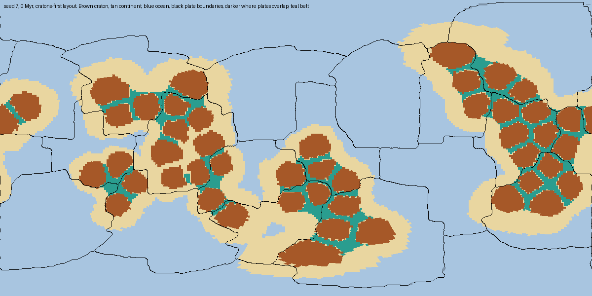
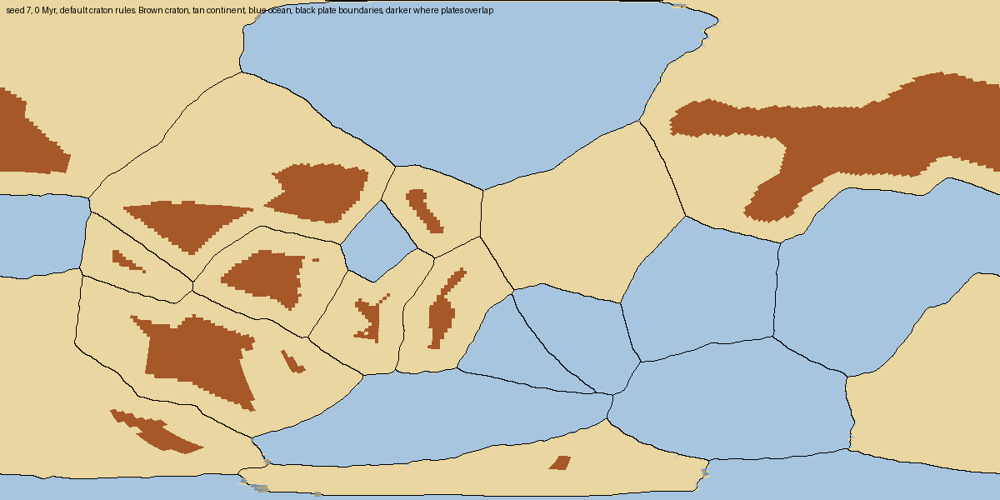
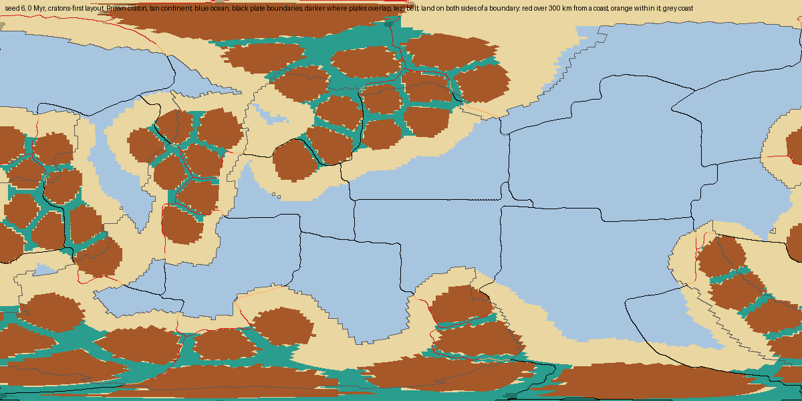
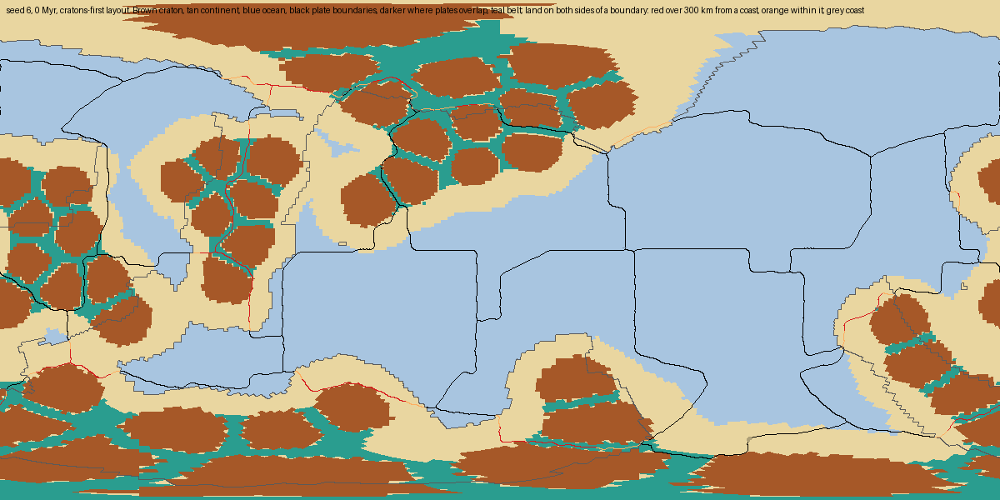

# Cratons-first generator: layout at t = 0 (#462)

[RFC 0009](../../rfc/0009-craton-mosaic.md)'s step "Cratons-first generator" (Design,
"Generation, cratons first (solution 1)"). This measures the layout the new generator builds
at t = 0 against the RFC's acceptance targets over 40 seeds: 7, 11, 2024 and 1-6, 8-10, 12-19,
used while tuning, and 20-39, held out. The generator is behind a flag
(`continent_layout.CRATONS_FIRST_DEFAULT = False`), so `main`'s random worlds are unchanged:
with the flag off, `generate_plates` on seeds 7, 11 and 2024 (with and without the UI's
sliders) and `generate_world(7)`'s seeded cratons hash the same as origin/main `dd3c620`.

The model description is in
[docs/simulation-model/foundations.md](../../docs/simulation-model/foundations.md#cratons-first-layout-continent_layoutpy-plate_partitionpy).

## Figures



*Seed 7 at t = 0, cratons-first layout, `land_fraction` 0.29, density 1. Brown: craton; tan:
continental crust; teal: belt; blue: oceanic crust; black: plate boundaries
(`bin/debug/render_craton_map.py --seed 7 --cratons-first --land-fraction 0.29`). Five
continents carry 47 cores. Where a boundary crosses a continent it follows belts between
cores, and no core is cut.*



*The same seed generated plates first (today's default): every continental edge is a plate
boundary and each continental plate's craton sits in its middle.*

## Layout measures

`bin/debug/measure_plate_layout.py --cratons-first` on a quarter-degree grid; per-seed rows in
[layout_t0.json](layout_t0.json). Land uses the Generate World dialog's default
`land_fraction` 0.29. "RFC objective" is the partition as the RFC first specified it; "land
aware" is the one this branch ships ([below](#land-on-both-sides-of-a-boundary)).

| Measure (min / median / max over 40 seeds, seeds passing) | Target | Cratons first, land aware | Cratons first, RFC objective | Plates first |
|---|---|---|---|---|
| Land edge within 300 km of a plate boundary | 15-50% (Earth 28%) | 17 / 25 / 35%, 40 | 15 / 24 / 34%, 39 | 35 / 73 / 100%, 5 |
| Plates mixed by land share | ≥ 50% (Earth 69%) | 42 / 63 / 90%, 36 | 47 / 69 / 100%, 38 | 0 / 23 / 56%, 3 |
| Boundary length with land on both sides | ≤ 25% (Earth 17%) | 18 / 23 / 29%, 36 | 21 / 27 / 35%, 10 | 0 / 15 / 24%, 40 |
| All three of the above | | **33** | 10 | 1 |
| Boundary length with craton on both sides (a core crossed) | 0 | 0, 40 | 0, 40 | – |
| Continents with room for two cores but fewer than two | 0 | 0, 40 | 0, 40 | – |
| Belts, of continental area | 10-30% | 10.8-18.2%, 40 | same | – |
| Craton, of continental area | 35-50% | 36.4 / 40.0 / 40.3%, 40 | same | 17 / 29 / 49% |
| Continental area, of the sphere | 0.5 ± 0.05 | 0.499-0.501, 40 | same | 0.06 / 0.37 / 0.78 |

Reported separately, as the RFC asks: the continental-crust edge within 300 km of a boundary
is 12 / 26 / 38% (plates first: 100% on every seed), and plates mixed by crust type are
47 / 75 / 100% (plates first: 0%). Craton area is below 40% where a continent smaller than
one core disk gets no core. The plates-first craton share is the 875 km interior rule's.

Without a `land_fraction`, land is wherever the relief noise is high, independent of the
continents, and the land measures swing with it: land on both sides 7 / 25 / 42% (20 of 40
pass), mixed by land 28 / 62 / 91% (32 of 40), the three together on 12 of 40. The
crust-based measures don't depend on land.

## Land on both sides of a boundary

**Where the excess is.** `measure_plate_layout` splits land-on-both-sides boundary length into
interior (more than 300 km from any coastline: a continent split through its middle) and
coast-adjacent, and for a cratons-first world reports the part along a belt.

| Share of all boundary length (min / median / max) | Earth | RFC objective | Land aware |
|---|---|---|---|
| Land on both sides | 16.9% | 21 / 27 / 35% | 18 / 23 / 29% |
| ... more than 300 km from a coast | 5.7% | 15 / 21 / 29% | 13 / 18 / 22% |
| ... within 300 km of a coast | 11.1% | 3 / 6 / 8% | 3 / 5 / 8% |
| ... along a belt | – | 5 / 12 / 20% | 2 / 10 / 18% |

Earth's 17% is mostly coast-adjacent: the Mediterranean, the Middle East and the Red Sea.
The model's is almost all interior splits, about half of them along belts. Half the sphere is
continental, and Poisson-disc sites with the ±25% area band give plates of similar size, so the
large continents have to be divided between several plates.





*Seed 6 at t = 0, `land_fraction` 0.29, under the RFC objective (top: 32.5% of boundary length
with land on both sides, 26.1% of it interior) and the land-aware objective (bottom: 22.1%
and 15.4%). Colours as above, plus grey coastlines; boundary with land on both sides is red
more than 300 km from a coast and orange within it
(`bin/debug/render_craton_map.py --seed 6 --cratons-first --land-fraction 0.29
--land-boundaries`; the top panel with `plate_partition`'s `PLATE_COST_LAND_LINK = 0` and
`PARTITION_CANDIDATES = 1`). Several boundaries that cut across the northern and western
continents move to their coasts.*

**What was tried.** Each over the 20 tuning seeds; "all three" is land on both sides ≤ 25%,
mixed by land ≥ 50% and land edge 15-50% on the same seed.

| Change to the RFC objective | Land on both sides (min / median / max, seeds passing) | All three |
|---|---|---|
| None | 22 / 27 / 33%, 4 | 4 |
| `PLATE_COST_MARGIN` 3 → 6, 10 or 20 | 21 / 27-28 / 32%, 4-5 | ≤ 5 |
| Refinement for 200 sweeps (0 sweeps: 30% median) | 21 / 27 / 32%, 4 | 4 |
| `CONTINENT_COUNT_RANGE` 1-3, 3-8 or 4-10; `CONTINENT_SIZE_CONCENTRATION` 5 | 18-25 / 27-28 / 31-36% | mixed by land falls to 41-42% |
| Unequal plates: per-site growth speed, log-normal σ 0.3 (σ 0.5 failed to partition 13 seeds) | 21 / 29 / 35%, 4 | 4 |
| Dijkstra path over continents at half cost, best of 8 | 9 / 21 / 27%, 19 | 16 |
| Land-land link cost 2 or 5, refinement only | 21 / 26 / 33%, 5 | 5 |
| Land-land link cost 5, best of 8 | 20 / 23 / 26%, 19 | 18 |
| **Land-land link cost 10, best of 8** | 20 / 23 / 25%, 20 | **19** |
| Land-land link cost 5 or 10, best of 16 | 16 / 22 / 25%, 20 | 17-18 |
| Land-land link cost 10, half-cost path, best of 8 | 15 / 21 / 26%, 19 | 16 |

On the held-out seeds 20-39, land-land cost 10 with best of 8 passes all three on 14 (the RFC
objective 6), cost 5 with best of 8 on 12, and adding the half-cost path on 13: the 19 of 20
on the tuning seeds was optimistic.

**Why it takes both changes.** Refinement makes one-cell moves and stops at a local minimum: a
straight boundary across a continent's interior can't move off it one cell at a time,
whatever a land link costs, so the land cost alone barely moves the measure. Choosing between
whole starting partitions by J is a non-local move the land cost can act through. The shipped
partition (`plate_partition.py`) uses `PLATE_COST_LAND_LINK = 10` and
`PARTITION_CANDIDATES = 8`. That needs the land mask before the plates, so generation draws
the relief fields after the continents and before the partition
(`lithosphere_plate.cratons_first_layout`). The mask disagrees with the generated land on at
most 0.6% of area on seeds 6, 7, 11, 20, 30 and 2024.

**What's left.** Seven of the 40 seeds still miss a target: four on land on both sides
(25.2-28.7%, seeds 31, 37, 38, 39) and four on mixed by land (42-47%, seeds 5, 26, 31, 33).
Interior splits remain 13-22% of boundary length against Earth's 5.7%. Whether 33 of 40 meets
the criterion, and whether a structural change (unequal plate areas, a global partition
optimizer) is wanted, is the owner's call.

## Generation time

`generate_world` at density 1: 0.93-1.32 s over the 40 seeds (plates first 0.75-0.89 s). On
seeds 7, 11 and 2024 at density 4: 2.7-3.7 s (plates first 1.8 s on seed 7). The first
generation in a process also builds the cached whole-sphere lattice (1.8 s on seed 7 at
density 1 from cold).

## Judgment calls

- **Drowned cores keep host thickness.** Land and sea come from the relief noise, which
  doesn't know where the continents are, and offshore subsidence then thins submerged
  continental crust. That left 26-31% of core area thinner than `CRATON_HOST_MIN_HC_M` on
  seeds 7, 11 and 2024 (up to 78% with no `land_fraction`), which seeding would have made
  into craton on thinned shelf. Core columns are raised to at least the host minimum before
  seeding, so drowned cores are submerged platforms (on the order of 1 km deep).
- **`BELT_CLOSURE_KM = 800`** (not an RFC knob): at 600 km belts were 9.7-16% of
  continental area.
- **A continent whose core target exceeds one disk always gets two nuclei.** Before, the
  noise let one core stretch over a target just above a disk (seeds 4 and 14).
- **`PLATE_COST_CORE` = `PLATE_COST_MARGIN`.** The RFC gives costs for ocean, belt and
  margin only; a boundary along a core's edge is costed like one through margin.
- **`continental_fraction` stays a plate share with the flag off.** `CONTINENTAL_FRACTION`
  (0.4) and the UI copy are unchanged so `main` doesn't move; the area share is
  `plates.CONTINENTAL_AREA_FRACTION = 0.5`, used only by the cratons-first path. The slider
  copy ("of the surface") changes when G3 makes the layout the default.

## Reproduce

```bash
SEEDS=7,11,2024,1,2,3,4,5,6,8,9,10,12,13,14,15,16,17,18,19,20,21,22,23,24,25,26,27,28,29,30,31,32,33,34,35,36,37,38,39
PYTHONPATH=backend backend/.venv/bin/python bin/debug/measure_plate_layout.py \
    --seeds $SEEDS --cratons-first --land-fraction 0.29 --out /tmp/layout-cf.json
PYTHONPATH=backend backend/.venv/bin/python bin/debug/measure_plate_layout.py \
    --seeds "" --earth --out /tmp/layout-earth.json
PYTHONPATH=backend backend/.venv/bin/python bin/debug/render_craton_map.py \
    --seed 6 --cratons-first --land-fraction 0.29 --land-boundaries --out /tmp/seed6.png
```

The RFC-objective and experiment rows set `plate_partition`'s `PLATE_COST_LAND_LINK`,
`PARTITION_CANDIDATES` and the other knobs above before generating. The half-cost path and
the per-site growth speeds were patched into the partition for the experiment only and
aren't in the shipped code.
