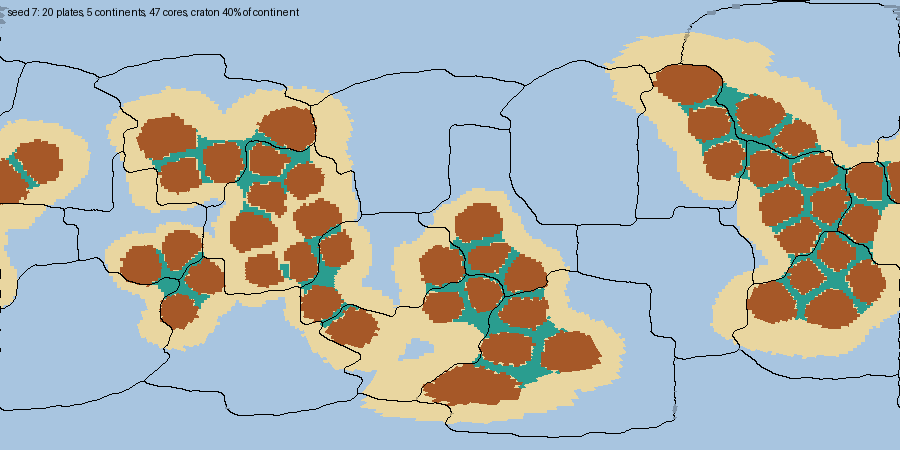
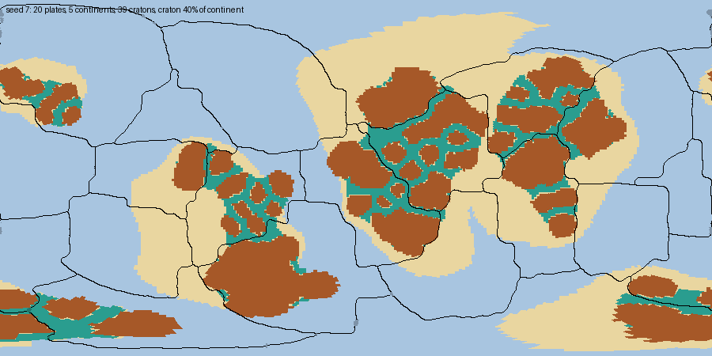
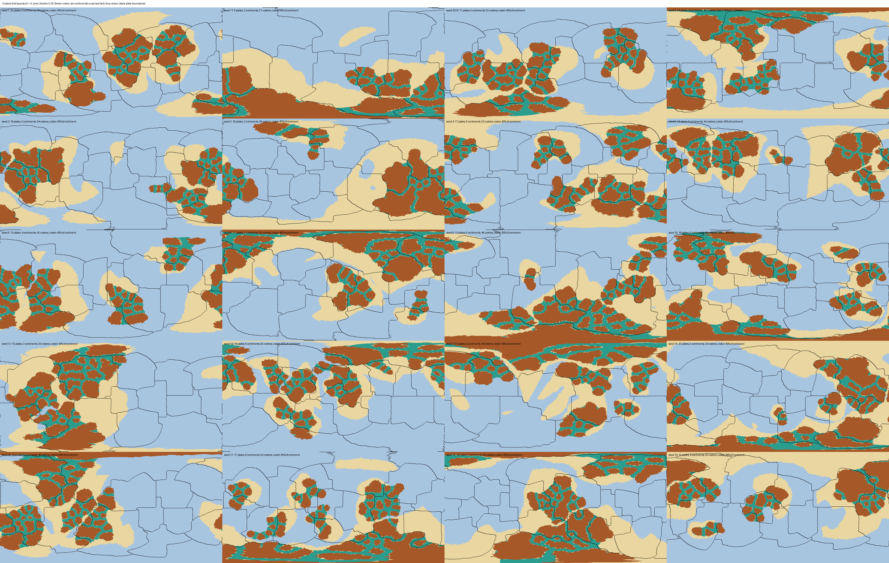
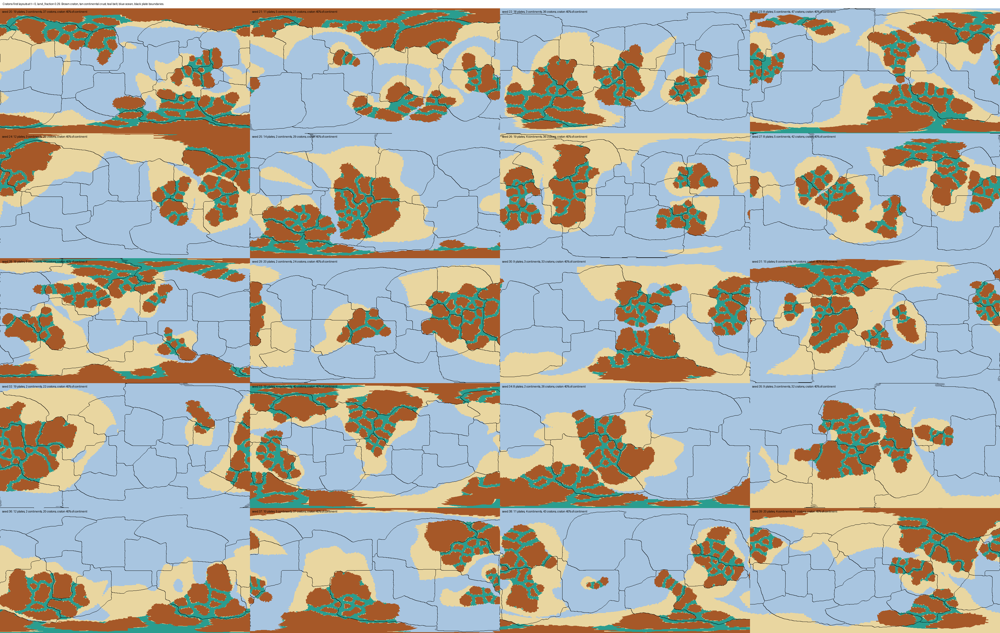

# Continent generation: composite cratons and cratons at continental edges (#470)

A follow-up to the cratons-first generator (#462, PR #467) in
[RFC 0009](../../rfc/0009-craton-mosaic.md). #467's layout met most of the RFC's layout
targets, but its continents didn't look like Earth's:

1. **Every craton sat deep in its continent's interior.** Each continent grew outward from its
   cores by a uniform distance, so every craton was wrapped in an even rim of margin. On Earth
   many cratons sit at a continent's edge: West Africa, Australia's Pilbara and Yilgarn,
   Siberia, Baltica, and several in North America.
2. **Cratons looked like polka dots.** Every nucleus was its own craton, a noise-perturbed
   1,000 km disk at least 1,500 km from every other, so every world got 42-48 same-sized dots.

A review of the first version asked for the small cratons to be smaller and for a few more
large ones, with the largest kept about as they were.

## Changes (`backend/app/continent_layout.py`)

- **Composite cratons, from a Chinese restaurant process.** Within a continent, each new
  nucleus starts a new craton with probability α / (α + n), where n is the continent's nuclei
  so far (`CRATON_CLUSTER_CONCENTRATION` α = 8). Otherwise it joins an existing craton, chosen
  in proportion to its nuclei, 0.8-1.3 of that craton's reach from one of its nuclei
  (`NUCLEUS_JOIN_STEP_RANGE`), so the disks overlap into one irregular craton. A craton stops
  taking joiners at `CRATON_MAX_AREA_KM2` (18 M km²), and a new craton grows outward from the
  assembly's edge, picking its parent nucleus in proportion to its squared distance from the
  continent's centre.
- **Craton size scales.** Each craton draws a scale from `CRATON_SIZE_SCALE_RANGE` (0.5-1) and
  reaches that scale times the 1,000 km core radius, so a craton nothing joins can be well
  under one disk. Spacing scales with size: a new craton keeps the 1,500 km spacing times the
  two cratons' mean scale from other cratons' nuclei, so small cratons pack closer and the gap
  between neighbours stays about a belt wide. If a continent runs out of room before its
  cratons cover the 40% share, its scales grow together, each capped at 1.
- **Cratons at continental edges.** A continent grows outward in order of growth time: the
  distance to its cratons plus the distance to its centre (`CONTINENT_CENTRE_PULL` = 1), over a
  growth speed exp(σ × noise) that varies smoothly at continent scale
  (`CONTINENT_GROWTH_SPEED_SIGMA` σ = 1), plus the outline noise. Cratons on a continent's far
  side, or where it grows slowly, end up near the coast.
- **Belts.** Belt is a continent's non-craton points in the closure of its cratons, taken over
  the whole sphere so ocean beside a coastal craton doesn't erode it, or in the lens between
  two cratons (distances to the two nearest summing to at most two belt widths), which covers
  the gap between two small cratons that a closing can't bridge. Belts are marked before the
  continent grows and the continent always contains them, so no sea opens between two of its
  cratons. The belt width is 400 km (`CRATON_BELT_WIDTH_KM`, in the RFC's 200-600 km sweep;
  it started at 300): at 300-350 km, belts fell to 9-10% of continental area on some seeds.
- **Shortfalls.** The centre pull can leave a continent's own region smaller than its area; the
  shortfall comes from unclaimed points in its growth order. Nucleus placement gets up to
  1,000 tries (from 200).

## Figures




*Seed 7 at t = 0, `land_fraction` 0.29: #467's layout (top) and this one (bottom). Brown:
craton; tan: continental crust; teal: belt; blue: ocean; black: plate boundaries
(`bin/debug/render_layout_sheets.py --seeds 7`).*

All 40 seeds after the change:





Before, as posted on #470: [seeds 7, 11, 2024 and 1-19](before_sheet1.png),
[seeds 20-39](before_sheet2.png). The first version of this change, before the size review:
[seeds 7, 11, 2024 and 1-19](first_sheet1.png), [seeds 20-39](first_sheet2.png).

## Measures

Over the same 40 seeds, `land_fraction` 0.29, density 1 (`measure_plate_layout.py
--cratons-first`; per-seed rows in [layout_t0.json](layout_t0.json)).

| Measure (min / median / max) | Before (#467) | First version | After |
|---|---|---|---|
| Cratons per world | 42 / 45 / 48 | 22 / 39 / 47 | 20 / 37 / 55 |
| Craton area: 5th / 50th / 95th percentile, largest (M km²) | not measured | 1.3 / 2.1 / 6.3, 20.5-23.1 | 0.51 / 1.5 / 9.3, 23.4 |
| Cratons under 1 M km² | not measured | 0% | 30% |
| Cratons of 10 M km² or more per world, median (range) | not measured | 0 (0-3) | 2 (0-4) |
| Craton-area coefficient of variation, median | 0.16 | 0.59 | 1.14 |
| Cratons within 300 km of the continental-crust edge | 0 / 0 / 2% | 11 / 35 / 49% | 14 / 36 / 61% |
| Belts, of continental area (RFC 10-30%) | 11 / 13 / 18% | 13 / 17 / 20% | 11 / 16 / 20% |
| Craton, of continental area (RFC 35-50%) | 36 / 40 / 40% | 39 / 40 / 40% | 36 / 40 / 40% |
| Continental area (RFC 0.5 ± 0.05) | 0.50 | 0.50 | 0.50 |
| Continents with room for two cratons but fewer; cores crossed by a boundary (RFC 0) | 0; 0 | 0; 0 | 0; 0 |

| Plate-boundary targets, seeds passing of 40 | Before (#467) | First version | After |
|---|---|---|---|
| Land edge within 300 km of a boundary, 15-50% | 40 | 39 | 40 |
| Plates mixed by land ≥ 50% | 36 | 36 | 38 |
| Boundary with land on both sides ≤ 25% | 36 | 34 | 38 |
| All three | 33 | 29 | **36** |

Land on both sides is now 16 / 23 / 26%, its interior part 11 / 18 / 22%. The craton count and
edge share have no Earth target: Bleeker (2003) counts about 35 Archean cratonic pieces, and
this layout makes 20-55 cratons. The knobs are design choices, set by sweeps over these seeds:

| Sweep (40 seeds) | Cratons per world | 5th pct / largest (M km²) | ≥ 10 M km² per world | Belts | Craton share |
|---|---|---|---|---|---|
| α 20, scale 1, 500 km belt (first version) | 22-47 | 1.3 / 20.5 | 0 | 13-21% | 39-40% |
| α 20, scale 0.4-1, 500 km | 23-63 | 0.56 / 24.7 | 0 | 18-28% | 39-40% |
| α 8, scale 0.4-1, no cap, 500 km | 13-49 | 0.56 / 48.4 | 2 | 9-23% | 37-40% |
| α 8, scale 0.3-1, cap 18 M km², fixed spacing, 550 km | 21-52 | 0.49 / 22.0 | 2 | 10-20% | 36-40% |
| α 8, scale 0.3-1, cap, size-aware spacing, 550 km | 22-63 | 0.09 / 21.8 | 2 | 16-32% | 33-40% |
| α 8, scale 0.5-1, cap, size-aware spacing, 350 km | 20-51 | 0.56 / 19.1 | 1.5 | 10-17% | 36-40% |
| **α 8, scale 0.5-1, cap, size-aware spacing, 400 km** | **20-55** | **0.51 / 23.4** | **2** | **11-20%** | **36-40%** |
| α 8, scale 0.6-1, cap, size-aware spacing, 400 km | 21-56 | 0.67 / 18.8 | 1.5 | 11-20% | 39-40% |

Without the cap the largest craton doubled (48 M km²). With fixed spacing, small cratons left
gaps of up to 1,350 km between them, and marking those as belt pushed belts to 42% of
continental area; size-aware spacing keeps neighbouring gaps about a belt wide.

## Generation time

`generate_world` at density 1: 1.17-1.94 s over the 40 seeds (#467: 0.93-1.32 s), under the
RFC's 2 s but close to it. Not profiled yet.

## Reproduce

```bash
PYTHONPATH=backend backend/.venv/bin/python bin/debug/render_layout_sheets.py --out /tmp/sheets
PYTHONPATH=backend backend/.venv/bin/python bin/debug/measure_plate_layout.py \
    --seeds 7,11,2024,1,2,3,4,5,6,8,9,10,12,13,14,15,16,17,18,19,20,21,22,23,24,25,26,27,28,29,30,31,32,33,34,35,36,37,38,39 \
    --cratons-first --land-fraction 0.29 --out /tmp/layout.json
```
