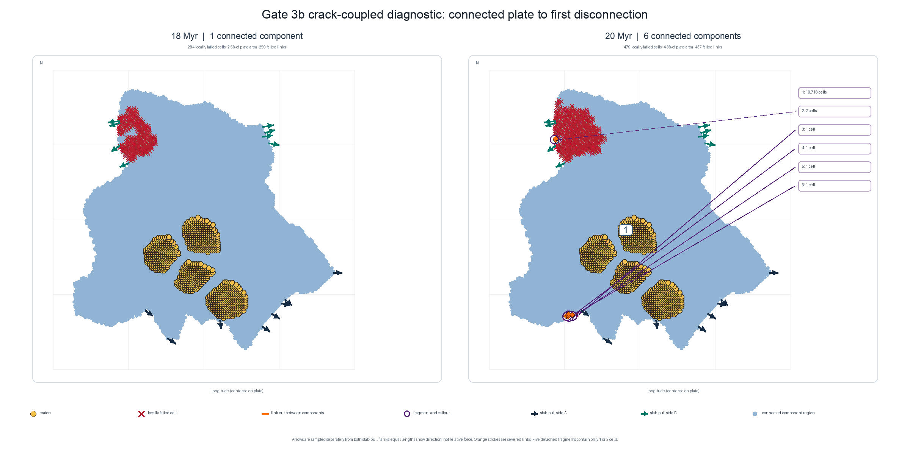
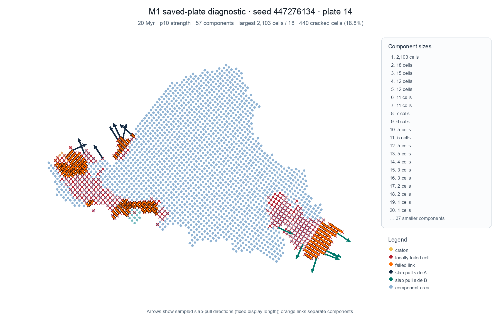
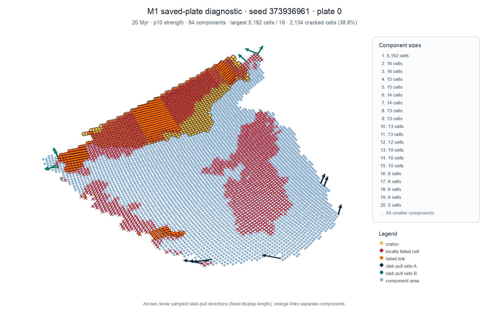
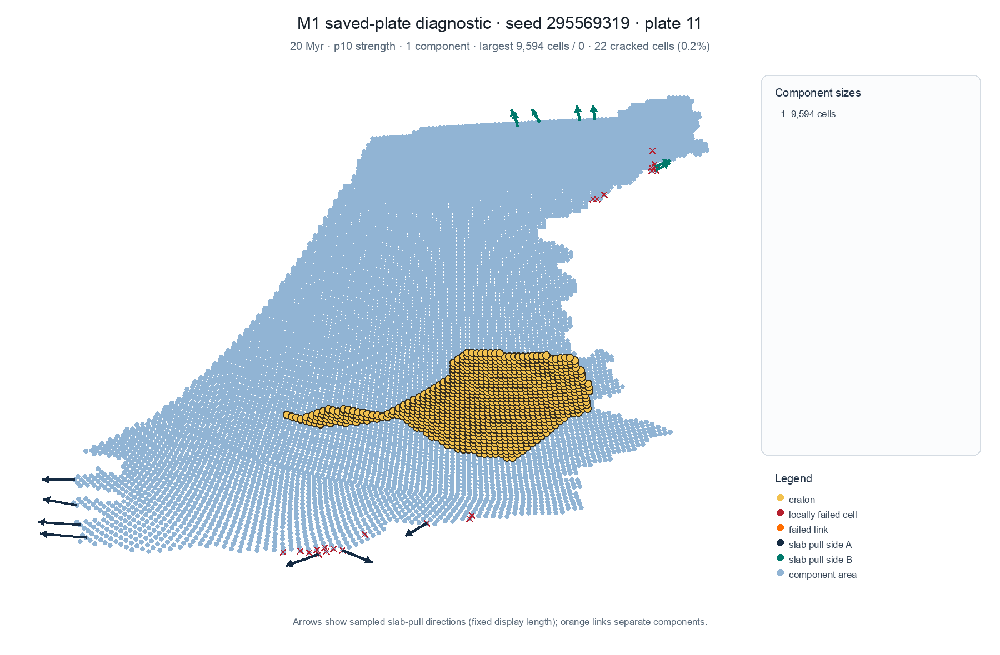
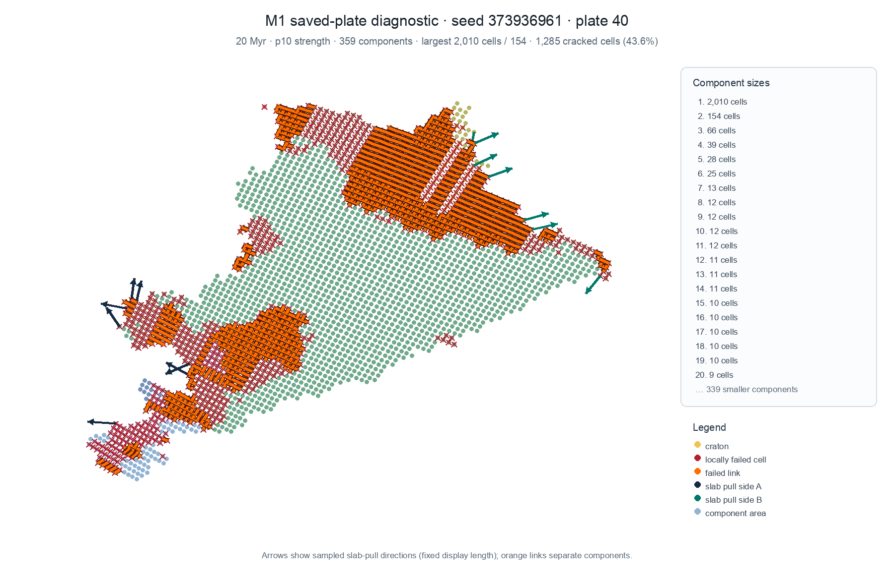
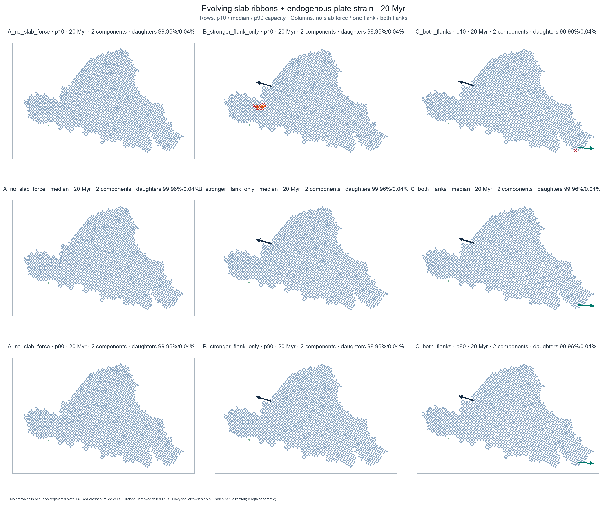

# RFC 0010 Gate 3b: plate-scale rift closure

## Status

**Preregistration published before Gate 3b probes; method clarification appended 2026-10-30.** This record distinguishes the accepted
local-mechanism evidence in Gate 3a (#487) from the plate-scale closure now under test in
#699. No result in the Gate 3a coupons is counted as plate-scale validation.

The current whole-plate split violates design principle 1 (state the question and model
boundary) because flow-fit clustering selects an instantaneous plate-wide cut without
representing local lithospheric loading or failure. Its coin-flip breakup and whole-band
failed-rift thinning also do not express an accumulated local process (principle 3), and
craton-crossing splits conflict with principle 7. The observable invariant for this gate is:
**a plate remains one plate until locally failed surface adjacencies form a connected,
viable, kinematically divergent boundary; failure stays localized to the predeclared weak
or loaded region, and all material/topology changes remain attributable.**

## Candidate and scope

Use a cheap, grid-scale closure on production spherical plate meshes. Gate 3a supplies relative
local crack/weakness evidence, not a calibrated plate-scale law: seeded 3 MPa flaws initiated
under the tested 7 MPa host tension while the 14 MPa intact proxy stayed intact in 0/9 cases;
a moving tip advanced consistently in its controlled coupon and a 10x tougher band arrested it;
finite-source stress transfer increased tension ahead of the fixed seeded crack. Gate 3a did not
show spontaneous initiation or new damage ahead of a seed, and did not produce a spatial
plate-scale crack/weakness raster. Do not transfer these MPa or coupon lengths directly to plate
cells.

The candidate identifies local crack seeds and supported damaged adjacencies from the available
local weakness ranking and extension/loading signal. When segments need to link, a shortest-path
search over the production plate's exact cell-edge adjacency finds a low-cost route between
active tips. Physical edge length is the base cost; local resistance raises it, while inherited
weakness and locally supported extension lower it. Cratons/strong bands raise resistance. The
search only considers a bounded neighborhood of active tips and only advances an edge when the
local support rule permits damage. Thus the graph search proposes a cheap connection through
local cracks; it does not lay down a complete separator or create failure in unsupported cells.
If no supported route grows, the rift arrests. Split only after accumulated cuts make a
connected, viable, divergent boundary. Crack-tip behavior below cell scale stays an explicit
closure.

This is a local path-connection heuristic for plausible, affordable simulation, not new
crack-propagation science or a predictive geophysics claim. It differs from rejected #480
whole-plate static min-cut: endpoints arise from local segments, path search is local, edge
costs use local loading plus inherited weakness, and only locally supported edges are damaged.
The Gate 2 capacity anchors remain conditional scale references. No constitutive value is fitted
to historical split outcomes. The prior 0.6 weak-zone and 3.0 strong-zone multipliers remain
scenario values, not Earth calibration. Use production sparse-quad adjacency directly; the
territory-clipped Delaunay mesh is only a geometry diagnostic, not the rift graph.

The controlled screen uses generated cratons-first worlds for seeds 7, 11 and 2024, selecting
for each seed the largest connected continental plate by represented area before inspecting its
rift response. Mesh densities are 1, 4 (production), and 8; the cell spacing implied by the
model is 125, 62.5, and 44.19 km, respectively. Geometry, scenario masks, loading direction,
strength multipliers, and load schedule are matched across cases. An intact uniform-strength
case is the control for each seeded weak-corridor case. An actual craton mask and a separately
labelled 3.0x strong-band case test arrest/diversion; results from those two are not pooled.

If any selected plate is edge-disconnected, has under 95% coverage by a connected spherical
shell mesh, or cannot be mapped across resolutions without changing the prescribed physical
scenario, that case is recorded as ineligible with the reason. It is not silently replaced
based on its rift outcome. Whole-planet runs report all plates and the excluded share.

## Frozen predictions and thresholds

These are Gate 3b operational thresholds, frozen before probes. They do not revise RFC 0010's
existing historical acceptance targets.

| Question | Primary measure | Pass threshold |
|---|---|---|
| Weak-corridor localization | Applied-load multiplier at first failed adjacency, weak corridor / matched intact control | `<= 0.80` in each seed at density 4; at least 80% of failed edge length remains inside the prescribed corridor through `1.2 x` its initiation load, while the intact control has `<= 5%` failed edge length at that load |
| Strong/cratonic arrest | Whether a failed path crosses the predeclared 3.0x strong band; actual-craton response reported separately | No through-going path across the strong band by `2.0 x` the weak-path breakthrough load; at least 75% of tips touching the band arrest or turn along it rather than cross it |
| Segment linkage | Link load divided by the isolated single-segment propagation load at physical step-overs 0, 150, 300 and 600 km | 0 km links by `1.25x`; 150 km links by `1.50x`; 300 km stays unlinked through `1.50x`; 600 km stays unlinked through `2.00x`. Required ordering is monotonic with gap. The 150 km link-load change from density 4 to 8 must be `<= 20%`; density 1 is reported as a coarse-resolution ordering check, not required to resolve sub-cell geometry. |
| Transform/shear transfer | Sign and integrated magnitude of shear resultant in the predeclared transfer zone; topology; source-force and torque closure | Transfer-zone shear has the imposed sign, is nonzero and changes monotonically with imposed shear; no plate split occurs in the shear-only case. Force and torque residuals are each `<= 1%` of their applied source totals. This is a mechanics-transfer check, not a calibrated geological slip law. |
| Load/timestep partition | Failed-edge area intersection-over-union (IoU), initiation/link load | IoU `>= 0.80` and event-load drift `<= 10%` between one load increment and two half increments, and between 2 Myr and 1 Myr history steps where applicable. |
| Refinement | Per-case topology ordering and characteristic load thresholds | The qualitative weak/intact, arrest, and step-over ordering persists from density 1 to 4 to 8. Density 4 to 8 characteristic loads drift `<= 20%`; a threshold that does not converge is a failed gate result, not a tuning target. |
| Mechanical accounting | Elastic boundary work versus stored membrane energy plus explicitly booked failure dissipation; global force/torque residual | Work residual `<= 5%` of external boundary work; force and torque residuals `<= 1%`. If the candidate has no defensible failure-dissipation account, the work check fails and the closure must be revised before histories. |
| Material accounting | Continental-material ledger error; Hm source/sink accounts; daughter-plate material inventory | Continental ledger relative error `<= 1e-10` of initial continental inventory (the existing `continental_ledger.assert_closed` tolerance). Hm is not conserved: report each named source/sink and signed live change, with unattributed residual `<= 1%` of the absolute recorded gross change. No unbooked duplication or deletion at a split. |
| Runtime | Added rift-closure wall time per density-4 world step | `<= 2%` of matched baseline step time, measured over the same 20-step window after warm-up; report absolute seconds and per-plate scaling too. |

A miss on any predeclared local-mechanism or refinement threshold is reported as a miss. The
quantitative thresholds are operational screening cutoffs, not scientific constants; qualitative
ordering is the main claim. No
parameter sweep may be used to move the threshold after seeing the result. Any revised closure
or threshold requires a new dated preregistration and owner review before its acceptance run.

## Whole-planet comparison

After the controlled screen passes, compare the old split rule from `origin/main` with the
candidate closure on generated seeds 7, 11 and 2024. Generate matching initial worlds,
cratons-first layout, craton formation off, node density 4, 2 Myr steps, 200 Myr duration
(100 steps); repeat decisive comparisons at 1 Myr and density 8. Keep hash seed and software
versions fixed and record both source hashes. Run one world at a time. Report successful and
failed rift systems separately, plate count and daughter areas, split line-craton rate, band
craton exposure, craton loss, crust and Hm accounts, force/torque closure, boundary work,
runtime and event histories.

The 200 Myr history is an early scale screen; it cannot establish the RFC's 1 Gyr / multi-Gyr
craton-loss targets or a global breakup frequency from a small event count. Preserve the RFC
targets unchanged and label any underpowered historical comparison inconclusive.

## Reproduction inputs

- RFC branch base: `origin/main` commit `2baeac22d7c55a362063ce59b0770a398fe91d95`.
- Production schedule from the Gate 1 replay: 2 Myr; cratons-first layout; craton formation
  and post-PR-490 spherical relief disabled; seeds 7, 11, 2024.
- Controlled screen: generated worlds only, node density 1/4/8; no Downloads save is used.
  The matched seed-generated initial state is necessary for cross-arm equality and avoids
  selecting a saved trajectory based on its rift outcome.
- Local Gate 3a results are supporting mechanism evidence only. The 150 km flat-plate result
  failed its earlier refinement screen; this preregistration tests it anew on the sphere and
  treats failure to converge as falsification of this candidate.

## Method clarification (2026-10-30)

The issue's original preregistration comment described strongest-overload edge removal and
re-equilibration. The owner clarified that Gate 3b should use Gate 3a evidence to find a cheap
local path through cracks and weaknesses to form a rift, targeting a somewhat realistic simulation
rather than new science. Gate 3a's relevant evidence and limitations are summarized in
[PR #700](https://github.com/adubey/mantle-bloom/pull/700). This supersedes the earlier candidate
mechanics paragraph while preserving its scenarios and operational screening thresholds.

Before the first path diagnostic, the exact rule was frozen in [issue comment
6520271866](https://github.com/adubey/mantle-bloom/issues/699#issuecomment-6520271866): on exact
production cell adjacency, use great-circle edge length times mean endpoint relative resistance
divided by positive opening projection as the Dijkstra cost; an edge is supported only when the
prescribed dimensionless load times its opening projection reaches its resistance. Grow one
adjacent edge per update and recompute. The first screen uses synthetic prescribed corridors and
a prescribed extension axis: Gate 3a supplies no plate-scale weakness raster. Dijkstra spans the
full exact plate graph between local endpoints (it is not clipped to a tip neighborhood), but
returns one route rather than a plate separator. This checks graph geometry, not a production
stress field or plate-scale validation. The geometry-only Delaunay mesh pre-screen is not rift
evidence. See [scope correction](https://github.com/adubey/mantle-bloom/issues/699#issuecomment-6520392557).

## Results

### Geometry eligibility screen

The first geometry pre-screen selected the largest continental plate by represented area and
checked exact source-graph connectivity plus a territory-clipped spherical triangulation used
only to inspect shell coverage. Six of nine planned seed/resolution cases were eligible with
one exact source component and at least 99.99% area coverage. Seed 7 failed the deterministic
20-plate generation partition at densities 1, 4 and 8; these cases remain ineligible rather than
being replaced. Full per-case measurements are in `plate-mesh-screen.json`. The Delaunay shell
coverage is not used as the path graph.

### First local graph path screen

The corrected run used seed 11, density 4, a generated continental plate, endpoints selected
before reading material scenarios at 600 km great-circle separation, exact sparse-quad adjacency,
and the preregistered prescribed axis with `lambda=1.5`.

| Scenario | Result | Route length | Weak corridor share | Interpretation |
|---|---|---:|---:|---|
| Weak corridor (150 km wide) | Supported route, 13 nodes | 748.5 km | 100% | A low-cost connected route was found. |
| Intact control | No supported route | — | — | Negative at this one synthetic loading setting. |
| Weak corridor plus strong band (300 km wide) | No supported route | — | — | Arrest, not diversion, in this setup. |

This is a graph-algorithm screen only. Material masks and loading are prescribed, no production
local stress field is coupled, and no crack growth, topology change or plate split occurs. It
cannot establish the RFC's plate-scale or geological acceptance criteria. The initial attempt's
topology-diameter endpoints produced a roughly 20,255 km route; that endpoint-selection result is
retained separately in `local-path-screen-global-endpoints-ineligible.json` and excluded from
interpretation. The corrected result is in `local-path-screen.json`, and the result/limitations
were posted in issue comment
[6520330787](https://github.com/adubey/mantle-bloom/issues/699#issuecomment-6520330787).

### Robustness subset

The same frozen graph rules were run at seed 11 densities 1/4/8 and seed 2024 density 4.
The actual-craton arm uses the existing `cratons.strength(craton_crust_m)` as a separate
resistance floor, `max(scenario resistance, 1 + 2 * strength)`; the factor of 2 is an uncalibrated
screening choice.

| Case | Weak only | Intact | Strong band | Actual-craton floor |
|---|---|---|---|---|
| Seed 11, density 1 | Connected; 805 km; 100% weak-mask path; 100% craton-node overlap | No path | No path | No path |
| Seed 11, density 4 | Connected; 749 km; 100% weak-mask path; 0% craton-node overlap | No path | No path | No path |
| Seed 11, density 8 | Connected; 795 km; 100% weak-mask path; 72% craton-node overlap | No path | No path | No path |
| Seed 2024, density 4 | No path | No path | No path | No path |

The weak/intact fork and arrest ordering repeat across seed 11's three mesh densities, but the
weak-only route's actual craton overlap changes sharply with resolution. Adding the existing
craton-strength floor arrests that route at each density. Seed 2024 has no supported route at the
fixed load in any arm. These are recorded as limitations/misses, not validation: the projection
and support rule are too restrictive or seed-sensitive for a general path mechanism, and a weak
mask can exploit cratons if the resistance map omits them. No tuning follows from these outcomes.
All robustness cases are synthetic graph diagnostics; no production stress, damage evolution,
segment linkage, split or geological history has been measured. Per-case results are in
`local-path-screen-seed11-density1-craton.json`,
`local-path-screen-seed11-density4-craton.json`,
`local-path-screen-seed11-density8-craton.json` and
`local-path-screen-seed2024-density4-craton.json`; the results were posted in issue comment
[6520377961](https://github.com/adubey/mantle-bloom/issues/699#issuecomment-6520377961).

### Current design decision

Do not treat the prescribed-axis graph screen as a production rift mechanism. In production,
`torque.gather_per_node_force_field` supplies per-node source forces but its own API describes
them as inputs to an internal-load calculation, not as local stress. `thin_shell.solve_force_field`
can produce a reduced membrane diagnostic, but that solver is explicitly offline/diagnostic and
is not coupled to production damage or topology updates. RFC 0010 likewise calls local loading
unresolved: per-node forces currently reduce to whole-plate torque, and neither torque nor
`Plate.internal_stress` determines intraplate stress.

Before a production path rule, Gate 3b needs a local extension-demand field on the production
cell graph (or a documented shell solve), a force-transfer/accounting rule, and source-force,
torque and work checks. Then the Gate 3a weak/intact/tip-arrest ordering can inform actual edge
damage and linkage. Until those pieces exist, the synthetic graph results are feasibility
screens only; they neither pass nor falsify plate-scale rifting. The blocker and source references
were posted in issue comment
[6520406763](https://github.com/adubey/mantle-bloom/issues/699#issuecomment-6520406763).


### Local-load transfer feasibility

The preregistered offline shell diagnostic did not produce a usable local demand field. At seed
11, density 4, the solve was interrupted after approximately 120 seconds while SciPy LSMR
was still iterating; no JSON result, demand quantiles, or force/torque closure measurements
were produced. This is a censored runtime outcome, not a convergence failure.

The predeclared reduced-resolution follow-up kept the same seed, plate-selection rule, force
assembly, material thickness, modulus and clipped-shell method at density 1. It failed while
assembling the mesh with `ValueError: thin-shell mesh contains a degenerate triangle`, before
the equilibrium solve; no output JSON was produced. This records a mesh-eligibility failure,
not a solver timing result. The preregistration and both outcomes are in issue comments
[6520456345](https://github.com/adubey/mantle-bloom/issues/699#issuecomment-6520456345) and
[6520542634](https://github.com/adubey/mantle-bloom/issues/699#issuecomment-6520542634).

Together with the solver's diagnostic-only status, these outcomes do not support putting the
current FEM solve in a production per-step route. They also do not justify relabeling per-node
source forces or plate torque as local stress. Gate 3b therefore remains at the phenomenological
path-screen stage: a candidate production load transfer would need its own explicitly approximate
force-to-edge rule and conservation/accounting checks, or a different validated low-cost solver.
No local damage or production rift update has been implemented from this diagnostic.

### Coarse shell-response follow-up

The preregistered coarse follow-up reduced the same seed-11, density-4 plate to deterministic
512- and 1,024-medoid meshes, aggregated existing per-node forces and thickness, and solved the
offline linear membrane diagnostic. The clipped meshes contained isolated triangle slivers, so
the method amendment retained each mesh's largest edge-connected triangle component and reported
the discarded components. The result is compactly recorded in
`coarse-shell-response-seed11-density4.json`.

Both meshes covered over 99% of represented plate area. Coarsening changed net force by 1.16%
and 0.30% of summed source-force magnitudes at 512 and 1,024 representatives, respectively;
torque residuals were 1.07% and 0.40% of summed source-torque magnitudes. Solver equilibrium
residuals were 1.02% and 2.88%, both above the preregistered 1% cutoff. The two spatial rankings
nonetheless agreed at Spearman 0.911, with 0.726 area IoU for the top demand decile. Each solve
took under one second. This supports feasibility for a coarse diagnostic field but misses the
predeclared force-transfer cutoff at 512 and equilibrium cutoff at both resolutions. The plotted
field is therefore labeled provisional; it is not a production extension, stress, damage or rift
field. No numerical parameters were tuned after seeing the miss. The [preregistration](https://github.com/adubey/mantle-bloom/issues/699#issuecomment-6527325898),
[mesh amendment](https://github.com/adubey/mantle-bloom/issues/699#issuecomment-6527356236) and
[result](https://github.com/adubey/mantle-bloom/issues/699#issuecomment-6527479690) are recorded
on issue #699.

The updated plate plot colors the coarse principal tensile-resultant response behind the craton
mask and crack-path candidates. Color values are clipped at the plotted mesh's 99th percentile to
show spatial contrast, then nearest-medoid mapped onto the plate cells for display. The shell
field is from generation time, while the route paths use the state after one 2 Myr tectonic step;
the overlay is therefore a spatial illustration, not a matched-state coupled diagnostic. The
figure is generated by `plot_gate3b_plate_paths.py --shell-json` and does not add validation
beyond the checks above.


### Data-backed divergent-boundary linkage screen

The preregistered initial-state case had no divergent nodes on the selected plate. The amended
rule used exactly one 2 Myr tectonic step after generation (climate/biomes disabled) before
selecting the largest connected continental plate. Seed 11 at density 4 then had 213 divergent
nodes in 38 exact-adjacency components. The closest qualifying pair of distinct components was
612 km apart. The fixed 500–700 km selection rule was applied without reading resistance fields.

The route used exact plate adjacency and great-circle edge length times mean endpoint resistance.
Inherited non-cratonic belts used relative resistance 0.6; intact cells used 1.0. The craton arm
floored resistance at `1 + 2 * cratons.rift_resistance(craton_crust_m)`. These values are routing
ranks, not calibrated strength or support thresholds.

| Case | Divergent nodes / components | Endpoint gap | Route length, belt arm | Belt fraction | Craton fraction |
|---|---:|---:|---:|---:|---:|
| Seed 11, density 1 | 404 / 41 | 614 km | 953 km | 0% | 0% |
| Seed 11, density 4 | 213 / 38 | 612 km | 612 km | 50% | 58% |
| Seed 11, density 8 | 130 / 29 | 604 km | 971 km | 0% | 0% |
| Seed 2024, density 4 | 0 / 0 | ineligible | — | — | — |

At density 4, the inherited-belt route cost was 500,151 relative metres versus 612,372 for the
intact control, an 18% reduction with the same geometric route. The craton floor increased that
route's cost to 1,110,101 but did not divert or arrest it; 58% of the route length crossed craton
cells. At densities 1 and 8, the selected route did not encounter belt or craton cells, so all
three resistance arms returned the same route. Seed 11 route length was not resolution-stable,
and seed 2024 supplied no eligible divergent pair after its fixed single step. These outcomes do
not establish robust weak-path preference or craton protection. No tuning or case substitution
followed.

The exact per-case results are `boundary-linking-seed11-density1-poststep.json`,
`boundary-linking-seed11-density4-poststep.json`,
`boundary-linking-seed11-density8-poststep.json`, and
`boundary-linking-seed2024-density4-poststep.json`. The runs and scope are summarized in issue
comments [6520975606](https://github.com/adubey/mantle-bloom/issues/699#issuecomment-6520975606)
and [6520999485](https://github.com/adubey/mantle-bloom/issues/699#issuecomment-6520999485).

This advances the graph screen from prescribed crack endpoints to actual divergent boundary
segments and model belt/craton fields. It still only proposes a shortest connection: it does not
check local force support along interior edges, grow damage over time, split the plate, or test
conservation and work. The seed and resolution misses mean this candidate is not ready for a
production rift update.


### Craton barrier sensitivity

The first craton-protected route arm was still only a soft path cost: `rift_resistance` is at
most 0.75, so the chosen `1 + 2 * rift_resistance` formula capped a cell at 2.5 times
intact resistance. Dijkstra has no route-support cutoff and returns a path whenever the graph is
connected, so the route could still traverse the craton. This is why the original plotted route
looked nearly straight and crossed the shield; it was not a viable split boundary.

A preregistered sensitivity then removed all edges incident to craton cells. With the original
endpoint pair, the source itself was cratonic, so that arm had no path from its seed. A second
preregistered variant selected the same nearest-pair rule from divergent nodes outside craton
cells (endpoint gap 598 km). The soft actual-belt route was 801 km and crossed craton cells for
77% of its length. The finite craton penalty shifted the route slightly and reduced craton overlap
to 38%, but still crossed the shield. When craton-touching edges were prohibited, no craton-free
path connected these two off-craton divergent segments. Thus the current graph geometry offers no
ordinary around-craton connection for this endpoint pair; it does not justify pushing a rift
through the craton.

Per-case outputs are `boundary-linking-seed11-density4-craton-barrier.json` and
`boundary-linking-seed11-density4-noncraton-tips.json`. The preregistration and result are in
issue comments [6521203014](https://github.com/adubey/mantle-bloom/issues/699#issuecomment-6521203014)
and [6521224977](https://github.com/adubey/mantle-bloom/issues/699#issuecomment-6521224977). A craton-edge veto is a qualitative ordinary-rift sensitivity, not a claim of absolute physical impermeability.

### Geometry correction: boundary linkage is not an intraplate rift

The data-backed linkage screen above selected divergent components from the existing plate
boundary. Its endpoints and much of its route follow the plate edge, so it tests a connection
between boundary faults; it is not an intraplate rift, does not demonstrate plate breakup, and is
excluded from Gate 3b rift evidence. The craton-resistance and no-path observations remain valid
only for that boundary-linkage geometry.

Gate 3b needs to seed finite cracks inside continental plate material, using local weakness and
extension evidence, then propagate between interior crack tips on supported adjacencies. A route
that joins existing edge faults, or merely minimizes distance between edge segments, cannot meet
that criterion. The next diagnostic must explicitly keep its nucleation and growth corridor inside
the plate and check that a completed cut leaves two material-retaining sides. Until a local
interior loading signal exists, synthetic interior paths remain graph-feasibility screens rather
than a physical rift prediction.

### Interior weak-belt candidate: preregistered first trial (2026-10-30)

The plate-edge linkage screen is excluded from rift evidence. Before running the next candidate,
freeze an interior-only graph trial on seed 11, density 4: generate the same cratons-first world,
advance one 2 Myr tectonic step with climate/biomes disabled, then select the largest continental
plate by represented area. Define interior as nodes outside the production boundary-force band
(`dist_to_neighbor > boundary_force_reach_rad`, or no neighbor), and remove craton nodes from
candidate seed segments. Find exact-adjacency connected components in the remaining inherited
`cratons.belt_mask`; select the closest pair of distinct components whose nearest nodes are 500–700
km apart, nearest 600 km, with node-index tie breaks. If no such pair exists, record ineligible;
do not substitute endpoints after observing routes.

Use those component nodes as candidate interior segment tips. The tip-to-tip great-circle direction
is an illustrative prescribed opening axis, not a derived local stress field. For each edge, compute
the prior frozen tangent-plane opening projection `D_e=max(0, |n_e dot x_hat|)` and mean endpoint
relative resistance (belt 0.6, intact 1.0, synthetic strong band 3.0). Route cost is great-circle
edge length times mean resistance divided by positive opening projection; an edge is supported only
when `lambda * D_e >= R_e`, with the frozen illustrative `lambda=1.5`. Remove every edge incident
to an actual craton node in the ordinary-rift arm: no supported path means arrest, not craton
crossing. Advance at most one supported edge from an active tip per update, then recompute.

This one-trial candidate checks whether real inherited weak-belt geometry can connect interior
segments while respecting the craton barrier. It does not validate load transfer, damage physics,
segment birth, split viability, step-over refinement, or Gate 3 acceptance. The prescribed axis and
load multiplier remain graph falsification inputs only. The candidate must be replaced or stopped
if it cannot produce an interior supported route without crossing craton; no parameter tuning or
endpoint replacement follows this trial.

The route graph is further bounded to nodes within twice the selected tip separation of the
spherical midpoint between the tips. This local-search radius is fixed before reading the route;
it prevents the candidate from becoming a plate-wide separator search.

#### Implementation correction before interpreting the first result

The first implementation mistakenly required an all-supported path before beginning growth. The
frozen rule instead lets Dijkstra propose a low-cost route over positive-opening links, checks
support only on the next edge from either active tip, advances one supported edge, and recomputes.
The first output, saved as `interior-belt-path-seed11-density4-all-supported-precheck.json`, is
retained as a support-connectivity precheck, not as the candidate routing result. The code is corrected to implement the frozen
stepwise rule; the same seed, tip-selection rule, local radius, resistance values, load multiplier,
and craton veto are retained for the candidate rerun.

#### First interior weak-belt candidate result

The corrected stepwise trial selected two distinct interior inherited-belt components on seed 11,
density 4, with tips 598.8 km apart and a fixed 1,197.6 km local-search radius. The plate had
33,856 cells, 6,218 interior non-cratonic belt cells, and 37 eligible belt components. At the
illustrative `lambda=1.5`, the inherited-belt arm and matched intact arm both advanced 14 supported
links (12 from the source tip, 2 from the target tip), then arrested. Their paths were identical;
the remaining tip gap had grown to 1,526.5 km. The supported-edge share within the local search
neighborhood was 49.93% in both arms. The craton-edge veto was active throughout, so neither arm
crossed craton.

This is not evidence of a useful weak-path advantage: the real inherited-belt map did not change
the selected growth sequence relative to intact material, and the tips diverged instead of linking.
It does show the stepwise support rule can arrest a pair without a forced plate split. This single
roughly-600-km step-over trial is not a pass/fail of the full step-over/refinement gate and does not
provide local stress, crack nucleation, force transfer, viable breakup or geological validation.
The initial all-supported-connectivity precheck is preserved separately as
`interior-belt-path-seed11-density4-all-supported-precheck.json`; the corrected candidate output is
`interior-belt-path-seed11-density4.json`.

#### Next frozen candidate case: 150 km interior step-over (before run)

Use the same generated-world schedule, seed 11, density 4, plate-selection rule, actual inherited
belt/craton fields, local boundary exclusion, opening projection, resistance values, illustrative
`lambda=1.5`, stepwise tip growth, and craton-edge veto as the 600 km trial. This is a separate
predeclared case, not replacement of the 600 km pair. Select the closest pair of distinct eligible
interior belt components whose nearest nodes lie 100–200 km apart, nearest 150 km with node-index
tie breaks. No eligible pair means record ineligible without widening the interval. Keep the
local search radius at twice the selected gap. A linked path by `lambda=1.5` is the preregistered
short-step prediction; otherwise record arrest. Compare the same pair against the intact control.

#### 150 km step-over candidate result

The fixed selection found a 150.35 km gap between eligible interior inherited-belt components 10
and 11. At `lambda=1.5`, both the inherited-belt and intact controls advanced eight supported
links (five from the source and three from the target) before arrest. Their edge sequences were
identical, and both stopped with the tips 67.57 km apart. Each path bent along the local graph,
with cumulative growth lengths of 334.13 km and 200.13 km; neither crossed craton. The local
supported-edge shares were 54.17% for inherited belts and 52.08% for intact material.

The predeclared 150 km prediction (link by `lambda=1.5`) was missed. The small supported-edge
share difference did not alter propagation or connect the segments. Together with the 600 km
case, this first candidate does arrest without crossing cratons but has not demonstrated weak-path
localization or the required short/long step-over ordering. Do not tune the support multiplier or
replace endpoints from these results; the missing production local-loading signal and candidate
linkage rule need revision before any full gate run. Output: `interior-belt-path-seed11-density4-stepover150.json`.

Reproduction commands:

```bash
PYTHONPATH=backend backend/.venv/bin/python bin/debug/probe_gate3b_interior_belt_paths.py \
  --out analysis/issue699/interior-belt-path-seed11-density4.json
PYTHONPATH=backend backend/.venv/bin/python bin/debug/probe_gate3b_interior_belt_paths.py \
  --target-gap-km 150 --minimum-gap-km 100 --maximum-gap-km 200 \
  --out analysis/issue699/interior-belt-path-seed11-density4-stepover150.json
```

## Gate 3b direction revision (2026-10-30)

The project owner redirected Gate 3b to work backwards from at least one plate-scale
**rift-potential event** to the simplest current source capable of producing it. The working
hypothesis is that mantle or magma currents load broad sections of a plate over time; a sustained
coherent extensional field creates the potential, and Gate 3a's local crack/segment rules then
determine nucleation, growth, arrest and linkage. A localized snapshot or prescribed crack route
does not count as the event. A duration of tens of Myr, initially a 10–30 Myr bracket, is a
hypothesis for testing rather than a hard timer.

The revised diagnostic sequence is: (1) preregister measurable event criteria and distinguish the
broad loading precursor from cracks, completed rift and plate breakup; (2) identify and characterize
at least one event on a generated spherical plate, including footprint, direction, load relative to
the local crack threshold, persistence, timestep response and force/work accounts; (3) infer the
minimum broad current field needed to deliver that load; (4) audit existing `mantle.flow_at` and
per-node basal drag as candidate interfaces without assuming they model magma currents or rift
traction; and (5) forward-run the simplest low-cost current source through Gate 3a's local response.
The event definition, footprint and amplitude cutoffs, duration cases and accounting checks must be
frozen in an issue comment before a new probe.

The prescribed-axis path trials and static coarse shell-response maps above remain useful exploratory
mechanism/visualization work. They do not isolate the current contribution or demonstrate broad,
persistent rifting load. The preregistered first screen selects the seed-11 density-4 largest
connected continental plate before inspecting response fields, isolates the existing basal-drag
source against full-force and no-basal-drag controls, and, if accounting passes, follows matching
2-Myr and 1-Myr histories through 30 Myr. A candidate event requires one edge-connected area of cells with Gate 2
`N_ext/N_cap >= 1` covering at least 25% of the plate's continental area at every 2-Myr output over
at least 10 Myr. The 25% and 10-Myr values are operational cutoffs. Report 10/20/30-Myr snapshots,
directional coherence, craton/belt overlap, and sensitivity across the documented Gate 2 capacity
scenarios; do not tune capacity or current amplitude.

Validity checks require force and torque transfer residuals at or below 1%, shell equilibrium
residual at or below 1%, and separate source/mantle/drag and shell elastic-work accounts with
energy residuals at or below 5%. Equal-and-opposite mantle reaction is booked. Rigid plate work and
non-rigid shell deformation work stay separate. A candidate failing any accounting check is
ineligible. The preregistration and timestep-arm clarification are in issue comments
[6528140164](https://github.com/adubey/mantle-bloom/issues/699#issuecomment-6528140164) and
[6528145896](https://github.com/adubey/mantle-bloom/issues/699#issuecomment-6528145896). No new
simulation probe has run under this preregistration yet. The gate scope is recorded in
[issue #699](https://github.com/adubey/mantle-bloom/issues/699) and the revised Gate 3b text in
[RFC 0010](../../rfc/0010-rifts-follow-weak-lithosphere.md).

### Rift-potential accounting preflight (2026-10-30)

The preregistered selection used seed 11, density 4, the generated t=0 state, and the largest
edge-connected continental component by represented area. It selected 30,133 continental cells
(`116.38 million km²`) on production plate 1, which has 33,869 total cells and covers
`131.14 million km²`. The selected component is a proper subset of that production plate; eight
other continental components were present.

The current coarse-shell mesh builder validates its mesh with `plate.contains_batch`, which tests
whole-plate territory. It cannot preserve the selected continental-component boundary or construct
a valid load/accounting mesh for this preregistered target. The probe therefore stopped before
force gathering, capacity scoring or any rift-potential measurement. Earlier whole-production-plate
static shell numbers are excluded from this gate because they do not use the frozen component
selection. The 2-Myr and 1-Myr histories were not run; this is a diagnostic eligibility failure,
not evidence for or against a persistent event.

The required next diagnostic change is a shell mesh and force aggregation that preserve the chosen
component's boundary, with the frozen force, torque, equilibrium and work checks rerun before the
30 Myr persistence arm. Any change to the diagnosed load-transfer method needs a dated issue
preregistration update before its acceptance run. Measurements are in
`rift-potential-seed11-density4-preflight.json`; the diagnostic is
`bin/debug/probe_gate3b_rift_potential.py`.

### Component-bound shell accounting result (2026-10-30)

The dated issue amendment above was followed exactly for the initial accounting check. The
same generated seed-11, density-4 world had climate disabled and was advanced through the
frozen 2 Myr startup step. Before inspecting forces, the largest edge-connected continental
component selected on production plate 1 contains 30,156 cells and represents 116.47 million
km² (88.85% of the 33,856-cell, 131.08 million km² parent plate). Component-specific shell
containment was built from those active cell keys; production forces were gathered on the
unchanged parent plate, checked for node-order alignment, then restricted to component cells.

The basal-drag-only source passes coarse force/torque transfer at both caps (512: 0.510% and
0.439%; 1,024: 0.634% and 0.673%) and component shell-area coverage (99.09% and 99.16%). The
separate basal-drag energy account closes exactly at the computed precision: plate work
`9.049e9 W`, mantle reaction work `-7.992e10 W`, and viscous dissipation `7.087e10 W`, with
residual `0.0%`; the mantle reaction is equal and opposite to the component source force and
moment. However, shell equilibrium residuals are 8.78% and 24.30%, both above the frozen 1%
limit. Independently integrated elastic strain-energy residuals are 27.51% and 5.38%, above
the frozen 5% limit. Thus neither basal-drag mesh is accounting-eligible. No force correction,
solver tolerance adjustment, mesh-cap change, or threshold change was attempted.

The controls are also not accounting-eligible: the full production-force transfer residuals
are 3.61–4.07% force and 3.25–4.72% torque; the no-basal-drag control residuals are
16.18–18.22% force and 15.77–23.02% torque. All shell equilibrium residuals exceed 1%.
Some control elastic-energy residuals also exceed 5%. Component coverage itself exceeds 99%
in all six meshes. The complete metrics and per-check pass flags are in
[`rift-potential-component-accounting-seed11-density4.json`](rift-potential-component-accounting-seed11-density4.json),
reproduced by [`probe_gate3b_component_shell.py`](../../bin/debug/probe_gate3b_component_shell.py).

The frozen eligibility rule therefore stops Gate 3b before Gate 2 capacity scoring,
rift-potential scoring, or any 2/1 Myr persistence history. This is a mechanics/accounting
eligibility failure, not evidence that basal drag does or does not produce broad persistent
rift potential. The component-bound method fixes the previous whole-plate target mismatch,
but the current coarse force transfer and shell solve cannot support the preregistered event
measurement. A revised transfer/solver method needs a separately dated issue preregistration
amendment before another acceptance diagnostic; no tuning is inferred from this null
eligibility result.

### Accounting audit and corrected parent-shell result (2026-10-30)

The component-only result above is retained as a failed diagnostic attempt, but its ineligibility
conclusion is superseded. Two implementation errors caused it to overstate the accounting
failure: it cut the shell at the continental-component boundary, omitting the mechanical path
through the rest of the same plate; and its shell-work calculation included the rigid-rotation
load removed by the thin-shell solver. The coarse-mesh transfer also dropped load and area assigned
to representative cells omitted by the connected mesh filter.

The corrected preflight uses the entire production plate as the shell domain and keeps the frozen
largest continental component only as the event-evaluation mask. It uses the thin-shell solver's
default precision and iteration limit; separately measures physical unscaled equilibrium; computes
non-rigid shell external work from the solver's equilibrated force; and transfers omitted
representative bins to the nearest retained shell node while still reporting the original mesh
coverage. These amendments and their predictions were recorded on #699 before this run. No
cutoff, source field, representative cap, or material assumption changed.

At both 512 and 1,024 representatives, all three frozen force cases passed every accounting check:
basal drag only, full production force, and production force without basal drag. The weakest margins
are still comfortably within the limits: maximum force-transfer residual is below `6e-15`, maximum
torque-transfer residual is `0.52%`, maximum equilibrium residual is `0.015%`, maximum shell
elastic-work residual is `0.0076%`, and minimum full-plate area coverage is `99.24%`. The separate
basal-drag plate/mantle/dissipation energy residual is `3.6e-14%`. Thus the seed-11 density-4
initial-state **accounting gate passes** and the run is eligible to continue to the preregistered
capacity/event screen. The persistence history itself has not run; no rift-potential event is
claimed.

The full data, including solver stopping statistics, component demand summaries, parent-plate
resultants, and individual pass flags, is in
[`rift-potential-parent-shell-accounting-seed11-density4.json`](rift-potential-parent-shell-accounting-seed11-density4.json).
The reproducer is [`probe_gate3b_component_shell.py`](../../bin/debug/probe_gate3b_component_shell.py).

After rebasing the issue branch onto `origin/main` at `0f591e2a`, I reran the same seed-11 density-4
preflight. All six source/cap cases passed again, with identical force, torque, equilibrium, shell
work, area-coverage, and basal-energy residuals. The repeated run took 14.29 seconds. This confirms
the rebase did not change the accounting result; the persistence history and rift-potential screen
remain unrun.

### Midplate upwelling-line persistence screen (2026-10-30)

The owner clarified the source geometry: use an interior line through the plate rather than a
minimum cut. Before inspecting response, the diagnostic selects the area-weighted centroid and
principal axis of the seed-11 density-4 largest connected continental component, then lays a
great-circle chord through that center. The selected component covers 116.47 million km². Its
geometry-only chord is 15,531 km long. Positive convection centers are evenly spaced along the
chord; two parallel rows of negative centers, each half the total upwelling strength, represent
balanced return flow on opposite sides. The prescribed current is fixed in the world frame and
superposed on native mantle centers. Its source-only p95 flow speed is swept over 0, 1, 2, 4, 8,
16 and 32 cm/yr. The existing basal-drag law supplies the plate load. This is a simplified,
depth-averaged current pattern, not a resolved convection model.

Each arm starts from the same generated world with climate disabled and runs 30 Myr at 2 Myr
steps. The event screen requires a single edge-connected continental area with Gate 2
`N_ext/N_cap >= 1` to cover at least 25% of the selected component at every output for at least
10 Myr. Capacity cases use the frozen Gate 2 p10 / median / p90 values (6.25e12 / 1.38e13 /
2.86e13 N/m). The starting cell selection is followed through quad refinement and coarsening by
cell-key lineage. Accounting is checked at every valid output.

No tested arm produced a persistent event. At 16 cm/yr the largest connected over-capacity
footprint was 1.75% of the component under the p10 capacity scenario, at 20 Myr, and it was zero
again at 30 Myr. At 32 cm/yr the p10 footprint grew to 24.89% at 28 Myr, just below the frozen
25% cutoff; the median footprint was 0.45% and p90 remained zero. The 32 cm/yr shell solve then
failed on a degenerate triangle at 30 Myr. Its valid outputs through 28 Myr passed accounting,
but the arm is incomplete and cannot qualify as an event. No 1 Myr partition check was triggered
because no arm passed the screen.

Across all valid outputs, minimum production-plate area coverage was 98.87%; maximum force-
transfer residual was below `5e-15`, torque-transfer residual 0.211%, shell-equilibrium residual
0.0355%, shell-work residual 0.223%, and basal-drag energy residual below `6e-15`. These pass the
frozen accounting limits. The 32 cm/yr terminal mesh failure is a numerical limitation at the
highest tested load, not a failed accounting check at earlier outputs.

This screen supports the proposed broad-source experiment but finds no qualifying rift potential
in the fully completed arms. The near-threshold p10 result at 32 cm/yr motivates a separately
preregistered follow-up around that load and a fix or explicit eligibility rule for the terminal
mesh degeneracy. The source sweep measures loading only: it does not accumulate local cracks,
form a split, or establish that this source is geophysically realistic. The full per-output record
is [`midplate-current-seed11-density4.json`](midplate-current-seed11-density4.json); reproduce it
with [`probe_gate3b_midplate_current.py`](../../bin/debug/probe_gate3b_midplate_current.py).

### Higher-current extension (2026-10-30)

Following the 32 cm/yr near-threshold result, the same source geometry and event/accounting rules
were preregistered for additional source-only p95 targets of 40, 48, 64, 96 and 128 cm/yr in
[issue comment 6535540600](https://github.com/adubey/mantle-bloom/issues/699#issuecomment-6535540600).
The previous 0–32 cm/yr arms were reused without rerunning. All five added 2 Myr arms completed
30 Myr and passed accounting.

The p10 capacity case qualified at 48 cm/yr: its largest connected over-capacity region covered
at least 25% of the selected continental area at each 2 Myr output from 16 through 30 Myr, a
14 Myr interval. The same p10 screen also qualified at 64, 96 and 128 cm/yr, beginning at 2 Myr
for those arms. The 40 cm/yr arm had brief p10 crossings at 16, 18 and 28 Myr but no persistent
interval. No arm qualified under the median or p90 capacity scenarios. At 128 cm/yr the median
case briefly exceeded 25% at scattered outputs, but never persisted for 10 Myr. The first
qualifying level in the tested sequence is therefore 48 cm/yr **for the low-capacity p10
scenario only**; this is not a robust threshold across capacity uncertainty.

The preregistered 1 Myr comparison does not validate that result. At 40 cm/yr, the shell mesh
became degenerate at 12 Myr. At 48 cm/yr, the p10 footprint exceeded 25% from 6 through 12 Myr,
only a 6 Myr interval, then the shell mesh became degenerate at 14 Myr. Because the finer-step
arm ended before it could show the unchanged 10 Myr persistence rule, the event is timestep
unresolved and remains provisional. The mesh failure is not an accounting failure: every valid
checkpoint before it passed the frozen accounting limits.

This extension finds the requested load level for one permissive capacity scenario, but not a
capacity-robust or timestep-validated rift potential. The p90 case stayed below the area cutoff
even at the highest tested speed. The next gate work is to resolve the high-load mesh degeneracy
before accepting the coarse-step event; do not interpret the large imposed speeds as calibrated
or realistic magma currents. No crack accumulation or plate split is part of these probes.

### Bilateral slab-pull screen (2026-10-30)

Following the owner's slab-pull hypothesis, the preregistered diagnostic in [issue comment 6536923913](https://github.com/adubey/mantle-bloom/issues/699#issuecomment-6536923913) kept each generated world's native mantle centers and added no synthetic convection. It tested cratons-first seeds 7, 11 and 2024 in order at density 4, with a 2 Myr startup and a 30 Myr history at 2 Myr steps. Seed 7 failed its known 20-plate partition setup; seed 11 had no eligible bilateral target. Seed 2024 selected the largest eligible plate: plate 0, 43.31 million km².

Eligibility required active down-going boundary cells in both outer fifths of the geometry-only principal axis, neighbors with lower mean column mass per area on both sides, and slab-pull resultants pointing outward in opposite axial directions. The selected target met those rules, but its end loads were very uneven: outward axial projections were `5.68e18 N` and `7.33e16 N` (the weaker side was 1.3% of the stronger side). The run is therefore a valid asymmetric bilateral case, not a strong test of balanced two-ended pulling.

No production split was recorded through 32 Myr elapsed world time (30 Myr after startup); breakup time is right-censored at 30 Myr of measured history. The diagnostic shell's largest connected over-capacity footprint was 1.03% under the Gate 2 p10 capacity (at 28 Myr), 0.00% under p90, and no capacity case met the unchanged 25%-for-10-Myr event screen. At 32 Myr the p10 over-capacity cells were scattered across the central bins (under 1% of individual slice area); no slice approached the event criterion. Across checkpoints, shell accounting passed: area coverage was at least 99.04%, force-transfer residual below `2e-15`, torque-transfer residual below 0.08%, equilibrium residual below 0.0054%, and elastic-work residual below 0.12%.

At 32 Myr the center bins had less slab-pull force per mass than the ends. Axial bins 4 and 5 measured `1.89e-3` and `2.19e-3 N/kg`, while end bins 0 and 9 measured `29.88e-3` and `19.63e-3 N/kg`. These are force-to-mass diagnostics in the quasi-static solver, not plate accelerations. The shell response spread inward over time, but did not put a substantial connected region above even the low-capacity anchor. This run does not falsify balanced slab-pull rifting: the eligible plate's two end loads were strongly asymmetric, only one generated seed supplied an eligible target, and the existing production breakup rule does not consume shell failure.

| Gate 2 capacity case | Capacity (N/m) | Peak connected over-capacity footprint | Time of peak | 25% for 10 Myr? |
|---|---:|---:|---:|---|
| p10 | `6.25e12` | 1.03% | 28 Myr | No |
| p90 | `2.86e13` | 0.00% | 2 Myr (tie; remained zero) | No |

The 10-slice mass, crust/mantle volume, slab-pull force per mass and local shell response are in [`slab-pull-bilateral-screen.json`](slab-pull-bilateral-screen.json). Reproduce with [`probe_gate3b_slab_pull.py`](../../bin/debug/probe_gate3b_slab_pull.py):

```bash
PYTHONHASHSEED=0 PYTHONPATH=backend:bin/debug NUMBA_CACHE_DIR=<private-cache> \
  backend/.venv/bin/python bin/debug/probe_gate3b_slab_pull.py \
  --out analysis/issue699/slab-pull-bilateral-screen.json
```

The run used commit `e585d153089237eebc9797b1dd993334221c92d1`; compact output SHA-256: `815004a4f08e4bdbf026226245dd2338593cbaefe535b847cac0d445b8564f5f`.

At the 32 Myr checkpoint, the ten fixed material bins were:

| Axial slice | Mass (`10^21 kg`) | Lithosphere volume (`10^6 km³`) | Slab-pull resultant (`10^18 N`) | Slab pull / mass (`10^-3 N/kg`) | Area above p10 capacity | Area above p90 capacity |
|---:|---:|---:|---:|---:|---:|---:|
| 0 (end) | 0.103 | 32.3 | 3.068 | 29.876 | 0.00% | 0.00% |
| 1 | 0.923 | 295.5 | 9.022 | 9.777 | 0.00% | 0.00% |
| 2 | 1.566 | 499.1 | 4.350 | 2.777 | 0.00% | 0.00% |
| 3 | 1.903 | 603.5 | 2.322 | 1.220 | 0.00% | 0.00% |
| 4 (center) | 1.654 | 525.0 | 3.129 | 1.892 | 0.00% | 0.00% |
| 5 (center) | 1.026 | 323.7 | 2.250 | 2.192 | 0.98% | 0.00% |
| 6 | 0.805 | 250.3 | 3.352 | 4.166 | 2.39% | 0.00% |
| 7 | 0.681 | 211.9 | 2.439 | 3.583 | 2.38% | 0.00% |
| 8 | 0.403 | 125.7 | 1.289 | 3.200 | 0.00% | 0.00% |
| 9 (opposite end) | 0.140 | 43.5 | 2.740 | 19.625 | 0.00% | 0.00% |

The 32 Myr bin-level p10 exceedances in slices 5–7 are small and do not form a broad connected path. Slice 4's median extensional demand was 2.76e12 N/m and slice 5's was 2.85e12 N/m at this checkpoint, below the p10 capacity of 6.25e12 N/m. The full p10/p90 demand histories remain in the JSON.

### Slab pull plus geometric midline upwelling to breakup (2026-10-30)

The follow-up was preregistered in [issue comment 6537681467](https://github.com/adubey/mantle-bloom/issues/699#issuecomment-6537681467), with an event-triggered daughter-shell measurement added in [comment 6537720137](https://github.com/adubey/mantle-bloom/issues/699#issuecomment-6537720137). It regenerated seed 2024 at density 4, used the same 2 Myr startup and selected plate 0, then added the prior geometry-only midline source in the mantle frame. Its source-only p95 speed was matched to the starting native mantle flow: 7.845 cm/yr. The source geometry was an 8,438 km chord with 20 upwelling centers and two 20-center return-flow rows. No high-speed sweep was run.

The tracked production plate completed a split at 8 Myr after startup: `Plate 0 split into plates 0 and 14.` The run stopped at that event. Plate 0 had failed-rift events at 2, 4 and 6 Myr before the completed split. The split is the production mantle-flow disagreement gate plus its existing stochastic outcome; it is not a local crack-accumulation event. The p10 connected over-capacity footprint at the daughters was 0.00% for plate 0 and 8.50% for plate 14; the p90 footprints were 0.00% and 0.19%. Both daughter shell accounting checks passed. Neither daughter met the existing 25% footprint screen.

At 6 Myr, immediately before the split step, the active subducting front measured 10,099 km across the tracked plate. The production pull law's effective down-dip sink length is fixed at 250 km. The model has no changing 3D slab-body length, so 250 km is a constitutive assumption, while the measured front length is the represented trench extent. The active down-going columns averaged 33.9–41.1 km thick by slice. The measured Moho temperature is the model's conductive column proxy including thermal lag; it is not a full crust/mantle temperature field.

| Slice | Mass (`10^21 kg`) | Lithosphere volume (`10^6 km³`) | Mean total thickness (km) | Mean active slab-column thickness (km) | Mean Moho temperature (°C) | Active slab-front length (km) |
|---:|---:|---:|---:|---:|---:|---:|
| 0 (end) | 0.107 | 33.8 | 43.6 | 37.4 | 473 | 1,157 |
| 1 | 0.950 | 304.9 | 74.0 | 41.1 | 553 | 2,849 |
| 2 | 1.496 | 478.0 | 77.0 | 37.9 | 518 | 1,327 |
| 3 | 1.810 | 575.3 | 86.6 | 38.3 | 475 | 604 |
| 4 (center) | 1.623 | 515.9 | 93.7 | 37.4 | 474 | 558 |
| 5 (center) | 0.965 | 305.4 | 60.3 | 37.0 | 453 | 634 |
| 6 | 0.606 | 190.3 | 35.7 | 36.7 | 404 | 765 |
| 7 | 0.487 | 153.1 | 35.5 | 34.8 | 408 | 496 |
| 8 | 0.340 | 107.2 | 36.8 | 33.9 | 434 | 841 |
| 9 (opposite end) | 0.152 | 47.8 | 36.3 | 34.6 | 425 | 866 |

| Slice | Slab-pull resultant (`10^18 N`) | Slab pull / mass (`10^-3 N/kg`) | Midline-source basal-drag resultant (`10^18 N`) | Midline force / mass (`10^-3 N/kg`) |
|---:|---:|---:|---:|---:|
| 0 | 3.47 | 32.43 | 0.42 | 3.97 |
| 1 | 7.35 | 7.73 | 0.26 | 0.28 |
| 2 | 2.78 | 1.86 | 0.16 | 0.11 |
| 3 | 1.69 | 0.94 | 0.01 | 0.01 |
| 4 | 1.65 | 1.02 | 0.12 | 0.07 |
| 5 | 1.60 | 1.66 | 0.10 | 0.10 |
| 6 | 2.14 | 3.53 | 0.06 | 0.10 |
| 7 | 1.07 | 2.19 | 0.16 | 0.34 |
| 8 | 0.70 | 2.06 | 0.68 | 1.99 |
| 9 | 1.81 | 11.92 | 0.43 | 2.84 |

Slice thickness and temperature did not vary monotonically: for example, slices 6–7 averaged about 36 km total thickness and 404–408 °C, while the 94 km center slice averaged 474 °C. This is the current model's Moho proxy with its thermal-lag state, so it does not establish that thinner rock is always hotter in the simulation. The measured forces are source-attributed quasi-static loads; N/kg is not acceleration.

The completed split occurred much earlier than in the native-current-only 30 Myr screen, but it does not establish that slab pull caused the split. The source added to the mantle flow field can trip the existing flow-fit split rule, while the daughter shell response remained below the broad p10 screen. This is evidence that a modest, native-speed midline source plus existing production dynamics can produce a split in this seed; it is not evidence that the model accumulated a physically resolved slab-driven rift. The first attempted run used cross-plate cell-key matching and falsely attributed plate 7's split to plate 0; that run was excluded. The reported rerun tracks the selected plate ID through merge events and checks the logged split parent.

Reproduce with [`probe_gate3b_slab_pull_to_breakup.py`](../../bin/debug/probe_gate3b_slab_pull_to_breakup.py):

```bash
PYTHONHASHSEED=0 PYTHONPATH=backend:bin/debug NUMBA_CACHE_DIR=<private-cache> \
  backend/.venv/bin/python bin/debug/probe_gate3b_slab_pull_to_breakup.py \
  --out analysis/issue699/slab-pull-to-breakup-seed2024-density4.json
```

The run used commit `e585d153089237eebc9797b1dd993334221c92d1`; compact output SHA-256: `0aec5f77e9547d7e976c3f839bc2681a6c693dbfefccfdde111c0b22834545af`. Full 2 Myr force, thickness, temperature and topology histories are in [`slab-pull-to-breakup-seed2024-density4.json`](slab-pull-to-breakup-seed2024-density4.json).

### Coupled local damage and crack-link split screen (2026-10-30)

The preceding 8 Myr production split did not test the owner's required causal sequence: production
splitting still uses mantle-flow clustering and a stochastic outcome. This controlled diagnostic
therefore starts from the same generated seed-2024, density-4, plate-0 bilateral candidate after
the 2 Myr startup, computes production slab pull plus the geometric midline current, advances a
Gate 3a local damage state under an increasing load, and permits a diagnostic split only if failed
local adjacency links make exactly two viable connected daughters.

This is a fixed-geometry mechanics experiment, not a production-history replay. The initial
force pattern and plate geometry remain fixed through the damage history; source amplitudes are
raised every 10 Myr and the final load is held to 1 Gyr. Slab pull is bracketed by multiplying
the production 250 km effective sink length through 500, 1,000 and 2,000 km. This is only a
constitutive force bracket: the model does not represent a changing 3D slab body. The selected
plate's active down-going front length is 9,132 km. Midline current is held at native strength
first, then raised to 2x and 4x. The native midline p95 is 7.845 cm/yr.

The damage law uses the Gate 3a local-feedback scenario values (`epsilon_onset=0.25`,
`epsilon_fail=1.25`, `eta=9e21 Pa·s`, residual strength 1/3), not calibrated production
parameters. Capacity anchors are assigned by crust type: Gate 2 continental p10, median and p90
anchors to continental cells, and mature-oceanic anchors to noncontinental cells. The simulation
does not represent oceanic seafloor age, so mature oceanic is a fixed scenario assumption. A cell
becomes locally failed at `epsilon_fail`. An adjacency link is removed only when both adjacent
cells have failed, the current load exceeds residual strength at both cells, and the link's
opening projection exceeds 0.5 against each endpoint's principal extension axis. Every cell is
retained. A split candidate requires exactly two connected components of at least 10% of initial
plate area each. These directional and daughter-size cutoffs are diagnostic conventions, not
geological constants.

| Effective slab sink / midline current | Principal-demand p10 / p50 / p90 (10^12 N/m) | Shell accounts |
|---|---:|---|
| 250 km / 1x | 0.00 / 0.35 / 1.08 | Pass |
| 500 km / 1x | 0.16 / 0.77 / 1.75 | Pass |
| 1,000 km / 1x | 0.52 / 2.02 / 3.89 | Pass |
| 2,000 km / 1x | 1.29 / 4.88 / 8.28 | Pass |
| 2,000 km / 2x | 1.30 / 4.85 / 8.73 | Pass |
| 2,000 km / 4x | 1.42 / 4.92 / 9.54 | Pass |

| Effective slab sink / midline current | Largest connected over-capacity footprint / whole plate (p10 / median / p90) | Continental subset (p10 / median / p90) |
|---|---:|---:|
| 250 km / 1x | 0.5% / 0.0% / 0.0% | 0.0% / 0.0% / 0.0% |
| 500 km / 1x | 5.5% / 0.0% / 0.0% | 0.0% / 0.0% / 0.0% |
| 1,000 km / 1x | 18.2% / 5.0% / 0.1% | 0.0% / 0.0% / 0.0% |
| 2,000 km / 1x | 70.0% / 45.6% / 6.2% | 30.3% / 0.0% / 0.0% |
| 2,000 km / 2x | 72.1% / 47.3% / 7.6% | 37.1% / 0.0% / 0.0% |
| 2,000 km / 4x | 75.3% / 49.4% / 8.8% | 47.9% / 2.2% / 0.0% |

The whole-plate 25%-for-10-Myr footprint screen first qualifies at the 2,000 km slab-sink
stage for p10 and median capacities; p90 does not qualify. The continental-only denominator is
22.35% of the plate, so its screen qualifies only for p10 at the largest slab-sink stage. This
capacity footprint is a load screen, not proof that the plate has opened into a rift.

| Capacity case | Failed cells at 1 Gyr | Failed area of whole plate | Plate components after link removal | Two largest components | Viable split? |
|---|---:|---:|---:|---:|---|
| p10 | 7,912 | 75.5% | 3,294 | 36.8% / 1.2% | No |
| Median | 5,674 | 54.2% | 2,043 | 60.6% / 3.4% | No |
| p90 | 1,910 | 17.4% | 404 | 95.7% / 0.3% | No |

The corrected per-crust run creates broad overload and extensive local damage in the p10 and
median cases. Yet it does not generate a rift: failed links fragment the adjacency graph into
hundreds or thousands of pieces, and even the second-largest component remains below the required
10% daughter area in all three cases. The failure is in the local-crack-to-coherent-split closure;
the registered load screen alone is insufficient. A connected crack-growth or segment-linkage
rule is still needed. Thus the diagnostic has exercised the proposed causal sequence but has not
produced the split required to close Gate 3b, and it is not yet integrated into the production
simulation.

The plate map below shows the last one-component state (18 Myr) and the first graph-disconnected
state (20 Myr): the p10 case goes from one component to six, but the detached pieces are tiny and
do not qualify as a viable plate split. Gold circles mark craton cells, red crosses local failures,
orange strokes the nine failed adjacency links that separate components, and arrows sampled
slab-pull directions from both bilateral flanks (navy and teal, sampled separately). Equal arrow
lengths show direction only, not relative force. The numbered purple callouts show each component's location and cell count:
the largest has 10,716 cells; the other five have 1, 1, 1, 1 and 2 cells. Arrow lengths are schematic.
Recreate it with [`plot_gate3b_crack_coupled_snapshots.py`](../../bin/debug/plot_gate3b_crack_coupled_snapshots.py).



All six shell load solves passed accounting. Plate-area coverage was 99.83%; maximum force,
torque, equilibrium and elastic-work residuals were 1.9e-15, 7.1e-4, 4.4e-5 and 7.6e-5.
No daughter split occurred, so this probe records no topology or material transfer. It does not
close Gate 3b, and the earlier flow-fit production split remains non-causal evidence.

Reproduce with [`probe_gate3b_crack_coupled.py`](../../bin/debug/probe_gate3b_crack_coupled.py):

```bash
PYTHONHASHSEED=0 PYTHONPATH=backend:bin/debug NUMBA_CACHE_DIR=<private-cache> \
  backend/.venv/bin/python bin/debug/probe_gate3b_crack_coupled.py \
  --out analysis/issue699/crack-coupled-edge-links-seed2024-density4.json
```

The run used commit `e585d153089237eebc9797b1dd993334221c92d1`; corrected compact output
SHA-256: `305f7eca787541c48f79e3558e3143e6d4c9c05ee90e89a6bcafdcab81507c91`. An earlier
run incorrectly applied continental capacity values to all crust types; its output is superseded
and not gate evidence. The cell-removal and force-scaling-bug outputs are also retained with
`exploratory` / `excluded` names. The load-extension preregistration, link-rule clarification,
initial outcome and capacity-assignment correction were posted in [issue comments 6538295063](https://github.com/adubey/mantle-bloom/issues/699#issuecomment-6538295063),
[6538313795](https://github.com/adubey/mantle-bloom/issues/699#issuecomment-6538313795),
[6538349095](https://github.com/adubey/mantle-bloom/issues/699#issuecomment-6538349095), and
[6538373105](https://github.com/adubey/mantle-bloom/issues/699#issuecomment-6538373105).

### M1 20 Myr comparison across four saved plates (2026-10-30)

Each named plate was loaded from its saved world and run through the same frozen-geometry M1
damage diagnostic for 20 Myr, with a 2 Myr step. The measured production force field and a
geometrically centered midline source were held on the saved geometry. The native midline source
was matched to that plate's native mantle-flow p95. Slab sink length was 250 km through 10 Myr,
500 km from 10–20 Myr, and 1,000 km for the final 2 Myr; midline current stayed at 1x. Each
strength scenario (p10, median, p90) had its own local-damage history. The images show p10,
the weakest capacity scenario. These are diagnostic damage runs, not 20 Myr steps of the full
tectonic world or production rift events.

| Seed / plate (saved age) | p10: components; two largest (cells, area %) | Median: components; two largest (cells, area %) | p90: components; two largest (cells, area %) | p10: cracked cells / plate area; failed links |
|---|---|---|---|---|
| 447276134 / 14 (116.3 Myr) | 57; 2,103 (93.0%) / 18 (0.8%) | 5; 2,264 (99.8%) / 1 (<0.1%) | 2; 2,267 (100.0%) / 1 (<0.1%) | 440 / 18.8%; 428 |
| 373936961 / 0 (244.4 Myr) | 84; 5,192 (94.4%) / 16 (0.3%) | 39; 5,308 (96.7%) / 15 (0.3%) | 11; 5,468 (99.7%) / 5 (0.1%) | 2,134 / 38.8%; 2,045 |
| 295569319 / 11 (180.0 Myr) | 1; 9,594 (100.0%) / 0 (0.0%) | 1; 9,594 (100.0%) / 0 (0.0%) | 1; 9,594 (100.0%) / 0 (0.0%) | 22 / 0.2%; 8 |
| 373936961 / 40 (244.4 Myr) | 359; 2,010 (69.6%) / 154 (4.3%) | 100; 2,740 (94.6%) / 28 (0.9%) | 22; 2,861 (98.5%) / 28 (0.8%) | 1,285 / 43.6%; 1,537 |

None passes the diagnostic split rule: two components each at least 10% of plate area, with at least
80% of initial area retained in those two daughters. Plate 40's p10 case comes closest by area,
but its second-largest component is 4.3%; the other cases' second-largest components are all below
1%. Several runs create many disconnected graph fragments, which records crack/link damage rather
than a coherent rift. Plate 11 barely cracks at all under these 20 Myr loads.

| Seed / plate | Native mantle flow p95 (cm/yr) | Slab pull side A / B (10^18 N) | Resultant angle / balance | Active slab front (km) | Effective sink length (km) | Midline resultant (10^18 N) | Lighter-neighbor bilateral check |
|---|---:|---:|---:|---:|---:|---:|---|
| 447276134 / 14 | 5.69 | 4.156 / 2.487 | 152.2° / 0.598 | 5,131 | 250 → 1,000 | 0.498 | Pass |
| 373936961 / 0 | 3.13 | 0.153 / 0.731 | 33.7° / 0.209 | 16,875 | 250 → 1,000 | 0.160 | Fail |
| 295569319 / 11 | 2.15 | 1.321 / 4.008 | 95.1° / 0.330 | 8,889 | 250 → 1,000 | 0.540 | Fail |
| 373936961 / 40 | 4.40 | 5.806 / 3.190 | 146.6° / 0.549 | 5,710 | 250 → 1,000 | 0.193 | Pass |

The bilateral check is the original M1 screen's requirement for outward slab pull at both ends
against lighter neighboring columns. The two failures are still included because these four plates
were the requested comparison set; the table exposes that precondition. Side A and B are the
outer 20% bands along each plate's geometric long axis. The angle is between their three-dimensional
slab-pull resultants; balance is weaker divided by stronger resultant. The forces do not point
nearly opposite on every candidate: plate 0's side-band resultants are only 33.7° apart. Sink length
is a force-law parameter, not measured 3D slab length.

| Seed / plate | Mass (10^21 kg) | Crust / mantle-lithosphere volume (10^6 km³) | Mean total / active slab-column thickness (km) | Mean Moho temperature (°C) | p10 shell coverage | Max torque / equilibrium / energy residual |
|---|---:|---:|---:|---:|---:|---|
| 447276134 / 14 | 3.523 | 311.55 / 810.43 | 111.36 / 95.98 | 480 | 98.63% | 4.15e-4 / 1.77e-5 / 4.68e-4 |
| 373936961 / 0 | 6.723 | 663.16 / 1,479.44 | 101.66 / 190.28 | 678 | 99.26% | 5.91e-4 / 2.59e-5 / 3.35e-6 |
| 295569319 / 11 | 12.290 | 883.24 / 2,994.97 | 101.18 / 51.14 | 481 | 99.54% | 8.34e-4 / 6.67e-5 / 3.96e-3 |
| 373936961 / 40 | 1.815 | 118.71 / 445.86 | 45.88 / 44.06 | 305 | 98.77% | 4.19e-4 / 3.63e-5 / 1.13e-3 |

All twelve shell load solves passed the accounting check. The reported temperature is the saved
model's conductive Moho proxy with thermal lag. Ten equal-axis slice records, including per-slice
mass, volumes, thickness, temperature, active trench length, slab pull and midline drag, are in
each JSON result. Degenerate near-zero-area Delaunay slivers in the saved meshes were excluded at
the shell solver's own element-area cutoff; remaining shell meshes covered at least 98.63% of each
plate and passed force, torque, equilibrium and work accounting.

The four images show final 20 Myr p10 states, including craton cells, locally failed cells,
intercomponent failed links and sampled slab-pull directions from both axis-end bands. Arrow length
is schematic and shows direction only.









Reproduce each case in a separate process using [`probe_gate3b_m1_saved_plates.py`](../../bin/debug/probe_gate3b_m1_saved_plates.py)
and its `--case`, `--out`, and `--image` arguments. The result JSON files are
[`m1-saved-447276134-14.json`](m1-saved-447276134-14.json),
[`m1-saved-373936961-0.json`](m1-saved-373936961-0.json),
[`m1-saved-295569319-11.json`](m1-saved-295569319-11.json), and
[`m1-saved-373936961-40.json`](m1-saved-373936961-40.json).

### Evolving slab-ribbon mini-simulation (preregistered 2026-10-30)

This experiment implements the preregistered M1 sequence on seed 447276134, plate 14: transfer
material from its two measured active subduction fronts into 3D slab ribbons, advance the ribbons
and their loads, solve the shell response under native-strength midline mantle flow, and feed the
resulting strain to the existing local cracking/link diagnostic. It runs 20 Myr in 2 Myr steps at
p10, median, and p90 rock-damage capacities, with three arms: no slab pull, the stronger flank
only, and both flanks. A viable rift requires two connected daughters each at least 10% of initial
plate area. This remains a mini-simulation rather than production-world stepping.

| Capacity | Load arm | Failed cells / links | Components at 20 Myr | Two largest area fractions | Maximum slab length / depth (km) | Max shell strain | Max equilibrium residual |
|---|---|---:|---:|---:|---:|---:|---:|
| p10 | No slab pull | 0 / 0 | 2 | 99.9580% / 0.0420% | 1,599 / 1,176 | 1.20e-4 | 6.37e-5 |
| p10 | Stronger flank only | 13 / 8 | 2 | 99.9583% / 0.0417% | 1,600 / 1,177 | 9.76e-4 | 5.59e-5 |
| p10 | Both flanks | 1 / 0 | 2 | 99.9589% / 0.0411% | 1,607 / 1,182 | 5.30e-3 | 3.32e-4 |
| Median | No slab pull | 0 / 0 | 2 | 99.9580% / 0.0420% | 1,599 / 1,176 | 1.20e-4 | 6.37e-5 |
| Median | Stronger flank only | 0 / 0 | 2 | 99.9583% / 0.0417% | 1,600 / 1,177 | 9.76e-4 | 5.59e-5 |
| Median | Both flanks | 0 / 0 | 2 | 99.9589% / 0.0411% | 1,607 / 1,182 | 5.30e-3 | 3.32e-4 |
| p90 | No slab pull | 0 / 0 | 2 | 99.9580% / 0.0420% | 1,599 / 1,176 | 1.20e-4 | 6.37e-5 |
| p90 | Stronger flank only | 0 / 0 | 2 | 99.9583% / 0.0417% | 1,600 / 1,177 | 9.76e-4 | 5.59e-5 |
| p90 | Both flanks | 0 / 0 | 2 | 99.9589% / 0.0411% | 1,607 / 1,182 | 5.30e-3 | 3.32e-4 |

No arm produced a viable split. The component count of two is inherited from a one-cell isolated
component already present before damage; the secondary fragment is only 0.041–0.042% of plate
area. Only the p10 one-flank arm accumulated a small crack/link cluster. The both-flank p10 run
reached the largest shell strain but did not accumulate a connected crack path. The registered
plate itself has zero craton cells (the saved world has cratons on other plates), so its map cannot
show craton context. The active fronts initially contained 75 and 41 nodes, 933 km ribbon length,
and 5.33e19 and 2.64e19 kg of transferred lithosphere. At 20 Myr, maximum slab depth was
1,176–1,182 km; the model's down-dip advection carried part of each ribbon below the 660 km
bookkeeping horizon into the deep reservoir while conserving total slab volume.

All nine runs completed with material-volume relative residual 1.61e-16; maximum shell force,
torque, equilibrium, and elastic-work residuals were 2.23e-14, 5.68e-14, 3.32e-4, and 3.49e-9.
Maximum slab bending-work residual was 3.56e-13. These checks validate numerical accounting for
this probe, not geological realism or Gate 3b closure. The body geometry and loads remain simplified
and require calibration against the model's intended rift behavior.



Reproduce with [`probe_gate3b_evolving_slabs.py`](../../bin/debug/probe_gate3b_evolving_slabs.py),
passing the registered `.mbworld` via `--save`, plus `--out` and `--image` paths. The compact result
is [`evolving-slabs-seed447276134-14.json`](evolving-slabs-seed447276134-14.json). The preregistration
and numerical settings are in [issue comments 6540115898](https://github.com/adubey/mantle-bloom/issues/699#issuecomment-6540115898)
and [6540154180](https://github.com/adubey/mantle-bloom/issues/699#issuecomment-6540154180).
