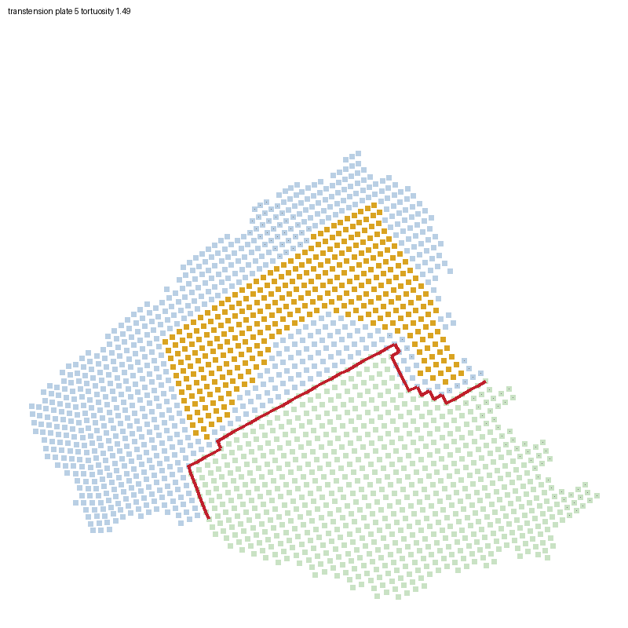

# RFC 0010 probe: can a bent split cut avoid cratons?

[RFC 0003](../../rfc/abandoned/0003-rifting-around-cratons.md) tried to steer a plate split's cut off
cratons by tilting its great circle (PR #418). It rarely could: 12% of craton-crossing cuts
had an admissible craton-free alternative. A great circle moves as a whole, so this probe
asks whether a cut free to bend, a minimum cut through a strength graph
([RFC 0010](../../rfc/0010-rifts-follow-weak-lithosphere.md)), does better.

**Outcome: no, on the current craton layout.** At a 1,000 km corridor, 13 of 135
craton-crossing cuts (10%) get a craton-free admissible minimum cut, about the same as
#418's tilting. Where it is admissible it trims the craton a rift's band would thin by
about a quarter, at a 1% residual cost. The obstacle is the craton layout: each continent's interior is one craton, so there is no
route around it except a coastal sliver, which the size gate rejects. That is the
evidence for [RFC 0009](../../rfc/0009-craton-mosaic.md).

## Method

`bin/debug/prototype_mincut_split.py` replays fresh worlds with every default
(`compare_cratons.run_job`, cratons on, 5 Myr steps to 1 Gyr, 100 Myr checkpoints) on
seeds 7, 11 and 2024, one at a time, on a model identical to origin/main `1227c36`. A
read-only tap on `cratons.record_rift_cut` sees every cut that goes ahead (split or failed
rift) and computes, without changing the trajectory:

- the plate's 8-nearest-neighbour node graph, links over 2.5 spacings dropped;
- link cost = chord / spacing × (floor + mean strength), with strength = max(craton
  strength, keel term), RFC 0003's cut score;
- the minimum cut between nodes beyond a corridor of half-width W either side of the flow
  cut (`scipy.sparse.csgraph.maximum_flow`), for W = 500, 1,000, 1,500, 2,500 km and floor
  0.05 and 0.25;
- admissibility, RFC 0010's gates: both halves ≥ `SPLIT_MIN_NODES`, poles at least the
  relaxed separation apart, RMS residual ≤ 1.1 × the flow cut's, and each half's largest
  connected component ≥ 99% of it. Area misfit is reported, not gated: the corridor bounds
  the cut's movement instead;
- "through craton": any craton node within `FAILED_RIFT_BAND_MULT` (2.5) spacings of a node
  on a cut link, the band a failed rift thins. Measured the same way for the flow cut; it
  agrees with the great-circle band count to within two cuts (135 against 133);
- "line through craton": a craton node at either end of a cut link;
- **B**, operational band exposure: craton area in the band, summed over the 135
  craton-crossing cuts using the minimum cut where it is admissible and the flow cut where
  it isn't, over the same sum for the flow cuts;
- boundary length: the summed chord length of the links a cut crosses.

```bash
PYTHONPATH=backend backend/.venv/bin/python bin/debug/prototype_mincut_split.py \
    --out $S/mincut_1gyr.json
PYTHONPATH=backend backend/.venv/bin/python bin/debug/prototype_mincut_split.py \
    --coverage-only --out $S/coverage.json
```

Runs took 794–1,075 s each, and reproduced the first version's trajectories cut for cut. Compact numbers: [mincut_probe.json](mincut_probe.json).

## Results (0–1 Gyr, three seeds pooled)

542 cuts went ahead (190, 180, 172); 135 crossed craton (69, 40, 26).

| Corridor W, floor 0.05 | Band craton-free | …and admissible | Line craton-free, admissible (L) | Failing size / poles / residual / connected | B (per seed; pooled) | Median residual ratio | Median misfit | Median length ratio |
|---|---|---|---|---|---|---|---|---|
| 500 km | 8 | 7 (5%) | 26 (19%) | 21 / 3 / 0 / 7 | 0.85, 0.84, 0.88; 0.85 | 1.001–1.004 | 4% | 0.87–0.89 |
| 1,000 km | 23 | 13 (10%) | 23 (17%) | 47 / 3 / 5 / 11 | 0.75, 0.66, 0.76; 0.73 | 1.007–1.016 | 9% | 0.80–0.83 |
| 1,500 km | 30 | 16 (12%) | 29 (21%) | 54 / 5 / 17 / 9 | 0.71, 0.64, 0.74; 0.69 | 1.015–1.028 | 13–16% | 0.75–0.78 |
| 2,500 km | 51 | 13 (10%) | 21 (16%) | 91 / 2 / 51 / 7 | 0.78, 0.78, 0.81; 0.78 | 1.065–1.093 | 29–30% | 0.62–0.64 |

"Failing" counts are over all 135 craton-crossing cuts, whether or not the minimum cut was
craton-free. Of the 135, 121 flow cuts also have craton on the line itself (67, 33, 21).
Floor 0.25 gives nearly the same cuts (8–12 band-free and 20–27 line-free admissible cuts
per corridor). The minimum cut takes at most 22 ms; the whole evaluation, about 33 ms per
cut.

- **The bent cut follows the flow.** Within 1,000 km it raises the fit residual by about 1%,
  and its boundary is 17–20% *shorter* than the great circle's, so the great circle wasn't
  the flow's best line either.
- **It rarely clears the craton.** Wider corridors find craton-free routes (51 of 135 at
  2,500 km), but they cut off a small piece of the plate: the size gate fails 91 times.
  Even the line alone clears craton in an admissible cut for at most 21% of cuts.
- **It trims the craton a rift would act on, modestly.** Counting only admissible minimum
  cuts, craton in the operational band falls by 27% at 1,000 km and 31% at 1,500 km. Wider
  corridors do worse, because more of their cuts fail the gates.
- **The control for RFC 0009's G1.** On today's layout L = 17% and B = 0.73 at 1,000 km,
  outside both of G1's building branches (L ≥ 20% and B ≤ 0.75, or L ≥ 50% and B ≤ 0.50).

The first version of this probe (reviewed in #421) counted `admissible` without the
connectivity gate, reported a link-count length ratio, and averaged band craton over all
minimum cuts, admissible or not. That made the cut look as if it halved band craton; the
operational figure above is the correct one. The craton-free admissible counts were
unchanged by the connectivity gate.

## Why: the craton is the interior

On craton-crossing cuts, the median plate is 34% craton (interquartile 18–51%), and craton
fills a median 44% of the flow cut's band (19–71%). At generation, craton covers 104, 82
and 46 M km² (20%, 16% and 9% of the surface) on seeds 7, 11 and 2024. The largest
craton-bearing plates carry 54 of 92 M km² (seed 7), 30 of 55 (seed 11) and 19 of 49
(seed 2024).

Seeding (875 km in) and formation (500 km in, 200 Myr quiet) make every continental
interior a single craton, and over 1 Gyr cratons rise to 88–97% of genuine continental area
on these runs (the compare_cratons checkpoints in this replay; #409 attributes the rise to
loss of non-cratonic crust). A cut that divides a continent into two viable halves has to
cross that interior. Steering the line, straight or bent, can't help until interiors have
weaker seams, which is RFC 0009's proposal.

## What this does not show

- Whether minimum cuts avoid cratons on a mosaic of cores and belts: RFC 0009's gate G1.
- How much rifting loss a quarter less craton in the band would save. Failed-rift
  loss scales with band craton directly, but most loss is stretch donation and divergent
  thinning along the boundary afterwards (#388), which this probe doesn't follow.
- "Craton-free" is strict: any craton node within ±312 km of the cut. A thinner band or a
  minimum craton thickness would count more cuts as clear.

## Rift settings and routes (2026-10-31)

Exploration for the detected-rift revision, not gate evidence. `bin/debug/probe_rift_settings.py`
looks for the four rift settings on saved worlds, then routes a rift from each site. Intact craton
interiors are blocked; edges within 200 km, cratons below half strength and heated interiors with an
eroded keel are open at a cost. The great circle through the same site and direction is the
baseline. Thresholds are design choices, and no replay was run: each row is one snapshot, so these
are not rates. No save has plumes, so the keel rule itself was not exercised.

Saves, from the private B2 bucket and not available for download: seeds 317739385 (86 Myr),
447276134 (116), 308161711 (121), 628977350 (227) and 373936961 (244). Compact result:
[`rift-settings.json`](rift-settings.json).

| Setting | Sites | Separating route | Blocked cells entered | Routes touching craton | Routes dividing a craton | Line touches craton | Median tortuosity | Median smaller daughter |
|---|---:|---:|---:|---:|---:|---:|---:|---:|
| Active | 0 (no plumes in any save) | — | — | — | — | — | — | — |
| Passive | 16 | 16 | 0 | 4 | 2 | 7 | 1.21 | 44% |
| Rollback | 0 | — | — | — | — | — | — | — |
| Transtension | 117 | 84 | 0 | 27 | 17 | 50 | 1.34 | 11.7% |

"Line touches craton" counts the separating routes whose same-site great circle has craton in its
band. An earlier run with every craton cell plus a 1-cell buffer forbidden gave 16 passive and 64
transtension routes, with no craton touched or divided. Opening edges and weak cratons added 20
transtension routes at the cost below.

**Craton cost.** 19 of the 100 routes leave craton on both sides. The median route detaches 8% of the
craton it divides, 8 detach more than 10%, and 4 more than 25%, with a maximum of 35%. The routes
detaching most run through interiors below half strength. Routes crossed 421 craton cells of 5,013
route cells. This is the owner's "a weak craton is easier to break", but it is a real risk to the
craton-loss target, and these numbers were not tuned.

Of the 33 transtension failures, 30 found no arm and 3 made a daughter below 5%. 19 of the 117
sites began on a blocked cell, including 10 of the failures. The probe's `meets_min_nodes` field
fails on most rows, including near-even splits, because `SPLIT_MIN_NODES` scales with density and
not plate size.



*Transtension route on plate 20, seed 373936961 at 244 Myr, tortuosity 1.79. Gold cells are craton;
the red route divides the plate into blue and green daughters. The route follows the craton's edge
as designed, but at right the arms hook back along the plate margin and carve off a thin strip.
That is a route-quality defect the separation test does not catch, and tortuosity alone may not
either. The image was chosen by the probe as this world's largest great-circle craton overlap, so
it is not a typical route.*

**Why two settings found nothing.** All 16 local saves have zero plumes, so active rifting was not
tested. Rollback is a real gap: every oceanic node counts as down-going, so an ocean-ocean front has
no upper plate. Only 134 and 184 of 1,922 and 9,445 ocean-facing convergent nodes qualified on the
two worlds checked, and on the 244 Myr world 37.5% of those moved away from the trench faster
than 1 cm/yr, in runs too short for the 300 km front.

**What this does not show.** Transtension is over-counted, with 70 of 117 sites from one world,
because a front is broken into fragments. The sites are snapshots, not sustained settings. The
route was not run in a history, so this does not measure plate count, craton loss or daughter
motion after the split. Rollback's upper-plate signal is a proxy: upper-plate motion does not explain
every subduction zone [Heuret & Lallemand, 2005](https://doi.org/10.1016/j.pepi.2004.08.022).

```bash
PYTHONPATH=backend backend/.venv/bin/python bin/debug/probe_rift_settings.py \
  --saves <saves> --out analysis/rfc0010/rift-settings.json --image-dir <private-dir>
```
