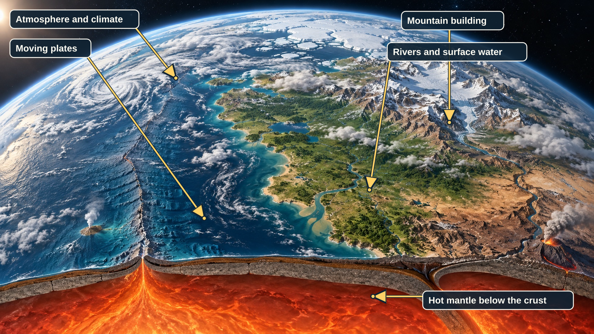

# Simulation Model

This guide explains how Mantle Bloom builds and changes a planet. Each topic begins with
its main ideas in plain language, then gives the rules, units, and code locations that
explain how the simulation works.

The simulation represents terrain as cells attached to moving plates. Climate, water, ice,
and erosion act on that terrain; map views turn the model state into pictures.

*Conceptual overview of the systems described in these pages. The arrows identify features
in the illustration; it is an educational image, not a rendered Mantle Bloom world.*

Use the topic pages below for the full explanation. The topic list is also a code map: it
points to the main Python modules that implement each part. When model behavior changes,
update the matching topic page so readers and developers have the same description of the
current model.

## Topics and implementation map

| Topic | Start here for | Main implementation areas |
|---|---|---|
| [Foundations and generation](simulation-model/foundations.md) | Sphere geometry, plate-local coordinates, initial and sketch-driven worlds, mantle flow | `geometry.py`, `plates.py` generation, `continent_layout.py`, `plate_partition.py`, `layout_lattice.py`, `synthetic_relief.py`, `worldsketch.py`, `mantle.py` |
| [Tectonics and lithosphere](simulation-model/tectonics.md) | Plate motion, boundary deformation, crust and mantle columns, faults, volcanism | `plates.py`, `quad_tectonics.py`, `lithosphere_plate.py`, `rheology.py`, `orogeny.py`, `merge_split.py`, `gaps.py`, `cratons.py`, `faults.py`, `volcanism.py` |
| [Climate and atmospheric flow](simulation-model/climate.md) | Climate fields, biomes, atmospheric solver and grid transfers | `hydroclimate/climate.py`, `fluid_dynamics.py`, `atmosphere_cfd.py`, `biomes.py` |
| [Surface processes and resources](simulation-model/surface-processes.md) | Erosion, isostasy, bathymetry, sea level, tuning and geology | `hydroclimate/erosion.py`, `bathymetry.py`, `eustasy.py`, `geology.py`, `lithosphere.py` |
| [Hydrology and glaciation](simulation-model/hydrology.md) | Flow routing, rivers, lakes, lake hierarchy, glaciers and coastlines | `hydroclimate/hydrology.py`, `lakes.py`, `ice_sheet.py`, `coastline.py` |
| [Rendering and inspectors](simulation-model/rendering-and-inspectors.md) | Map projections, image generation, view rotation, plate and fault inspection | `projections.py`, `render_image.py`, backend routes in `main.py`, frontend map and inspector components |

## Detailed section links

Use these Markdown links to jump directly to detailed sections on the topic pages.

- [Why not a grid](simulation-model/foundations.md#why-not-a-grid)
- [Plate-local frames](simulation-model/foundations.md#plate-local-frames)
- [Initial plate generation (plates.py)](simulation-model/foundations.md#initial-plate-generation-platespy)
- [Cratons-first layout (continent_layout.py, plate_partition.py)](simulation-model/foundations.md#cratons-first-layout-continent_layoutpy-plate_partitionpy)
- [Human-made worlds (sketch-driven generation) (worldsketch.py)](simulation-model/foundations.md#human-made-worlds-sketch-driven-generation-worldsketchpy)
- [Mantle flow (mantle.py)](simulation-model/foundations.md#mantle-flow-mantlepy)
- [Plate motion and deformation (torque.py's coupled solve and Plate.deform)](simulation-model/tectonics.md#boundary-evolution)
- [Quad-surface deformation (quad_tectonics.py)](simulation-model/tectonics.md#quad-deformation)
- [Orogenic relief before delamination (orogeny.py)](simulation-model/tectonics.md#orogenic-relief)
- [Merge and split (merge_split.py)](simulation-model/tectonics.md#merge-and-split)
- [Whole-sphere coverage: local thinning-then-melting, plus a whole-sphere fallback (gaps.py)](simulation-model/tectonics.md#gap-filling)
- [Per-node crust type](simulation-model/tectonics.md#per-node-crust-type)
- [Cratons (cratons.py)](simulation-model/tectonics.md#cratons)
- [Volcanism (volcanism.py, plus lithosphere_plate.deform_columns)](simulation-model/tectonics.md#volcanism)
- [Faults (intraplate) (faults.py)](simulation-model/tectonics.md#faults)
- [Projections (projections.py)](simulation-model/rendering-and-inspectors.md#projections-projectionspy)
- [Render image (render_image.py)](simulation-model/rendering-and-inspectors.md#render-image-render_imagepy)
- [Rotating the view](simulation-model/rendering-and-inspectors.md#rotating-the-view)
- [Plate Inspector](simulation-model/rendering-and-inspectors.md#plate-inspector)
- [Climate (climate.py)](simulation-model/climate.md#climate-climatepy)
- [Biomes (biomes.py)](simulation-model/climate.md#biomes-biomespy)
- [Atmospheric wind solver (fluid_dynamics.py, atmosphere_cfd.py)](simulation-model/climate.md#atmospheric-wind-solver-fluid_dynamicspy-atmosphere_cfdpy)
- [Always-on, not a mode](simulation-model/climate.md#always-on-not-a-mode)
- [Wind model: "diagnostic" (default) vs "cfd"](simulation-model/climate.md#wind-model-diagnostic-default-vs-cfd)
- [Surface-wind contract](simulation-model/climate.md#surface-wind-contract)
- [The shallow-water formulation](simulation-model/climate.md#the-shallow-water-formulation)
- [The pole problem, and why both solvers need it solved](simulation-model/climate.md#the-pole-problem-and-why-both-solvers-need-it-solved)
- [Ocean currents (retired CFD; now diagnostic in climate.py)](simulation-model/climate.md#ocean-currents-retired-cfd-now-diagnostic-in-climatepy)
- [Atmospheric Fluid Dynamics (atmosphere_cfd.py)](simulation-model/climate.md#atmospheric-fluid-dynamics-atmosphere_cfdpy)
- [Performance and grid resolution](simulation-model/climate.md#performance-and-grid-resolution)
- [Rendering](simulation-model/climate.md#rendering)
- [Erosion (erosion.py)](simulation-model/surface-processes.md#erosion-erosionpy)
- [Bathymetry (bathymetry.py)](simulation-model/surface-processes.md#bathymetry-bathymetrypy)
- [Eustatic sea level (eustasy.py)](simulation-model/surface-processes.md#eustatic-sea-level-eustasypy)
- [Live tuning knobs (world.TUNING_MULTIPLIER_FIELDS)](simulation-model/surface-processes.md#live-tuning-knobs-worldtuning_multiplier_fields)
- [Resources and soil (geology.py, plus volcanism.py's own eruption roll)](simulation-model/surface-processes.md#resources-and-soil-geologypy-plus-volcanismpys-own-eruption-roll)
- [Hydrology: rivers and lakes (hydrology.py)](simulation-model/hydrology.md#hydrology-rivers-and-lakes-hydrologypy)
- [Lakes are an explicit object tree (lakes.py, not hydrology.py)](simulation-model/hydrology.md#lakes-are-an-explicit-tree)
- [Lake vs. sea tiers: a depth ceiling by size (2026-09-10)](simulation-model/hydrology.md#lake-vs-sea-tiers-a-depth-ceiling-by-size-2026-09-10)
- [Glaciation (hydrology.py)](simulation-model/hydrology.md#glaciation-hydrologypy)
- [River Inspector](simulation-model/hydrology.md#river-inspector)
- [Lake Inspector](simulation-model/hydrology.md#lake-inspector)
- [Plates & Faults view](simulation-model/rendering-and-inspectors.md#fault-inspector)
- [Coastline (coastline.py)](simulation-model/hydrology.md#coastline-coastlinepy)
- [Known simplifications](simulation-model/foundations.md#known-simplifications)
