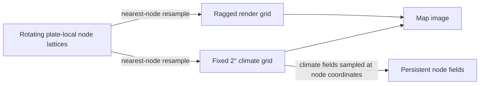

# Climate and atmospheric flow

[Back to the Simulation Model index](../simulation-model.md).

## Climate (`climate.py`)

Seven fields -- land temperature, ocean surface temperature, air temperature, wind, ocean
currents, humidity, and precipitation -- computed for five map views (temperature, wind,
ocean currents with swells marked, humidity, precipitation), implementing a climate model
whose mechanisms are richer than a first-principles description would suggest. Of those
seven, only **wind and air temperature** are read straight off `World.atmosphere_cfd_state` --
a real, continuously time-integrated shallow-water solve (see [Atmospheric wind
solver](#ocean-atmospheric-fluid-dynamics)) -- rather than reconstructed by this module's own
formulas on every call. Land temperature stays a genuine per-call diagnostic (it's also the
CFD state's own equilibrium relaxation target, computed the same way). Ocean currents, ocean
surface temperature, humidity, and precipitation are all per-call diagnostics too: the
shallow-water *ocean* solver had no stable operating point on this grid and was retired
(`compute_ocean_currents` + `advect_ocean_temperature` run here every step instead, fed by the
CFD wind), and the CFD atmosphere's own humidity/precipitation had no orographic-lift,
moisture-convergence, or lake/river/vegetation term and produced a near-zero, uncalibrated
rainfall field that starved erosion and hydrology. The precipitation sweep is at steps 9-10
below. Rivers, lakes, and
vegetation feed back into humidity here (see
step 9 and "Moisture recycling") -- the one place this module reaches outside its own fixed
grid, into the persisted node fields hydrology.py/erosion.py/biomes.py already maintain. The
precipitation field is a steady-state advective sweep, so it already reads as long-term
average rainfall rather than an instantaneous rate.

**A third, genuinely fixed-shape grid, used only here.** Elevation is Lagrangian (see [Why
not a grid](foundations.md#why-not-a-grid)); the render grid ([Render image](rendering-and-inspectors.md#render-image)) is a *ragged*
lat/lon sweep, immediately flattened to 1D. Neither supports the array tricks climate leans
on -- `np.roll` wraparound, centered-difference gradients, divergence, land-excluding
neighbor averaging. So climate gets its own equirectangular array, `lat: (H,)` / `lon: (W,)`,
every field `(H, W)`, `GRID_HEIGHT = 90` x `GRID_WIDTH = 180` (2 degrees/cell) at the
`climate_density = 1.0` reference -- scaled directly in each dimension by a world's own
`World.climate_density` (the UI's "climate & biome resolution" choice,
`climate.CLIMATE_DENSITY_CHOICES = (0.5, 1.0, 2.0, 4.0)`, `climate.DEFAULT_CLIMATE_DENSITY =
4.0`, see `climate.grid_dimensions`) for a sharper, less pixelated climate map at the cost of
real compute: confirmed directly, `2.0` (4x the cells) costs roughly 2-3x longer to render a
climate/biome-family view and only a modest ~10% longer per simulation step (climate is a
comparatively small share of a step's total cost next to boundary evolution/erosion/hydrology
over the plate node cloud); the default `4.0` (16x the cells) costs roughly 6x longer to
render such a view and roughly 1.5-2x longer per simulation step; `0.5` (a quarter of the
cells) is the corresponding lower-resolution option, for a coarser climate map and slightly
faster steps. Fixed-*degree* offset distances internal to the wind/current
mechanics below (mountain/coastal wake lookback, mountain tangent sampling) stay physically
meaningful at any density via `_REFERENCE_CELL_DEG`, a reference cell size decoupled from the
grid's own actual width -- one exception, noted where it's defined
(`MOUNTAIN_GRADIENT_SMOOTHING_ITERATIONS`): a handful of *iteration*-count-based smoothing
passes blur by a fixed number of grid cells rather than a fixed real distance, so their
real-world smoothing radius shrinks proportionally at a higher density -- a deliberate,
smaller-scope simplification, not rescaled. This grid is never stored on `World` and never
touches `world.plates`.

**Conceptual diagram — plate-local nodes are resampled onto separate render and climate grids; the climate grid also feeds diagnostic fields back to nodes.**

The three grids have different jobs and shapes: plate lattices own persistent terrain, the
ragged render grid samples that terrain for map output, and the regular climate grid supports
finite-difference and wraparound operations. The arrows show resampling direction, not
shared storage.

**Terrain-derived; wind/currents/temperature CFD-sourced, humidity/precipitation diagnostic.**
Elevation/is_ocean are resampled from scratch on every call, from whatever the *current* plate
elevation/crust_type happens to be (the same `cKDTree` nearest-neighbor sampling
`_render_grid_arrays` already uses) -- there's no persistent terrain field of climate's own to
keep in sync, since terrain itself already persists incrementally on the plates. Temperature/
wind/currents are read off the world's own always-on, genuinely prognostic CFD states (see
above); humidity/precipitation are recomputed by this module's own steps 9-10 every call, from
that CFD-sourced wind/ocean temperature. Either way climate is genuinely recomputed every step
regardless of whether a climate view is currently being rendered (see [Erosion](surface-processes.md#erosion),
which needs a live climate snapshot for rain/wind/humidity every step), not just on render.
`compute_climate`'s `skip_moisture=True` path (used only by `world._advance_fluid_dynamics`'s
CFD-forcing call, which consumes only elevation/is_ocean/the temperature baselines) skips the
humidity/precipitation sweep and returns those two as zeros.
Two more generation-time-fixed exceptions: `World.axial_tilt_deg` and `World.climate_density`,
both set once by `generate_world` and read again on every future step/render, since insolation
needs the former and the grid's own shape needs the latter long after generation, neither
being something to recompute per call.

**Pipeline order.** Wind needs a temperature field, but the *final* (current-advected) ocean
temperature needs currents, which need wind -- resolved by computing a pre-advection baseline
first and closing the loop only for the final consumer-facing fields:

1. **Insolation** -- `cos(lat)` zenith-angle law (clipped floor) at full sun (`SUNLIGHT =
   1.0`), plus axial tilt: with tilt 0 it's the flat law; otherwise the mean of that same law
   over `AXIAL_TILT_DECLINATION_SAMPLES` declinations swept between `-tilt` and `+tilt` (the
   sub-solar latitude's annual sweep -- this model has no calendar, so it's an annual mean,
   not a season cycle). `World.solar_multiplier` scales it live.
2. **Land temperature** = `LAND_TEMP_MIN_C + LAND_TEMP_RANGE_C * insolation` (`-28 + 55*(·)`,
   calibrated so the equator-to-pole profile lands near `25 / 10 / -1 / -22 C` at lat
   `0 / 45 / 60 / 90` -- an earlier `-60 + 95*(·)` at a dimmed sun put the equator at ~18C
   and everything poleward of ~40 degrees below freezing) minus elevation-based lapse-rate
   cooling, kept as part of the same base-heating formula rather than a separate causal
   channel (mountains being cold is a consequence of solar heating at altitude).
3. **Ocean temperature baseline** = `WATER_TEMP_MIN_C + WATER_TEMP_RANGE_C * insolation`
   (`-2 + 30*(·)`), a narrower range plus a freezing floor (water's greater thermal inertia)
   -- pre-advection.
4. **Wind** -- latitude-banded meridional flow (trade winds/westerlies/polar easterlies,
   empirical lookup, the near-surface branch of the real three-cell circulation) plus
   Coriolis zonal deflection (`u = GAIN * sin(lat) * v`), plus an additive term from the real
   local gradient of the pre-advection land/ocean surface temperature (`np.roll`
   centered-difference) -- the empirical banding supplies planetary-scale structure a
   gradient-alone field doesn't produce on its own, the
   gradient term is the genuinely temperature-responsive component. **Mountain
   deflection/Venturi/wake**: smooth elevation
   (Jacobi blur) before differencing into a gradient, cancel wind's into-slope component and
   redirect it tangentially with a speedup factor, ramped so gentle hills don't fully block;
   tangent side chosen by local topology (sample smoothed elevation along both perpendicular
   candidates, pick whichever is lower) -- mesoscale flow-splitting has no Coriolis-preferred
   side the way basin-scale currents do. Wake: walk backward along the (post-deflection) wind
   direction checking for upstream terrain, damping speed near the obstacle and relaxing back
   over a lookback window.
5. **Ocean currents** -- Ekman base (wind rotated by a fixed angle, hemisphere-flipped),
   redirected around coastlines by the same cancel/redirect mechanism as mountain deflection
   but with the tangent side chosen by a *fixed hemisphere sense* instead of local topology
   (real boundary currents have a Coriolis-preferred circulation direction), then smoothed
   along the coast (land-excluding Jacobi averaging, re-deflected each pass, so the effect
   propagates along a coastline rather than staying a single cell deep). **Land swirl**:
   every ocean cell gets a tangential contribution from its *nearest land cell* (`cKDTree`,
   nearest-cell-based rather than landmass-grouped), ramping from 0 at the coast to a peak then
   decaying with distance, direction matching the coastal deflection's hemisphere sense so
   the two agree. **Circumglobal boost**: a speedup on any row with zero land cells anywhere
   along it (a complete ocean ring) -- the stand-in for the Antarctic Circumpolar Current.
   **Wake**: the same backward-walk-and-damp structure as wind's, obstacle test is
   land-instead-of-elevation, plus a per-world-state noise texture (deterministic in `(seed,
   elapsed_years)`, so repeated renders of the same world state don't flicker) standing in
   for turbulent mixing.
6. **Ocean swells** -- convergence (negative divergence, `np.roll` centered differences) of
   the *final* current field, weighted-sampled down to `MAX_OCEAN_SWELLS` points
   (weighted-without-replacement sampling over the convergence field).
7. **Final ocean surface temperature** -- semi-Lagrangian backward advection (single
   fixed-distance backward sample, nearest-cell) of the baseline along the final current
   field: "carried by ocean currents."
8. **Air temperature** -- the land baseline's own solar-heating formula, pulled toward the
   *nearest ocean cell's* final temperature by a distance-based (`exp` e-folding) falloff:
   "moderating effect of oceans," literally, right down to the "nearest ocean and its
   temperature" query being a `cKDTree` chord-distance search -- true 3D distance, so no
   pole/antimeridian special-casing is needed the way a lat/lon-tangent-plane BFS search would
   require. Land temperature itself is never moderated -- only air temperature is.
9. **Humidity** -- an evaporation ceiling over ocean from the local final ocean temperature,
   *plus* a local land-surface moisture source (lake/river evaporation and vegetation
   transpiration -- see "Moisture recycling" below), advected onto land by a wind-driven 2D
   sweep: a zonal pass and a meridional pass (each a sequential flow-direction walk,
   vectorized across the perpendicular axis, single-column evaporation/retention/orographic-
   dump step per iteration -- pure numpy, no `numba`), blended per-cell by each wind
   component's share of total wind magnitude. The zonal pass's sweep *direction* is the same
   fixed latitude-band lookup wind's meridional structure uses (`zonal_direction_for_lat`),
   not the literal local wind sign. Land-cell moisture (advected carry-over plus local source)
   is capped at the same ceiling ocean evaporation saturates at -- without that cap, a long,
   uniformly-sourced land stretch (a continent-spanning rainforest belt) would compound its
   own source additively, cell after cell, toward an asymptote many multiples of any
   physically sensible humidity value; confirmed directly during development as a genuine
   runaway (mean land precipitation still climbing after ten simulated steps, land humidity
   exceeding the ocean's own maximum) before this cap was added.

   **Inland decay is a real per-km half-life, not a per-cell constant.** Each sweep step's
   carried-over moisture is discounted by `climate._retention_factor`, whose flat-land base
   rate (`_zonal_base_retention`/`_meridional_base_retention`) implements the rule of thumb
   that rainfall roughly halves a few hundred km inland (`MOISTURE_HALVING_DISTANCE_KM = 380`
   -- a little longer than the ~300 rule-of-thumb, since the CFD-sourced wind carries moisture
   inland less efficiently than the old diagnostic trade-wind field did, and a strict 300 dried
   continental interiors to near-total desert on the now-warmer planet) -- computed from each step's *actual* physical
   distance (`plates.PLANET_RADIUS_KM`-scaled degrees, `cos(lat)`-corrected for the zonal
   pass, since a step's real longitude distance shrinks toward the poles) rather than a fixed
   per-grid-cell multiplier. This matters because a fixed-per-cell retention silently decays
   inland moisture at a rate that depends on how much real distance one grid step happens to
   span -- which varies with `World.climate_density` (a lower-density world's larger cells
   cover 300km in barely more than one step) and, for the zonal pass, with latitude. An
   earlier fixed `RETENTION_PER_CELL = 0.96` was confirmed directly as the cause of humidity
   and precipitation reading *highest in continental interiors* rather than near coasts: at
   coarser densities a single step barely dented moisture even 300km inland (~95% retained,
   not the physically-expected ~50%), so land-locked interiors sat near the ocean's own
   evaporation ceiling indefinitely, before any local land-surface source was even added on
   top -- unlike real Earth, where roughly 70-80% of precipitation falls over ocean and only
   20-23% over land, concentrated near coasts and windward mountain slopes rather than spread
   evenly (or worse, favoring the interior) across a continent. On-terrain wind slowdown
   (`elevation_factor`, from own-cell elevation and mountain wake) still applies as an
   *additional* multiplicative discount on top of this distance-based base rate, unchanged
   from before -- air moving slower through rough terrain loses proportionally more moisture
   to mixing independent of the distance it covered.

   **Coherent noise breaks the zonal banding.** The ocean evaporation ceiling is a clip of
   the insolation-driven ocean-temperature baseline, so it's very nearly a pure function of
   latitude, and both sweeps inherit those flat parallels -- visible as horizontal banding on
   the humidity map and in the precipitation baseline it scales. The same fractal gaussian
   perturbation the moisture-flux convergence uses (`_coherent_noise` -- a scale-free
   `1/k**MFC_NOISE_SPECTRAL_BETA` spectral field, correlation length
   `MFC_NOISE_CORRELATION_DEG`, seeded per world state on its own RNG stream) is added to the
   blended humidity field at std `HUMIDITY_NOISE_STD` (smaller than `MFC_NOISE_Q_STD` -- it
   perturbs the baseline everywhere, not just a belt edge), re-clipped to
   `[MIN_BACKGROUND_HUMIDITY, MAX_EVAPORATION_CEILING]`. The orographic dump, a separate
   rain-shadow channel, is left untouched. **`MIN_BACKGROUND_HUMIDITY`** is an irreducible
   background specific humidity -- the trace of water vapour no advective sweep drains
   completely. Without it the centre of a large cold continent reaches *exactly* zero
   humidity (the distance-decay sweeps with no local source over a frozen interior), hence
   exactly zero precipitation, which starves glacier accumulation (scaled by frozen
   precipitation, see [Glaciation](hydrology.md#glaciation)) so a pole cold enough to keep ice forever
   never receives any to keep. ~0.02 q is a few tens of mm/yr of baseline precipitation --
   the order of a real polar desert, enough to seed a polar ice cap over geological time.
10. **Precipitation** = f(humidity) + an orographic bonus (continuous saturating
    windward-slope moisture dump, from wind blowing up-elevation) + a **Hadley/Ferrel
    moisture-flux convergence** term (`compute_moisture_flux_convergence`): the
    metric-correct spherical divergence `-div(humidity * wind)` of the CFD wind field,
    smoothed and blended toward its own per-latitude-row mean (`MFC_ZONAL_COHERENCE`) so the
    wet/dry belts read as continuous bands. Converging moisture-bearing wind adds rainfall
    (the ITCZ where the two hemispheres' trades meet, the ~50-65 deg sub-polar front);
    diverging wind multiplies the humidity baseline *down* (the subtropical highs at ~15-35
    deg, the poles under the polar cells) -- but the final field is floored at the
    `MIN_BACKGROUND_HUMIDITY`-equivalent rainfall, so subsidence can suppress the convective
    baseline toward zero without ever driving precipitation to exactly zero (a polar plateau
    is permanently subsiding yet still accumulates snow). This is the model's zonal precipitation
    climatology -- but emergent from the winds, not a hardcoded function of latitude, so the
    bands shift and distort with the circulation (a supercontinent, an off-centre landmass, a
    monsoon dragging the ITCZ poleward over a summer continent). The convergence bonus is
    capped (`MFC_CONVERGENCE_MAX_Q`) for the same reason the humidity sweep is capped at
    `MAX_EVAPORATION_CEILING`: to keep the precipitation -> rainforest -> transpiration ->
    humidity recycling loop from running away along an equatorial forest belt.
    Because the row-mean blend leaves each latitude nearly flat, the belt edges would
    otherwise fall on hard parallels and show as horizontal banding in the map; a fractal
    gaussian perturbation (`_coherent_noise` -- white noise shaped by a
    `1/k**MFC_NOISE_SPECTRAL_BETA` power spectrum in the spectral domain, so it's isotropic
    and scale-free rather than one dominant bump size, std `MFC_NOISE_Q_STD`, correlation
    length `MFC_NOISE_CORRELATION_DEG`, seeded per world state) added after the blend warps
    and stipples those edges the way real convergence zones meander, without moving the
    wind-derived per-row means.
    Feeds erosion and hydrology (see [Erosion](surface-processes.md#erosion) and [Hydrology](hydrology.md#hydrology)), and
    -- one step later, via the moisture-recycling source above -- itself.

**Moisture recycling: rivers, lakes, and vegetation release moisture too** -- the "rain in a
rainforest" effect, where a wet, densely-vegetated region partly sustains its own
precipitation. `compute_humidity` samples the plates' own persisted `lake_depth`/
`channel_depth` fields onto the climate grid (the same nearest-neighbor resample elevation
itself already gets, see `_sample_elevation_and_crust`) to size a lake-evaporation and a
river-evaporation source; a third source, vegetation transpiration, comes from
`biomes.classify_biomes` (`VEGETATION_TRANSPIRATION_BY_BIOME`, a hand-picked weight per Köppen
class peaking at the wet-tropical / oceanic classes, near zero at ice/tundra/desert classes
and at every pelagic ocean class) applied to a *flat* classification with a broadcast latitude
row (continentality via a distance transform on `is_ocean`). Classifying vegetation needs a precipitation value, and
this step's own precipitation is exactly what transpiration itself feeds into -- so, like
every other circular coupling in this module (e.g. ocean current <-> temperature), the loop is
broken with a one-step lag: vegetation is classified from `World.climate_cache`, last step's
already-cached snapshot, not this step's still-unknown one. Zero everywhere on a world's very
first call (`world.climate_cache is None`), self-correcting after one step. A frozen surface
(`air_temperature_c` below `hydrology.FREEZE_POINT_C`) can't evaporate, so lake/river
evaporation -- but not transpiration, already near zero in any biome cold enough to freeze --
is zeroed there.

**Transpiration recycles last step's own rainfall -- it can't manufacture moisture from
nothing.** `_vegetation_transpiration_source` scales `VEGETATION_TRANSPIRATION_BY_BIOME`'s
per-biome weight by `VEGETATION_RECYCLING_FRACTION` (0.16 -- below the real Amazon-basin
quarter-to-half range, tuned down as the climate model got warmer, see the constant's own
comment) *and* by that same cell's own `prev.precipitation_mm` from `World.climate_cache`
(converted back to humidity units) -- a fraction of what actually fell there last turn, not a
flat per-biome constant. An earlier version used a fixed `VEGETATION_TRANSPIRATION_MAX` source
keyed only on biome type, with no real reservoir behind it -- confirmed directly as a real
multi-step runaway: mean land precipitation climbed turn after turn with no equilibrium,
eventually overtaking the ocean's own total. Tying the source to a fraction of real, already-
fallen rain gives the land/ocean split a genuine fixed point instead: stepping two seeds 65-80
turns past generation settles the land precipitation share near ~24% (real Earth is ~20-24%),
rather than climbing without bound toward a land-dominated one.

This also decreases the standing water it comes from, per the same request that asked for the
recycling effect in the first place: lake evaporation already shrinks `lake_depth` (lakes.py's
own water balance, a separate, unrelated mechanism computing the same physical process); river
evaporation is a new loss along `hydrology.route_downstream` (`RIVER_EVAPORATION_*`), reducing
`flow_accum` as water flows through a warm, dry stretch. That evaporation loss can't be the
same one climate.py's own source term reads, since hydrology.py runs *after* climate.py each
step (consuming its precipitation/temperature output) -- climate.py's land-surface term is
necessarily a same-step stand-in sized from the persisted channel_depth instead, not the
literal amount hydrology.py evaporates this same step.

**Scope, explicitly decided.** Kept out: river outflow feeding currents, deep currents.
Included, even though richer than a one-line causal description: axial tilt, wind's mountain
deflection/Venturi/wake, ocean currents' coastal deflection/land swirl/circumglobal
boost/wake, humidity's evapotranspiration term and lake/river climate influence, and
precipitation's zonal wet/dry banding -- the last modelled as the moisture-flux convergence
of the CFD wind field (step 10 above), not the hardcoded latitude climatology an earlier
design had ruled out. All implemented in full, not simplified down. Dropped outright: river
outflow feeding currents, the one river/lake/vegetation-climate coupling still not modeled.

**Rendering.** `render_image.py`'s `CLIMATE_VIEWS` (`temperature`, `wind`, `oceanCurrents`,
`humidity`, `precipitation`, `biome`) route to `_render_climate_view`, a separate path from
the plate-tectonics views since the data source is structurally different from the render
grid's ragged lattice. `temperature`/`wind`/`oceanCurrents` draw the native `(npix,)` CFD
state arrays directly; `humidity`/`precipitation`/`biome` take `compute_climate_cached`'s
diagnostic `(H, W)` fields and resample them nearest-cell onto the HEALPix cells.
Heatmap views (temperature/humidity/precipitation) reuse the elevation view's
color-stop-interpolation technique with their own stop tables; wind/ocean-currents draw
subsampled arrows (numpy-vectorized projection/direction math, looped only for the
unavoidable per-arrow PIL draw calls), and ocean currents additionally marks each sampled
swell point with a small circle. Temperature/humidity/precipitation additionally draw the
current coastline (see [Coastline](hydrology.md#coastline)) -- a color-scale view carries no land/ocean
information on its own, unlike elevation's own hypsometric coloring. `biome` is categorical,
not a heatmap -- see [Biomes](#biomes) below -- and (like wind/oceanCurrents) skips the
separate coastline stroke, since its own flat Ocean color already reads as a land/ocean
boundary on its own.

### Biomes (`biomes.py`)

A pure, stateless classification -- `biomes.classify_biomes(temperature_c, precipitation_mm,
elevation_m, slope, is_ocean, sea_level_m, *, lat_deg, axial_tilt_deg, continentality=None,
dist_to_land_rad=None, has_sea_ice=None)` -- assigning each land cell one of the **31
Köppen-Geiger** 3rd-level classes (`classify_koppen`) and each ocean cell one of **10 pelagic
classes** (`classify_pelagic`), with `is_ocean` settling the land/water split. `BIOME_NAMES` /
`BIOME_COLORS` are the Köppen classes first (descriptive names -- "Humid Subtropical", not
"Cfa"), then the pelagic classes; `OCEAN_IDS` is the id set of the latter.

Real Köppen keys off sub-annual quantities this model never produces -- coldest/warmest-month
temperature and the summer/winter precipitation split -- so `biomes.py` **synthesizes** them:
`seasonal_temp_amplitude` drives a mean-to-peak seasonal swing from `|lat|`, continentality
(distance inland, 0 at the coast), and `axial_tilt_deg` (a tilt-0 world gets amplitude 0, so
its `s`/`w`/`d` subtypes never occur); `_precip_season` drives a summer precipitation share
and a seasonality concentration from latitude (monsoon belt summer-wet and peaked, a narrow
subtropical dry-summer dip, mid-latitudes even), scaled by the same tilt factor. All of these
constants are visually tuned like the codebase's other openly-approximate values (e.g.
erosion.py's `RAIN_EROSION_COEFFICIENT`), calibrated so an Earth-like world lands its major
zones roughly where Earth's are -- latitude alone can't tell a west coast (Mediterranean) from
an east coast (humid) at the same latitude, so `s` is further gated on maritime
continentality and modest precipitation, and some regimes (the East-Asian-monsoon `Dw` belt)
read as their `f` sibling instead. The same `seasonal_temp_amplitude` (plus an optional relief
boost) also drives glacier melt -- see [Glaciation](hydrology.md#glaciation).

**Pelagic classes** are PPOW's abiotic hierarchy rather than its Earth-geographic province
names (which can't transfer to a different planet): a thermal realm from sea-surface
temperature (polar / cold-temperate / temperate / subtropical / tropical) crossed with a
structural zone -- sea ice (`has_sea_ice` or SST `< -1`), coastal shelf
(`dist_to_land_rad <= SHELF_RANGE_RAD`, matching `geology.SHELF_RANGE_RAD`), equatorial
divergence (`|lat| <= 6` in the tropics), or open ocean / subtropical gyre.

`smooth_biome_field` (the version the map views and `/world/stats` use) computes
`continentality` and coast distance from `is_ocean` itself via a distance transform, plus
sea-ice cover from a passed glacier-depth grid, then runs the same stateless neighbour-vote
cleanup as before on land cells only. `climate.compute_climate` calls it once per computation
and stores `ClimateFields.biome_ids` (see [Climate](#climate)); `stats.py`'s
`biome_land_fraction` (which excludes every `OCEAN_IDS` id) reads that stored field, while the
map-view / hex-export / vegetation-transpiration call sites still classify against their own
grid.

**Wetland and Carboniferous Forest** are no longer displayed climate classes (Köppen has no
such category), but `classify_wetland` and its constants stay: `geology.py`'s per-node coal
formation calls it directly (see [Resources and soil](surface-processes.md#resources-and-soil)). Both require
flat, low-lying land (`elevation_m > 0`, `<= WETLAND_MAX_ELEVATION_M`,
`slope <= WETLAND_MAX_SLOPE`); Carboniferous Forest is the warm
(`>= CARBONIFEROUS_MIN_TEMP_C`, aliased to `TROPICAL_TEMP_C`), very wet
(`>= CARBONIFEROUS_MIN_PRECIP_MM`, aliased to `HUMID_MM`) subtype.

**Slope** (`biomes.grid_slope`, still used by `classify_wetland` and `geology.py`) -- real
elevation difference to each cell's steeper of its north/south or east/west neighbor, divided
by that neighbor's real great-circle spacing in meters (longitude narrowed by `cos(lat)`, the
same convention `elevation_lines.iter_local_lattice` uses) -- computed on the fine Biome/Combined grid
(`_biome_fields`'s own `elevation_m`, previously unused by these two views) rather than
climate.py's coarser native grid. A different, coarser discretization than
`erosion.compute_slope`'s own node-cloud slope (used by `geology.py`, see below), but both are
genuine rise/run slopes over roughly comparable real distances (~100-125km), so
`WETLAND_MAX_SLOPE` is a shared, visually-tuned cutoff rather than two independently-fit
thresholds -- `stats.py`'s own `biome_land_fraction` reuses `grid_slope` too, against its own
coarser native climate grid, for the same reason.

No new per-step state or caching -- like `render_image.py`'s own `temperature_colors`/
`humidity_colors`, this runs fresh from whatever `climate.compute_climate_cached` already
produced, entirely inside `_render_climate_view`'s `"biome"` branch (and `_render_combined_view`
for "Combined", though Ocean/Intertidal Zone's own biome color is never actually visible there
-- see that view's own legend). Implemented with `np.select` (first-matching condition wins)
rather than chained `np.where` overwrites, so each band's cutoffs stay a self-contained,
independently checkable list instead of depending on write order to get boundary cells right.

**Combined-view shading.** `_render_combined_view` multiplies each land cell's flat Köppen
color by `biomes.biome_relative_shade_factor` -- a *continuous* brightness ramp from
`1 - BIOME_SHADE_AMPLITUDE` at a class's lowest-elevation cell to `1 + BIOME_SHADE_AMPLITUDE`
(±25%) at its highest, linear in that cell's elevation *rank among its own class's cells only*
(so a class pinned to a narrow absolute elevation band still spans the full range). Near real
peaks the result is further blended toward the elevation gradient (`RELIEF_BLEND_MAX`); ocean
cells are the pelagic-province color blended toward the hypsometric depth shade
(`OCEAN_PELAGIC_RELIEF_BLEND`), so deep basins still darken and shelves lighten while every
water cell carries its province's hue. Because that wide color spread means a pixel's *color*
no longer identifies its class, the render is **RGBA** and the per-pixel class/lake/glacier id
is carried in the alpha byte (`alpha = 255 - code`, every classified land and ocean cell now
carrying one; see `render_image.COMBINED_LAKE_ID_CODE`). `frontend/src/legendData.ts` mirrors
that id mapping by hand -- grouping the 41 classes into the ~17 1st/2nd-level legend rows --
and `MapCanvas.tsx` reads it straight off alpha for legend-click-to-highlight, then resets
alpha to opaque before display.

## Atmospheric wind solver (`fluid_dynamics.py`, `atmosphere_cfd.py`)

Most of [Climate](#climate) is *diagnostic* -- recomputed from scratch every call via
latitude-banded heuristics (Ekman currents, coastal deflection, mountain deflection),
not a real fluid solve. **Wind is the exception**: `World.atmosphere_cfd_state` is a genuine,
time-integrated **shallow-water** solve -- real Coriolis/pressure-gradient momentum physics,
explicit numerical time-stepping, real *prognostic* `u`/`v`/`eta`/`temperature_c` that persist
and evolve step to step (rather than being rebuilt every call the way `climate_cache` is), plus
a sustained latitude-banded forcing so the planetary circulation doesn't spin down.

**A shallow-water *ocean* solver (`ocean_cfd.py`) also existed** -- prognostic currents,
surface temperature, and a sediment tracer. It was **retired**: on this HEALPix grid it had no
stable operating point that produced realistic circulation (either an over-damped near-still
interior or a coastal grid-scale instability), and its sediment views had already been dropped.
Ocean currents and the current-advected surface temperature are diagnostic in `climate.py`
every step now (`compute_ocean_currents` + `advect_ocean_temperature`, see below), fed by the
CFD-solved wind.

### Always-on, not a mode

Earlier revisions gated Fluid Dynamics behind a three-way `World.fluid_mode` toggle
(`POST /world/mode`) that froze plate tectonics/climate while it was active. That's gone:
`World.atmosphere_cfd_state` is created once, by `generate_world`
(`atmosphere_cfd.init_atmosphere_cfd`, seeded from the diagnostic `compute_wind` bootstrap),
and never re-initialized again for the rest of that world's life.

**Every `POST /world/step` call advances it**, via `step_world`'s own
`_advance_fluid_dynamics`, right alongside plate tectonics/climate/erosion -- gated on
`World.simulate_climate_biomes` the same way erosion/hydrology already are (not on
`simulate_plate_movement`; wind keeps evolving even with plate movement paused), *and* on
`World.wind_model == "cfd"` -- the diagnostic wind model (see [Wind model](#wind-model)
below) turns `_advance_fluid_dynamics` into a no-op.
Real atmospheric fluid dynamics needs timesteps of hours to days; plate tectonics needs
timesteps of thousands to millions of years -- reconciled by advancing the wind state by a
**fixed real-time increment per tectonics step, regardless of the tectonic `years`
requested**: `atmosphere_cfd.SECONDS_PER_TECTONIC_STEP` (one simulated day). A single
`/world/step` call covering a million tectonic years still only advances the atmosphere by one
simulated day -- an intentional decoupling.

**`refresh_forcing`** (called right before `step_atmosphere_cfd` each tectonics step) keeps the
state's terrain-derived boundary conditions -- `elevation_m`/`is_ocean`/
`equilibrium_temperature_c` -- in sync with the world's evolving plate state, while leaving the
genuinely prognostic `u`/`v`/`eta`/`temperature_c` untouched, so they keep evolving
continuously across tectonics steps rather than resetting. It's fed a `skip_moisture=True`
`compute_climate` snapshot at `World.fluid_density`'s resolution (the humidity/precipitation
sweep is dead weight for forcing that consumes only elevation/is_ocean/temperature baseline).

`climate.py`'s own `compute_wind` diagnostic still exists as the one-time cold-start
bootstrap `init_atmosphere_cfd` falls back to during `generate_world` (before
`World.atmosphere_cfd_state` exists yet) -- *and* as the full wind source whenever the
diagnostic wind model is selected, below.

### Wind model: `"diagnostic"` (default) vs `"cfd"`

`World.wind_model` (live-adjustable via the Controls window / `POST /world/controls`) picks
which wind field feeds `climate.py`:

- **`"cfd"`** -- the genuine shallow-water solve described above. At the default
  `fluid_density` this is the single most expensive piece of a `/world/step` (hundreds to
  a thousand+ CFL-stable substeps; see [Performance](#fd-performance)).
- **`"diagnostic"`** (default) -- skip that solve entirely. `_advance_fluid_dynamics` becomes a no-op
  (the CFD state is *kept*, just frozen, so switching back resumes from it rather than a
  cold start), and `climate.compute_climate` rebuilds wind from `compute_wind` and air
  temperature from `compute_air_temperature_diagnostic` every call -- the same closed-form
  "ABL" path the cold-start bootstrap uses, but for the whole run. `compute_air_temperature`
  (the maritime-moderation cold-start air temp) is *not* reused here: it's a poor match for
  the CFD's near-radiative-equilibrium temperature field (benchmarks at ~41% land-biome
  agreement vs the CFD, against `compute_air_temperature_diagnostic`'s ~90%).

**Why it's a reasonable trade.** The CFD wind is relaxed hard toward the same
latitude-banded target `compute_wind` builds, and only integrates ~one simulated day per
step, so downstream (ocean currents, humidity advection, precipitation) barely distinguishes
the two wind fields -- keeping the *CFD* air temperature while swapping to diagnostic wind
holds land-biome agreement near 95%. Measured against a ~12-step CFD reference at
`fluid_density=2.0` across three seeds, the fully-diagnostic model reproduces **~84-89% of
the land biome map** and precipitation/temperature **within ~8-11%**, while cutting a
12-step run from ~42 s to ~7 s (**~6x**) at that resolution -- the CFD substep loop itself
is ~15x, diluted by the rest of a step's fixed cost, and the multiple grows with
`fluid_density` (closer to ~1.5x at `0.5`). The residual gap is almost entirely the
air-temperature field's missing advective/diffusive structure -- see [GitHub issue #118](https://github.com/adubey/mantle-bloom/issues/118) for the
options to close it.

**Rendering.** The `"wind"` and `"temperature"` map views normally draw
`World.atmosphere_cfd_state`'s native HEALPix arrays; under `"diagnostic"` they fall back to
`compute_climate`'s own wind/air-temperature (resampled onto the HEALPix cells like every
other climate field) so the maps reflect the model that's actually driving the sim rather
than a frozen CFD snapshot.

### The shallow-water formulation

Both solvers run on the same fixed equirectangular grid shape `climate.py` already uses (same
`(lat_deg, lon_deg, world_xyz)` shape convention, built via the same `climate.compute_climate`
pipeline), but at `World.fluid_density`'s own resolution rather than `World.climate_density`'s
-- a separate, independently choosable Advanced-settings option (same `climate.
CLIMATE_DENSITY_CHOICES` set, defaulting to match `climate_density`'s own default so an
unchanged world behaves exactly as before), letting a world keep a sharp climate/biome render
grid while running FD mode at a coarser (faster) resolution or vice versa; see
[Performance and grid resolution](#fd-performance) below. The solve is a two-equation shape
(`fluid_dynamics.py` holds every numerical primitive; the retired ocean solver shared them):

- **Momentum** (`u`, `v` -- east/north velocity, m/s): `du/dt = f*v - g'*d(eta)/dx + forcing_x - drag*u + nu*laplacian(u)`, symmetric for `dv/dt`. `f` is the *real* Coriolis parameter (`fluid_dynamics.coriolis_parameter`, `2*OMEGA*sin(lat)`, `OMEGA = 7.292e-5 rad/s` -- a genuine physical constant, unlike `climate.py`'s own simplified `sin(lat)` proxy, since this is an actual momentum equation) and `eta` a geopotential-height anomaly. `forcing_x` also carries the latitude-banded wind-forcing relaxation `WIND_FORCING_RELAXATION_PER_S * (u_target - u)` (see [Atmospheric Fluid Dynamics](#atmosphere-cfd)).
- **Continuity** (`eta`): `d(eta)/dt = -div(H*(u, v))` plus a thermal-relaxation term (see [Atmospheric Fluid Dynamics](#atmosphere-cfd) below), `H` a fixed troposphere-depth constant.
- **Advection-diffusion** of `temperature_c`, via `fluid_dynamics.semi_lagrangian_advect` -- the same backward-trace-and-sample technique `climate.py`'s own `advect_ocean_temperature`/`_sample_at_offset` already use: unconditionally stable regardless of how far `dt * speed` reaches relative to one grid cell, so advection never adds a second, stricter stability constraint on top of the gravity-wave one substep sizing is already built around.

**Reduced gravity.** Real values of `g` and layer depth give a gravity-wave speed near 200
m/s, which at planet-grid resolution forces the CFL-stable substep down near 100 seconds --
correct, but far more substeps than the large-scale wind pattern actually displayed needs to
look right. **Reduced gravity** (`atmosphere_cfd.REDUCED_GRAVITY_M_S2 = 0.5`) is the standard
technique barotropic models use to keep wave speed -- and thus substep count -- tractable
while the solver still *genuinely* integrates Coriolis/forcing/topography every substep.

**Substepping.** A UI "Step" (real seconds -- no relation to tectonic `years`) is subdivided
into as many CFL-stable substeps as the current grid spacing and reduced-gravity wave speed
demand (`fluid_dynamics.cfl_substeps`, CFL safety factor 0.4), computed fresh every call from
the grid's own real spacing (`fluid_dynamics.grid_spacing_m`, `cos(lat)`-corrected the same
way `climate.py` handles meridian convergence throughout) and the current flow speed. `dt`
always evenly divides the requested `seconds` (substep count computed first, `dt` derived
from it), and a hard ceiling (`MAX_SUBSTEPS_PER_STEP`, mirroring `main.MAX_ANIMATION_FRAMES`'s
own "bound worst-case request time" precedent) guards against a single request running
unboundedly long.

### The pole problem, and why both solvers need it solved

A fixed lat/lon grid's east-west cell spacing shrinks toward zero at the poles (`cos(lat) ->
0`) -- a real, well-known numerical challenge for exactly this kind of grid ("the pole
problem"), not specific to this codebase. Two consequences, both confirmed directly during
development:

- **CFL sizing.** If substep sizing respected the *true* spacing all the way to the pole, a
  handful of pole-adjacent cells would force an ever-smaller global timestep as grid
  resolution increases, regardless of how coarse the rest of the grid is.
- **Blow-up.** Even with substep sizing fixed, `gradient_m`/`laplacian_m`'s own `1/dx`
  (`1/dx^2` for the viscosity/diffusion terms) still explode at the pole-most rows if `dx`
  is allowed to keep shrinking -- confirmed directly: an early build stayed stable at a
  world's default (coarser) Detail setting but reliably diverged to `inf`/`NaN` within the
  first simulated day at the finest Detail setting, purely from this.

The fix (the same one real lat/lon-grid ocean/atmosphere models use, rather than a much
larger undertaking like a staggered/reduced/icosahedral grid): **`fluid_dynamics.
grid_spacing_m` clamps `dx_m` to its own value at `POLAR_FILTER_START_LAT_DEG` (75 deg) for
every row poleward of it** -- the grid's real spacing never shrinks further than that,
consistently, for every derivative *and* for CFL sizing. **`polar_zonal_filter`** blends each
row poleward of that same latitude toward its own zonal (east-west) mean, ramping to a full
zonal average at the pole-adjacent row, applied to `u`/`v`/`eta` every substep -- this is
what makes the clamp above honest: without also suppressing the *state's* own fine east-west
structure there, the raw physics would keep regenerating exactly the small-scale variation
the clamp assumes doesn't matter.

**The polar cap needs its own extra damping, too.** Removing zonal degrees of freedom near
the pole also removes the small-scale eddies that would normally dissipate momentum there, so
a merely-adequate mid-latitude drag left the zonally-averaged polar band spinning up to a
persistent, unrealistic drift under ordinary forcing (confirmed directly: sustained growth
well past any real wind-driven current, still rising after a 10-day run with nothing else on
the grid unstable). `fluid_dynamics.polar_sponge_drag_per_s` adds an extra damping *rate*
ramping up poleward of the same 75 deg latitude, on top of each solver's own ordinary drag.
Both this and ordinary drag are applied **semi-implicitly** (backward Euler for just the
linear drag term: divide by `(1 + dt*drag)` rather than subtract `dt*drag*u` outright) --
unconditionally stable regardless of how large `dt*drag` gets, which matters specifically
here: an explicit update needs `dt*drag` comfortably under 1, and confirmed directly to blow
up outright (not merely stay too energetic) once the sponge was strong enough to actually fix
the polar over-acceleration it exists to prevent.

**A related, non-polar tuning note.** The solver's own *ordinary* (non-polar) drag
(`atmosphere_cfd.SURFACE_DRAG_BASE_PER_S`) had to be tuned noticeably stronger than an initial
physically-naive guess: at high latitude generally (not
just inside the polar cap), the real Coriolis parameter is largest, which leaves a
weakly-damped system in a lightly-damped, Coriolis-dominated regime -- a persistent
near-inertial oscillation that, at too-weak a drag, hadn't decayed to a physically plausible
speed even after many simulated days. Since drag here is semi-implicit too, raising it is
never a stability risk, only a "how energetic does the flow look" tuning choice -- confirmed
directly by sweeping drag strength until sustained speeds settled into a realistic range.

### Ocean currents (retired CFD; now diagnostic in `climate.py`)

`ocean_cfd.py` was a shallow-water current solver (Coriolis + pressure-gradient momentum, a
`tau = Cd * |W| * W / MIXED_LAYER_DEPTH_M` wind stress over a near-surface mixed layer, a
temperature tracer the currents advected, and a suspended-sediment dye). On the HEALPix grid
it had no stable operating point: every drag/reduced-gravity/integration-time setting either
over-damped the interior to a near-still ~0.02 m/s or went grid-unstable at coastlines
(rogue cells, surface-height anomalies past 600 m). Fixing that properly means real
numerical-methods work (staggered C-grid, upwind advection, boundary-layer treatment).

It was removed. `climate.py`'s own `compute_ocean_currents` (Ekman base + coastal deflection +
land swirl + circumglobal boost + wake -- a stable, closed-gyre *diagnostic*, the same one that
used to be the CFD's cold-start bootstrap) runs every step now, and
`advect_ocean_temperature` carries the zonal baseline poleward along it. Current *speed* here
is a stylized, unitless quantity (wind-magnitude scale, meaningful only relative to other
cells -- direction and relative magnitude are what the map arrows and the temperature
advection use), not a physical m/s -- unchanged from how the diagnostic model always worked.

### Atmospheric Fluid Dynamics (`atmosphere_cfd.py`)

A shallow-water solve for wind and air temperature. Inputs: **Coriolis force** and
**elevation** (both baked into the momentum equation -- Coriolis directly, elevation via
orographic deflection around high terrain and a lapse-rate-cooled radiative-equilibrium
temperature target, see below).

**Humidity and precipitation are not solved here.** An earlier version carried humidity as a
prognostic wind-advected field with a flat evaporation source and a super-saturation
condensation sink; that produced a near-zero, uncalibrated precipitation field with no
orographic-lift term, which starved erosion and hydrology. Both fields moved back to
`climate.py`'s own diagnostic sweep (orographic lift + lake/river/vegetation moisture
recycling + per-km inland decay), fed by this solver's wind and the ocean solver's surface
temperature -- see [Climate](#climate). This solver keeps only `u`/`v`/`eta`/`temperature_c`.

**Sustained prevailing wind.** The shallow-water momentum equation here has surface drag,
viscosity, and orographic damping but no term that would sustain a planetary circulation on
its own, so the bootstrap winds (`climate.compute_wind`'s latitude bands, ~6 m/s) spun down
to a near-still thermal-gradient balance within a few tectonic steps -- taking the
Ekman-forced ocean currents down with them. `(u, v)` is now additionally relaxed, in the
fast momentum pass, toward a latitude-banded target (`WIND_FORCING_RELAXATION_PER_S` toward
the same trade-wind/westerly/polar-easterly `meridional_dir * MERIDIONAL_BASE_SPEED` +
Coriolis-deflected structure `climate.compute_wind` bootstraps from, *without* its mountain/
temperature-gradient terms -- this solver produces those itself). Steady-state planetary wind
then settles near the target's own ~6-8 m/s scale and holds there step to step, while
Coriolis, the pressure-gradient/thermal term, and orographic deflection still reshape it away
from a pure zonal band.

**Thermal forcing.** `eta` (here, a geopotential-height anomaly rather than a literal sea-
surface height) relaxes toward a target proportional to the local temperature anomaly
(`ETA_TEMPERATURE_COUPLING_M_PER_C`) -- the real atmospheric "hypsometric" relationship (a
warmer air column is thicker, so upper-level geopotential height reads higher over warm
regions), standing in for a full 3D pressure/density solve the same way `climate.py`'s own
wind model already stands in for one. Temperature itself relaxes toward a radiative-
equilibrium target computed once at mode entry from `climate.compute_land_temperature`/
`compute_ocean_temperature_baseline` (frozen elevation/insolation, so this target itself
never changes mid-session) -- diabatic heating from real insolation
(`climate.compute_insolation`, reused directly) plus lapse-rate cooling with elevation,
exactly the mechanism `climate.py`'s own land-temperature formula already uses.

**Orographic deflection.** `_mountain_deflection_tendency` cancels wind's into-slope
component near high terrain and redirects a matching amount tangentially -- the same "cancel
and redirect" *shape* `climate.py`'s own `_mountain_deflection` uses, but expressed here as a
per-second *tendency* (added into `du_dt`/`dv_dt` alongside Coriolis/pressure-gradient/drag)
rather than a direct state overwrite. That distinction is required, not stylistic: an earlier
version applied the cancel-and-redirect transform (including a >1x "Venturi speedup" factor)
directly to `(u, v)` every substep, which is stable as a single diagnostic transform
(`climate.py`'s own version only ever runs once per whole climate computation) but compounds
*geometrically* when the same transform re-applies every substep to an already-redirected
velocity -- confirmed directly as a real bug during development, wind speeds diverging to
absurd values within a single UI "Step" purely from this. The tendency form (energy-neutral:
the damped magnitude is redirected exactly, no speedup factor) only ever damps a *persistent*
into-slope flow, the same stability property ordinary drag already has.

### Performance and grid resolution

The wind-solver grid resolution is set by **`World.fluid_density`** (the "Fluid dynamics
resolution" Advanced-settings choice, same `climate.CLIMATE_DENSITY_CHOICES = (0.5, 1.0, 2.0,
4.0)` set `climate_density` itself uses) -- independent of `World.climate_density`, so a world
can keep a sharp climate/biome render grid while running the wind solve at a coarser (faster)
resolution, or the reverse. Defaults to `climate.DEFAULT_CLIMATE_DENSITY = 4.0`, matching `climate_density`'s
own default, so a world generated without touching this setting behaves exactly as it did
before this option existed: a "Step" can take several seconds at the finest setting (many
hundreds of CFL-stable substeps, see `fluid_dynamics.cfl_substeps`, over a ~250k-cell grid),
an accepted trade-off rather than something silently degraded -- lowering `fluid_density`
trades that away deliberately, both by shrinking the cell count itself and, since CFL substep
count scales inversely with grid spacing, by needing fewer substeps to cover the same
requested `seconds` per step. `World.node_density` (plate terrain resolution) is
unrelated and has no bearing on either FD mode.

### Rendering

`_render_climate_view` draws `"wind"` and the land side of `"temperature"` straight off
`World.atmosphere_cfd_state`'s own HEALPix `u`/`v`/`temperature_c`. Every other field -- the
ocean side of `"temperature"`, `"oceanCurrents"` (arrows + swell markers), `"humidity"`,
`"precipitation"`, `"biome"` -- is a `climate.compute_climate_cached` diagnostic (see
[Climate](#climate)) resampled nearest-cell onto the HEALPix cells. `render_image.render_png`
degrades to a plain background-only image if the state is somehow `None`, the same "always
renders *something* standalone" contract every other view in `VIEWS` has. The former
`"oceanCfdSediment"`/`"oceanCfdDeposition"` sediment views were removed with the ocean solver.
