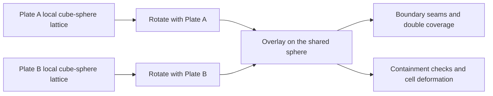

# Foundations and generation

[Back to the Simulation Model index](../simulation-model.md).

## Why not a grid

mantle-bloom does not model the planet as an equirectangular lat/lon grid, and deliberately
so: a fixed lat/lon grid brings a cluster of problems. Pole cells need an artificial
full-clique patch to be mutually adjacent, falloff radii need a
[Dijkstra](https://en.wikipedia.org/wiki/Dijkstra%27s_algorithm) search weighted by real 3D
chord distance to correct for latitude-dependent cell size, and -- the significant one --
elevation/sediment carried by a rotating plate has to be resampled onto the fixed grid every
step via nearest-neighbor
[semi-Lagrangian](https://en.wikipedia.org/wiki/Semi-Lagrangian_scheme) backward-advection,
which doesn't conserve mass where a plate stretches or compresses.

mantle-bloom drops the global grid entirely: each plate carries its terrain on its own
plate-local lattice of cells that rotates *exactly* with the plate (no resampling at all for
ordinary motion), and cells are only ever added or removed where a boundary actually creates
or destroys crust.

## Plate-local frames

Each plate owns a rotation matrix `frame` (world = `frame @ local`, see
`geometry.plate_frame_from_seed`) defining its own local spherical coordinate system
`(phi, theta)`, with local `(phi=0, theta=0)` mapping to the plate's original seed point.
Terrain is stored as a sparse set of active cells (`PlateWithSparseQuadPatch`,
`sparse_quad_patch.py`) on an equiangular cube-sphere lattice laid out in that local frame:
six faces, each an `n x n` grid whose cell edges are great-circle arcs, face 0 centred on the
seed. One terrain node sits at each active cell's centre, carrying every surface field
(`surface_fields.SURFACE_FIELDS`) for that cell's exact footprint.

**Conceptual diagram — each plate rotates its own cube-sphere lattice; overlaying those independently rotated lattices can create seams, overlaps and containment conflicts at plate boundaries.**

Each lattice stays internally aligned with its own plate. The seam appears only when the
independent cell sets are compared in world coordinates; boundary evolution reconciles those
sets rather than forcing both plates onto one shared grid.

- **Rotating a plate is exact.** Advancing `frame` by composing the incremental rotation
  from the plate's current Euler pole/rate ([Rodrigues'
  formula](https://en.wikipedia.org/wiki/Rodrigues%27_rotation_formula),
  `geometry.rotation_matrix_from_omega`) updates every node's world position automatically,
  with no interpolation and no lost material -- because ordinary rotation never resamples
  anything, there's no semi-Lagrangian resampling step to lose or duplicate mass in the
  first place.
- **Nearly uniform, and no pole singularity.** An equiangular cube-sphere cell's area varies
  by at most about 1.4x across a face, and `n` is chosen so cells are about
  `TARGET_LINE_SPACING_KM` (default 125 km) across -- avoiding the latitude distortion a
  fixed lat/lon grid has, where spacing narrows sharply toward the poles. A plate of any
  size, including one owning a pole, needs no special case. Every cell's area is exact, so
  area-weighted totals (crustal volume, land area) are exact too.
- **Territory is the cell set.** A plate owns exactly its active cells; boundary evolution
  (see below) adds or removes whole cells at the plate's edge, which is where irregular
  shapes should show up.

## Initial plate generation (`plates.py`)

Total plate count isn't asked of the caller: `num_plates`, if not given, is drawn from the
seed's own RNG stream (`plates.MIN_AUTO_PLATES = 8` to `plates.MAX_AUTO_PLATES = 20`), so the
world still tiles itself the same deterministic way for a given seed without the caller
having to pick a number. That many *primary* seed points are scattered uniformly on the unit
sphere (normalized Gaussian samples), and each gets a plate-local frame built from its own
seed (`geometry.plate_frame_from_seed`).

A plate is not a single Voronoi cell, though: alongside the primaries,
`lithosphere_plate.build_plate_tiling` scatters `EXTRA_SITES_PER_PLATE = 2` extra sites per
plate and hands each one to a plate by Prim-style region growing (the still-unassigned site
angularly closest to any already-assigned site joins that site's plate). A plate's territory
is then the *union* of its own sites' Voronoi cells -- still a nearest-site lookup, so still
gap/overlap-free by construction, but the merged cells give lumpier, less convex outlines
than one-cell-per-plate did. `extra_sites_per_plate = 0` recovers the original tiling. Kept
modest deliberately: the more cells a plate fuses, the more concave its outline gets.

Three generation choices *are* user-facing -- the UI's "continental plates" and "initial
land" sliders, both 0 to 1 (percent in the UI), defaulting to
`DEFAULT_CONTINENTAL_FRACTION = 0.70` and `DEFAULT_LAND_FRACTION = 0.29`, plus a "point
density" choice (`NODE_DENSITY_CHOICES = (0.5, 1.0, 2.0, 4.0)`, see below).

- `continental_fraction`: on a [cratons-first](#cratons-first-layout) world, the
  continental share of the surface. Otherwise, when given, `round(continental_fraction * num_plates)` plates
  (`rng.choice`, without replacement) are made continental instead of the usual independent
  `CONTINENTAL_FRACTION = 0.4` coin flip per plate, and `num_plates` is bumped up if needed
  so there's still room for at least `MIN_OCEANIC_PLATES` of real ocean floor regardless of
  how high a fraction was requested.
- `land_fraction`: independently controls how much of the *whole sphere* -- not just of
  continental crust -- starts above sea level. This is a genuinely separate knob from
  `continental_fraction`, because continental crust from randomly-seeded Voronoi cells
  doesn't cover a *fixed* area fraction just because a *plate-count* fraction was requested
  (cells vary in size), and because not all continental crust needs to be dry land (compare
  real continental shelves). `_land_noise_threshold` does the work: a one-off whole-sphere
  sweep (independent of any plate's own lattice, at the coarser
  `LAND_FRACTION_SAMPLE_SPACING_KM = 150`, since this only needs to be a statistically
  representative sample) measures the *actual* continental area fraction, then finds the
  noise quantile that would put exactly the right sub-fraction of continental crust above
  sea level to hit the whole-sphere target (capped at 1.0 -- if there isn't enough
  continental area to reach the requested land fraction, every bit of it becomes land and
  that's as close as generation gets). Continental crust's elevation formula becomes
  `amp * (noise - threshold)` instead of the usual `BASE_CONTINENTAL_M + amp * noise` when a
  threshold is available; oceanic crust is untouched (its own base/amplitude make crossing
  sea level implausible regardless). Confirmed directly: at the defaults, measured land
  fraction across several seeds lands within about a percentage point of 29%.

Each plate's cells are populated by `PlateWithSparseQuadPatch.from_lattice`: sweep the plate's
whole cube-sphere lattice at `TARGET_LINE_SPACING_KM` resolution (or a finer one -- see
"Elevation point density" below), and for every candidate cell, keep it only if the
*nearest* site to its centre (`cKDTree` against all sites, primary and extra) is one this plate owns
-- the defining property of a spherical [Voronoi
diagram](https://en.wikipedia.org/wiki/Voronoi_diagram), computed directly rather than via
an explicit polygon-construction step. Every node ends up owned by exactly one plate, so the
initial tiling has no gaps and no overlaps *by construction* -- there's nothing to
separately verify. Kept nodes get a base elevation by crust type
(`BASE_CONTINENTAL_M = 200`, `BASE_OCEANIC_M = -3800`, continental overridden by
`land_fraction`'s threshold when given, see above) plus a smooth noise texture (`noise.py`,
a small sum of sinusoids with random frequency/phase -- not true gradient noise, just enough
texture to not look perfectly flat), swung by `CONTINENTAL_NOISE_AMPLITUDE_M`/
`OCEANIC_NOISE_AMPLITUDE_M` (2000/900, widened from an original, more timid 1200/500 so a
freshly generated world already shows real relief -- rolling hills and real ocean-basin depth
variation -- rather than a near-flat plain/seafloor waiting for tectonics to draw the first
contours). Confirmed directly across a couple of seeds: land elevation's own standard deviation
rose by roughly 50% (e.g. 306m -> 479m at one seed) and the deepest sampled ocean point got
several hundred meters deeper, without disturbing the land/sea split near sea level itself
(`BASE_CONTINENTAL_M`, or the `land_fraction`-derived threshold when one is given, is
untouched -- only how far the noise texture swings around whichever baseline is already used).

**Elevation point density.** The UI's "point density" choice (`node_density`, 4x default,
0.5x/1x/2x also available) scales `TARGET_LINE_SPACING_RAD` down via `plates.line_spacing_rad`
(halved at 4x -- node count for a fixed area scales with the *square* of resolution, so 4x the
nodes needs half the spacing, not a quarter; conversely 0.5x, the coarsest option, doubles the
spacing). Stored on `World.node_density`, set once at generation and
read for that world's entire life, not just at the moment it's generated: every later module
that builds new cells or derives a distance/count threshold from `TARGET_LINE_SPACING_RAD` --
the quad lattice size, `quad_tectonics.py`'s per-step advance/retreat thresholds (see [Plate
motion: shift and deform](tectonics.md#boundary-evolution)), `merge_split.py`'s plate-merge contact
distance, split-size floor, and defragmentation connect-radius / fragment-size floor -- calls
`line_spacing_rad(world.node_density)` (or scales its own reference constant by the same
ratio) instead of reading the bare module constant. Every distance-based threshold derived
from `TARGET_LINE_SPACING_RAD` scales linearly with the new spacing; every absolute
node-*count* constant tied to a fixed physical area (`merge_split.SPLIT_MIN_NODES`, etc.)
scales with `node_density` directly, not its square root, since it's already an area -- see
each constant's own comment for the exact reasoning. Genuine fixed physical distances
unrelated to sampling resolution (e.g. a real ~400km-wide collision belt) are deliberately
*not* scaled -- only thresholds explicitly defined as multiples of `TARGET_LINE_SPACING_RAD`
are. 4x density comes with a real, continuous performance cost, not just a one-time
generation cost -- several times slower per step -- which the UI surfaces as a short note when
4x is selected.

### Cratons-first layout (`continent_layout.py`)

Behind a flag, a random world (no sketch, no premade world) is laid out cratons first instead
([RFC 0009](../../rfc/0009-craton-mosaic.md), #462). It is off by default
(`continent_layout.CRATONS_FIRST_DEFAULT = False`) until the RFC's gate G3 decides whether it
replaces the tiling above; `generate_plates(..., cratons_first=True)` or
`world.generate_world(..., cratons_first=True)` turns it on. Sketch and premade worlds always
keep plates first, since their geography comes from a drawing or from data.

`continent_layout.build_layout` works on a whole-sphere cell lattice at the world's node
spacing (`continent_layout.lattice`), before any plate exists:

1. **Continents.** 2-6 centres (`CONTINENT_COUNT_RANGE`), Poisson-disc sampled
   `CONTINENT_SPACING_KM = 4000` apart. `continental_fraction` is a share of the surface here,
   clamped to 0.05-0.9 and defaulting to `plates.CONTINENTAL_AREA_FRACTION = 0.5`; a
   Dirichlet draw (`CONTINENT_SIZE_CONCENTRATION = 2`) splits that area between continents.
2. **Cores.** Nuclei chain out from each continent's centre, each at least
   `CRATON_CORE_SPACING_KM = 1500` from every other. A core takes the points within
   `CRATON_CORE_RADIUS_KM = 1000` of its nucleus, the distance perturbed by up to
   `CRATON_CORE_OUTLINE_NOISE_KM`, nearest nucleus winning. Points within
   `CRATON_BELT_WIDTH_KM / 2` of the line halfway between two nuclei are left out, so cores
   are at least 300 km apart. Nuclei are added until the cores can cover
   `CRATON_SHARE_OF_CONTINENT = 0.4` of the continent (at least two when that share exceeds
   one 1,000 km disk), then the radius is trimmed to hit the share. A continent smaller than
   one disk (about 3.1 M km²) gets no core.
3. **Belts and margins.** Each continent grows from its cores (from its centre if it has
   none) by a noise-perturbed distance until it reaches its area. Belt is the closure of its
   cores (dilated, then eroded, by `BELT_CLOSURE_KM = 800`) less the cores, so the whole gap
   between neighbouring cores is belt. Continental points outside the closure are margin.
4. **Plates.** `num_plates` sites (8-20, as above) are Poisson-disc sampled outside the
   cores, and each takes the points nearest it by path length over the 8-connected lattice
   (multi-source `scipy.sparse.csgraph.dijkstra`). Each core then goes whole to the plate
   holding most of its area. The sites are redrawn if a plate is disconnected or below
   `merge_split.SPLIT_MIN_NODES * node_density` cells.
5. **Boundary refinement.** A boundary point moves to an adjacent plate while that lowers
   `J`, the summed length of plate-crossing links times the mean `PLATE_COST_*` of their two
   ends (ocean and belt 1, margin and core 3). Each plate stays within 75-125% of its
   starting area and above the cell floor, cores never move, and a move must pass a
   simple-point check: the point's same-plate edge neighbours stay connected through its
   1-ring. Sweeps run in node order until one lowers nothing, or 20.

`lithosphere_plate._generate_cratons_first` then builds each plate from the points labelled
with it (`PlateWithSparseQuadPatch.from_lattice`, a cell joining the plate of its nearest
lattice point). A plate's nominal `crust_type` is the type of most of its area, and its
other-type cells carry an explicit `crust_type_code`. Hc, Hm and relief come from each cell's
own type, and `land_fraction`'s noise threshold is taken over the continental mask
(`plates.land_noise_threshold_for_mask`). After the bathymetry pass, every core column is
raised to at least `cratons.CRATON_HOST_MIN_HC_M` and seeded as craton
([cratons](tectonics.md#cratons)). The layout measures over 20 seeds are in
[analysis/issue462](../../analysis/issue462/README.md).

## Human-made worlds (sketch-driven generation) (`worldsketch.py`)

The Generate World dialog's "Human-made" tab (alongside the default "Random" tab, which is
everything above unchanged) lets the user draw a coastline in-app (`SketchEditor.tsx`, a
full-screen canvas: a coast pen, an eraser, and optional river/mountain pens) or load a
coastline image drawn elsewhere, instead of generating land/sea from noise. Both paths hand
the backend the same kind of PNG (`POST /world/generate`'s `sketch.image_base64`) under one
shared convention: a mostly-white image, the coastline drawn as a near-black outline (strokes,
not filled regions), with an optional blue-ish river stroke and brown/orange-ish mountain
stroke. Land vs. sea is therefore never painted directly -- `worldsketch.parse_sketch_image`
resolves it by flood-filling the white area on either side of the coastline, seeded from the
image's four corners as presumed ocean (a hand-drawn or loaded world map conventionally leaves
its corners as open ocean). Small pen gaps in the coastline are closed by a light dilation
first, so a rough, not-quite-closed sketch doesn't leak land into ocean or vice versa; a
landmass or ocean that wraps the antimeridian is kept as one connected region by padding the
working grid across that seam before labeling (latitude/the poles are not periodic and are
left unpadded). Everything is resampled onto a fixed working equirectangular grid
(`SKETCH_GRID_W x SKETCH_GRID_H`, 0.5 degree cells) independent of the source canvas/image's
own resolution or aspect ratio.

`lithosphere_plate.generate_plates`'s `sketch` parameter (a `worldsketch.SketchMasks`) then
replaces two independent pieces of the usual random generation:

- **Plate sites.** `worldsketch.sketch_plate_sites` -- not `build_plate_tiling`'s usual random
  scatter -- places plate seeds so boundaries fall in open ocean and across drawn landmasses,
  the "plate boundaries that fit the map" the feature is named for: `continental_fraction *
  num_plates` continental plate slots are divided across `worldsketch.landmasses` (connected
  components of the drawn land) by area share, each landmass's share placed via
  `scipy.cluster.vq.kmeans2` over its member cells (so a large hand-drawn continent assigned
  several plates is pre-partitioned into plausible sub-regions before Voronoi tiling ever
  runs, the way Earth's own continents straddle more than one plate); the remaining slots are
  oceanic sites, greedy farthest-point-sampled over every non-land cell so they spread out
  across open ocean instead of clustering. Every landmass is guaranteed at least one plate
  (an island never silently vanishes into a neighboring oceanic plate's territory), which can
  push the final plate count slightly above the requested one -- the same tolerance
  `generate_plates` already has for bumping plate count up to satisfy `MIN_OCEANIC_PLATES`.
  `build_plate_tiling` accepts these as an explicit `primary_sites` override (still growing
  the usual `EXTRA_SITES_PER_PLATE` extras onto them the normal Prim-style way, so outlines
  keep their usual lumpiness); `primary_sites=None`, every caller before this option existed,
  reproduces the exact same random placement as always.
- **Continental elevation.** Each continental plate's `hc_at` closure reads land/sea straight
  off `sketch.sample_land` instead of a noise-quantile `land_threshold` -- comfortably above
  or below the isostatic reference either way, so the sketch (not the noise field) decides the
  coastline -- while still layering `terrain_noise.ContinentalRelief`'s usual `sample()`
  texture (at reduced weight) and land-gated `uplift()` (orogenic belts/plateaus) on top for
  natural-looking local variation. A painted mountain stroke adds a flat extra uplift bonus on
  its land nodes; a painted river stroke carves a shallow, clipped-so-it-stays-on-land channel
  -- a hint for `hydrology.py`'s per-step flow routing to find once the world is stepped, not a
  persisted river (nothing about a river is a generation-time concept elsewhere in this
  codebase either -- see [Hydrology](hydrology.md#hydrology)). `land_fraction` is ignored when a sketch is
  given (the drawing decides land extent directly); oceanic `hc_at` is untouched either way --
  sketch masks only ever bias continental crust, the same way `land_fraction` already only
  touches the continental formula.

## Mantle flow (`mantle.py`)

A handful of upwelling/downwelling convection centers are placed via a **cubed-sphere
mapping**: a point on a cube face `(u, v, +-1)`, normalized to the unit sphere
(`mantle.cube_to_sphere`) -- "flow in a cube, projected to the sphere," chosen for even
coverage with no pole clustering. Each center contributes a tangential flow vector pointing
away from it (upwelling, positive strength) or toward it (downwelling, negative strength),
with Gaussian falloff by angular distance (`mantle.flow_at`).

Every step, each plate samples this field at its own current footprint (every terrain node
plus its boundary loop -- already available, no separate sampling grid needed) and fits
the best-fit rigid rotation via ordinary least squares: minimize
`sum |omega x p_i - v_i|^2`, a linear problem in `omega` solved as one 3x3 system per plate
(`mantle.fit_euler_pole`). `omega`'s direction is the [Euler
pole](https://en.wikipedia.org/wiki/Euler_pole), its magnitude the rotation rate -- this is
the real plate-tectonics formalism, not a hand-set per-plate velocity vector. The new target
is blended with the plate's current `omega` (`VELOCITY_DAMPING = 0.3`, so a plate
accelerates smoothly rather than snapping) and clamped to a plausible speed range
(`MIN/MAX_PLATE_RATE`, equivalent to 0.5-15 cm/yr at `PLANET_RADIUS_KM = 6371`).

**Torque engine (`torque.py`), which actually drives `omega` now.** OLS-to-mantle-flow above
is v1; the running engine balances slab-pull / ridge-push / basal-drag / collision-friction
torques (spec section 3) and integrates the stiff drag terms implicitly (`integrate_omega`).
Two long-run corrections (2026-09):
- **Slab pull only acts on a genuinely *converging* subduction margin** (`subducting_boundary_
  mask`: oceanic self-plate, within `reach_rad` of a neighbour, closing rate past
  `TRANSFORM_RATE_THRESHOLD`). It used to apply to the whole near-neighbour band -- ridge and
  transform stretches included -- so an oceanic plate spreading on three sides still felt a
  full-perimeter pull.
- **The sunk slab is resisted by the deep mantle** (`slab_drag_coefficient_matrix`, viscous
  coupling over `SUBDUCTION_LSINK_M` at `SLAB_MANTLE_VISCOSITY_PA_S`, folded into the implicit
  `K`). Spec Eq. 8 gives slab pull with no matching resistance, so on its own it drove *every*
  subducting oceanic plate straight past `MAX_PLATE_RATE` and `clamp_rate` pinned them all
  there -- the "every oceanic plate railed at MAX" reading the `overlapAge` / long-run
  plate-geometry investigations kept hitting. With the drag term, oceanic speed
  self-regulates (median ~4-5 cm/yr, a few genuinely fast plates near the cap) instead of
  everything sitting on the clamp. `backend/unit_tests/test_torque.py` pins both.
- **Continental collisions resist with a real force** (`contact_drag_pa_s_per_m`, RFC 0008,
  #399). At contested continent-continent nodes a drag coefficient in Pa·s/m joins the
  implicit `K`, sized so a fully braked contact at 4 cm/yr resists with
  `CONTACT_RESISTANCE_N_PER_M` (5 × 10¹² N/m of trench, the Himalaya–Tibet force of Copley et
  al. 2010) across the `BOUNDARY_FORCE_REACH_MULTIPLIER`-spacing band, at any node density.
  Each node is braked by `g = max(relief factor, craton strength)`, in [0, 1]. The earlier
  reference stress (5 × 10⁷) multiplied the relative velocity in m/s, so it resisted with
  about 10⁻⁷ of basal drag's traction and slowed nothing.
- **Buoyant columns don't pull, and jam the contact** (RFC 0008 solution 1, #400). Each
  subducting node pulls with its column's net negative buoyancy (`column_buoyancy_pa`),
  `g [(ρ_m − ρ_a) Hm (1 − s) − (ρ_a − ρ_cc) Hc_cont]`, with Hc_cont its crust where
  continental-coded and s its craton strength: continental crust holds the column up, a
  full-strength cratonic keel is neutral (Jordan 1978), and ocean floor pulls as before. A
  buoyant node pulls nothing; before, a terrane or craton was dragged into the trench at
  full strength, and a keel pulled harder than ocean floor. Separately, a continental-coded
  node on the side forced down (behind its own plate's slab at that contact,
  `slab_attached_continent`, or on the lower plate of the last frozen polarized front,
  `forced_down_mask`; see [Per-node crust type](tectonics.md#per-node-crust-type)), in the band of a
  contact closing at ≥ −1 cm/yr
  (`jam_mask`), jams with `j = clip((Hc − 15 km) / (30 km − 15 km), 0, 1)` (Cloos 1993).
  j joins the contact drag's factor, `g = max(j, relief, craton)`, and the neighbour reads it
  at its nearest node (`contact_jam_factor`), so both plates feel one resistance. The band
  runs through zero closing so a contact the brake has stalled stays braked.

## Known simplifications

Deliberate scoping decisions for v1 (elevation only), each an acceptable line to draw rather
than an oversight:

- **Two plates' lattices can't tile a shared boundary exactly.** Each plate's cells sit in
  its own rotated frame, so whole cells leave a thin uncovered or doubly-covered margin where
  two plates meet; gap filling closes the uncovered side and the overlap stays bounded (see
  [Plate motion: shift and deform](tectonics.md#boundary-evolution) and
  [docs/surface-parity.md](../surface-parity.md)'s C3 gate).
- **Vegetation is a derived climate classification, not a persisted field.** Climate (see
  [Climate](climate.md#climate)) feeds erosion, deposition, hydrology, and glaciation (see
  [Erosion](surface-processes.md#erosion), [Hydrology](hydrology.md#hydrology), and [Glaciation](hydrology.md#glaciation):
  rain/river/weathering/glacier erosion, downstream deposition, rivers, lakes, and glaciers,
  with glacier flattening as a mantle-bloom-original addition) and, since the moisture-
  recycling addition (see [Climate](climate.md#climate)'s own "Moisture recycling" section), humidity's
  evapotranspiration term feeds back the other way too, sourced from `biomes.classify_biomes`.
  Vegetation still isn't a *persisted* per-node field anywhere, though (`biomes.py`'s
  classification, and climate.py's own transpiration weight derived from it, are both
  recomputed fresh from climate every call) -- so weathering's own vegetation boost
  (erosion.py) and soil formation's vegetation input (geology.py, which still falls back to a
  warmth/moisture `productivity` proxy) remain out of scope, since neither has a persisted
  field to read like hydrology.py's `lake_depth`/`channel_depth`.
- **No glacial eustatic sea-level coupling, no seasons.** Glaciation is purely local/per-node
  here -- see [Glaciation](hydrology.md#glaciation).
- **Single in-memory world, no persistence.** See
  [World state](../architecture.md#world-state).
