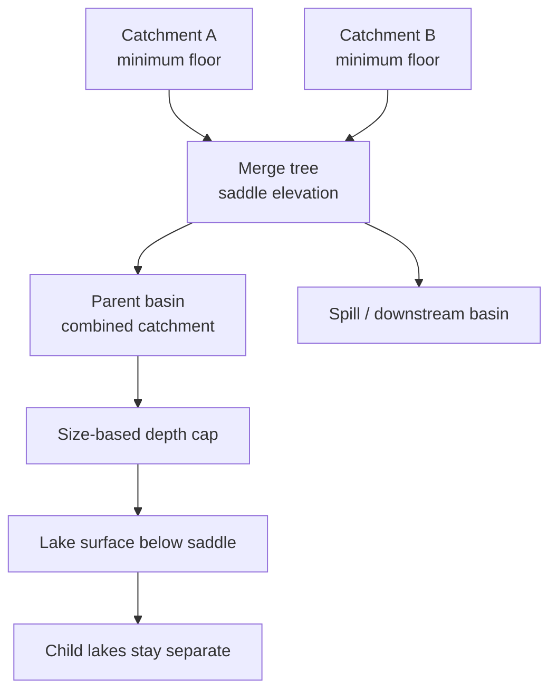

# Hydrology and glaciation

[Back to the Simulation Model index](../simulation-model.md).

## Hydrology: rivers and lakes (`hydrology.py`)

This module implements hydrology over mantle-bloom's irregular per-plate node cloud rather
than a fixed grid. Three core algorithms -- steepest-descent flow
direction, priority-flood basin-spill (lake/depression detection), and elevation-ordered
downstream flow accumulation -- all turn out not to actually need a *grid*, only a *graph*:
a regular 8-neighbor grid adjacency is just one convenient substrate for them. This module
builds a graph instead, via a whole-world k-nearest-neighbor query (`FLOW_NEIGHBOR_COUNT =
8`, the same technique `erosion.py` already uses for its own whole-world slope pass), then
runs the same three algorithms directly on it.

**Persistence comes for free.** A fixed-grid tectonic model has plates moving relative to
its grid, so a persistent field like `channel_depth` needs deliberate semi-Lagrangian
advection every step just to keep following the crust. mantle-bloom's terrain nodes already
rotate exactly with their own plate, so `channel_depth`, `channel_width`, `lake_depth`,
`silt_depth` (see [Lakes](#lakes-are-an-explicit-tree) below), and `glacier_depth` (see
[Glaciation](#glaciation)), stored as ordinary parallel arrays over the plate's cells right
alongside `elevation` itself (see [Why not a grid](foundations.md#why-not-a-grid)), get that same "just
works" persistence for free -- no advection scheme needed, since rotating a plate never
touches those arrays at all. Every cell edit carries them by their `SURFACE_FIELDS` remap
class: preserved where a cell survives, remapped by area, vote or carry where cells merge,
and reset to the field default on a genuinely new cell (generation, boundary advance,
gap fill -- new territory has no history to carry).

`flow_target`/`flow_accum`/`river_speed` are deliberately *not* persisted: recomputed fresh
every step, from that step's real climate -- purely this-step derived quantities, cached on
`World.hydrology_cache` only so a later same-turn caller (rendering) doesn't recompute them
again, the same reuse pattern `climate.compute_climate_cached` already established.
The cratons-first generator makes one zero-duration routing pass to populate that cache at
generation; the first simulation step replaces it with routing from that step's climate.

**Flow routing is computed once, not twice.** It would be simple enough to compute flow
routing twice per step -- once in `hydrology.py` for the real river_flow/rendering fields,
again inside `erosion.py` for the `water_accum` erosion itself needs -- but flow routing here
has no JIT and is comparatively expensive (confirmed: ~70-100ms on a world with a few
thousand land nodes, a real chunk of a step's total cost), so `erosion.py` computes it once
(`hydrology.compute_hydrology`) and reuses the result for both erosion and
`World.hydrology_cache`, rather than paying for it twice.

**Water units** (issue #355). Physical discharge and erosion-only breach forcing now drive the
river model, river presentation uses physical discharge and physical flow-edge length, and
lake silt reads the physical lake inflow (#363). The legacy route is only a fallback now.
Three kinds of water/forcing move along `flow_target`:

- **Physical water**, in m^3/yr: area-weighted Budyko runoff of liquid precipitation plus
  glacier meltwater. It balances the lakes (see *Balanced lakes* below), and its through-flow
  is the river discharge, `HydrologyFields.discharge_m3_s`, in m^3/s.
- **Glacier meltwater** is the ice ledger's per-step volume (`IceLedger.meltwater_m3`: surface
  and basal melt, overflow, ice shed at the depth guard, and snow melting on bare ground)
  divided by the step length (`hydrology.meltwater_m3_per_yr`). Melted ice is booked as
  water 1:1. Calved ice goes to the ocean unrouted, and accumulation
  and frozen river ice stay ice, so none of them is discharge. The ledger is still in the
  glacier model's own units (see [Glaciation](#glaciation)), so meltwater is small next to
  runoff.
- **Frozen river ice** is the physical water that settles at a frozen land node, turned into
  ice at the rate snowfall builds it (`hydrology.WATER_TO_ICE`, which is
  `GLACIER_ACCUMULATION_RATE / 1000`, 1/50,000 of real), a step late. The breach surge never
  becomes ice. Once glacier mass balance is physical (#353), this should convert by mass,
  water at 1000 kg/m^3 to glacier ice at about 917 kg/m^3, and meltwater should too.
- **The breach surge** (`HydrologyFields.breach_surge`) is a spilling lake's erosive forcing,
  sized by node count (`LAKE_BREACH_EROSION_COEFFICIENT`). It is never part of the discharge.
  Its separately-routed accumulation (`breach_surge_accum`) contributes to river erosion only.

`flow_accum` and `water_deposited` come from the older routing: stacked mm/yr of liquid
precipitation, melt and breach surge, with in-transit evaporation that scales with step
length. They grow with node density as well as with rainfall. Every consumer has moved off
them:

| Consumer | Reads | Moves in |
|---|---|---|
| River erosion | physical discharge on the default-density reference scale + `breach_surge_accum` | #355 step 3 |
| Channel width, river speed, deposition gates and River/Lake Inspector flow values | physical discharge | #355 step 3 |
| Geology's river-mouth resource boost | physical discharge at ocean-mouth nodes | #355 step 3 |
| River selection and server-rendered styling | physical discharge | #355 step 4 |
| River network visibility | physical flow-edge length | #355 step 4 |
| Lake silt | physical lake inflow (`LakeClimate.inflow_m3_per_yr`) | #363 |

No live consumer reads `flow_accum` or `water_deposited` any more; they remain only as the
fallback for hand-built fixtures and caches without `discharge_m3_s`.
The fixed reference cell area maps physical discharge back onto the old accumulated-mm/yr
scale at the default node density, making a fixed catchment independent of mesh density.
Because Budyko runoff is smaller than the old raw-precipitation source, the old numeric
erosion and width-growth coefficients did not preserve the default-density outcomes. Step 5
calibrated `RIVER_EROSION_COEFFICIENT` from 100 to 190 and `WIDTH_GROWTH_COEFFICIENT` from
50 to 75 against young and mature density-4 replays; the measured changes and the decision
to leave glacier coefficients alone are in [issue #355's analysis](../../analysis/issue355/README.md).
The breach surge uses the same reference scale for erosion but never contributes to reported
discharge, channel-width growth, deposition, geology or lake silt.

**The core algorithms**, all operating on the k-NN graph:

- **Basin-spill / spill routing** (`lakes.compute_spill_routing`): where a lake's overflow
  escapes to, and at what elevation, feeding `_compute_flow_direction`'s `should_spill` below.
  Formerly a *separate*, independently-computed multi-source Dijkstra priority-flood over bare
  terrain (`hydrology._compute_basin_spill`/`_basin_spill_kernel`, since removed) -- distinct
  from, and never reconciled with, `lakes.py`'s own catchment+Kruskal depression hierarchy
  (below), which is what actually decides lake *detection*/geometry. The two usually agreed
  closely but were evaluated at different times with different lag and could drift apart step
  to step (confirmed against a real save: a merged lake's own fresh water-balance resolution
  showed it hadn't yet reached its true rim, while the old kernel's stale, one-step-lagged
  threshold said it had already spilled). `compute_spill_routing` instead derives
  `filled_elevation`/`spill_target` directly from `lakes.py`'s own hierarchy -- see
  [Lakes](#lakes-are-an-explicit-tree) below for how, making that hierarchy the single source
  of truth for both where a lake *is* and where its water *goes*.
- **Depression breaching** (`breaching.py`, issue #297): before the hierarchy is built, one
  multi-source Dijkstra from the ocean gives every node the least total climb its water must
  make to reach the sea. Each climb costs the time to cut it: through whatever of the cell's
  loose mobile cover (`mobile_cover_m`) is left below its passage, at the weak-rock rate,
  then bedrock at the cell's own rate (slower on cratons). A channel deeper than the cover
  has already cut through it. Water crosses a cell at its *passage* elevation: its centre minus its
  `channel_depth` and any persisted breach notch, but never below its lowest neighbour.
  A pit is breached when three things hold:
  - its climb fits this step's carving budget: 10-100 m per 100 kyr, from craton to loose
    cover, scaled by step length;
  - every node on its path can be cut down to the pit's level within its own carving limit
    for the step, so a breached pit always drains;
  - it would overflow: the water reaching it, routed with the same per-node river losses the
    lakes use, exceeds the evaporation of a lake filled to its rim (`ENDORHEIC_DEMAND_FACTOR`).
    Runoff comes from Fu's Budyko curve, and open-water evaporation rises with temperature.
    Steepest descent carries runoff only to the first pit downhill, so each pit that
    overflows passes its surplus along its least-cost path to the next pit, from the highest
    cost down (`breaching._overflows`). A pit downstream of a chain of pits is judged on the
    river flowing through them, not on its own catchment alone (issue #503).

  Other pits stay closed and are filled as lakes, so dry and arid basins stay real endorheic
  basins. The hierarchy's boundary edges use the notched passages
  (`build_lake_hierarchy(interface_pass_elevation=...)`), and a lake whose outlet is cut to
  its floor and leads lower holds no water. `erosion.py` keeps the notches in their own field,
  `breach_notch_depth_m`, as sub-cell relief, so a breach stays open on later steps. Only the
  passage elevation reads that field: `channel_depth`, which drives the channel boost,
  channel-preferring flow, river evaporation and rendering, records only rock actually carved.
  Both coarsen and merge by max. Channels and notches also fade: sediment and lake silt
  settling in a cell fill them back in (the notch first). Uplift *across* a channel also wears
  it away: how much more a cell rose since the last erosion pass than the cell it drains to,
  as a scarp or bulge rising across the channel's path would. Even uplift raises a channel with
  its banks and leaves it intact. Uplift is measured against `channel_reference_elevation_m`,
  the post-erosion elevation recorded each step. Set `hydrology.BREACH_DEPRESSIONS_ENABLED =
  False` for the old centre-only behaviour.
- **Partial-cell lake flooding** (`lakes.CellHypsometry`, issue #297): a cell's elevation is
  its mean, so its ground is taken as spread evenly over `elevation +/- relief`. The relief is
  half the mean height difference to its neighbours, capped at 500 m. A lake floods each cell
  gradually from its lowest ground, and `lake_depth` is the cell's mean water depth (water
  volume / cell area). Flooded area and volume therefore change continuously rather than by
  whole cells. Lake silt settles over the wet area in proportion to each cell's wet fraction.
- **Balanced lakes** (`lakes.LakeClimate`, issue #297): lakes use real water-balance units.
  Inflow is area-weighted runoff (the same Budyko curve the breach gate uses) plus glacier
  melt, routed as volume (m^3/yr). In-transit river losses on these real-unit flows are a
  fixed per-node fraction, taken at a 100 kyr reference step
  (`hydrology.river_transit_loss_fraction`), so they don't grow with step length. The breach
  gate uses the same losses, and only frozen and ocean nodes are exempt: a spilling lake's
  sink and rim lose their share like any other node. A spilling lake's inflow is the flow
  through its sink.
  Evaporation is the real open-water rate, about 0.3 m/yr at 0 C rising to 1.8 m/yr at 25 C.
  Partly flooded cells evaporate up to 30% faster, since shallow margins warm faster
  (`SHALLOW_EVAPORATION_BOOST`). A real lake reaches balance in years to centuries, far
  inside one step, so each step a lake sits at its balanced level: where its flooded area
  evaporates exactly its inflow, capped at its rim. A lake whose inflow exceeds what it can
  evaporate at the rim fills and spills. Its size is set by its climate, as for real closed
  basins such as the Dead Sea or the Great Basin lakes. Every lake resolves this way: the
  original model-unit fill and evaporation constants, kept only for direct `step_lakes`
  calls in tests, were removed (#358 item 5).
- **Flow direction** (`_compute_flow_direction`): among each node's k nearest neighbors
  strictly below its own elevation (a downhill candidate), prefers whichever one already has
  the deepest established channel (`channel_depth > CHANNEL_PREFERENCE_THRESHOLD_M`),
  falling back to plain steepest descent only when *no* downhill candidate has a real channel
  yet -- real rivers meander within, and stay inside, their own existing valley rather than
  recalculating the mathematically steepest path every step. This is a mantle-bloom addition:
  distinct from (and upstream of) `erosion.py`'s own `channel_boost`,
  which only affects how *fast* a node erodes once water is already routed there, not *where*
  it gets routed to begin with. A sink is -1 if there's no downhill candidate at all -- unless
  the sink's water surface at the start of the step (last step's `lake_depth`, through
  `CellHypsometry`) has already reached its basin's spill point, or that spill point is at or
  below the sink's own centre (a breach notch cut to the floor), in which case it redirects to
  `spill_target` (turning a filled-past-its-rim lake into a normal through-flowing river
  cell). A node whose annual mean is below `FREEZE_POINT_C` (see [Glaciation](#glaciation) for
  why this is a separate, warmer threshold than the one permanent glaciers use) is unconditionally forced to
  -1 *after* the should_spill check above, rather than folded into the same check: an
  ordinary, unobstructed downhill node has `filled_elevation` exactly equal to its own
  elevation, so forcing it to look like a sink first would make it trivially satisfy
  `water_surface >= filled_elevation` and get redirected right back onto its own normal
  neighbor via `spill_target` -- silently undoing the freeze for most ordinary terrain (caught
  directly by this module's own test coverage). Applying the override to the final
  `flow_target` instead has no such escape hatch.
- **Spilling within the step** (`_spill_within_step`, issue #503): the spill test above and
  `lakes.compute_spill_routing`'s choice of governing rim both read last step's water, but a
  100 kyr step's inflow fills most basins many times over. After routing the physical water,
  every governing basin (`lakes.governing_bodies`) whose inflow, net of a rim-level lake's
  open-water evaporation, fills its remaining room opens its outlet, and the water is routed
  again. Basins whose spills run into each other form a `flow_target` cycle; they are united
  at their lowest common ancestor in the hierarchy, which spills at its own rim if this step's
  water fills it and otherwise holds the water as one lake. A cycle that runs through a
  channel into a neighbouring catchment instead (channel-preferring flow can cross the
  steepest-descent catchments the hierarchy is built on) sends that node down its steepest
  descent. Repeats to a fixed point (`SPILL_WITHIN_STEP_MAX_ROUNDS`). Without it, a river
  crossing a chain of dry pits advanced one pit per step, and basins filling in the same step
  spilled into each other indefinitely. A frozen sink still holds its water.
- **Downstream accumulation** (`route_downstream`, public -- `erosion.py` reuses it
  directly): a single forward sweep over land nodes in elevation-descending order,
  accumulating a source quantity (precipitation, for `flow_accum`; eroded material, for
  erosion's own deposition pass) along `flow_target` edges, weighted by a `retain_fraction`
  per edge (deposited locally, e.g. sediment) and, as of the moisture-recycling addition, a
  separate `loss_fraction` per edge (in-transit river evaporation, `RIVER_EVAPORATION_*`) --
  unlike a retained share, a lost share simply vanishes rather than being added to `deposited`,
  since it left as atmospheric moisture rather than staying in the channel. Correct in one
  pass because every node's target is guaranteed strictly lower, so it's always visited
  *later* in this same order.

**Conceptual diagram — catchment floors join at a saddle; a size-limited depth tier can leave the merged lake surface below that saddle, preserving separate child lakes.**

The merge tree records nested catchments, floor minima and saddle elevations. Lake depth tiers
cap depth by basin size; a capped surface below the saddle does not inundate the higher
catchment, so child lakes remain separate. The sketch shows topology, not a numeric elevation
profile.

**Lakes are an explicit object tree (`lakes.py`, not `hydrology.py`)**, replacing an earlier
flat per-node flood-fill design (`update_lakes`/`_flood_fill_lake_extent`, since removed).
That design fixed a real bug of its own (letting every previously-wet node, not just the
literal sink, carry its own depth forward and become a flood-fill seed -- see the surrounding
history preserved in `hydrology.py`'s own module docstring), but even with two added rate
limits (a hop budget on growth into new territory, a hard cap on per-node depth change per
step) it only bounded how *fast* a lake's flood-fill could grow, not whether it ever reached a
real equilibrium: a sufficiently large, gently-sloped catchment could keep creeping outward
step after step without ever stopping. `lakes.py` instead computes each basin's actual
floor/rim geometry directly, so a lake's maximum extent is known immediately rather than
discovered incrementally, which is what actually fixes that runaway-growth failure mode.

The core data structure is `lakes.Lake`: an n-ary tree built by `build_lake_hierarchy`, a
two-phase algorithm -- a "depression hierarchy" / "watershed by immersion" technique (Barnes et
al.'s fill-spill-merge family), adapted from a regular grid to this codebase's k-NN graph:

- **Phase 1** assigns every node to the catchment of the true local minimum its own *pure*
  steepest descent (not `_compute_flow_direction`'s channel-biased version -- a routing
  concern, orthogonal to basin geometry) eventually drains to, or marks it as draining
  straight to the ocean if that chain never passes through a land local minimum first. Without
  this phase, a naive merge over every raw graph edge would wrongly treat every intermediate
  ridge/rim node passed on the way down to the ocean as its own trivial one-node "lake"
  (confirmed directly during development). Every genuine catchment gets a leaf `Lake` eagerly,
  not lazily on first merge -- a catchment that never merges with anything (a real, fully
  enclosed endorheic basin with no ocean anywhere reachable) would otherwise never get a `Lake`
  object at all, despite being exactly the "no known spill, could fill indefinitely" case this
  needs to represent.
- **Phase 2** walks catchment-boundary edges (weighted by `max(elevation[i], elevation[j])`,
  the saddle/col height a path between them is forced to cross) in ascending order,
  union-finding catchments together -- Kruskal's minimum-spanning-tree construction, except
  the "tree" being built is the *merge tree* of the elevation field itself. A lake's own
  `max_depth` is just the elevation of the very next merge event it takes part in, whether that
  unions it with a sibling lake (creating a parent, whose own `min_depth` is that same
  elevation -- "the point where the basins split") or with the ocean (finalizing it as a root)
  -- both are "reaching the top of the basin," one spilling to another basin, the other to the
  sea.

Each step, `compute_hydrology` builds this hierarchy fresh from current terrain
(`lakes.build_lake_hierarchy`, bare `elevation` -- see below) -- consistent with
`flow_target`/`flow_accum` above being recomputed fresh every step rather than advected --
*once*, early (before flow direction, so `compute_spill_routing` above can use it), then reuses
that same tree object later in the step (`lakes.resolve_lakes`) to resolve every lake's own
water balance top-down, rather than paying for a second, redundant rebuild that could drift
from the one spill routing already used. `lakes.step_lakes` -- `build_lake_hierarchy` +
`resolve_lakes` in one call -- still exists for any caller (tests, mainly) that just wants
"lakes for this terrain, resolved" without needing to reuse the tree for anything else.
`resolve_lakes` resolves every lake's own water balance top-down: each lake sits at its
balanced level (see the `LakeClimate` bullet above), where evaporation over its flooded area
equals its real-unit inflow summed over every one of its own members (more than one can be a
true sink once several originally separate basins have merged), clipped to
`[dry level, max_depth]` and its lake-vs-sea tier ceiling.
Tracking a lake's level as one scalar shared by every member, rather than a per-node depth, is
what removes the old design's threshold-crossing failure mode entirely. Merge/split
transitions fall out of comparing this against each lake's own `min_depth`: a still-separate
child whose own new level reaches its parent's saddle promotes to one merged body (pinned at
exactly the saddle, continuity); an already-merged lake whose new level recedes below its own
saddle demotes back into its children (both starting at exactly the saddle, continuity in
reverse). No cross-step `Lake`-object registry is needed for any of this -- see
`lakes.py`'s own module docstring for why continuity is instead derived from the same
persisted `lake_depth` array (`elevation + prev_lake_depth`, the same "last step's water
surface" the old per-node design itself already used) rather than matching this step's
freshly-rebuilt tree against last step's by member-overlap, which would be fragile to a tree's
exact shape shifting from ordinary terrain churn even when nothing physical about the lake
changed.

**Lakes accumulate silt.** `silt_depth` (a persistent per-node field, carried exactly like `lake_depth`) is a
small volume fraction (`SILT_ACCUMULATION_COEFFICIENT`, m^3 of silt per m^3 of water) of the
same real inflow that sets the lake's level, including the flow through a spilling lake's
sink, settling permanently (monotonically -- silt never erodes back away) on a lake's own bed.
Because it's sized in m^3/yr, a catchment silts the same at any node density, and the breach
surge never reaches it (#363). The coefficient keeps the total silt laid down under the
earlier model-unit rule, which read `water_deposited`, on a reference replay
(`analysis/issue363/`). That old rule gave a spilling lake almost no silt beyond the surge. `erosion.py` folds each
step's `silt_deposited` straight into real terrain `elevation` (like every other deposition
pathway), so `build_lake_hierarchy` builds every hierarchy from bare `elevation` -- last
step's fill is already baked into it, no separate `elevation + silt_depth` effective floor
needed -- a small, low-inflow lake can plausibly silt in entirely over a long enough run: once
its floor has risen to meet the surrounding rim, it stops registering as a local minimum at
all (steepest descent no longer sees a depression there), and the lake disappears outright,
exactly the "reaches ground level" case a lake should eventually hit.

**A frozen lake still silts in (2026-09-14).** `_water_balance` forces a lake with any member
below freezing (`hydrology.FREEZE_POINT_C`, the mild 0C threshold -- a seasonally-freezing lake,
not necessarily a permanently ice-locked one) to report its own dry floor -- no visible standing
water this step. It used to also skip silt entirely while frozen ("no liquid water to carry
suspended sediment"), but that made a *chronically* frozen catchment (common at altitude/
latitude on an old, rough world) accumulate literal zero silt forever, no matter how much inflow
reached it -- one of the two ways a pit can genuinely "never hold water, get nothing" named in
GitHub issue #117 ("Lake-hierarchy caterpillar trees"), where thousands of tiny, often
sub-freezing catchments each stay their own permanent `Lake` leaf instead of silting into their
neighbors, producing merge-tree depths in the thousands on old, rough worlds. Real meltwater
still carries a suspended sediment load that settles onto the bed even when the surface won't be
reported as open water, so silt now still deposits from this step's inflow while frozen -- only
the reported water level (and sea-tier promotion) stays gated on not being frozen.

### Lake vs. sea tiers: a depth ceiling by size (2026-09-10)

Before this, a closed basin's only depth limit was its own real geological rim (`max_depth` --
unbounded for a genuinely endorheic basin) -- so a large, gently-sloped drainage catchment
could keep filling for hundreds of My with nothing to say "this is now physically implausible."
Confirmed directly on a 286 My save (seed 931964976): the largest closed basin had grown to
~4.84M km^2 and 4,626 m deep, sitting right at its own real spill point -- 13x the Caspian
Sea's actual area and 4.5x Lake Baikal's actual (the real deepest lake's) depth. `lakes.py`
also had no notion that a basin this size should behave any differently from a five-node pond,
climatically or visually.

`lakes._classify_tier(members, prev_lake_depth, node_area_km2)` decides, per lake, per step,
whether it counts as **sea tier**: its own *prior* step's flooded extent (not the depth this
step is about to compute -- the same "read the already-persisted array" idiom `_prev_level`'s
own `already_merged` check already uses, avoiding a chicken-and-egg loop) covers at least
`SEA_MIN_FLOODED_AREA_KM2` (200,000 km^2 -- between the historical Aral Sea and the Caspian).
`node_area_km2` is derived once per call from `4*pi*R^2 / len(elevation)`, not a node count, so
the threshold is resolution-invariant without threading `world.node_density` into a module that
otherwise takes only bare arrays. Each tier gets its own depth ceiling, folded into
`_water_balance`'s existing `cap_depth` alongside the real rim (`cap_depth = min(rim_cap or
inf, tier_max_depth)`) -- `LAKE_MAX_DEPTH_M` (1,800 m, comfortably above Baikal's real 1,642 m)
for an ordinary basin, `SEA_MAX_DEPTH_M` (3,500 m, deeper than the Caspian's real 1,025 m --
a simulated rift-sea basin can plausibly run deeper, but not unbounded) once promoted. Both are
first-pass estimates pinned to those two real-world reference points, not swept.

**The cap doubles as the fix for "smaller lakes should split apart" rather than staying
pathologically merged.** It applies at whichever `Lake` node `_resolve` is currently
resolving, leaf or already-merged composite alike -- so a composite lake's own rise is capped
too, not just a leaf's. A depth ceiling low enough to matter sits below some basins' own
internal merge saddles, so a composite that only stayed merged because nothing capped its rise
can fall back below its own `min_depth` and split on the very next `_resolve` pass, using the
ordinary split mechanism `build_lake_hierarchy`'s merge tree already provides -- no new
mechanism needed, just removing the thing that let a merge become permanent regardless of
whether the water level could actually still support it.

**The split reset had to change too, or the cap oscillates forever instead of ever actually
shrinking anything.** `_resolve`'s existing split branch reset both children to exactly
`node.min_depth` regardless of how far below it `new_level` had fallen -- a fine approximation
for an ordinary organic dip (the two sides really were still at that shared saddle a moment
ago), but wrong by a wide margin when the *tier cap*, not evaporation, is what pushed
`new_level` down: resetting to the stale `min_depth` completely undoes the cap for this step's
reported depth, and -- confirmed directly on the 286 My save above, as a genuine infinite loop,
not just an approximation error -- the very next step's `_prev_level` check reads that reset
value as still exactly `>= min_depth`, re-merges into the identical capped computation, and
splits again, forever, with the depth never actually decreasing. `max_depth` being a real rim
can never trigger this on its own (a rim is always `>= min_depth` by construction, so a
rim-bounded `new_level` can never itself fall below `min_depth`) -- only a tier cap, independent
of the tree's own topology, can. The fix: when `new_level` lands at or past `tier_max_depth`
above the floor (the exact, checkable signature of "the tier cap bound this, not organic
decay"), both children reset to that real, capped `new_level` instead of `min_depth` (each
clamped to its own `floor_elevation`, since one child's floor can sit above the merged body's
overall floor, in which case that child now reads as dry rather than negative-depth) -- a
genuinely lower value the next step's `_prev_level` reads as *not* still merged, so it resolves
each child independently instead of re-entering the same losing computation. The mirror-image
case needed the same fix: the merge branch (two children rejoining) also folds the merged
body's own `_classify_tier` cap into its `min(node.min_depth, floor + tier_max_depth)` result,
not just `node.min_depth` -- without it, a child large enough to independently reach the saddle
on its own (legitimate: a child that itself classifies sea tier can grow past an internal
saddle below `SEA_MAX_DEPTH_M`) would merge back up past the cap the split just enforced, only
to be capped and split again next step. Both fixes are pinned in `test_lakes.py`'s own
`test_a_composite_lake_held_below_its_own_saddle_by_the_tier_cap_splits`, which re-resolves a
second time from the first split's own output and asserts no immediate repeat split. Verified
on the 286 My save: the largest basin's own reported depth, previously frozen forever at 4,626
m (an exact, unchanging fixed point under both bugs), now converges to a stable ~3,340 m within
a handful of resolution passes and stays there.

**Known residual, not chased further: some steady-state merge/split churn remains, invisible
to the player.** On the same save, replaying `lakes.step_lakes` repeatedly against *frozen*
terrain/inflow (an artificial worst case -- real gameplay's climate, silt, and tectonics all
change every step) still shows a stable ~13 splits / ~56 merges per pass, sphere-wide, once the
depth itself has settled -- smaller basins trading membership back and forth without the depth
bound ever being violated again. This never reaches the player: `erosion.py`'s own comment
already documents that lake merge/split transitions are deliberately *never* routed to
`World.log_event` at all (even the near-sea-level-aggregated ones "churn constantly along a
dithering coastline and drown out the genuine tectonic events" -- see `summarize_lake_events`),
so this is purely internal tree-topology churn, not a console-spam regression. Worth a closer
look if it turns out to cost real per-step time on a large save, but not otherwise pursued here.

**Sea tier reaches climate and rendering, not `hydrology.is_ocean`.** `resolve_lakes` returns
a new `(N,) bool` `lake_is_sea` array (`HydrologyFields.is_sea`, same "recomputed fresh every
step, no persistent identity" contract as `lake_depth` itself), true for every currently-wet
member of a sea-tier lake. `climate.py`'s `_land_moisture_source` picks `SEA_EVAPORATION_
CEILING` (1.0 -- well above `LAKE_EVAPORATION_CEILING`'s 0.5, still short of open ocean's own
`MAX_EVAPORATION_CEILING` 1.4, since a big enclosed sea has no current-driven mixing/upwelling
replenishing its surface the way the open ocean does) over a sea cell, so a large enough basin
now visibly drives more downwind humidity -- the "generating humidity" a real inland sea does.
`render_image.py` draws a sea cell in a distinct, more saturated `SEA_COLOR_RGB` (both the
Biome/Combined grid and the Elevation/Plates lattice), with its own Combined-view alpha id
(`COMBINED_SEA_ID_CODE`) and legend row ("Salt Sea") for click-to-highlight. Deliberately
**not** folded into `hydrology.is_ocean`: no ocean currents, ocean-temperature advection, or
pelagic biome classification -- a sea tier basin is still a closed body, just one with
sea-strength evaporation and a sea-blue tint, not the connected-ocean machinery a genuinely
open, current-driven body assumes. `is_sea` isn't a value persisted on the plates themselves
(unlike `lake_depth`/`channel_depth`) -- both climate.py and render_image.py resample it from
`world.hydrology_cache` per call (`hydrology.sample_is_sea`), the same up-to-one-step-stale
tolerance and all-False-fallback contract `hydrology.sample_is_ocean` already established for
`is_ocean`.

A river's own `flow_target` can point at a node that's genuinely part of a lake (real inflow),
but a flooded node is never itself classified `is_river` -- checked against this step's
*final* lake extent, after `lakes.step_lakes` runs, not the flat land/ocean split alone -- so a
river's own classification ends at the lake's shore rather than jumping straight across the
water to whatever's on the far side, even though the water itself (`flow_target`/`flow_accum`)
still physically continues through if the lake is spilling.

**A spilling lake erodes its own outlet hard**, proportional to the lake's own surface area,
not just the ordinary precipitation-driven flow passing through that one channel node. Once a
sink's `should_spill` fires (see `_compute_flow_direction`), `compute_hydrology` adds an extra
term into `water_source` right there -- `LAKE_BREACH_EROSION_COEFFICIENT` times the node count
of that lake's own connected component (`_lake_component_sizes`, a union-find grouping over
the same k-NN graph flow routing uses; no separate "physical area" concept exists elsewhere in
this codebase, so node count is the same implicit area proxy `flow_accum` itself already
relies on). That extra term then rides `route_downstream` downstream through the whole outflow
channel exactly like real precipitation would, so it's already fully picked up by erosion.py's
existing river-erosion and channel-growth formulas with no changes needed there -- both
channel_depth and channel_width grow from it automatically. This models a real phenomenon a
plain per-node flow_accum can't: a large standing lake finding an outlet carries far more
erosive force at that point than an equivalent ordinary river of the same instantaneous
discharge, because the whole reservoir sits behind a narrow breach rather than just whatever
rain fell immediately upstream this step -- confirmed directly against a real generated world
that a several-hundred-node lake's breach source (in the low millions) dwarfs the handful of
millimeters of ordinary precipitation reaching that same point, carving its spillway down
hard rather than leaving a shallow, precipitation-scale groove.

That same surge is also added directly at the lake's own rim member (`Lake.outlet_node_idx`,
exposed by `lakes.compute_spill_routing` as `rim_node_idx` alongside `spill_target`) -- not
only at the sink it's routed from. The sink's own `flow_target` jumps straight to
`spill_target` (the node on the *far* side of the governing boundary edge, outside the lake
entirely), never actually passing through the lake's own rim member at all, and which of the
edge's two members is the higher one -- the real bottleneck a spillway has to cut through -- is
roughly a coin flip (confirmed directly with a small synthetic basin). A sink-only surge left
the true dam untouched, and its `max_depth` fixed, whenever the lake's own rim happened to be
that higher side: the lake could spill for the rest of a run without its cap ever dropping,
since `build_lake_hierarchy` recomputes that cap fresh from `elevation` every step. Injecting
the same term at both members erodes the true bottleneck regardless of which side it's on,
which is what actually lets a long-spilling lake grind its rim down and, given enough
simulated time, drain.

**Channel width** (`channel_width`, grown in `erosion.py` alongside `channel_depth`) is a
mantle-bloom addition: standard hydraulic-geometry scaling (width ~
discharge^0.5, the same discharge exponent `RIVER_EROSION_COEFFICIENT`'s own stream-power law
uses) but with no slope term at all -- width is driven by how much water passes through, not
by gradient, so a slow, wide lowland river and a narrow, steep mountain torrent can carry
comparable discharge without needing comparable width. Persistent, monotonically non-
decreasing, capped at `MAX_CHANNEL_WIDTH_M`, the same shape `channel_depth` already has,
rather than a stateless function of the current step's flow alone -- a river that temporarily
dries up doesn't instantly narrow either. Drives both river rendering's color/width blend and
the hillshade-carved-canyon effect below (issue #190) -- not surfaced in the River Inspector's
own per-river stats (`hydrology.RiverInfo`), which stays flow/topology-only.

**Rendering.** Both baked directly into the existing elevation/plates/platesDetail views
(no new map-view mode or API surface needed): lakes are always visible, with no separate
overlay toggle needed. Lake cells use
a muddier, less-saturated blue than open ocean (`render_image.LAKE_COLOR_RGB`) via the same
nearest-neighbor grid resample `_render_grid_arrays` already does for elevation/plate_id
(`plates.collect_all_lake_depth`, index-aligned with `plates.collect_all_points`'s own
output so both can share one `cKDTree` query). Rivers are drawn as short line segments, one
per drawn `is_river` node to its own `flow_target`. Which segments and how they look is
`render_image._rivers_to_draw`: every `is_river` node with a real downstream `flow_target` and
a `channel_width` past the small `RIVER_VISIBLE_MIN_WIDTH_M` creek floor is a candidate, not
just the strongest few networks by mouth flow -- dropped along with the old node_density-scaled
`RIVER_DRAW_MAX_NETWORKS_BY_NODE_DENSITY`/`RIVER_DRAW_MIN_FLOW_BY_NODE_DENSITY` network-rank
cap. Downstream of a drawn segment, every `is_river` node is drawn too, to the river's mouth,
at no less than the channel width upstream (`_extend_drawn_rivers_downstream`): a river's last
cells before the coast are often new or reset cells whose channel is still narrower than the
floor, and the line used to stop one to three nodes short of the sea (issue #503). Color and line width are driven by two different, deliberately decoupled measures of "how
big":

- **Color** is a *percentile rank* of `channel_width` among this same render's own currently-
  drawn segments (`render_image._percentile_rank`), not a fraction of any fixed physical or
  per-network scale -- both were tried and rejected (see issue #190's discussion): `is_river`
  already only selects each catchment's own highest-flow tail, so most drawn segments sit close
  to whatever fixed denominator you pick, reading as uniformly bright with barely any visible
  head-to-mouth gradient. A percentile rank is spread evenly from `RIVER_COLOR_BLEND_MIN_FRACTION`
  (this render's own narrowest visible channel) to 1.0 (its widest) by construction, while
  staying exactly monotonic in `channel_width` -- so a real confluence (a genuine local width
  increase) still visibly brightens everything downstream of it toward the river-blue overlay
  color.
- **Line width** is a percentile rank of physical discharge instead, floored at a much steeper
  `RIVER_WIDE_MIN_PERCENTILE` (only a genuine top few percent of drawn segments ever widen past
  1px). Discharge, not `channel_width`, because `channel_width` only ever grows (see
  `erosion.py`) and, confirmed directly against a real 60My-old run, its *median* across every
  currently-drawn segment already sits within 1% of the physical `MAX_CHANNEL_WIDTH_M` cap --
  it has essentially no discriminating power left at world maturity, so an absolute
  `channel_width` threshold either caught most of the map or nothing. Physical discharge has no such
  ceiling and still meaningfully separates a world's few truly major rivers once `channel_width`
  has saturated for most of what's drawn.

A segment whose color percentile doesn't clear the visibility floor is skipped entirely before
either measure is computed -- the tint would be imperceptible, so there's no point paying for
the draw call -- which is what keeps drawing every network cheap even though there's no longer
a fixed cap on how many get considered. A segment that does draw wider than 1px gets a two-pass
cross-section (`RIVER_CORE_WIDTH_FRACTION`/`RIVER_HALO_FILL_FRACTION`): a full-width, dimmer
"halo" first, then a narrower full-color "core" on top, so its outer edge visibly blends toward
the land color while its centerline stays close to full river-blue, instead of reading as one
flat, uniformly-blended slab. The River Inspector also filters short networks for legibility,
using a 1,875 km physical-length cutoff (the former 30-node threshold at default
`node_density=4`). The cutoff stays fixed as mesh density changes. River selection itself uses
physical discharge, so breach-only erosion paths cannot appear as physical rivers.

**Canyons via hillshade (issue #190).** A channel deep past `CHANNEL_INCISION_MIN_DEPTH_M`
and wide past `CHANNEL_INCISION_MIN_WIDTH_M` (ramped over `CHANNEL_INCISION_WIDTH_RANGE_M`) has
that incision subtracted from its node's own elevation before `render_image._hillshade_for_world`
fits its local surface gradient -- so a real canyon shows up as genuinely lit/shadowed relief
the same directional way a mountain ridge already does, rather than the flat multiplicative
darken (`_channel_visible_shade`) this replaced. A channel that's deep but too narrow for this
node spacing to resolve stays invisible, matching how a real relief map sampled this coarsely
wouldn't show it either.

Confirmed live on a real run: river networks render as visibly branching, dendritic
drainage patterns converging toward coasts and lake basins, matching real-world drainage
network shapes; channel_depth grows from 0 to several hundred meters over tens of Myr
without instantly saturating at `MAX_CHANNEL_DEPTH_M`; lakes form, merge, split, and
fluctuate in count/depth across many steps rather than either vanishing or ratcheting
monotonically upward, staying a small fraction of a world's total land nodes even after many
steps rather than creeping to cover a whole continent; `is_river & is_lake` never overlaps on
a real stepped world (a river's own classification genuinely stops at a lake's shore).

## Glaciation (`hydrology.py`)

**Freezing uses the annual mean; melt uses an imputed seasonal cycle.** `FREEZE_POINT_C` (0C,
the real phase-change point) governs whether precipitation falls as snow/ice rather than rain,
and whether standing lake water or flowing river water freezes solid *this same step* -- a node
whose annual mean is below it never holds liquid water at all: any precipitation there is
treated as fully frozen (no partial liquid/frozen split, matching `erosion.py`'s existing "use
precipitation is enough" simplification), an existing lake sitting there freezes solid into
`glacier_depth`, and a river reaching it stops flowing entirely this step.

A step spans thousands of years or more, so seasons are never stepped through, but their
effect on glacier melt is imputed (issue #275 phase 2). Each node gets a seasonal
half-amplitude from `biomes.seasonal_temp_amplitude` -- the same latitude x continentality x
axial-tilt synthesis Köppen classification uses ([Biomes](climate.md#biomes)), plus a relief boost of
`_SEASON_RELIEF_GAIN_C_PER_KM` (2.5C/km above sea level, saturating at 8C) for the larger
swings of mountain valleys -- computed in `erosion.apply_erosion` and passed to
`compute_hydrology` as `seasonal_amplitude_at_nodes`. Surface melt then scales with the mean
positive degrees above `GLACIER_MELT_THRESHOLD_C` (0C) of a sinusoidal annual cycle around the
annual mean (`hydrology.seasonal_positive_degrees`, a closed-form positive-degree-day
integral). A valley at -8C with a 15C half-amplitude thaws every summer and melts; a maritime
cell at the same -8C with a 4C swing never does. The ice margin settles where a summer's
positive degrees just balance snowfall -- for typical precipitation, where the warmest month
sits a degree or two above freezing (about -12.5C annual mean under a 15C half-amplitude),
close to real glacier equilibrium lines. With zero amplitude (a tilt-0 world, or a caller that
passes none) melt starts at a 0C annual mean.

This replaced `GLACIER_ACCUMULATION_TEMP_C` (-10C), a fixed annual-mean floor below which ice
never melted -- a stand-in for seasons that kept permanent ice in high-amplitude continental
and mountain interiors whose summers are well above freezing, while melting ice in
low-amplitude places that never thaw. A node at, say, -3C still freezes its lake/river solid
every step, and the ice it forms still melts back at a real rate when its summer clears 0C.

Freezing happens *before* `flow_target` is (re)computed, so a lake that
just froze is correctly treated as a genuine sink again this step rather than immediately
re-filling from this same step's routed water (see `lakes.step_lakes`'s own docstring). This
ordering avoids a specific failure mode: without the freeze-before-routing ordering and an
`is_frozen` gate on `lakes.step_lakes`'s own inflow/pin-at-cap logic, a lake formed in a
warmer epoch would never freeze, and a just-frozen basin would re-flood back to its old cap
the very same step, double-counting the same water as both a lake and a glacier at once.

**A frozen river doesn't just vanish.** `_compute_flow_direction` forces a frozen node's
`flow_target` to -1 unconditionally (see [Hydrology](#hydrology) for why this override can't
reuse the ordinary should-spill escape valve a genuine closed-basin lake gets) -- water
arriving there this step has nowhere to go, so `route_downstream` settles it in place, and
the physical water settled there (see *Water units* above) is folded into `glacier_depth`
right after routing finishes (the ice solve already ran by then, so this newly-frozen river ice
joins its ice body from next step onward -- an explicit one-step lag the ice ledger books,
see below). A river's flow also loses a
real, evaporating fraction of itself every step it's *not* frozen (`RIVER_EVAPORATION_*`,
applied as `route_downstream`'s new `loss_fraction`, distinct from `retain_fraction`'s
locally-deposited share -- an evaporated share simply vanishes rather than settling anywhere)
-- warmer nodes lose more, capped well short of 1.0 so a single very large step can't
evaporate an entire river in one hop. In the legacy `flow_accum` routing, it's excluded at
an already-frozen node (already blocked above) and at a spilling lake's own breach node
(`should_spill`, see [Hydrology](#hydrology)): that term already models a lake's concentrated overflow surge sized purely from its own
surface area, and shouldn't also lose a further fraction to evaporation in the very same step
it's cut loose. This evaporated water is genuinely lost from the river system, and is exactly
half of the "rivers, lakes, and vegetation release moisture" ask (see [Climate](climate.md#climate)'s own
"Moisture recycling" section for the other half -- that lost moisture actually reappearing as
atmospheric humidity, which for architectural reasons can't be the literal same-step amount
this module evaporates, since climate.py runs *before* this module each step).

- **Accumulation and melt rates**: `GLACIER_ACCUMULATION_RATE` converts frozen
  precipitation into metres of ice per Myr. The same rate, as `WATER_TO_ICE`, converts the
  physical water a river settles when it freezes solid at a cold sink, and a standing lake's
  `lake_depth` when the lake freezes (issue #503).
  `GLACIER_MELT_RATE_M_PER_MYR`, scaled by the seasonal positive degrees over
  `GLACIER_MELT_REFERENCE_DEGREES_C` (capped at `GLACIER_MELT_MAX_FACTOR`; see above), is the
  surface melt. Where these rates apply, and to how much ice, is the ice-body solve below.
- **Ice bodies and the volume contract** (`ice_sheet.py`, issue #353). Ice no longer flows one
  hop down the bed each step. Each step `ice_sheet.step_ice` groups ice into **bodies**:
  connected components, over the symmetrised k-NN graph, of nodes that hold ice or have
  positive surface balance at the reference surface (bed + last step's ice). A body's volume
  is conserved: its opening volume, `sum(glacier_depth * area)` plus any lake that froze into
  it this step, changes by exactly the step's accumulation less surface and basal melt, less
  calving and overflow. The ledger (`HydrologyFields.ice.ledger`, per body in `.bodies`)
  closes to round-off, and ice is never created.
- **Backward-Euler extent.** Each body's candidate extents form a nested family: `phi` is the
  signed graph distance from the edge of its positive-balance area S (negative inside, two
  scipy Dijkstra passes), and the extent at margin position `d` is every node with
  `phi <= d`. The step solves `V(d) = V_open + dt * B(d)` for `d`, with B summed on the
  solved surface: accumulation where it snows (`GLACIER_ACCUMULATION_RATE` per mm/yr), minus
  the positive-degree surface melt on the imputed seasonal cycle (see above), minus
  geothermal basal melt on a thawed bed, with the surface `LAPSE_RATE_C_PER_KM` colder per km
  of ice. Positive-balance bare ground also feeds the body its snow. So accumulation
  *magnitude* matters, not just its sign. The root is bracketed by walking outward one edge
  at a time from last step's extent, and the one nearest it is kept: a higher sheet is
  colder, so B can change sign more than once, and the nearest root preserves Weertman
  (1961) hysteresis (a plateau that is bare stays bare; a covered one keeps its sheet). For
  a step much longer than the ice's response time the root is the steady state B = 0; for a
  short one it is the explicit `dV = dt * B`. Mass balance is still in model units
  (`GLACIER_ACCUMULATION_RATE` is ~50,000x slower than real snowfall; converting it as #297
  did for lakes is issue #353's open decision), so the ice is *not* assumed to be in balance
  within a step.
- **Plastic geometry.** Within an extent, the ice takes Nye's (1952) perfectly plastic
  profile, `|grad s| = c / H` with `c = tau_b / (rho_i g)` (11.1 m at 100 kPa) -- a geometry
  approximation, as ICESHEET (Gowan et al. 2016) uses it for reconstruction, not a claim that
  the ice is in steady state. It is solved by an ordered upwind (fast-marching-style) numba
  sweep on the symmetrised graph: each node takes the earliest arrival over its accepted
  neighbours of `((H_i + H_up) / 2) * (s_i - s_up) = c * dx`, which is exact along a straight
  flat-bed path, monotone, causal, and never divides by H. The margin sits inside each
  frontier edge, placed by interpolating `phi` to `d`, so V(d) is continuous and
  nondecreasing for the root find; a cell holds the ice on the halves of its edges (H^2
  linear along an edge, exact for Nye's flat-bed profile), so margin cells hold the right
  volume at 60-180 km spacing. On a flat bed the divide thickness and volume match Nye's
  analytic dome within 1% and 4% at node densities 0.5-4, on square and hexagonal lattices.
  A bed bump above the surface pokes through as a nunatak.
- **Yield stress and thermal state.** A bed is warm-based once steady conduction brings it to
  the pressure-melting point, `T_s + G H / k >= -8.7e-4 H` (G = 60 mW/m^2 for now, k = 2.1;
  about 700 m of ice at -20 C). `tau_b` is 100 kPa on a frozen bed or bare rock, falling to
  30 kPa on a thawed bed with `ICE_SOFT_BED_COVER_M` of mobile cover. The yield stress uses
  last step's thermal state (a one-step lag). Basal melt is `G / (rho_i L_f)` (~6 mm/yr of
  real ice) scaled into the same model units as accumulation; it replaced the old
  depth-squared basal melt, whose only job was to stop ice piling up on flat beds where
  bed-slope flow left it.
- **Bed and flotation.** The thickness solve and the flotation test use the unloaded bed,
  `elevation - ice_load_deflection_m`, which is the bed `lithosphere.grounded_ice_load_kg_m2` loads. A
  cell keeps ice only where that function would give it a load, so stored ice is grounded
  exactly where it loads its column. Margin points with a bed below sea level carry the
  flotation thickness (a grounding line), so grounded marine ice keeps a real surface
  gradient. The mass-balance surface is the current, already-depressed elevation plus the
  ice, a one-step lag on the deflection.
- **Sinks.** Surface and basal melt, and snow that melts on bare ground, go into that step's
  `water_source` at the node where they melt, so rivers route them and lakes can trap them.
  A body that can't hold its volume even at its largest grounded extent is *saturated*: the
  excess calves if it has a marine margin (booked as `calved_m3`, never routed: it goes
  straight to the ocean), or leaves its margin as meltwater otherwise. Calving from a partly
  marine margin that isn't saturated is not modelled (a body keeps growing inland until it
  balances), so this under-states calving from Greenland-like sheets. Ice afloat on the
  ocean outside the ice-age sea-ice cap calves. Eustasy reads only `glacier_depth` and lake
  depth, so every sink returns its water to the ocean's budget.
- **Liquid water freezes on cold ground only.** A standing lake, a river crossing a node and
  the water settling at a sink freeze only where the annual mean is below `FREEZE_POINT_C`
  (`water_frozen` in `compute_hydrology`). Snowfall over an ice cap on warm ground still falls
  as snow (the `is_frozen` rule above), but rivers and meltwater on that ice drain along the
  ground, and a lake beside or under it stays water. Frozen in place, a river reaching a warm
  ice node rebuilt it every step: a 36,000 m^3/s river held a single-node, 600 m ice plug at
  +0.4C, the ice's own meltwater refroze there too, and frozen river ice outgrew snowfall
  twofold (issue #503).
  Lakes balance in real units since #297, so a lake on warm ground under ice refills with
  runoff and meltwater every step. A lake that does freeze turns into ice at `WATER_TO_ICE`,
  the rate river water does. Frozen 1:1, real-unit lake water fed the ice about 35x faster than
  all snowfall (in model units), and once basins filled within the step that grew the ice by a
  third in 10 Myr (`analysis/issue503/README.md`; see also `analysis/issue353/README.md`).
- **Thickness guard.** `GLACIER_MAX_DEPTH_M` (5 km) caps the plastic profile itself, so a
  sheet too big for it gets a flat top and its volume spreads outward through the root find
  instead of being shed. A plastic divide is `sqrt(2 c L)` thick for a margin L from the
  divide: 3.3 km at 500 km and 4.7 km at 1000 km under 100 kPa. The same guard holds the
  ice-age sea-ice cap and frozen river ice. Ice shed there is booked (`capped_m3`,
  `frozen_river_capped_m3`), and the cap is never treated as physics: real ice spreads and
  melts at its base long before 5 km, so any step where ice reaches it logs a warning
  (`ice_sheet.warn_if_capped`, `warn_if_river_ice_capped`).
- **Small bodies.** A plastic profile on one or two cells is meaningless, so a body with room
  for fewer than `ICE_BODY_MIN_NODES` (3) cells -- counting the ground it could advance onto,
  not just the nodes it covers -- spreads its volume evenly over its own nodes, under the same
  backward-Euler contract. Counting room rather than current size matters: lake or river ice
  frozen on one node can be kilometres thick, and held to that node it saturates, sheds the
  excess as meltwater that refreezes on the same frozen node, and repeats every step.
- **Frozen river ice, a step late.** The ice solve needs this step's meltwater to route
  rivers, so it can't know what settles yet. River water frozen at a sink is added to
  `glacier_depth` after routing (converted by `WATER_TO_ICE`, clipped to
  `GLACIER_MAX_DEPTH_M`) and joins its body's opening volume next step; the ledger books it
  as `frozen_river_ice_m3`, and next step's opening is this step's closing plus it.
- **Flux, velocity and sliding** (diagnostic only; volume moves through the body solve). The
  balance-flux source per cell is `(b - d(glacier_depth)/dt) * area` in m^3/yr, routed down
  the plastic surface with multiple-direction weights proportional to each lower neighbour's
  surface slope (Le Brocq et al. 2006: single-direction routing streaks balance flux into
  lines), clipped at zero. The depth-averaged velocity is `Q / (sqrt(area) * max(H, 10 m))`;
  on a uniform slab it matches the analytic balance velocity `b x / H`. Basal sliding is
  `ICE_SLIDING_FRACTION` (0.7) of it on a warm bed and zero on a frozen one. While mass
  balance stays in model units these are a calibrated proxy, ~50,000x slower than real ice.
  Material riding the ice (`HydrologyFields.ice_flow_target`: glacial till, landslide debris
  on the ice) moves down the ice surface on visible ice and down the ground off it.
- **Erosion and flattening**: see [Erosion](surface-processes.md#erosion). Glacial abrasion now scales with this
  step's sliding speed, so ice frozen to its bed doesn't erode the way sliding ice does;
  flattening is still driven by the *previous* step's `glacier_depth`.
- **Cost.** Two Dijkstra passes per step, then per body a few numba sweeps per root-find
  evaluation and one flux sweep. On the seed 997271774 save it is about 5% of step time
  (see `analysis/issue353/README.md`).
- **Saves.** Nothing new is persisted: the opening volume comes from `glacier_depth`, and the
  previous extent from where that ice sits. An old save's ice is reshaped, body by body with
  its volume conserved, on its first step, so replay comparisons show a one-off jump there.
- **Ice loading** (issue #275 phase 3; `erosion.apply_erosion`,
  `lithosphere.ice_load_deflection`): grounded ice sinks its column. The load is the ice's
  mass per area (`RHO_ICE` = 917 kg/m³) less the water it displaces below sea level
  (`lithosphere.grounded_ice_load_kg_m2`), so floating sea ice and ice shelves load nothing.
  The deflection is the loaded column's `isostatic_elevation` minus the unloaded one's, about
  0.28 m per metre of ice on land and deeper once the depression is submerged. Glacial
  isostatic adjustment takes ~10 kyr, so each step the column is in equilibrium with its
  current ice. The applied depression is stored per node in `ice_load_deflection_m`, and
  elevation moves by only its change each step, so meltback rebounds the surface by exactly
  what loading took. `lithosphere.sync_plate_elevation` keeps it when it recomputes
  elevation from Hc/Hm. `ErosionResult.ice_load_pa`/`ice_load_change_pa` expose the vertical
  load and this step's loading or unloading. Unloading can trigger earthquakes on nearby
  faults; see [Faults](tectonics.md#faults) (`trigger_unloading_earthquakes`, phase 5).

**Deliberately left out**: no rendering as a distinct color/
layer beyond the same `LAKE_COLOR_RGB`-style baking treatment lakes get (mantle-bloom has no
SNOW biome, so this uses its own `GLACIER_COLOR_RGB`, distinct from both `LAKE_COLOR_RGB` and
`elevation_colors`' own high-peak white/gray stops, applied the same nearest-neighbor-grid-resample way as lakes via
`plates.collect_all_glacier_depth`), no stepped seasonal cycle (seasons are imputed into melt
only; accumulation is still annual-mean-gated, with no seasonal rain/snow split). Issue #353
also leaves out physical mass-balance units, calving from partly marine margins, seasonal
basal hydrology (Schoof 2010), longitudinal stress coupling (its 1-10 ice-thickness length,
Kamb & Echelmeyer 1986, is below node spacing), ice-shelf buttressing, and coupling the
geothermal flux to Hm.

Confirmed live on a real run: glaciers form and grow preferentially at cold (polar)
latitudes, visually distinct from both lakes and high-elevation terrain on the rendered map;
population size and total ice depth fluctuate across steps as plates rotate glaciated nodes
in and out of genuinely cold regions, rather than growing monotonically or vanishing
outright.

**Ice ages** (`World.ice_age_period_years`, the Controls → Climate "Ice Age Frequency"
slider; 0 disables). A raised-cosine glacial intensity in `[0, 1]`
(`climate.ice_age_glacial_intensity`) driven purely by `elapsed_years` -- 0 at generation and
at every whole multiple of the period, 1 at the half-period glacial maximum -- scales a
uniform cooling of up to `climate.ICE_AGE_MAX_COOLING_C` applied to *both* temperature
baselines in `compute_climate`, so air temperature, biomes, hydrology's freeze / glacier
growth and erosion all feel it through fields they already read -- the cooling spreads the
existing per-node freeze (rivers stop, standing lakes turn to ice, precipitation falls as
snow) across a much wider area, and `hydrology.compute_hydrology`'s `is_frozen` mask also
picks up *any* node already carrying a real ice cap (`GLACIER_VISIBLE_DEPTH_M` of ice), so
snowfall stays snow on top of an ice sheet even on a step whose temperature briefly ticks
above 0. Liquid water there freezes only below 0 (see *Liquid water freezes on cold ground
only* above). Two further effects switch on
in a deep glacial phase: hydrology lets ice pile up over freezing polar *ocean* nodes instead
of calving at the coast (`hydrology.SEA_ICE_FORMATION_TEMP_C`, gated at intensity ≥
`hydrology.ICE_AGE_SEA_ICE_MIN_INTENSITY`, with a little hysteresis for a cap that already
exists) -- a floating polar ice cap that retreats when the
age passes; and **glacial eustasy** returns -- `eustasy.trapped_water_volume_m3` debits the
liquid-water equivalent of all `glacier_depth` plus every visible lake's `lake_depth` from the
conserved total surface-water budget, so the ocean's share (and the shoreline) falls as the
ice sheets grow and rises again as they melt.

## River Inspector

A third interactive map mode, same "raw JSON, client renders it" philosophy as
[Plate Inspector](rendering-and-inspectors.md#plate-inspector): `GET /world/rivers` returns every distinct river
network's flow-edge segments plus mouth metadata, plus the current coastline
(`coastline_segments` -- see [Coastline](#coastline); this view has no filled backdrop at
all, so without it there'd be no land/ocean/lake cue whatsoever), as plain JSON, and
`frontend/src/RiverInspector.tsx` renders and drives the interaction entirely client-side --
reusing the same `rotationDrag.ts` gesture (rotation is shared with `MapCanvas`/
`PlateInspector` via one lifted `App.tsx` state, so switching views preserves orientation),
plus click-to-select and Tab/Shift+Tab to cycle through rivers.

**There is no "a river" concept anywhere else in the codebase before this feature.**
`hydrology.py`'s `is_river` is (and remains) a flat per-node boolean mask -- the top ~7%
(`RIVER_FLOW_PERCENTILE`) of land physical discharge, plus every still-positive downstream node
along a selected channel. Transit evaporation can lower discharge below the percentile threshold
partway to the mouth; extending the mask downstream across that positive-flow path prevents the
River Inspector from splitting one routed channel into disconnected networks. A land node not
itself under visible ice but with at least one neighbor that is (`GLACIER_VISIBLE_DEPTH_M`), and
that's actually carrying real outflow this step (`discharge_m3_s > 0`), is also selected as a
source before that downstream extension. Rivers commonly begin right where a glacier's
meltwater first emerges from the ice, but a fresh headwater has, by definition, no upstream
tributaries yet, so it can easily fail to clear the ordinary percentile threshold on its own
even though it's a perfectly real river source -- this gives such a stream a visible source
right at the glacier's edge instead of only appearing once downstream tributaries happen to
push it over the percentile cut. With no grouping into distinct networks otherwise.
`hydrology.group_rivers` adds
that grouping with union-find over `flow_target` edges restricted to nodes that are `is_river`
on *both* ends. Adjacent selected nodes stay in one component; disconnected selected segments
remain separate. Grouping is recomputed
fresh from `world.hydrology_cache` on every `/world/rivers` (and `/world/river_at`) call
rather than persisted -- `hydrology_cache` itself is already at most one step stale by design,
and grouping it is cheap, so a `river_id` is only ever meaningful against the most recent
`/world/rivers` response for that reason, not a stable identity across steps (unlike
`plate_id`, which survives a plate's whole lifetime). `App.tsx` resets `selectedRiverId` on
every step for the same reason, not just on generate.

**A network's mouth is its downstream-most member.** **`mouth_type`** reads
`is_ocean`/`lake_depth` off *what the mouth's own `flow_target` points at*, not off the mouth
itself -- the mouth can never itself carry standing water, so checking its own lake_depth
would make `"lake"` unreachable and silently mislabel a river ending at a lake as `"ocean"`
instead (a real bug an earlier version of this had, since fixed): `"other"` only when
`flow_target` is exactly `-1` (a true, still-unresolved, not-yet-spilling dry sink -- one
`lakes.step_lakes` is already busy growing into a real lake node by node every step, so this
reads as `"lake"` on its own the moment that basin's water crosses
`LAKE_MIN_VISIBLE_DEPTH_M`).

The API's `flow_rate` is the physical discharge at this mouth in m^3/s
(`HydrologyFields.discharge_m3_s`). `length_m` is the summed geodesic length of its flow edges.
This same discharge field supplies each Lake Inspector inflow/outflow summary. The Inspector's
`speed` remains a stylized, unitless comparison value.

**`num_tributaries` is an original definition** -- nothing existing to build on. Counts each
member's in-network in-degree (how
many *other* members flow directly into it); a member with in-degree 0 is a headwater, a
separate source stream with nothing upstream of it in this network. A single unbranched
channel has exactly one headwater (itself) and zero tributaries; each additional headwater is
one more distinct stream joining the network somewhere along its course, so
`num_tributaries = headwater_count - 1`.

**Speed** reuses `hydrology.compute_river_speed` (moved there from `erosion.py`, which only
ever consumed it, so `group_rivers` could share it
without a `hydrology.py -> erosion.py` reverse import) evaluated at the mouth, against
`_slope_to_flow_target`'s rise/run to the mouth's own `flow_target` -- the same slope
definition glacier flow already uses, distinct from (but conceptually the same kind of
quantity as) `erosion.py`'s own separate `SLOPE_NEIGHBOR_COUNT`-based slope.

**Rendering**: every river is always drawn as a set of flow-edge line segments (a flat edge
list, not an ordered polyline -- a network can branch), dim for every river and bright,
thicker for the selected one, mirroring Plate Inspector's dim/bright split. Each segment is
projected with the same "unwrap the second point's longitude relative to the first's own"
technique `render_image.py`'s `_draw_rivers` already uses server-side (`_project_offset`),
the two-point analogue of `ScreenProjector.loop` (`screenProjector.ts`, which unwraps a whole
loop relative to its own center) -- needed because a naive independent projection of both endpoints can bow
a short edge all the way across the map at the antimeridian seam. **The selected river's mouth
draws a ring** (`ctx.arc`, a new drawing primitive Plate Inspector doesn't need at all),
colored by `mouth_type` (`ocean`/`lake`/`other` each a distinct hue) so the endpoint
classification is visible at a glance, not just in the sidebar text.

**Click-to-select** is a server round trip (`GET /world/river_at`), the same nearest-node
`cKDTree` hit-test pattern as `plate_at` (`hydrology.river_at`, searching every network's own
member points at once) -- there's no shape to point-in-polygon test against, only a sparse
node cloud, so this is the natural fit rather than a departure from the pattern. No baked-PNG
elevation backdrop, matching Plate Inspector's own confirmed "the shapes are the whole visual"
choice, rather than adding one just for this view.

## Lake Inspector

A fourth interactive map mode, same "raw JSON, client renders it" philosophy as
[River Inspector](#river-inspector): `GET /world/lakes` returns every currently-visible lake's
basin info as plain JSON, and `frontend/src/LakeInspector.tsx` renders and drives the
interaction entirely client-side -- reusing the same rotation gesture and Tab/Shift+Tab
cycling pattern as the other inspectors, plus a click that always resolves to *something*
useful (the user's own spec: click a lake and see its inflows and where its water would spill
out; click ordinary dry land and see "the basin nonetheless," including its own lowest point).

**A "lake" here means one connected component of `lake_depth >
hydrology.LAKE_MIN_VISIBLE_DEPTH_M` nodes** -- exactly the mask `render_image.py`/`coastline.py`
already use to draw standing water, grouped via `hydrology.lake_components` (an undirected
union-find over the k-NN flow graph, factored out of what used to be `_lake_component_sizes`'s
own private tally so `main.py` could reuse the real grouping, not just a count). This is a
different unit than `lakes.Lake` itself: a `Lake` is a node in the depression *hierarchy* --
one basin's own catchment, dry or wet, geometric regardless of whether water currently reaches
it -- while a Lake Inspector "lake" is specifically the *currently-manifested* connected body
of standing water, which can span more than one `Lake` once several small basins have merged.
`main._smallest_lake_containing` bridges the two: given a wet component, it walks this step's
freshly-rebuilt hierarchy (`lakes.build_lake_hierarchy`, same "recomputed fresh, not persisted"
philosophy `group_rivers` already follows) top-down for the smallest tree node whose own
`members` fully contains that component -- the basin exactly as currently manifested, so its
own `outlet_node_idx`/`max_depth` is the *current* rim, not an interior saddle that's already
flooded by an earlier merge.

**A lake's displayed extent is its wet members only, not its whole geometric catchment.** A
`Lake`'s own `members` routinely includes dry higher ground on the way down to the basin's
floor (see `lakes.py`'s own docstring) -- drawing all of it as "lake" would both misrepresent
what's actually underwater and mean a click near the lake's own edge could land on a dry
catchment member and read back as a plain basin instead (confirmed directly while building
this: the very first version did exactly that on a small, newly-formed lake). `main.
_lake_basin_summary` filters to `fields.lake_depth`-wet members before reporting `member_xyz`/
`member_count`/`floor_xyz` whenever `is_lake` is true; a dry basin has no such distinction to
make, so it keeps reporting its whole catchment.

**A land click always resolves to a basin, not just a lake hit.** `GET /world/lake_at` finds
the node nearest the click, then classifies it into one of four `kind`s: `"lake"` (currently
flooded -- same info shape as a `/world/lakes` entry), `"basin"` (dry land that's still part of
a real catchment -- `main._leaf_lakes_by_node` maps every catchment-owning node straight to its
own leaf `Lake`, no hierarchy walk needed since a dry click doesn't need to align with any
currently-merged water body), `"no_basin"` (an ordinary hillslope whose steepest-descent chain
reaches the ocean without ever passing a local minimum -- `lakes.py`'s own `_OCEAN_CATCHMENT`,
never part of any basin at all), or `"ocean"`. Every non-ocean, non-no_basin case reports the
same shape: `floor_xyz`/`floor_elevation_m` (the basin's own lowest point) and
`outlet_xyz`/`outlet_elevation_m` -- "the lowest point of the edge of the basin," the saddle a
river out of it would source from, `null` for an unresolved closed/endorheic basin with no
known spill (a legitimate state, not missing data), plus every `RiverInfo` (see
[River Inspector](#river-inspector)) whose own mouth lands somewhere in the basin, regardless
of that river's own `mouth_type` label -- both `"lake"` and `"other"` read as "a river that
ends here" from the basin's own point of view. A basin's own *outflow* is looked up the
opposite way -- by which river network (if any) owns the node just outside the governing rim
(`Lake.outlet_target_idx`), since that's where the basin's own water actually exits, not where
some other river happens to end -- and reported as a full `RiverSummary`-shaped
`outflow_river`, `null` whenever there's no live outflow to show (closed basin, not currently
spilling, or a spill too fresh to have grown its own river network yet).

**Rendering** is a point cloud, not traced shapes: each lake's own wet members (and, for a
selected dry basin, its whole catchment) are drawn as dots, dim for every lake and bright for
the selected basin, mirroring Plate Inspector's dim/bright split -- there's no natural polygon
outline for a scattered k-NN node group the way a plate's own boundary line already gives one
for free. The selected basin's floor and outlet (and every inflowing river's own mouth) each
draw a ring, the same drawing primitive River Inspector's mouth marker uses, so "where would
this basin drain out" is visible at a glance rather than only in the sidebar text. When the
basin actually has a live `outflow_river`, its full segment path is drawn too -- River
Inspector's own river color, at its own "selected" line width -- so a spilling lake's actual
outflow reads as a real river leaving the basin, not just another ring at the rim. The same
`coastline_segments` River Inspector already fetches is reused rather than a second copy, since
`/world/lakes` computes the identical boundary -- both endpoints expose it independently
(matching `/world/rivers`' own precedent) but the frontend only needs to fetch it once.
`LakeInspector.tsx` projects each of those coastline edges with the same two-point,
antimeridian-safe technique River Inspector's own segments use (unwrap the second endpoint's
longitude relative to the first's -- see River Inspector's own Rendering section above): an
earlier version projected each endpoint independently here, which drew a spurious line clear
across the whole canvas whenever a rotated view put the seam across a coastline edge (a bug,
since fixed).

## Coastline (`coastline.py`)

The temperature/humidity/precipitation views and the River Inspector all needed a coastline
for the same reason: none of them have any other land/ocean cue at all. The elevation/plates
views show it implicitly through hypsometric coloring, and rivers/lakes draw directly onto
that same backdrop, but a climate value's color scale (or the River Inspector's otherwise
blank canvas) carries no land information on its own -- confirmed live: without this, a river
network on the River Inspector was just a handful of disconnected cyan squiggles floating on
black, with no way to tell where the coast actually was.

**Traced on climate.py's own grid, not the node cloud.** A coastline is inherently about
*land shape*, which needs a "here or not" decision at every point on the sphere -- climate's
`(H, W)` grid already covers the whole sphere densely and uniformly (see
[Climate](climate.md#climate)), exactly what's needed, and `world.climate_cache` is already there to
reuse (same one-step-stale caching philosophy as everywhere else that reuses it) rather than
building a second grid just for this.

**Land, ocean, and lake are three separate categories, not two.** `climate.py` has no lake
concept of its own (see its "deliberately not ported" list), so lake-ness is resampled onto
that same grid here, the same nearest-node `cKDTree` technique
`climate._sample_elevation_and_crust` already uses for elevation. The first version of this
folded "land" and "lake" into one combined category contrasted only against ocean -- which
turned out wrong the moment it was tested against an inland lake (one entirely surrounded by
land, the common case): both sides of that boundary read as the same "land-or-lake" value, so
no segment was ever drawn there at all. Fixed by keeping all three categories distinct
(`0=ocean, 1=lake, 2=land`) and tracing an edge wherever *any* pair of adjacent cells
disagrees -- ocean/land (the ordinary coastline), land/lake (an inland lake's own shoreline),
and ocean/lake (a lake that happens to sit right at the coast). A lake mask is also masked to
`~is_ocean` first: `is_lake` and `is_ocean` are two independent nearest-neighbor resamples (of
`hydrology_cache.points` and the plate node cloud respectively), so they can disagree right at
a coastline -- ocean always wins that conflict, rather than a cell reading as both at once.

**A rectilinear trace, not a smoothed contour.** For every pair of horizontally- or
vertically-adjacent grid cells whose category disagrees, the shared edge between them (half a
cell-step in from each of their centers) is one coastline segment -- deliberately matching the
grid's own existing visual language everywhere else it's drawn (render_image.py's
`_fill_rects`, itself rectangular per cell) rather than introducing a marching-squares-style
smoothing pass this codebase has no other use for. Segments are a flat edge list, not an
ordered polyline or closed loop, matching the same `(point_a, point_b)` convention
`hydrology`'s river edges already use -- land/lake shapes aren't simple loops (a lake can sit
inside a landmass that itself isn't one), so there's no ordering to preserve anyway.

**Two consumers, one computation.** `render_image._draw_coastline` projects each segment
(reusing `_project_offset`, same antimeridian-seam handling `_draw_rivers` already needs, for
the same reason: a real, short step between two adjacent grid points can still land on
opposite sides of the seam once the view can rotate arbitrarily) and strokes it into the
temperature/humidity/precipitation PNGs, plus a legend entry. `GET /world/rivers` sends the
same segments as `coastline_segments` (world-space xyz, same shape as `river.segments`) for
the River Inspector to project and draw itself -- see [River Inspector](#river-inspector).
Both call `coastline.compute_coastline_segments` directly rather than each re-deriving the
land/ocean/lake grid their own way, so the coastline a climate view bakes into its PNG and the
one the River Inspector draws client-side are always exactly the same shape.

**A single fixed line color would vanish against parts of the temperature gradient's own
white/black extremes** (see [Render image](rendering-and-inspectors.md#render-image)'s temperature stops), so this is
always drawn as a dark halo pass first, then a lighter line on top -- the same "halo" trick
real maps use for a boundary that has to stay legible over an arbitrary backdrop color, ported
identically to both the server-side PNG stroke and the River Inspector's canvas stroke.
