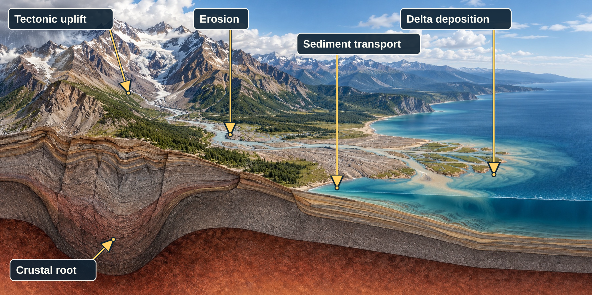
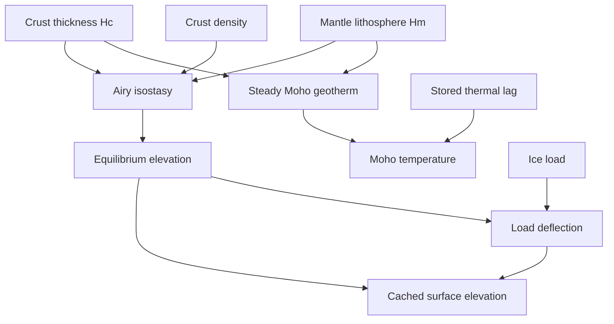

# Surface processes and resources

[Back to the Simulation Model index](../simulation-model.md).

Surface processes change the ground after tectonic motion builds or breaks crust. **Erosion**
removes rock and loose sediment; rivers and ice can carry some of it downhill, while
deposition puts sediment back. **Isostasy** is the model's rule for how crust and mantle
support surface height: thicker or lighter columns tend to stand higher. These processes
use simplified rates and limits rather than resolving individual grains or rock layers.



*Conceptual mountain-to-ocean landscape. The arrows label uplift, erosion, sediment transport
and deposition, and the crustal root beneath high terrain. The cutaway is simplified and not
to scale; this is not a simulation render.*

Higher terrain affects rain and ice; those processes can then lower or reshape the terrain.
The model tracks water, rock, and sediment with physical units where it can.

The pages use **weathering** for breaking rock down in place, **transport** for moving loose
material, and **deposition** for laying it down elsewhere. These are separate steps: erosion
can remove material from a slope even when a river later deposits much of that material in a
valley or basin.

## Erosion (`erosion.py`)

Climate lets terrain affect weather: higher ground is colder, mountains deflect wind, and
mountains can reduce rainfall on their far side (a rain shadow). Erosion closes the loop by
letting weather affect terrain. It lowers exposed land and seafloor, moves loose material,
and deposits some sediment downstream. The model includes several major sources of erosion
but leaves out processes that need data or physics it does not have.

**Seven erosion sources: five subaerial, two sea-side.** Weathering's vegetation boost is
dropped (no vegetation field, same reasoning as climate.py's own "deliberately not ported"
list). Rain/sheet erosion, river-channelized erosion, weathering, glacier erosion, and seismic
erosion are the five subaerial sources; they feed into a downstream deposition pass (see
[Hydrology](hydrology.md#hydrology-rivers-and-lakes-hydrologypy) for the flow-routing graph all of this depends on, and
[Glaciation](hydrology.md#glaciation-hydrologypy) for how `glacier_depth` itself is grown/melted/flowed), so material
isn't purely one-way removed anymore: a slow, big river drops part of its sediment load locally
instead of carrying every last grain to the coast. **Submarine erosion** and **coastal
erosion** -- both mantle-bloom-original additions, previously listed as out-of-scope
"coastal-current erosion" -- are the sea floor's and the shoreline's counterparts: they erode
where the five subaerial sources are zeroed, and their debris sheds seaward onto the
surrounding sea floor as marine sediment rather than into any river's flow graph. Submarine
erosion is also what keeps a range built by two *submerged* plates colliding growing far more
slowly than a subaerial one. Glacier-driven **flattening** (broad terrain smoothing under an
ice sheet) and **seismic erosion** (earthquake-triggered landsliding) are also
mantle-bloom-original additions -- see below.

**The mapping problem, and why it's easier in this direction than the reverse.** climate.py
already solves node-cloud -> grid (`_sample_elevation_and_crust`'s cKDTree nearest-neighbor
resample) to build its grid from the current plate state. This module needs the reverse,
grid -> node-cloud: a node's world position converts straight to (lat, lon)
(`geometry.xyz_to_latlon`) and then to a climate-grid (row, col) by direct arithmetic --
mirroring `climate._build_grid`'s own convention exactly -- no tree, no resampling needed at
all, since (unlike the irregular node cloud) the climate grid is already a plain regular
lattice.

**Slope is the one genuinely new piece of math.** climate.py's grid gets slope for free
from neighbor-index differences; an irregular node cloud has no such structure. This reuses
the same whole-world cKDTree pattern (build once, query `SLOPE_NEIGHBOR_COUNT=4`
nearest neighbors per node) the tectonic engine uses for its own per-plate distance
queries: for each node, the elevation drop to the *lowest* of
its nearest neighbors (0 if the node is already a local minimum -- the "slope to lowest
neighbor" definition), divided by the real great-circle distance to that
neighbor. This is a genuine dimensionless rise/run -- elevation drop over real distance, not
elevation drop per grid step (a grid-step measure isn't a true slope at all, since it
silently depends on grid resolution) -- which is why `RAIN_EROSION_COEFFICIENT` was picked
by order-of-magnitude reasoning against the then-current direct convergent uplift rate
(`CONVERGENT_MOUNTAIN_RATE_M_PER_MYR`, 800 m/Myr, since retired for Hc-driven uplift) and checked against real slope/precipitation distributions from an actual run,
rather than reused from a value tuned against a different scale.
`WEATHERING_COEFFICIENT` needed no such rescaling, since wind speed already uses a directly
comparable scale (`MERIDIONAL_BASE_SPEED = 6.0`) unaffected by the slope re-derivation. River
erosion depends on physical catchment discharge (see [Hydrology](hydrology.md#hydrology-rivers-and-lakes-hydrologypy)), converted to a
fixed reference-cell scale before the stream-power law. `RIVER_EROSION_COEFFICIENT` was
originally derived by order of magnitude and checked against channel-depth growth; issue
#355 step 5 recalibrated it after replacing accumulated precipitation with Budyko runoff.
Glacier erosion is calibrated separately, against the glacial erosion the old depth * slope
law produced (see the formula below).

**The formulas**, all computed per-node:

- **Rain/sheet erosion** = `RAIN_EROSION_COEFFICIENT * slope * (precipitation_mm / 1000) *
  dt_myr`.
- **River erosion** = `RIVER_EROSION_COEFFICIENT * channel_boost * water_accum_m^
  RIVER_FLOW_EXPONENT * slope^RIVER_SLOPE_EXPONENT * dt_myr`, where `channel_boost = 1 +
  CHANNEL_EROSION_BOOST * clip(channel_depth / CHANNEL_BOOST_REFERENCE_M, 0, 1)` -- a river
  preferentially re-carves its own established channel, the real mechanism behind
  meandering rivers staying within their valleys rather than cutting a fresh path every
  step. `channel_depth` (persistent, see `surface_fields.SURFACE_FIELDS`) grows by this same term
  every step (`clip(channel_depth + river_erosion_amount, 0, MAX_CHANNEL_DEPTH_M)`) --
  monotonically non-decreasing, land-only, capped purely as a sanity bound (not a
  physically-derived limit).
- **Weathering** = `WEATHERING_COEFFICIENT * wind_speed * humidity_norm * relief_factor *
  dt_myr`, where `humidity_norm` is humidity (g/kg) over
  `HUMIDITY_REFERENCE_G_KG` (11.56, air over 20 C open water), clipped to `[0, 1]`, and `relief_factor = clip(slope / WEATHERING_RELIEF_REFERENCE_SLOPE,
  0, 1)` (same normalize-and-saturate idiom as `humidity_norm`). `relief_factor` is a
  mantle-bloom-original addition -- added after a real bug: unlike rain/river erosion (both already `*
  slope`), weathering originally had no relief dependence at all, so a flat, low-lying coastal
  plain weathered exactly as
  fast as a steep mountain flank -- confirmed directly against a real generated world (a
  single 2 Myr step converted ~4.9% of all land nodes to ocean; at the affected nodes,
  weathering alone -- uniform regardless of relief -- exceeded the node's *entire* elevation,
  well beyond rain/river's own, already slope-gated contribution). `WEATHERING_RELIEF_REFERENCE_SLOPE` (the slope at which weathering reaches full
  strength) was picked against a real world's own slope distribution: median land slope is
  roughly 2.7e-4, far below the reference, so typical flat terrain now gets only a small
  fraction of full weathering, while land already near the 90th percentile of steepness
  (roughly 3e-3) reaches full strength. This roughly halved the single-step land-to-ocean
  flip rate in the same test; the remainder is rain erosion (already slope-gated, but tuned
  with a large coefficient to balance mountain-building rates) eroding low-lying land with
  nonzero slope -- a separate, not-yet-addressed contributor to the same overall trend.
- **Glacier erosion** = `GLACIER_ABRASION_COEFFICIENT * u_b ** GLACIER_ABRASION_EXPONENT *
  dt_myr` (issue #353), where `u_b` is this step's basal sliding speed from the ice solve
  (`HydrologyFields.ice.sliding_speed_m_per_yr`, see [Glaciation](hydrology.md#glaciation-hydrologypy)): a share of
  the balance velocity on a thawed bed, zero on a frozen one, so ice frozen to its bed no
  longer abrades the way sliding ice does (Hallet 1979). Herman et al. (2015) fit an exponent
  near 2 on one Alpine glacier; Cook et al. (2020) find sub-linear scaling across a global
  compilation; the exponent is 1, between them, which also keeps the calibration linear.
  While glacier mass balance stays in model units the sliding speed is a proxy ~50,000x
  slower than real ice, so the coefficient is calibrated, not physical: total glacial erosion
  on the reference replay matches the old law it replaced (see
  `analysis/issue353/README.md`). That old law was `GLACIER_EROSION_COEFFICIENT * slope *
  ice_factor * dt_myr`, `ice_factor = clip(glacier_depth / GLACIER_EROSION_REFERENCE_DEPTH_M,
  0, GLACIER_EROSION_MAX_FACTOR)`, with the coefficient set equal to the rain coefficient at
  100 m of ice against a global compilation of glacial erosion rates (#145); `ice_factor`
  still scales the flattening blur below.
- **Seismic erosion** = `SEISMIC_EROSION_COEFFICIENT * slope * mountain_height_factor^
  SEISMIC_EROSION_ELEVATION_EXPONENT * dt_myr`, a mantle-bloom-original addition modeling
  earthquake-triggered landsliding -- a real, well-documented contributor in young,
  actively-uplifting ranges (the Himalaya, the Andes) this model previously had no source for
  at all. `mountain_height_factor = clip(elevation / SEISMIC_EROSION_ELEVATION_REFERENCE_M, 0,
  SEISMIC_EROSION_MAX_HEIGHT_FACTOR)`: this model has no explicit fault/stress field, so
  sustained elevation itself stands in for "how tectonically active/seismic this range is,"
  there being no other elevation source that reaches these heights (collisional
  thickening -- see [Plate motion: shift and deform](tectonics.md#boundary-evolution)). The height term is deliberately superlinear
  (exponent 2) -- real seismicity in young orogens grows faster than linearly with height/
  ongoing convergence, and this is also the model's main mechanism for capping how tall an
  actively colliding range can get before its own erosion catches up with uplift, a real
  "geomorphic ceiling" effect rather than just cosmetic variation. Still needs a slope to fail
  down (an earthquake can't landslide a perfectly flat plateau); `SEISMIC_EROSION_COEFFICIENT`
  was picked the same order-of-magnitude way `RAIN_EROSION_COEFFICIENT` was, against the
  retired 800 m/Myr direct convergent uplift rate. Confirmed directly at a real seed run 20
  steps (60 Myr): together with reverse-fault valleys (see [Plate motion: shift and
  deform](tectonics.md#boundary-evolution)), the fraction of land nodes pegged at `MAX_ELEVATION_M` dropped
  from roughly 9% to under 2% versus the same run without either addition. Its debris runs
  out by gravity rather than joining the water-routed pool -- see "Landslide debris runs out
  by gravity" below.
- All five summed, zeroed over ocean nodes (`elevation <= 0`, the sea-level convention used
  everywhere else) -- every source above is a subaerial process. The combined result is
  capped at the node's own drop-to-lowest-neighbor (in meters, not the normalized slope), so
  a single step can't erode a node *past* the valley it drains into and carve a new, lower
  pit.
- **Submarine erosion** = `(SUBMARINE_EROSION_COEFFICIENT + SUBMARINE_PRESSURE_COEFFICIENT *
  clip(depth_below_sea_m / SUBMARINE_PRESSURE_REFERENCE_M, 0, 1)) * slope * dt_myr`, applied
  only to ocean nodes. A current-driven baseline (slope alone) plus a term that grows with how
  deep the node still sits (bottom water pressure, gravity-driven slumping of an unbuttressed
  scarp), the whole thing `* slope` so a flat abyssal plain still erodes near zero. Because the
  pressure term fades as a crest climbs toward the surface, the brake on a submerged colliding
  range is strongest while it is deep and eases continuously as it approaches sea level, handing
  off to the subaerial sources the moment it breaches. Coefficients picked the same
  order-of-magnitude way `RAIN_EROSION_COEFFICIENT` was, against the retired 800 m/Myr
  direct convergent uplift rate: at a moderate submarine-ridge slope
  (~0.02) and mid-depth the two terms sum to roughly half the uplift rate -- a sustained drag
  on submarine orogeny, not a hard ceiling.
- **Coastal erosion** = `(COASTAL_EROSION_WAVE_RATE_M_PER_MYR + COASTAL_FROST_MAX_RATE_M_PER_MYR
  * frost_factor) * coastal_proximity * dt_myr`, applied in the near-sea-level band on *both*
  sides of the shoreline (`coastal_proximity = clip(1 - |elevation| / COASTAL_EROSION_BAND_M,
  0, 1)`, so it tapers to zero at ±`COASTAL_EROSION_BAND_M` and also gnaws the crest of a
  mid-ocean range that rises into the band). Wave attack is a flat rate across the band (swell
  energy doesn't depend on the node's own relief -- deliberately *not* relief-gated the way
  weathering is); `frost_factor = exp(-((temperature_c - COASTAL_FROST_PEAK_C) /
  COASTAL_FROST_WIDTH_C)^2)` is a Gaussian peaked just below freezing, since freeze-thaw
  wedging needs the climate to actually cycle through 0 °C -- it falls off toward both
  permanently-frozen and never-freezing climates. Integrated every year like every other rate
  here.
- Submarine + coastal erosion are summed and capped against whatever drop-to-lowest-neighbor
  the subaerial sum didn't already claim (so the joint per-step erosion still can't carve
  below the sea floor a node drains into), then their eroded rock is handed to
  `_spread_marine_sediment`: a submerged source keeps `MARINE_SEDIMENT_LOCAL_FRACTION`
  locally, a subaerial sea-cliff source sheds it all seaward, and the remainder spreads
  inverse-distance-weighted onto the nearest *lower* ocean nodes within `MARINE_SPREAD_RANGE_KM`
  (sediment runs downhill into basins; a source with no lower ocean node in range keeps the
  full amount). Mass is conserved exactly. This marine sediment is folded into the same
  `sediment_deposited` total the `ErosionResult` carries, so [Resources and soil](#resources-and-soil-geologypy-plus-volcanismpys-own-eruption-roll)'s
  shelf oil-and-gas and soil terms see it alongside every other deposition pathway.

**Coastal leveling** (`_coastal_openness` / `leveling_datum_m` / `coastal_leveling_grind` /
`_spread_coastal_leveling`, mantle-bloom-original): every source above is either purely
subaerial or purely submarine, and none look at coastal *connectivity*, so a
marginally-submerged flat continental shelf sitting right on the waterline is a stable fixed
point that just dithers land↔ocean node-by-node forever (the per-node elevation noise
exceeds the surface's own height above/below sea level). This pass makes a coherent
coastline the stable state instead. It is one symmetric operation over a band straddling sea
level (`COASTAL_LEVELING_BAND_M`, ±45 m): every band node has a local target datum, nodes above
it are ground down (wave-cut planation) and nodes below it are filled (sheltered-shelf and
interdistributary infill), both toward that same datum. It replaced separate one-sided
planation (land, `PLANATION_BAND_M`) and infill (ocean, `INFILL_DEPTH_M`) passes, which each
saw only half the checkerboard (b7df00a).

- **Wave exposure.** `_coastal_openness` is a per-node proxy in [0, 1] -- the fraction of
  nodes within `COASTAL_OPENNESS_RANGE_KM` (~150 km, a coarse fetch scale) that are open
  ocean (`hydrology`'s connectivity-aware `is_ocean`, so an inland-lake or enclosed-pit
  shore reads as fully sheltered). Two radius counts
  (`cKDTree.query_ball_point(..., return_length=True)`), density-independent.
- **Datum.** `leveling_datum_m` is `sea_level - LEVELING_PLATFORM_UNDERCUT_M * exposure +
  LEVELING_MARSH_CREST_M * shelter`: an exposed coast targets a wave-cut platform a few
  metres below the waterline, a sheltered one (`shelter = 1 - openness / INFILL_SHELTER_REF`)
  a marsh crest a few metres above it ([Biomes](climate.md#biomes-biomespy)' `classify_wetland`). Aiming off the
  waterline, rather than exactly at it, is what resolves a checkerboard into a coast that
  follows the shelter field instead of only damping it. Grind and fill share this one number,
  so they never fight over a node.
- **Grind.** `coastal_leveling_grind` planes a band node above its datum at
  `LEVELING_RATE_M_PER_MYR * coastal * proximity * prominence * dt_myr`, never past the
  datum; a just-submerged shoal is planed as readily as low land, and a landlocked lowland
  (openness ~0) not at all. `coastal_leveling_multiplier` scales it.
- **Fill.** `_spread_coastal_leveling` spreads the ground-off rock, plus
  `COASTAL_INFILL_MARINE_FRACTION` of that step's submarine + coastal erosion (redirected
  from `_spread_marine_sediment`'s downhill-to-deep spread, which is counterproductive in a
  shallow embayment) and `DELTA_REDIRECT_FRACTION` of a slow river's near-sea-level deposit
  (the distributary fan), onto band nodes below their datum, land or ocean alike, within
  `INFILL_RANGE_KM`. Each sink can take only its own room to the datum per step; over
  `LEVELING_FILL_ITERS` passes a source's remaining load flows on to sinks that still have
  room, weighted by shelter, hollowness and room left. A sink needs at least
  `LEVELING_MIN_OPENNESS` of open water nearby, so a lake shore never silts up here. Exactly
  mass-conserving via `np.add.at`; whatever no sink can hold stays on the source.
- **Barrier islands** are emergent, not explicitly detected: a shallow sink with land within
  `BARRIER_LANDWARD_KM` that still faces open water (`openness >= BARRIER_MIN_OPENNESS`) gets
  a `BARRIER_PRIORITY` weight boost and a datum `BARRIER_CREST_M` above sea level, so a
  shore-parallel bar breaches; the water it then shelters loses open-ocean neighbours, so on
  later steps its own openness falls, its `shelter` rises, and the back-barrier lagoon silts
  up to marsh.
- **Prominence** (`PROMINENCE_REF_M` / `PROMINENCE_MAX`, from each node's height above its
  flow-graph neighbourhood mean) reweights the grind up on protrusions and the fill up in
  hollows -- what actually collapses a pixel-scale checkerboard, since `openness` measured at
  a ~150 km fetch scale is far too smooth to make a land/ocean call at ~60 km node spacing.
  It only reweights; the rock a prominence-boosted node loses still flows through the
  conservative fill.

**Glacier flattening** (`_flatten`, mantle-bloom-original): real
continental ice sheets grind down local relief over broad areas (the Canadian Shield and
Fennoscandia read as glacially smoothed bedrock today, not just eroded lower) -- a genuine
local blur that can lower a peak or raise a valley. It is a pairwise exchange over each node's
`hydrology.py` flow-graph neighbours (reusing that graph rather than a separate query): a node
sends `relax * (its height - neighbour's height) / k` of thickness to every *lower* neighbour,
where `relax` grows with `GLACIER_FLATTEN_RATE_PER_MYR` (0.3, raised from 0.2 alongside the
glacier-erosion coefficients above, same "heavier ice grinds harder" reasoning) and the same
`ice_factor` glacier erosion uses. Glacier-free nodes (`ice_factor = 0`) send nothing. Since
issue #275 it moves rock (and its continental share) rather than relaxing each node toward its
neighbourhood mean independently, which created or destroyed material. Each node's sends are
capped at its Hc headroom above the floor.

**Glacial sediment transport pushes material outside the range.** A glacier's scoured load
splits two ways: `GLACIER_TILL_FRACTION` (0.5) settles immediately as subglacial till, right
where the ice picked it up; the rest travels *with the ice itself* rather than joining the
water-routed pool -- `apply_erosion` reuses `hydrology.route_downstream` directly (the same
engine the ordinary river-deposition pool already uses, see [Hydrology](hydrology.md#hydrology-rivers-and-lakes-hydrologypy)), but along
`hydrology.HydrologyFields.ice_flow_target` (the ice's own real downhill flow path, not water's
-- see [Glaciation](hydrology.md#glaciation-hydrologypy) for why those two differ) instead of `flow_target`, retaining
in full the moment a hop reaches a node with less than `GLACIER_VISIBLE_DEPTH_M` of its own ice
-- genuinely outside the glacier -- rather than continuing to travel once there's no more ice
there to carry it. This is a real terminal moraine/outwash deposit built beyond the ice margin,
not debris stranded throughout the glacier's interior. Confirmed directly on a real run: land
nodes sitting right at a glacier's edge (ice-free themselves, with at least one glaciated
neighbor) received roughly 7x the mean sediment deposit of ordinary land elsewhere.

**Landslide debris runs out by gravity ([issue #275](https://github.com/adubey/mantle-bloom/issues/275) phase 4).**
Seismic erosion's debris doesn't join the water-routed pool. That pool stops dead at a frozen
node, because hydrology gives frozen land no flow target, and nearly every column at
`MAX_CRUSTAL_THICKNESS_M` is a frozen summit. So its landslide debris used to settle straight
back where it came from, and the highest collision belts never lost any net rock.
`_route_mass_wasting` instead hands each node's debris to its lowest strictly-lower neighbour on
the bare-rock surface, frozen or not, with no lake-spill or ice edges. Debris leaves its source.
From the first node downslope, a share settles wherever it passes. None settles on ground at or
above `MASS_WASTING_RUNOUT_SLOPE` (0.005, a mountain flank), all of it on flat ground, and a
linear share in between: the foreland basin at the foot of the range. A column within
`MASS_WASTING_HEADROOM_TAPER_M` (2 km) of the Hc cap takes proportionally less, and a column at
the cap takes none. So debris runs on past a saturated plateau instead of overflowing it, and
no node takes more than the room it has below the cap. A land pit fills only to that room; the
rest spills over the basin rim to hydrology's `spill_target` and runs on, for up to
`MASS_WASTING_SPILL_PASSES` (4) sweeps. Debris still left after that, or in a pit with no
spill outlet, settles in its pit even past the cap. Debris that lands in a lake spreads across
it like other lake sediment (`_spread_lake_sediment_capped`), but each member takes only up to
its room below the cap, the rest going to members with room left. Debris that starts on, or
runs onto, a glacier (`glacier_depth` at least `GLACIER_VISIBLE_DEPTH_M`) rides the ice instead.
A glacier carries rockfall on and in the ice to its margin (lateral and medial moraine), so the
debris follows `ice_flow_target`, the same path glacially eroded material takes, until it reaches
ice-free ground. Once the ice overtops a closed basin's rim, that path leaves through the basin's
lowest outlet, as a filled lake's does. Wherever the ice puts the debris down, it runs out by
gravity again from that node under the same Hc room, so the ice can't pile it past the cap.
Debris reaching the sea is spread by `_spread_marine_sediment` onto the shelf and down
into the ocean basin, under the same `ocean_deposition_multiplier` as the other marine sediment.
Each deposit carries the continental fraction of the flux it came from. The budget reports
`mass_wasting_removed_m3`, `mass_wasting_foreland_m3`, `mass_wasting_marine_m3` and
`mass_wasting_on_ice_m3`.

**Deposition.** The capped, combined erosion amount is routed downstream (see
`hydrology.route_downstream`) with a `retain_fraction` wherever a river qualifies as "big and
slow" -- `river_speed < DEPOSITION_SPEED_THRESHOLD` (a stylized, unitless quantity, faster
where slope is steeper and where more water has accumulated) *and*
`water_accum_m > DEPOSITION_MIN_FLOW_M` (guards against a merely-flat trickle depositing) --
in which case `DEPOSITION_FRACTION` of the material passing through that node settles right
there (a floodplain or delta) instead of continuing on; the rest keeps going, eventually
reaching either another depositing node, an internal sink, or the coast (where it can raise
an *ocean* node's own elevation -- a river delta building outward is real, intended
behavior, not a bug). `elevation`, `channel_depth` (this module's own), and
`lake_depth`/`glacier_depth`/`silt_depth` (state transitions owned by
`hydrology.py`/`lakes.py`, read directly from `World.hydrology_cache` -- see
[Hydrology](hydrology.md#hydrology-rivers-and-lakes-hydrologypy)) all get written back together per plate
(`Plate.set_fields_on_plate`) -- no resampling, no topology change.

**Erosional isostatic compensation.** The net per-step surface change (all erosion minus all
deposition, plus glacial flattening and lake silt) is the rock added to or stripped from a
lithospheric column, so it is applied to `crustal_thickness_m` in full and to `elevation`
only by the resulting Airy response -- `isostatic_elevation(Hc + delta, Hm) -
isostatic_elevation(Hc, Hm)`, the same delta idiom `deform()` uses for tectonic Hc/Hm
changes (see [Isostasy](#isostasy)). An unloaded crustal root rebounds and a sediment pile
subsides under its own weight, so only ~1/6 of subaerial erosion and ~1/4 of submarine
erosion shows up as a surface elevation change; the rest is isostatic. Without this,
coastal + submarine erosion exporting continental crust to the deep ocean planed every
continent flat over a few hundred Myr once orogeny slowed ([GitHub issue #120](https://github.com/adubey/mantle-bloom/issues/120)); with it, `elevation`
also stays a faithful readout of `isostatic_elevation(Hc, Hm)` between tectonic events rather
than drifting away from it.

**Conservation and provenance ([issue #275](https://github.com/adubey/mantle-bloom/issues/275)).**
Every transport pathway above carries *volume*: each node's thickness change times its own
accounting area (`Plate.accounting_areas_m2`, exact cell areas on the quad surface, which is
not equal-area), converted back to thickness at the receiving node. So moving rock between a
large and a small cell no longer creates or destroys material. Every removal (subaerial,
sea-side, the coastal grind, flattening) is capped at the column's Hc headroom above
`MIN_CRUSTAL_THICKNESS_M` *before* anything is routed, so the floor clip at write-back can't
hand downstream nodes rock their source never gave up. `hydrology.route_downstream` visits nodes
in a topological order whenever a spill or ice edge points uphill. Previously an
elevation-ordered sweep silently lost the flux it added to an already-visited node: about 0.1%
of water-routed and about 9% of glacier-carried sediment per step. Nodes on a flow cycle keep
their own load.

Alongside the volume, each pool carries its continental-derived share: the per-node
`continental_material_m` tracer `continental_ledger.py` persists. A node gives up continental
material first, up to its tracer, because it sits on top: continental sediment draped over an
oceanic host is the first thing eroded off it. Every pathway moves that share along exactly
the same transfers, so continental sediment shed onto oceanic plates stays identifiable. The
step's area-weighted totals come back as `ErosionResult.budget`. With the default knobs,
`removed_m3` equals `deposited_m3` to rounding. The remaining non-conservative terms are
declared there: lake silt (a non-continental source), the `ocean_deposition_multiplier`
knob, and deposition clipped at `MAX_CRUSTAL_THICKNESS_M`. Continental material that
can't be placed goes to declared ledger sinks: `numerical_unplaced_m3` for the Hc cap (and
for any tracer some other pass left above its column's Hc, which erosion clips), and
`discarded_marine_sediment_m3` for the ocean-deposition knob below 1. `bin/debug/
measure_erosion_budget.py` measures closure per call.

**Mobile cover ([issue #297](https://github.com/adubey/mantle-bloom/issues/297) phase 2).**
Loose sediment is not intact rock. Each column persists `mobile_cover_m`, the unconsolidated
share of its Hc at the top of the column, and `mobile_cover_continental_m`, the
continental-derived share of that cover. Both are extensive surface fields, so quad
refinement, coarsening, merge and partition conserve their volume. Everything that settles
enters the cover: every deposition pathway, the overflow carry and lake silt. So does weathered
rock, at the point where it settles. Every removal takes cover before substrate. The erosion
laws are substrate laws. A rate law (subaerial, submarine and coastal) entrains cover
`MOBILE_COVER_ERODIBILITY_FACTOR` (5) times faster than the same forcing detaches substrate.
It only reaches substrate once the cover is gone, so a bare column erodes exactly as before.
`_strip_mobile_cover` integrates this exactly over the step: one long step and several shorter
ones with the same forcing agree. Craton resistance scales only the substrate share. The
leveling grind, glacial flattening and overflow-laden ice scour take cover first too. The
cover is well mixed, so its continental share leaves at the cover's own fraction. Substrate
under it gives up its continental tracer first, as before. Cover buried deeper than
`MOBILE_COVER_CONSOLIDATION_DEPTH_M` (1 km) consolidates back into substrate with a 20 Myr
e-folding time. Consolidation leaves Hc and the tracer unchanged and only moves the split.

There is no in-place regolith production yet. The erosion laws are calibrated against real
denudation, so a soil-production term would let every low-relief column entrain up to five
times its calibrated rate: a global retune, left to the coupled solve.

Tectonics moves the cover too (`mobile_cover.py`):
- Rift stretching (`deform_columns`, and `quad_tectonics._open_rift`) thins it with its
  column. A rift's stretched share carries it onto the rifted cells.
- A column that melts through loses its cover (`rift_reset_m3`).
- Orogenic collapse and ductile flow carry it in proportion to the crust they move.
- Cells consumed at a trench subduct it (`subducted_m3`).
- Suture donors and a relocated terrane's displaced columns metamorphose it into the accreted
  crust (`accreted_m3`).
- Erupted lava buries it (`volcanic_buried_m3`), in proportion to the lava's thickness. That
  is measured as the elevation the eruption adds: large igneous provinces emplace roughly
  5-10x more intrusive than extrusive volume, so surface lava is near a sixth of the Hc gain,
  about what the elevation gain gives. A cell rising `VOLCANIC_SEAL_THICKNESS_M` (20 m) is
  fully sealed; the thin tail of a volcanic-plain apron, lava over part of the cell, seals
  that fraction.
- A failed rift (aulacogen) thins it with its column (`rift_thinned_m3`).
- Stranded fragments that defragmentation drops take theirs with them (`stranded_m3`).

Shortening, underplating, anatexis, fault relief and the column caps act at depth and leave
it alone. Anything left above a column is clipped at the next erosion step
(`stale_mobile_cover_excess_m3`). Strike-slip advection copies every field from its nearest
upstream node, which conserves no extensive field, Hc and the continental tracer included. Its
net change to the cover is booked, signed, as `fault_advection_m3`. `World.mobile_cover_ledger`
keeps these sources and sinks, so `mobile_cover.balance_error_m3` closes to round-off.

The budget reports `bedrock_detached_m3` plus the cover's
`prior`, `entrained`, `deposited`, `consolidated`, `clip` and remaining volumes, with
continental shares. Prior + deposited − entrained − consolidated − clip equals what remains.

**Cadence: every step, no lag on climate -- but a deliberate change from erosion's own
earlier no-hydrology version regarding flow routing.** This module still calls
`climate.compute_climate(world)` fresh every step (no staleness to reason about, same as
before). Flow routing (`hydrology.compute_hydrology`) is comparatively expensive with no JIT
available, so rather than computing it twice per step, this module computes it once and
reuses the result for both erosion and `World.hydrology_cache` (see
[Hydrology](hydrology.md#hydrology-rivers-and-lakes-hydrologypy)). Runs in `world.step_world`
right after `shift`/`deform`, topology changes and gap filling, every step.

Nine of the twelve live [tuning knobs](#live-tuning-knobs-worldtuning_multiplier_fields) act here -- each erosion/deposition
term reads a `world.*_multiplier` scale (default `1.0`) at the point it is formed.

## Bathymetry (`bathymetry.py`)

Bathymetry is the shape and depth of the seafloor. In this model, crust thickness and
composition set much of that depth, and the coastline-to-deep-ocean transition is shaped at
world generation. Isostasy then updates surface height when the crust and mantle column changes.

### Isostasy

**Conceptual diagram — Hc and Hm set the unloaded surface elevation and Moho thermal proxy; thermal lag adjusts current Moho temperature, while ice load adds a temporary downward deflection.**



Each node stores crustal thickness `Hc` and mantle-lithosphere thickness `Hm`; the
`lithosphere.isostatic_elevation(Hc, Hm, rho_c)` Airy calculation derives the unloaded
surface elevation. `elevation` is a cache synchronized from those columns after changes.
Ice load contributes a separate deflection and does not replace the unloaded column state.

Submerged crust's own depth is set directly by Airy isostasy on its lithospheric column
(`lithosphere.isostatic_elevation`, see [Isostasy](#isostasy)) -- thin oceanic crust floats
low (abyssal plain), thick continental crust floats near sea level, and rifting that thins a
column subsides it. Nothing relaxes elevation toward a separate shelf/deep-water target
during the simulation any more (an earlier v1 module did; isostasy superseded it).
`SHELF_RANGE_KM`/`SHELF_RANGE_RAD` (200km) -- the shelf width `geology.py` uses to tell
shallow, oil/gas-favorable shelf water from open ocean -- lives here.

Per-plate generation seeds every column purely from its plate's crust type, which leaves
two things a real sea floor doesn't have. **`shape_initial_bathymetry(plates)`** fixes both
**once, at generation** (nothing here touches the ongoing simulation), by thinning `Hc`
(and, in the margin pass, `Hm`) -- via `lithosphere.crustal_thickness_for_submerged_elevation`
where it needs an exact target depth -- so `elevation` stays a faithful isostatic readout:

1. **`_subside_offshore_continental_crust`** -- submerged continental crust otherwise reads
   as one uniform bright shelf however far from land it sits. This drowns it toward the
   abyssal reference depth (`ABYSSAL_REFERENCE_DEPTH_M` ~= -5.2km, the same depth an aged
   oceanic column floats at) by distance to the nearest coastline: shelf within
   `OFFSHORE_SHELF_KM` (200km), full basin depth past `OFFSHORE_ABYSSAL_KM` (1400km),
   smoothstep between. Submerged *continental* nodes only, *downward* only (it never lifts
   crust the generation noise already put deep), and weighted in with depth so coastlines
   hold. Physically: hyper-extended / attenuated continental crust, exactly what real
   drowned continental interiors (Zealandia, submerged plateaus) are.

2. **`_smooth_continental_margins`** -- every continent/ocean plate boundary otherwise
   starts as a vertical cliff. This grades the `Hc`/`Hm` columns across it with an iterated,
   restricted neighbour-average (a Jacobi relaxation of the heat equation) so the seabed
   ramps shelf -> slope -> abyssal over `MARGIN_TRANSITION_KM` (400km):

   - Only *submerged* nodes within that range of opposite-type crust take part; grading
     weight ramps in with depth (`COAST_GUARD_DEPTH_M` -> `MARGIN_FULL_DEPTH_M`) and,
     smoothstepped, with proximity to the contact -- so land, deep-ocean interiors, and
     oceanic/oceanic boundaries (where a ridge or trench genuinely *is* a sharp step) are
     left untouched.
   - Weight-0 nodes are the fixed boundary values the relaxation ramps between. At the
     contact the same-crust and opposite-crust neighbour groups are weighted *equally*
     regardless of node count, so the smoothed field is continuous across the thin seam
     where the two plate lattices meet.

Later tectonics re-sharpen boundaries on their own terms (fresh ocean floor at a rift, old
floor bending into a trench), which is correct. Confirmed directly at the default density:
submerged continental crust now runs from ~-50m on the shelf to ~-5.2km in a large drowned
interior (was a near-flat ~-500m everywhere), and the median elevation step between adjacent
nodes straddling a continent/ocean boundary drops from ~4km to ~2km.

## Eustatic sea level (`eustasy.py`)

**Eustatic sea level** means the average ocean level around the planet, as opposed to a local
tide or storm surge. The model keeps the planet's total ocean water volume and solves for the
level that volume reaches as ocean basins, lakes, and ice change.

`World.sea_level_m` -- the datum every `is_ocean` / coastline / bathymetry check in the
codebase reads -- is **not a fixed input**. It is re-solved every step from a *conserved
ocean water volume*, so the shoreline responds to tectonics and erosion the way it does on
the real Earth: open a new ocean basin and sea level drops, handing that volume of coastline
back to the continents as freeboard.

Ocean volume is summed over each node's accounting area `A_i` (`Plate.accounting_areas_m2`,
the exact cell areas):

```
V = sum over all nodes of  A_i * max(0, sea_level - z_i)
```

Quad cells are not equal-area and their count changes with topology, so weighting quad nodes
by the nominal area would drift the budget as water moves between cells of different sizes
(issue #257).

`V` (m³) is snapshotted once at generation (`eustasy.initialize_water_budget`, from the flat
`sea_level_m = 0` starting datum) and stored on `World.ocean_water_volume_m3`. Each step,
`eustasy.update_sea_level` (called unconditionally at the end of `step_world`) subtracts the
water currently held in ice and lakes (`trapped_water_volume_m3`) from `V` and solves
`ocean_water_volume_m3(h) == V - trapped` for the new `h` by bisection. `ocean_water_volume_m3`
counts only ocean connected to the open sea at that candidate `h`, so a landlocked basin below
sea level isn't counted as free ocean depth; raising `h` can only merge components, so it is
still strictly increasing in `h` and the bracket `[min z, max z + headroom]` holds exactly one
root.

- **Deepening a basin** (sea-floor spreading, a subducting slab, `growth_seed_thickness`
  tiling drowned oceanic column) raises `ocean_water_volume_m3(h)` at every `h`, so the solved
  `h` **falls** -- the eustatic response that a fixed sea level never produced, and the
  reason continental subsidence is no longer a one-way loss of dry land.
- **Node-count creep** (the continental boundary ratchet) grows total represented area; the
  same water volume over more ocean area also lowers the stand, which is physically right.
- The `POST /world/controls` sea-level slider now calls `eustasy.set_sea_level_via_water_
  budget`: "put sea level at X" is interpreted as "add or remove ocean water until the
  *current* hypsometry floats at X", and that new `V` is then conserved going forward (a
  glacio-eustatic / bigger-ocean change, not a one-frame override the next step erases).
- Persistence backfills `ocean_water_volume_m3` for a save written before it existed
  (including saves carrying the older, nominal-area `ocean_water_column_m`, which is dropped),
  from that save's own hypsometry and `sea_level_m`, so loading it doesn't jump the shoreline.

Measured (seed 926698457, node_density 0.5, climate off, 100 My): the land-fraction decline
roughly halves against a fixed sea level (~-0.025 vs ~-0.052), and the trajectory changes
from monotonic decline to a slight rise then a slow decline as sea level tracks the basins
down (to roughly -150 to -300 m over the run). See [GitHub issue #120](https://github.com/adubey/mantle-bloom/issues/120), "Land fraction slowly
declines".

## Live tuning knobs (`world.TUNING_MULTIPLIER_FIELDS`)

The controls in this section scale selected process rates while a world is running. A value
of `1.0` uses the model's default rate; increasing or decreasing it makes that process act
more strongly or weakly. These are calibration controls, not new physical laws.

The long-run land budget is a tug-of-war between a handful of erosion, deposition, uplift and
volcanism processes whose individual hard-coded rates can't be recalibrated for one seed
without regressing another. Twelve **dimensionless multipliers** on `World` let the user
retune a *live* world and watch the result, via the "Controls" window / `POST /world/controls`
(same immediate-`climate_cache`-recompute path as `sea_level_m`/`solar_multiplier`). Every one
defaults to `1.0`, and `1.0` is **byte-identical** to the code before the knobs existed (plain
IEEE `*1.0`; verified by `test_tuning_knobs.py` and an old-pickle load). Negative values are
rejected with a `400`.

| Knob | Scales | Where |
|---|---|---|
| `rain_erosion_multiplier` | rain/sheet erosion term | `erosion.apply_erosion` |
| `river_erosion_multiplier` | stream-power river erosion term | `erosion.apply_erosion` |
| `wind_erosion_multiplier` | wind-driven weathering term | `erosion.apply_erosion` |
| `ocean_erosion_multiplier` | submarine slump + coastal wave/frost attack | `erosion.apply_erosion` |
| `coastal_leveling_multiplier` | the symmetric near-shore planation *grind* (`ground_off`) | `erosion.apply_erosion` |
| `glacier_erosion_multiplier` | glacial abrasion term **and** the ice-flattening blur (`_flatten`) | `erosion.apply_erosion` |
| `seismic_erosion_multiplier` | earthquake-triggered landsliding term | `erosion.apply_erosion` |
| `river_deposition_multiplier` | floodplain/delta settle-out fraction (`DEPOSITION_FRACTION`, clamped `< 0.95`) | `erosion.apply_erosion` |
| `ocean_deposition_multiplier` | *settled* beach + marine sediment (see caveat below) | `erosion.apply_erosion` |
| `collision_uplift_multiplier` | plastic crustal-thickening rate across the convergent band | `rheology.apply_convergent_deformation`'s `strength` arg, driven from `lithosphere_plate.boundary_context` |
| `collision_uplift_reach_multiplier` | how far the shortening cascade carries a collision into the plate (`shortening.py`'s `reach_scale`); `<1` also weakens the contested-band thickening in proportion | `lithosphere_plate.boundary_context`, `shortening.py` |
| `volcanism_multiplier` | per-step eruption probability **and** metres added per eruption | `volcanism.apply_volcanic_activity` |

**Mass-conservation caveats.** The erosion terms are scaled where they are computed, so the
neighbour-drop cap, the transport split and the isostatic bookkeeping downstream all see a
consistent scaled amount. `river_deposition_multiplier` only changes where routed sediment
settles, so it conserves. `ocean_deposition_multiplier` instead scales the already-spread
settled beach and marine sediment (scaling the pre-spread pool would desync the mass-conserving
`np.add.at` spread against the deep-water remainder). Away from `1.0` it is a small, deliberate
shelf-building / shelf-starving source, the same character as lake siltation. Its net effect is
reported as `ErosionResult.budget["ocean_deposition_knob_m3"]`. Below `1.0`, the continental
share it withholds is booked to the ledger's `discarded_marine_sediment_m3` sink (see
[issue #275](https://github.com/adubey/mantle-bloom/issues/275) above).

**Collision uplift is in the real engine.** The live mountain-building path is
`lithosphere_plate.deform_columns` -> `rheology.apply_convergent_deformation` (thicken
`Hc`/`Hm`, then read isostasy), **not** a direct `plates.CONVERGENT_MOUNTAIN_RATE_M_PER_MYR`
elevation delta (the removed v1 `PlateWithLines.deform` did that). The *amount* knob is a
`strength` multiplier on the plastic thickening; the *reach* knob scales how far the
shortening cascade (`shortening.py`, issue #314) carries the collision's shortening into the
plate's interior, each cell taking a share by its strength and the room left under the caps.

**Far-field collision uplift is retired.** `ELEV_CHANGE_COLLISION_FAR_FIELD` remains a legacy
"Last elevation change" code so old saves still render intelligibly, but
the tectonic engine no longer applies a direct far-field elevation delta. Issue #206
retired that unbacked shortcut after lateral magma transport landed: collision-generated melt
can now reach distant thin continental crust as real Hc growth, so far-field relief comes
through isostasy rather than a separate raw elevation term.

### Effect sizes

Measured on seed 20, node_density 1, climate on, 80 My (40 x 2 My steps), land fraction and
mean land elevation vs. an all-`1.0` baseline of `land = 0.294`, `mean = 1172 m`:

| Setting | land | mean elev | note |
|---|---|---|---|
| `ocean_deposition` 0x / 3x | 0.285 / **0.317** | 1185 / 1152 | **strongest single land lever** -- ~+8% land area at 3x |
| `coastal_leveling` 0x | 0.300 | 1179 | planation off -> coasts keep their relief (the "save my land" direction) |
| `volcanism` 4x | 0.299 | 1185 | modest; only bites where a seed actually has active volcano nodes |
| `collision_uplift` 0.2x / 3x | 0.291 / 0.297 | 1181 / 1193 | monotonic on land *and* mean elevation |
| `collision_uplift_reach` 3x | 0.295 | 1158 | `elev_max` 8000 -> 8800 m: the belt spreads and the crest climbs |
| all erosion 0.3x / 3x | 0.297 / 0.291 | 1178 / 1157 | small over long runs -- see damping note |
| `river_deposition` 3x | 0.294 | 1176 | ~flat on this seed/horizon; fattens individual deltas locally |

Two things compress the whole-world numbers, and both are *features*, not knob weakness:

- **[Eustasy](#eustatic-sea-level-eustasypy) is a negative feedback.** Ocean water volume is conserved,
  so building land anywhere (deposition up, erosion down, uplift up) displaces water, raises
  the eustatic stand, and re-drowns marginal coastline elsewhere -- roughly halving the
  net whole-sphere land-fraction change a knob would produce without it.
- **Erosional isostatic compensation** rebounds most of any sustained elevation change over
  tens of My, so an erosion knob's effect on *mean elevation* is far larger on a short
  horizon than after the crust has re-floated. `test_tuning_knobs.py` pins the clean
  short-horizon scaling (e.g. total `crustal_thickness_m` scales monotonically with
  `collision_uplift_multiplier` over 6 steps); the table above is the damped long-run
  residual.

Practical guidance: for a world visibly losing land, nudge `ocean_deposition_multiplier` to
~1.3-1.5 and pull `coastal_leveling_multiplier` down to ~0.5 -- the two levers that add/keep
coastal land without feeding the eustatic loop hard. **Do not stack aggressively.** The
per-knob effects do *not* simply add over a long run: across four seeds at
`ocean_deposition` 2.5x + `coastal_leveling` 0.3x + `ocean_erosion` 0.5x +
`collision_uplift`/`reach` 2x, one seed (`495717634`) *lost* most of its land (0.27 -> 0.09
over 150 My) because the extra shelf sediment plus railed orogens spiked eustatic sea level
and drowned everything below the new mountains. Big collision-uplift settings in particular
are unpredictable once peaks hit `MAX_ELEVATION_M`. Change one or two knobs at a time,
step 20-30 My, and watch `land_fraction` in Stats before going further. This is exactly the
"no single setting is right for every seed" situation the knobs exist to let you navigate by
hand -- which is why the shipped defaults are all `1.0`.

## Resources and soil (`geology.py`, plus `volcanism.py`'s own eruption roll)

This module estimates soil and resource properties from the surrounding geology, climate,
water flow, and volcanic activity. These are broad indicators for the simulated world, not
prospecting predictions for real deposits.

Six new persistent per-node fields (`surface_fields.SURFACE_FIELDS`; see [Why not a
grid](foundations.md#why-not-a-grid)/[World state](../architecture.md#world-state) for why "persistent" is
free here) -- `soil_depth`/`soil_mineral_content`/`soil_organic_content` (can rise *and*
fall, real soil erodes) and `coal_deposit_m`/`oil_gas_deposit_m`/`mineral_deposit_m`
(monotonically non-decreasing, the same self-reinforcing convention `silt_depth`/
`channel_depth` already establish -- buried peat/hydrocarbons/ore aren't un-buried by a later
climate shift). Like every surface field, they ride through every cell edit (insert, remove,
merge, split) by their remap class, with no per-site handling.

**Minerals** come from real hydrothermal circulation around volcanic activity (porphyry-copper/
VMS-style ore deposits) -- grown directly inside `volcanism.apply_volcanic_activity`'s existing
per-plate eruption roll, at the same `erupts` mask that already adds `ERUPTION_ELEVATION_M`, so
no separate detection pass is needed: "an eruption deposits mineral-rich material" is exactly
what that mask already means. This only ever fires where this codebase's own volcanism model
already places `is_volcano` nodes (rift-spawned volcanic fields, see
[Volcanism](tectonics.md#volcanism)) -- a fair collapse of real geology's two ore-forming settings
(mid-ocean-ridge VMS deposits, arc porphyry deposits) into the one volcanism mechanism this
simulator has.

**`erosion.apply_erosion` now returns an `ErosionResult`** (`points`/`elevation`/`slope`/
`rain`/`river`/`weathering`/`sediment_deposited`/`net_elevation_change_m`/`temperature_c`/
`precipitation_mm`, all this step's already-computed per-node terms, `None` for an empty world)
instead of nothing, so
`geology.apply_resource_formation` -- called right after it (and after `bathymetry.py`/
`volcanism.py`, so `mineral_deposit_m` is already this step's fresh value before soil reads it)
from `world.step_world` -- can reuse them directly rather than re-deriving them a second time.
Two of its own private helpers became public for the same reason (mirroring
`hydrology.compute_river_speed`'s own earlier relocation): `climate_grid_indices`,
`compute_slope`. `geology.py`'s own node ordering comes directly from
`World.hydrology_cache.plates_in_order` -- the exact plate list that produced `hydro`'s own flat arrays -- rather than a second independent gather, so there's
nothing to keep in sync by hand.

**Coal** forms from peat accumulating in flat, low-lying, waterlogged land -- Wetland or
Carboniferous Forest (see [Biomes](climate.md#biomes-biomespy)'s `classify_wetland`, shared directly so the map's
Carboniferous Forest region always lines up with where coal is actually forming fastest).
Carboniferous Forest (warm, tropical swamp) accumulates several times faster than plain
Wetland (a cooler bog/marsh) -- real Carboniferous/Permian coal is predominantly of that
tropical-swamp origin.

**Oil and gas** form the same way in shallow marine shelf water instead of on land --
organic-rich (mostly planktonic) sediment settling in a quiet, sunlit, nutrient-fed shelf sea,
real petroleum source rocks. Gated to shelf water via the same shelf-distance concept
`bathymetry.py` already established (`bathymetry.SHELF_RANGE_RAD`, a fresh land-distance
`cKDTree` query mirroring that module's own technique), boosted near a river mouth by reusing
`hydrology.py`'s own `water_deposited` directly (real petroleum provinces cluster near deltas
-- the Gulf of Mexico, Niger Delta -- for exactly this reason; an ocean node a river empties
into already tells this module "nutrient runoff reaches the sea here," no separate river-mouth
search needed).

**Soil** forms from weathered rock (a fraction of `erosion.py`'s own weathering term becomes
fresh regolith in place) plus organic matter from a warmth/moisture-driven `productivity` term
(this codebase has no vegetation field to draw on directly), is stripped by fast rain/river
erosion (real topsoil loss), and gets an extra deposit wherever a slow, big river drops its
sediment load -- `erosion.py`'s own floodplain deposition term (`sediment_deposited`), reused
directly rather than re-derived: soil "carried down river ... and deposited in flood plains"
is literally the same mechanism erosion.py already models for sediment generally.
`soil_organic_content` relaxes toward that same `productivity` term (same
exponential-toward-target style `bathymetry.py`'s own shelf relaxation already uses);
`soil_mineral_content` relaxes toward a target driven by the node's own accumulated
`mineral_deposit_m` (weathered/hydrothermal rock feeding the soil above it) plus a small
baseline from ordinary rock weathering. Both are zeroed wherever `soil_depth` reads as zero
(bare rock has nothing to hold either) or over ocean. The richest soil needs *both* high
mineral and high organic content at once -- the Soil Quality map view scores fertility as
`sqrt(mineral_content * organic_content)`, a geometric mean that rewards having both far more
than either alone, rather than a plain average.

**Generation-time "initial soil maturity."** `geology.seed_initial_soil`, called once from
`world.generate_world` right after `plates.generate_plates` (not stored on `World` afterward --
a one-time seed, the same treatment `continental_fraction`/`land_fraction` already get), seeds
`soil_depth`/`soil_organic_content`/`soil_mineral_content` on land nodes scaled by the UI's
"initial soil maturity" slider (0 to 1, default 0). At 0, every land node starts at exactly
zero soil -- the fields' own zero defaults already give this, so the function is a no-op
rather than special-casing it; the planet is barren by default, the same way `channel_depth`/
`glacier_depth` start empty at generation. Deliberately *not* climate-informed at seed time (no
biome differentiation yet at generation, unlike the organic-content relaxation
`apply_resource_formation` drives every step thereafter) -- just a uniform-ish starting
maturity with a `SphereNoise` texture for visual variation, the same role `plates.py`'s own
initial elevation noise plays, on a fresh RNG stream (`seed + 2`) so it doesn't disturb
`plates.generate_plates`' own stream or `world.py`'s `seed + 1` mantle-center stream.

**Rendering.** Two new node-cloud-derived views (`render_image.py`'s `RESOURCE_VIEWS`), sharing
one fine-grid resample (`_resource_fields`, structured like `_biome_fields` but narrower --
these views need none of `climate.py`'s own fields) that -- unlike Biome/Combined -- reads only
always-defined persistent fields, so both render sensibly even before the first step (all-zero/
barren, same as any other freshly generated world's persistent fields). "Resources" is a
categorical-ish overlay: a muted, low-saturation land/ocean backdrop, then coal (land) or oil &
gas (ocean -- the two never spatially overlap, one being strictly land-only and the other
strictly ocean-only) blended in by richness fraction, then minerals blended on top last (can
co-occur with either, since volcanism isn't restricted by crust type). "Soil Quality" is a
continuous fertility heatmap (the same color-stop-interpolation technique
temperature/humidity/precipitation already use), plus the coastline overlay (a continuous
color scale carries no land/ocean cue on its own).

A third node-cloud-derived view, **"geomorph"** (a debug view -- Map View dropdown's
**Debug > Erosion & Deposition**; see [debugging/map-views.md](../debugging/map-views.md#erosion--deposition-geomorph)), colours every node by
`ErosionResult.net_elevation_change_m` -- this step's post-erosion elevation minus its
pre-erosion elevation, i.e. erosion minus every deposition pathway plus the small
flatten/lake-siltation terms, but *not* tectonic deform, isostasy, or volcanism. It is
retained on `World.erosion_cache` (a one-step-stale cache, same tolerance as
`climate_cache`/`hydrology_cache`, not persisted) purely so this view can nearest-node
resample it onto the same fine grid `_resource_fields` uses. The scale is diverging (warm
brown/orange where the step net-lowered a node, cool blue where it net-raised one, neutral
grey in the +-few-metre band, clamped past +-60 m/step) with the coastline overlaid. Its
purpose is to make the per-step lumpiness of near-sea-level deposition -- a +200 m spike on
one node, ~0 on its neighbour, the coastal-checkerboard mechanism -- visible, since it shows
up in no other view. A flat neutral field before the world has been stepped.
