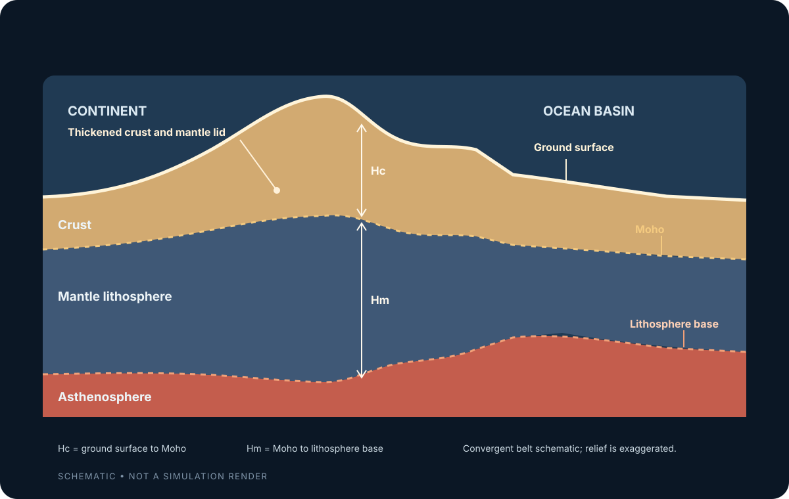
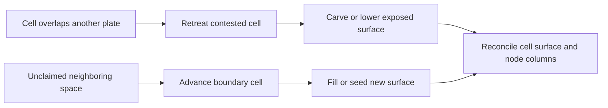

# Tectonics and lithosphere

[Back to the Simulation Model index](../simulation-model.md).

## The short version

Tectonic plates move across the planet's surface. Where they meet, they can push together,
pull apart, or slide past one another. Those motions change the rocks beneath the surface,
which can build mountains, open ocean basins, or create volcanoes.

The simulation represents each plate as a flexible map of four-sided cells arranged on a
sphere. The cells form an **adaptive mesh**: a large cell can be split into four smaller
cells where more detail is needed. Each cell carries a vertical rock column, and the model
uses that column to calculate the height of the land or depth of the ocean above it.

## Two layers beneath the surface: Hc and Hm

Each cell's rock column has two main thicknesses:

- **Hc** means *crust thickness*: the thickness of the planet's outer rocky crust. Earth's
  crust is the layer that includes the continents and ocean floor.
- **Hm** means *mantle-lithosphere thickness*: the thickness of the strong uppermost mantle
  that moves with the crust as part of a tectonic plate. It is only the upper, rigid part of
  the mantle, not the entire mantle beneath the planet.

Usually Hm is greater than Hc. For example, the simulation starts a typical continental
column with about 35 km of crust (Hc) over about 100 km of mantle lithosphere (Hm). A mature
ocean-floor column starts with about 11 km of crust over about 40 km of mantle lithosphere.
Very young crust at a mid-ocean ridge is a special case: its mantle lithosphere starts thin
and grows as it cools.

The two thicknesses matter because they help set a column's buoyancy. In the simulation,
thicker, less-dense crust tends to raise the surface, while denser mantle lithosphere tends
to lower it. The model combines both effects to calculate elevation, a balance called
**isostasy**. It recalculates the surface when either layer changes, so mountains and ocean
basins follow the structure of the rock column.

The boundary between the crust and mantle is called the **Moho**. It is marked in the
cross-section below.

*This conceptual cross-section shows the two thicknesses the simulation tracks. A mountain
belt can have thicker crust and thicker mantle lithosphere than the surrounding plate. The
drawing is simplified and its relief is exaggerated; it is not a simulation render.*

At plate boundaries, the simulation changes Hc and Hm according to the kind of motion:

- **Plates push together:** continental crust thickens along with its mantle lithosphere in
  the collision zone, helping build mountains. Oceanic crust is usually subducted. Where it
  sinks beneath a continent, melting can add extra crust to a volcanic arc; this added crust
  increases Hc without necessarily increasing Hm.
- **Plates pull apart:** the crust and mantle lithosphere thin. If the crust gets thin enough,
  melting adds new oceanic crust at the opening boundary.
- **Plates slide past:** the simulation adds a small amount of local surface uplift, without
  changing Hc or Hm through that uplift term.

## Boundary evolution

### How a plate changes during each time step

First the plate rotates according to its motion. Then the simulation checks whether parts of
its territory overlap a neighbor or leave open space behind. An overlap marks crust being
overridden or compressed; open space can be filled as the plate edge advances. These
geometric checks decide how the plate's cells change. A separate motion calculation helps
distinguish convergence, spreading, and sliding near the boundary.

The implementation uses two operations each step: `Plate.shift` rotates the plate, and
`Plate.deform` updates its columns and territory. The detailed rules below describe how those
operations work.

The simulation no longer uses boundary velocity alone to decide how every node changes.
Geometric overlap detects contested territory, while an open, unclaimed space indicates
where a boundary may advance. The relative closing rate is still used for some decisions,
including identifying active continental collisions when plates may merge (see
[Merge and split](#merge-and-split)).

The overview above explains the main ideas. The sections that follow are a more detailed
reference: they describe specific rules the simulation uses and point to the code that
implements them.

### Implementation details: plate motion and deformation

Each plate runs two operations every step, in this order:

1. **`shift(world, years)`** -- refit the plate's Euler pole from the mantle-flow field
   (damped toward the new target, same fit-then-clamp as generation-time, see [Mantle
   flow](foundations.md#mantle-flow)), then rotate rigidly by `years` at that rate: exact for every node
   the plate carries, no resampling (see [Plate-local frames](foundations.md#plate-local-frames)). Returns
   `D`, the greatest angular distance any of the plate's own nodes actually moved this
   step -- a real, physically grounded bound on how much crust could plausibly have been
   created, destroyed, or stretched this turn. Runs for every plate; order doesn't matter
   here, since rotating one plate only ever touches its own `frame`.
2. **`deform(world, other_plates, years, D)`** -- reconcile the plate's actual post-`shift`
   footprint against the footprint it's entitled to occupy: the sphere minus every *other*
   currently-live plate's own territory (its active cells). Runs once per plate, in a **freshly randomized order every turn** -- the reason
   is explained below.

A node is **contested** if it's now geometrically contained in some other live plate's
territory (`Plate.contains_batch`, checked only for nodes a cheap bounding-sphere prefilter
can't already rule out). Contested nodes are what used to be "convergent"; nodes that are uncontested and
far from every neighbor are what used to be "divergent" (open, unclaimed territory); nodes
that are uncontested but still close to a neighbor are "transform." This reframing needs no
real polygon union/intersection/subtraction machinery at all: "is this point in the union of
every other plate's territory" is just "is it contained in *any* one of them," a plain
boolean OR over the same containment test used everywhere else. The per-node consequences
below are computed by `lithosphere_plate.deform_columns`; the cell-level changes (which cells
retreat, which open) by `quad_tectonics.py` -- see [Quad-surface
deformation](#quad-deformation).

**Why randomize the processing order.** Two plates can both border the same unclaimed
patch of sphere (a polar cap nobody's reached yet, or ground a subducted neighbor just
vacated) -- if both tried to claim it in the same turn from a shared starting snapshot,
they'd overlap. Instead, each plate's "what am I entitled to" check runs against whatever
state its neighbors are *currently* in: a neighbor already deformed earlier this same turn
reflects this turn's change, one not yet reached doesn't. Whichever plate's turn comes first
claims the space; by the time a later plate checks, that space is already gone from its own
entitled footprint. Randomizing the order every turn (seeded by `(world.seed,
round(world.elapsed_years))`, so a replayed session still reaches the same order given the
same history) is what keeps this fair on average across many turns, rather than always
favoring whichever plate happens to be processed first.

**What each boundary class does to the column.** `lithosphere_plate.deform_columns` changes
crust and mantle-lithosphere thickness (Hc/Hm) and lets isostasy move the surface; only the
transform term below writes elevation directly. The near-boundary band (`reach_rad`,
`torque.BOUNDARY_FORCE_REACH_MULTIPLIER` = 3 spacings) is split by closing rate into
convergent, divergent and transform nodes (see the motion-based classification below). The
older elevation-line surface instead added per-case elevation deltas with their own distance
tapers (a banded arc, a trench rate, a 300 km rift reach); #251 retired it, and with it those
deltas.

- **Convergent** (either crust type) -> yield-limited plastic shortening
  (`rheology.apply_convergent_deformation`), scaled by `orogen_contested_strength` (the
  collision tuning knobs, boosted by how much of the band is in overlap -- see
  `OVERLAP_UPLIFT_SEVERITY_GAIN`) and, in "fault" mode, by `fault_influence`. The shortening
  is spread into the plate's interior by the shortening cascade (`shortening.py`, issue #314),
  and part of the core band's strain leaves as lateral magma parcels (issue #205). The result
  is a broad crumple zone, matching how wide a real collision belt is (e.g. the
  Himalaya/Tibetan Plateau). Continental crust is stamped `ELEV_CHANGE_COLLISION`
  (continental neighbour node) or `ELEV_CHANGE_SUBDUCTION_ARC` (oceanic neighbour node);
  oceanic crust `ELEV_CHANGE_TRENCH`, and its contested cells subduct (see retreat below).

  **Reverse faults: mountain ranges aren't uniformly smooth.** Real shortening in a collision
  belt isn't spread evenly across the whole zone -- fold-thrust belts partition it into
  discrete thrust sheets (fast-rising ridges) separated by footwall synclines/intermontane
  basins that keep rising far more slowly (the north-south rift valleys cutting across the
  Tibetan Plateau's overall convergent uplift; Basin-and-Range-style extension nested inside
  the Anatolian collision zone). In continental crust the convergent strain rate is
  multiplied by a `fault_factor` -- 1.0 almost everywhere, dropping to
  `rheology.REVERSE_FAULT_VALLEY_UPLIFT_FACTOR` (0.15) where a smooth, deterministic noise
  field (`BoundaryContext.fault_noise`) falls below -0.15. Those nodes still thicken, just far
  slower than their neighbours, so a valley opens between ranges as the belt grows. The noise
  is sampled in the plate's own *local* frame, seeded from `(world.seed, plate_id)`, so a
  downthrown block stays attached to the same crust as the plate rotates (see [Why not a
  grid](foundations.md#why-not-a-grid)). The elevation-line surface applied the same factor to elevation
  directly; there, with the seismic-erosion addition below, it cut the share of land pegged at
  `MAX_ELEVATION_M` from roughly 9% to under 2% on a 60 Myr seed run.
- **Continental arc** (continental crust, converging oceanic neighbour node) -> on top of the
  shortening, `rheology.apply_arc_magmatic_thickening` adds juvenile Hc across the whole
  `arc_band` -- every continental node within `reach_rad` of the converging oceanic neighbour, weighted
  1 at the contact and fading to 0.3 at the band edge. Not gated by `fault_influence`: a
  volcanic arc is a broad magmatic swath. See the continental arc magmatism note below.
- **Transform** -> a modest direct elevation delta, `TRANSFORM_UPLIFT_RATE_M_PER_MYR`
  (100 m/Myr) times `fault_influence`, with no distance taper -- strike-slip motion shoulders
  up local pressure ridges without net crustal shortening, so it bypasses Hc. Because nothing
  else consumes it, relief a node carries above what its column supports decays at
  `UNBACKED_RELIEF_DECAY_PER_MYR` (issue #189).
- **Divergent** -> `rheology.apply_divergent_deformation` thins Hc and Hm (a craton resists,
  `cratons.CRATON_RIFT_RESISTANCE`); a column thinned past the rift threshold melts through
  and erupts fresh crust (see [Volcanism](#volcanism)), and one that thinned past
  `RIFT_VOLCANISM_ONSET_HC_M` without melting gets a partial magmatic underplate
  (`apply_rift_magmatic_thickening`). Elevation follows the thinner column through isostasy.
- **Structural change: retreat and advance.** Contested cells at the plate's edge are removed
  and open ground in front of an uncontested edge gains new cells, both bounded by `D`
  (this step's own physical bound -- see `shift()` above) and a per-step safety cap; see
  [Quad-surface deformation](#quad-deformation) for how. The physics those cell operations
  carry:

  **New areal crust is oceanic, except at an active margin.** Ordinary new ground is a rift
  opening: the share of each new cell that lines up with the plates' separation stretches the
  crust behind it, volume conserved, and the rest is fresh magmatic crust seeded at the
  *oceanic* reference column (`lithosphere_plate.growth_seed_thickness()`) regardless of the
  plate's own `crust_type`, because any gap that opens on the sphere is floored by sea-floor
  spreading, not by the neighbouring plate's crust. Seeding a continental plate's own
  reference column there was a real land-area runaway: continental plates continuously grow
  into space subducting oceanic plates vacate, and continental crust never subducts back, so
  every such step permanently converted ocean floor into ~+200 m dry land (measured land
  fraction climbed 0.27 -> 0.48, mean planet elevation rose ~1.7 km over 180 Myr on one seed).
  New oceanic crust on a continental plate lands ~-3.5 km -- a drowned passive margin /
  accreted terrane. Genuine continental rifting thins *existing* crust
  (`rheology.apply_divergent_deformation`).

  The one exception is a continental plate's *leading* edge advancing into space a subducting
  oceanic slab is vacating (slab rollback / trench retreat). That ground is juvenile arc +
  accreted-terrane crust, so a new cell beside the arc band is seeded at
  `ARC_MARGIN_SEED_HC_M` / `ARC_MARGIN_SEED_HM_M` (~28 km / 55 km -> a shallow ~-450 m forearc
  that builds to land as convergence continues) rather than the drowned oceanic column,
  stamped `ELEV_CHANGE_SUBDUCTION_ARC`. This is the deliberately restricted reverse of the
  runaway above: a thicker seed *only* where the growing edge abuts a genuinely converging
  oceanic slab -- and still under the volume-budget gate below -- is arc accretion, the
  land-decline driver's physical counterweight ("an oceanic plate subducting under a
  continent makes more continent").

  **A continental edge retreats whether the overriding neighbour is oceanic or
  continental**, gated to contested patches of at least `CONTINENTAL_CONTESTED_RETREAT_MIN_RUN`
  cells (so boundary fuzz can't nibble a stable coast). Against an *oceanic* neighbour this
  is a passive margin (the slab descends under the buried continental cell, which is
  genuinely subducted and lost). Against a *continental* neighbour it is a suture whose
  territory overlap is **consumed into the orogen as accretion**: the retreated column's
  crustal volume is conserved and thrust onto the plate's own surviving cells behind the
  suture front, up to `SUTURE_ACCRETION_MAX_HC_M` (~2.4x reference Hc); past that it spreads
  farther and escapes along strike before any of it delaminates (see [Orogenic relief before
  delamination](#orogenic-relief)). Before any retreat at all, a continent-continent suture
  only crumpled in place, so a deep territory overlap just sat there for tens of Myr until
  `merge_split`'s forced-merge timer fused the pair (on `seed 656865324` @ 60 My, plate 8 sat
  17% on top of plate 6 since 33 My; with retreat it drains to ~2% within ~1.5 My). Retreat
  also breaks the **continental node ratchet**: a continent whose contested leading edge
  never gave ground while its trailing edge kept growing tiled itself with ever more drowned
  accreted-margin crust, and the dry-land fraction drifted down under a fixed sea level.

  **Interior subduction** is oceanic-only: a plate also removes contested ocean-floor patches
  stranded in its interior (a neighbour rotated bodily over them faster than its edge could
  retreat), leaving a hole the peel continues from. A continent's middle is never carved,
  since cutting it would sever the landmass into a spurious defragmentation plate. Before
  this, a continental lobe planted mid-plate on an oceanic plate left a frozen overlap that
  never healed (`seed 888151728` at 6.9 Myr, plates 9 and 1).

  **The continental area budget suppresses growth of continental-coded area.** A continental
  plate sheared into a much larger envelope by a far-off Euler pole can tile drowned passive
  margin outward (a plate reaching ~16% of the whole planet, with 70%+ of its own area below
  sea level, was a long-run symptom). `lithosphere_plate.boundary_context` compares the area
  of continental-coded nodes with its *genuine* continental area: continental cells with
  `crustal_thickness_m` at least `CONTINENTAL_BUDGET_HC_FRACTION` (0.6) of the continental
  reference. Once continental-coded area exceeds `CONTINENTAL_AREA_BUDGET_MULT` (1.8) times
  genuine area, it suppresses all areal growth for the step. Oceanic-coded cells do not count,
  even on a continental plate (#447); ordinary boundary growth seeds oceanic-coded cells.
  Therefore this gate does not bound a continental plate's total footprint. The long-run
  stress check tracks both measures and asserts the area this gate controls.
  Retreat, divergent thinning and convergent thickening keep running while growth is
  suppressed. The >1 multiplier allows continental shelf and accreted-terrane area.

  Mass conservation lives here: material is only created where new cells open and destroyed
  where cells are genuinely overridden -- there's no grid-resampling step that can lose or
  duplicate it.

**Overlap stays bounded.** The randomized-order design above means a plate's own "what am I
entitled to" check can be up to one turn stale against a neighbour not yet processed this
same turn, and two plates' lattices sit in different frames, so whole cells can't tile the
boundary between them exactly: a thin doubly-covered margin always remains (see
[docs/surface-parity.md](../surface-parity.md)'s C3 gate, which bounds it at 2% of the sphere).
Deeper overlap is contested and so retreats, subducts, or thickens into an orogen.

**Boundary classification is motion-based (torque engine, 2026-09).** `torque.classify_boundary_nodes`
used to be purely geometric: `contested` meant "currently inside a neighbour polygon" and
*everything else* in the near-boundary band was `divergent`. That thin, transient overlap
line was the only thing that read as convergent -- a boundary that was genuinely converging
but hadn't visibly overlapped yet was inert (no uplift, stamped "Divergent rift/ridge"), and
transform boundaries were lumped in with divergence, so the "Last elevation change" view ran
~175:1 divergent-to-convergent when the actual closing rates were roughly balanced. It now
partitions the band by the **sign of the closing rate** it already computes
(`rheology.normal_closing_rate_m_per_s`): `> +BOUNDARY_TRANSFORM_RATE_M_PER_S` → convergent
(builds an orogen before any overlap), `< −` → divergent, in between → transform (which
finally has its own gentle pressure-ridge uplift term, `TRANSFORM_UPLIFT_RATE_M_PER_MYR`).
Geometric `contested` is kept, folded into `convergent`, and is still the *only* trigger for
node deletion / continental retreat -- those must stay overlap-driven.

**Boundary loads use one line measure per neighbour front node (#468).** Slab pull, sunk-slab
drag, ridge push and contact drag are boundary processes: each sampled node contributes only
its share of the along-front length, `ds / rows_for_front_node`, where `ds` is
`line_spacing_rad(node_density) * PLANET_RADIUS_M` and the front node is identified by the
nearest neighbour's `(plate_id, node_index)`. The same weight is used by the four equations;
contact traction converts its share of force per metre back to a per-node coefficient using
that node's accounting area. Thus widening the band or repeating rows does not multiply the
load on a represented front segment. The force functions cache the weights on the per-step
`BoundaryForceInputs`; basal drag remains an area integral over the whole plate. The
synthetic normalization probe is `bin/debug/probe_boundary_load_normalization.py`, and the
equation checks are in `backend/unit_tests/test_torque.py`. The discretization still assigns
one `ds` to each distinct represented neighbour front node, so the represented length can
differ slightly from the geometric boundary span at coarse density or near the band edge.

**Spatial load transfer for rift diagnosis (#487, 2026-10-19).**
`torque.gather_per_node_force_field` returns each existing slab-pull, slab-drag, ridge-push,
basal-drag and contact-drag contribution as a per-node vector in N, before plate torque
aggregation. `PerNodeForceField.total_traction_pa` is the area-average applied external
traction; it is not internal stress. `thin_shell.solve_force_field` projects those loads onto
the spherical tangent plane, removes the area-weighted rigid-rotation component handled by
plate motion, and solves a linear membrane equilibrium problem on a triangular mesh. It uses
outward convex-hull facets by default and accepts explicit triangle connectivity to preserve
nonconvex outlines. It returns nodal incremental depth-integrated membrane stress resultants in N/m,
the largest positive principal extensional increment, and its ratio to a caller-supplied
depth-integrated *additional normal-fault strength* in N/m. The shell tensor is an elastic
increment from a zero-load reference with tension positive. The column capacity is the additional
horizontal extension to failure from an assumed background stress (`K0`); the comparison assumes
vertical compression remains the major principal stress. Explicit names are
`max_incremental_extensional_resultant_n_per_m`,
`extensional_capacity_resultant_n_per_m`, and `extensional_failure_ratio`; old tensile-named
fields remain compatibility aliases. Elastic modulus, thickness and integrated capacity are
explicit inputs. The triangle mesh must be element-connected: the solver rejects disconnected
components because each piece has additional rigid modes that the plate-wide rotation removal
does not handle. Replay diagnostics skip such events rather than report their residual or capacity
as valid. `orogeny.steady_moho_temperature_c`
provides a coarse conductive Moho-temperature proxy, and `moho_temperature_c` applies its
tectonic lag; neither supplies a vertical yield-strength profile or integrated extensional
capacity.
The boundary-local scalar Mohr-Coulomb proxy in `rheology.yield_excess` is not such a profile.
A manufactured uniaxial load on a shallow spherical cap recovers the analytic
resultant within 0.16% on 3 × 3, 5 × 5 and 9 × 9 node grids. An irregular convex cap recovers its
analytic free-edge load within 0.12%; clamping its west edge shifts the mean resultant by 2.82%
with a small equilibrium residual. An L-shaped concave mesh recovers its manufactured free-edge
load within 0.16% at both 9 × 9 and 17 × 17 resolution, with less than 0.001% spread. On the finer
mesh, west and south clamps shift the mean resultant by 16.5%; these are sensitivity checks, not
accuracy benchmarks or evidence for a preferred physical boundary condition. Representative
generated-plate node sets were also checked with seed 7, 12 plates and node density 0.5. The
largest hole-bearing oceanic plate (2390 nodes) and largest single-loop continental plate
(1988 nodes) had 2.48% and 2.38% outside-territory centroids in their convex-hull meshes. Explicit
territory-clipped meshes retained their two-loop and one-loop boundaries and recovered the
controlled shallow-cap resultant within 0.09%. This shallow-cap result tests topology only; the
separate original-coordinate solve below probes the broad curved meshes under a controlled load.
The same two meshes were also solved on their original broad curved coordinates under a projected
manufactured edge traction. Free-node residuals stayed below `8.5e-5` of load; clamping boundary
nodes in west/east/south/north bands changed the mean resultant by up to 23.5% on the oceanic plate
and 8.9% on the continental plate. A separate independent spherical-shell manufactured solution
uses uniform isotropic membrane tension, its analytic conormal edge traction and normal pressure
support. At 5 × 9, 9 × 17 and 17 × 33 nodes, mean extensional-resultant error decreases from 2.94%
to 1.46% to 1.18%; the fine-grid p95 absolute error is 2.75% and equilibrium residual is
`8.65e-6` of load. The single-plate diagnostic uses free in-plane displacement with supplied nodal
loads as boundary loading. Fixed-edge cases are sensitivity probes because no neighbor displacement
reference is available; paired clamps shift mean resultants by up to 46.6%, and clamping the full
boundary suppresses them by about 100%. These constraints do not represent tectonic boundary
conditions. Physically coupled plate edges require a multi-plate solve. An offline candidate
capacity `T_cap = T_ref * (1 - lambda * w)` was also swept against
the manufactured resultants, where `T_ref` is a caller-selected capacity and `w` is a prescribed
weak-zone weight. It localized the threshold response as intended, but its inputs are uncalibrated
design values and are not part of production deformation. Neighbor coupling, faults, bending,
plastic yielding and topology changes remain outside this read-only diagnostic. The source-force
moments are checked against
existing torque terms in `backend/unit_tests/test_torque.py`; synthetic equilibrium, rigid-rotation
removal, linear load scaling and mesh/edge cases are checked in `backend/unit_tests/test_thin_shell.py`.

**Deep interpenetration is classified too (torque engine, 2026).** The polygon-containment
test used to run only on nodes within `reach_rad` (~3 spacings) of a neighbour node, so a
plate that had slid *deep* over another had its deep-interior overlapping nodes classified
as neither contested nor divergent -- no thickening, no subduction, the overlap just sat
(observed: 15% of one plate on top of another, static). `torque.classify_boundary_nodes` now
also polygon-tests any node inside a neighbour's bounding sphere (cheap triangle-inequality
prefilter). A deep continental overlap then classifies contested -> `rheology` thickens
Hc/Hm -> **mountain uplift**; a deep oceanic overlap classifies contested -> subduction
deletion -> the overlap heals.

The thickening half of that quietly did nothing until 2026-09:
`rheology.EFFECTIVE_LITHOSPHERE_VISCOSITY_PA_S_PER_M`, the scale converting a boundary-normal
closing rate into the Mohr-Coulomb normal-stress proxy, was ~3-4 orders of magnitude too
small, so `plastic_strain_rate_per_myr` never cleared the yield stress at *any* closing rate
`mantle.MAX_PLATE_RATE` allows and `apply_convergent_deformation` returned Hc unchanged on
every contested node -- no collision in the engine's history built a mountain, continents
only ever thinned and drowned, and the stalled multi-plate overlaps the `overlapAge` view
shows (some stuck 100+ Myr) never crumpled into orogens. Recalibrated to `1e17` (a sustained
~3 cm/yr collision now sits a few x past yield: Hc doubles over ~45 Myr, the Himalaya/Tibet
timescale); `backend/unit_tests/test_rheology.py` pins it. See
[GitHub issue #119](https://github.com/adubey/mantle-bloom/issues/119).

**Continental arc magmatism (2026).** `apply_convergent_deformation` is yield-limited plastic
*shortening* -- it conserves crustal volume, and only bites at the contested contact line (a
few tens of nodes). Real Cordilleran margins also *grow* crust: the subducting slab dehydrates,
fluxes the mantle wedge, and the melt underplates / intrudes the overriding continental plate
across the whole arc band inboard of the trench. `lithosphere_plate.boundary_context` computes an
`arc_band` -- this plate's own continental nodes within `reach_rad` (~500 km at default
density) of a *converging oceanic* neighbour -- and `rheology.apply_arc_magmatic_thickening`
adds juvenile Hc there (Hc only; the contested subset's Hm is dragged along by the shortening
term), fading from the trench inboard and scaled gently by convergence rate. This is *added*
mass (from the mantle, not conserved from the neighbour) and is **not** yield-gated. Together
with the arc-crust growth seed above it is the crust-building answer to "an oceanic plate
subducting under a continent makes more continent" -- the land-fraction decline's physical
counterweight ([GitHub issue #120](https://github.com/adubey/mantle-bloom/issues/120), "Land fraction slowly declines"). Long-term footprint is still
bounded by the volume-budget gate. `backend/unit_tests/test_rheology.py` pins the calibration.

**Hc/Hm growth ceiling (2026-09, issue #161).** The recalibration above made
`apply_convergent_deformation` actually thicken crust -- but multiplicatively, every step a
node stayed convergent, with no upper bound at all. A node sitting in a long-lived convergent
regime compounds that exponentially: a 626 My / 6,265-step save measured Hc up to 413,885 m
and Hm up to 1,311,592 m, more than an order of magnitude past anything geologically real. The
elevation *cache* (`isostatic_elevation(Hc, Hm)`, synced onto `elevation` by `deform`'s own
before/after delta) stays clipped to the world's physical `[MIN_ELEVATION_M, MAX_ELEVATION_M]`
bounds, but the underlying Hc/Hm kept climbing unseen beneath that clip -- so the moment such a
node's regime flipped (rifting, a sudden erosion event), the delta was computed against a
wildly inflated baseline, producing single-step elevation swings of thousands of metres that
read as sheer canyon walls / cliff faces cutting through continental interiors, not smooth
terrain.

Both `apply_convergent_deformation` and `apply_arc_magmatic_thickening` now clip Hc at
`lithosphere.MAX_CRUSTAL_THICKNESS_M` (the same ~2.4x-reference, ~84 km ceiling
`SUTURE_ACCRETION_MAX_HC_M` already used for suture-accretion overflow -- both paths now agree
on where continental crust actually maxes out before delaminating) and Hm at
`MAX_MANTLE_LITHOSPHERE_THICKNESS_M` (same 2.4x ratio against the continental Hm reference, in
the real ~200-250 km range cratonic keels bottom out at). Arc magmatism's overflow is simply
not added -- it's juvenile mass from the mantle wedge, not conserved from anywhere, so refusing
to add more past the ceiling loses nothing that existed a moment ago.

`apply_convergent_deformation`'s overflow is different: real over-thickened crust doesn't just
vanish at its strength limit. A first fix thrust the *entire* clipped-off Hc onto the
surrounding crust in one instant, every step -- its own runaway ([GitHub issue
#145](https://github.com/adubey/mantle-bloom/issues/145): by 48 Myr into a real save, over half
of all continental land was pinned at the Hc ceiling). Two mechanisms now handle it. In
continental crust, the convergent band's shortening is carried into the plate's continental interior by
the shortening cascade (`shortening.py`, [GitHub issue
#314](https://github.com/adubey/mantle-bloom/issues/314)), which keeps every column under the
caps and leaves what the plate can't absorb in the boundary overlap for retreat and suture
accretion. What still overflows the ceiling (`deform_columns`' `ceiling_overflow`) is the
bottom of its column: `quad_tectonics._place_ceiling_overflow` melts out
`orogeny.melt_fraction` of it at that column's Moho temperature and places the melt the way a
suture front places consumed crust -- belts, escape along strike, then the far field (see
[Orogenic relief before delamination](#orogenic-relief)); the rest delaminates.
`backend/stress_tests/test_world_stepping.py`'s `two_continental_collision` debug-world test
confirms the ceilings hold over a long sustained collision.

Three more Hc/Hm growth paths needed the same ceiling, found by running that debug world long
enough to actually saturate the tectonic cap and checking every subsequent step. Plate
*generation* itself can seed a continental node above the ceiling from noise alone (confirmed
directly: 85,349 m on one seed, before any deform() ever ran) -- `generate_plates`/`new_plate`
now upper-clip there too, same as their existing `MIN_CRUSTAL_THICKNESS_M` floor, since this is
generation-time noise rather than real tectonic mass and doesn't need conserving. `erosion.py`'s
own Hc update (a column's crustal thickness absorbs net sediment deposition directly, the
same delta idiom deform() uses -- see "Erosional isostatic compensation" below) has no upper
bound of its own, so ordinary deposition landing on a column deform() had already
driven to the ceiling this same step could push it over by a few metres; now `np.clip`'d at
the same `MAX_CRUSTAL_THICKNESS_M`, with the overflow simply not booked (a thin, incidental
sliver, not a source of runaway growth the way unbounded multiplicative thickening was, so
not worth threading through erosion's own already-elsewhere redistribution accounting). And
every place Hc/Hm growth is conserved by scaling Hm in *proportion* to a capped Hc's own
growth ratio (suture accretion, `quad_merge`'s stacked-overlap remap) can still carry Hm past
its own ceiling even though Hc's is respected: a cell that started with very little Hc sees a
large new-Hc/old-Hc ratio when a consumed column's volume lands on it, and that ratio
multiplies Hm too. Every one of those sites also clips its own Hm result at
`MAX_MANTLE_LITHOSPHERE_THICKNESS_M`.

The floor needed the same treatment ([GitHub issue #256](https://github.com/adubey/mantle-bloom/issues/256)).
Thinning by a fractional share -- the donor cells `quad_tectonics._open_rift` stretches to
cover a rift opening -- only resets a column when its Hc melts through
`RIFT_CRITICAL_THICKNESS_M`. Oceanic crust already below that threshold never does, so
repeated rifts compounded its Hm toward zero. The donors' Hm is floored at
`MIN_MANTLE_LITHOSPHERE_THICKNESS_M`, and `quad_merge`'s remap holds newly created cells to
both caps, not only the stacked suture cells. As a backstop, `step_world` runs
`lithosphere.clamp_column_caps` on every plate once the step's last Hc/Hm writer (volcanism)
has finished. It clips both fields into their caps, shifts elevation by the isostatic change,
and books anything it adds or removes under `phase_budget`'s `column_cap_clamp` phase. That
phase should stay empty. A nonzero entry means some writer upstream is missing its own cap.

Every node's onset year is also stamped onto its
`overlap_onset_years` field each step (`merge_split.update_overlap_tracking`) and
surfaced as `since_years` in `GET /world/plates` and the `overlapAge` debug render view --
see [debugging.md](../debugging/map-views.md#overlapage-render-view-plate-overlap-onset).

**Consuming a continent-continent overlap (2026-09).** A contested continental edge
retreats against a *continental* neighbour too, not only an oceanic one (see [Boundary
evolution](#boundary-evolution) / `CONTINENTAL_CONTESTED_RETREAT_MIN_RUN`), so the territory
overlap of a stalled suture is consumed geologically instead of only by the forced-merge timer
below. The retreated column's volume is conserved as accretion onto the plate's own cells
behind the suture front (see [Quad-surface deformation](#quad-deformation)), so the overlap
crumples into an orogen rather than the boundary just sliding back. On
`seed 656865324` @ 60 My, plate 8's 17%-since-33-My overlap on plate 6 drains to ~2% within
~1.5 My, with no spurious defragmentation plates and a flat node count.

**Forced merge for a stuck continental pile-up (2026-09).** A continent-continent overlap
that classifies contested now *thickens*, but the two plates still don't *fuse* -- and the
worst pile-ups (a long-run save showed ~9 continental plates mutually overlapping 5-60%,
some since 100+ Myr) overlap so completely they no longer register any closing rate, so
`find_continental_collision_pairs` never sees them and `World.collision_progress` never
accumulates. `merge_split.update_overlap_progress` adds a second sustained-timer,
`World.overlap_progress`, on the *territory-overlap* signal instead of the closing-rate one:
for every continental pair whose node clouds interpenetrate by at least
`FORCED_MERGE_OVERLAP_FRACTION` (of the more-covered plate), accumulate years; once a pair
passes `FORCED_MERGE_SUSTAINED_YEARS` it is fused regardless of the size/closing-rate roll
(`apply_topology_changes`, at most one forced fusion per step, and skipped on a step that
already merged a ready closing-rate pair). Separately, `_merge_probability` now also lifts a
large pair's odds toward certainty in proportion to `|omega_a - omega_b| / MAX_PLATE_RATE` --
a fast, decisive convergence merges more readily than a slow oblique graze.

## Quad deformation

**Conceptual diagram — boundary cells retreat or advance while deformation cuts or fills their surface; exact masks depend on local overlap and boundary class.**

This is a process sketch, not a geometric map. See the boundary-class rules below for which
columns and cells each operation changes.

Each plate's `deform()` (issue #228) classifies its boundary and updates every node's column
through `lithosphere_plate.boundary_context` and `deform_columns` (above), once per plate, then
changes its territory with two operations on the cell graph. They replaced the retired line
engine's row-shaped operations (end-trim, end-stretch, row claims, a corner-notch filler, a
leading-row drop and regularization), each of which existed only because a row can grow or
shrink along its own axis alone:

- **Retreat.** Any retreatable cell (the same `shrinkable` set, with the continental
  minimum-run rule applied to connected components) that has a wholly exposed side is
  removed. The newly exposed layer is considered next, up to this
  step's displacement in cells and the usual per-step cell cap. A continental suture's
  consumed volume goes onto the surviving cells within `SUTURE_ACCRETION_SPREAD_NODES` hops
  behind that suture front, conserved by exact cell area. Once that band is full the crust spreads farther, escapes along strike, and only then may partly
  delaminate; see [Orogenic relief before delamination](#orogenic-relief).
  The issue #177 retreat budget is spent in area-weighted Hc.

  A plate also subducts contested ocean-floor patches the peel can't reach (`_carve_interior`).
  A patch qualifies when it is an edge-connected component of at least
  `INTERIOR_SUBDUCTION_MIN_CELLS` retreatable cells and none of its
  cells has a wholly open side; touching open ground only through half a side doesn't count.
  It is removed whole, which opens a hole in the plate. The carve shares the step's cell cap
  with the peel: a patch larger than what is left is carved partway, as a connected
  breadth-first prefix, so the hole gives next step's peel an edge to continue from.
  Continental cells are never carved, since cutting a continent's middle would sever it
  into a spurious defragmentation plate.
- **Advance.** Each uncontested boundary cell with open ground in front of it activates the same-level empty cell across each exposed side,
  for up to `MAX_CLAIM_ROWS_PER_STEP` layers. A candidate cell must not lie inside any
  neighbour, and must be farther than `EXTEND_THRESHOLD_MULTIPLIER` spacings from every
  neighbour node. Each new cell is a rift opening (`_open_rift`). The share of its footprint
  that lines up with the direction to the nearest neighbour is covered by stretching the
  `K_NEIGHBOUR_ROWS_FOR_MASS_CONSERVATION` layers of cells behind it, with volume conserved
  exactly. The rest is fresh magmatic oceanic crust. A cell that is mostly magmatic is a
  vent: it starts a volcano lifecycle without changing its column. An active continental
  margin grows `ARC_MARGIN_SEED_*` arc
  crust instead. The continental area-budget gate is measured in area, not node count.

Growth never follows a lattice axis, so a plate advances isotropically and there are no row
stubs to regularize. Cell insertion keeps the mesh 2:1 balanced by rejecting any candidate
that would border a leaf two levels away. Quad pairs merge through `quad_merge.py`.

The whole-world passes read territory from the cells rather than from node distances:

- **Overlap tracking.** `plates.compute_node_overlap` flags a node when its centre lies
  inside another plate, the same containment test the contested classification uses.
  Candidate pairs come from bounding caps, so a plate buried wholly inside another is still
  seen. A node-proximity tolerance would miss about a third of real overlap, because two
  plates' lattices never line up node for node. `overlap_onset_years`, the forced-merge timer
  and the plate stress accumulator all read this.
- **Gap filling.** Every step, the sweep counts a point as uncovered when no plate contains
  it; a node-distance reading (no node within `COVERAGE_RADIUS_MULT` spacings) couldn't see
  the seam about one cell wide that advance's standoff leaves between two plates. Adjacent
  plates grow into every uncovered cluster through the same frontier walk (`grow_frontier`),
  with no standoff. Clusters below `MIN_GAP_NODES` are pooled, so each plate grows once per
  pass, and aren't logged as gap events. `MIN_GAP_NODES` still gates spawning a new plate
  (`lithosphere_plate.new_plate`). Two plates' lattices sit in different frames, so whole cells
  can't tile the boundary between them exactly, and a thin uncovered and doubly covered
  margin always remains. Measurements are in
  [analysis/issue228-phase4-passes/report.md](../../analysis/issue228-phase4-passes/report.md).
- **Volcanism.** Volcanoes erupt through the field API. Each node's eruption draw is keyed
  by the seed, step, plate and the node's stable ID (`SurfaceNodes.node_ids`, the cell key),
  so adding or removing cells elsewhere on the plate doesn't change it.

### Orogenic relief

Continental collision mostly shortens, thickens and moves crust around (issue #290). Lower-
crustal delamination is real, but it needs a dense eclogitized root that is hot enough to
detach. Reaching the numerical Hc cap is not one of those conditions. On quad plates, the
over-thickened crust of a suture or a standing orogen goes through these processes:

- **Thermal proxy.** `steady_moho_temperature_c` is the steady-state conductive geotherm of a
  column with uniform radiogenic heating in the crust (`CRUST_HEAT_PRODUCTION_W_M3`, 0.7
  uW/m^3) over a lid with none, between 10 C at the surface and 1330 C at the lithosphere's
  base. A reference column (35 km crust, 100 km lid) gets a ~480 C Moho. Doubled crust on that
  lid gets ~960 C, and on a doubled lid ~860 C.
- **Thermal lag.** Each quad cell stores `moho_thermal_lag_c`, how far its Moho sits below
  that steady state; `moho_temperature_c` subtracts it. Shortening and stacking bury the Moho
  with its old temperature (`bury_moho`), so the lag grows by however much the steady state
  rose. Rift thinning exhumes it the same way, leaving a negative lag: the column is briefly
  hotter than its new steady state. This applies to the strain `deform_columns` applies
  (convergent shortening and divergent thinning, before any arc or rift magma), and to
  suture and overriding-plate receivers. The lag then decays with an
  e-folding time of `THERMAL_RELAXATION_MYR` (25 Myr), integrated exactly. Freshly thickened
  crust therefore starts cold, and it only weakens, melts or becomes able to delaminate as it
  heats. Arc, rift and anatectic magma bring their heat with them and leave the lag alone, and
  so does ductile flow. A column that melts through to fresh crust starts at steady state.
- **Crust states.** `crust_state` sorts continental columns into cold-strong, hot-weak (Moho
  at least `DUCTILE_ONSET_MOHO_C`, 700 C), melt-eligible (`MELT_ONSET_MOHO_C`, 750 C), and
  delamination-eligible. A delamination-eligible column has at least `DELAMINATION_MIN_ROOT_M`
  (10 km) of crust below `ECLOGITE_DEPTH_M` (50 km) and a Moho at least
  `DELAMINATION_MIN_MOHO_C` (750 C), or as much restite instead (below). All of these read
  the lagged temperature. `/world/stats` reports the area in each state
  (`crust_state_area_m2`).
- **Anatexis** (`anatexis`, each quad step before collapse). The crust hotter than
  `MELT_ONSET_MOHO_C` is the melting zone. That is everything below the 750 C isotherm, taking
  temperature as linear in depth down to the lagged Moho. The bottom of the zone is restite
  (`restite_m`), which is already depleted and can't melt again. The fertile rest above it
  is processed at `ANATEXIS_RATE_PER_MYR` (10% per Myr, integrated exactly). Each increment
  gives up its mean melt fraction, which ramps from 0 at 750 C to `MAX_MELT_FRACTION` (35%)
  at `MELT_FULL_C` (950 C), and leaves the rest behind as restite. The melt rises:
  - `ANATEXIS_RELAMINATION_FRACTION` (30%) relaminates into thinner neighbouring continental
    columns, carrying its column's continental-material fraction. A receiver can't be pushed
    past the Hc cap; what it can't take stays home.
  - The rest, and all the melt of a column with no thinner neighbour, is emplaced in the
    column's own upper crust, which changes no thickness.

  Cratonic crust is refractory, so anatexis never changes a craton (#340). In a partly
  cratonic column:
  - the melting zone and its fertile part come from the whole column's geotherm, as above;
  - the melt and residue are then scaled by the non-cratonic share of the crust above the
    restite, (Hc - restite - craton) / (Hc - restite). The craton is treated as spread
    through that crust in proportion, not as a basal layer: orogenic crust can arrive above
    a craton (thrust sheets) or below it (underthrusting), and the model doesn't record
    which. A column whose restite and craton fill it melts nothing, so restite plus craton
    never exceed Hc;
  - relaminated melt carries the non-cratonic crust's material fraction,
    (material - craton) / (Hc - craton);
  - receivers are thinner continental columns with no craton, each up to its room under the
    Hc cap.

  Restite is
  an extensive share of Hc. It thickens and thins with its column's strain, travels
  with suture crust, and stays put when crust flows, as Hm does.
- **Residue feeds delamination.** A column's delaminable root is its crust below 50 km or
  its restite, whichever reaches higher. Restite is garnet-rich and dense well above the
  eclogite transition. Delaminating roots shed restite first, so roots that founder are
  mostly restite rather than whatever lies below a fixed depth. In the model a craton is never
  part of the root: its delaminable root is capped at its non-cratonic crust, and a shed root
  takes only non-cratonic material (#340). That is a modelling rule, not a settled result.
  Lower-crustal delamination is conditional and debated. The lithosphere eastern North China
  lost is usually attributed to its keel (Hm), and eclogitized lower crust has stayed in
  place beneath the Fennoscandian Shield for ~2 Gyr (Buntin et al. 2021), but cratonic lower
  crust may founder elsewhere.
- **Polarized collision fronts** (`crust_transfer.py`, issues #318-#320). A continental
  collision front gets a lower and an upper plate from the subduction history of the ocean
  that closed (`collision_polarity.py`). Only the lower plate's contested cells retreat. Their
  mantle lithosphere goes down with the slab (`suture_hm_subducted_m3`), and none of it is
  added to either plate. Their crust is split, with exact cell areas, into three shares of
  the crust below the mobile cover; the cover goes with the first:
  - **scraped** (`World.suture_scrape_fraction`, default 0.7): thrust onto the upper plate
    through the staged placement below (stages 1-4), seeded at the upper plate's cells
    nearest the front;
  - **underthrust** (`World.suture_underthrust_fraction`, 0.27): added to the base of the
    upper plate's continental columns within `UNDERTHRUST_REACH_KM` (200 km) of the front,
    under the Hc cap. Whatever the reach can't hold is thrust up with the scraped share;
  - **lost** (`World.suture_lower_crust_loss_fraction`, 0.03): subducted with the slab.

  An upper plate with no continental columns takes no underthrust. Scraped crust the upper
  plate can't hold goes to the front's other neighbours with continental crust, never an
  oceanic one (stage 6), then down with the slab (stage 7); the mobile cover shares the
  fate of that thrust-up crust in proportion. All fronts landing on one upper plate in a
  step share one allowance of its root shedding (stage 3). Continental material, restite and cratonic
  crust split in the same proportions as the Hc. A lower-plate cell with craton never
  retreats (`cratons.retreat_allowed`), so no craton reaches the transfer: a front whose
  lower-plate candidates are all cratonic falls back to bilateral retreat, and the weaker
  crust of the upper plate takes the shortening (#340). The lost share's material is booked to
  `collision_lower_crust_subducted_m3`, apart from the no-outlet remainder. Receivers' Moho
  is buried and their elevation follows the Hc they gained. The shares are model knobs, not
  measured fractions: the partition varies along strike, and India-Asia mass balances that
  put the loss near half the converged crust are disputed. The defaults keep collision loss
  close to issue #276's calibration. They are checked at the start of each step's deform
  pass, so bad values fail before any plate deforms. `/world/stats` reports them under
  `suture_crust_transfer`. `crust_transfer.transfer_column` takes a column as volumes plus a
  world-frame front, so terrane docking (#321) can reuse it.
- **Suture accretion** (`quad_tectonics._place_suture_crust`). A front's consumed Hc tries each
  of these in turn, and only what one can't hold moves on to the next:
  1. **Belts.** It fills the first `SUTURE_ACCRETION_SPREAD_NODES` hops, then three more belts
     of that width (lateral spreading).
  2. **Tectonic escape.** It moves into the next `SUTURE_ESCAPE_EXTRA_HOPS` hops, but only cells
     within `SUTURE_ESCAPE_MAX_ANGLE_DEG` (45 degrees) of the suture's strike as seen from the
     front. The strike is perpendicular to the front's mean direction toward the overriding
     plate. A front without that direction uses its own long axis, and a compact one has none.
  3. **Delamination.** The belts shed part of their own eligible dense roots, and the incoming
     crust takes the room that frees. What sinks is the receivers' old lower crust, with its
     own continental material and cratonic crust in proportion; the incoming crust and its
     provenance are all placed. A belt cell sheds at most `DELAMINATION_RATE_PER_MYR` (5%)
     of its root per Myr, integrated exactly over the step, and a front frees at most
     `SUTURE_ACCRETION_MAX_DELAMINATION_FRACTION` (10%, calibrated in issue #276; see below)
     of its donation this way. Fronts that
     share a belt share its roots.
  4. **Far field.** It fills the nearest remaining capacity across the plate, one graph hop at
     a time.
  5. **Foreland spill.** When every continental receiver is full, the crust thrusts out over
     the plate's own non-continental cells (a drowned margin or oceanic foreland), nearest
     first. A cell left mostly continental crust is retyped continental. On seed 3, small
     plates with their whole continent at the cap caused about three quarters of all suture
     delamination before this stage existed.
  6. **Overriding plate.** A plate consumed faster than it can hold its own crust (a
     microcontinent ground into a collision) hands what's left to the quad plate overriding
     it: the neighbour containing most of the front's cell centres. There it goes through the
     same stages, seeded at the overrider's cells nearest the front, including that plate's
     own eligible roots. Continental material moves with the Hc it places. What that plate
     can't hold goes on to the plate's other neighbours with continental crust, most overlap
     with the front first, then nearest (issue #276). Two small plates grinding each other
     down are often both saturated, and each is the other's only overrider; the orogen they
     make spans their neighbours too. Oceanic neighbours are skipped, since this path doesn't
     retype the cells it fills.
  7. **No outlet.** Whatever still has nowhere to go goes down with the consumed plate, as
     deep continental subduction in a collision does: `no_outlet_subducted_m3` in the budget,
     `collision_subducted_m3` in the continental-material ledger, and `subducted_m3` for its
     craton. It was booked as delamination before issue #276. Most of it is now the
     oceanic-crust fronts of a continental suture, which have no spill or overriding-plate
     stage.

  Mantle lithosphere fills the belts and delaminates past them, as an over-thickened mantle
  root does.
- **Convergent-ceiling overflow** (`quad_tectonics._place_ceiling_overflow`). Shortening in
  `deform_columns` that would push a column past `MAX_CRUSTAL_THICKNESS_M` used to go to
  `rheology.apply_delamination_melt_intrusion`. That intruded a fixed 35% of it as melt into
  the near-field ring at a capped rate, and dropped the rest without booking it. On quad
  plates, the overflow is now the bottom of its column, melting at that column's lagged Moho
  temperature. Its `melt_fraction` (0-35%) is the melt; a column still cold after
  thickening melts none of it. Each edge-connected run of overflowing cells places its melt
  through stages 1, 2 and 4 above, seeded at those cells: belts, escape along strike, far
  field. The melt intrudes hot, so it sheds no roots and buries no Moho. The residue founders
  with its root (`ceiling_overflow_residue_m3`), and melt with no outlet is dropped
  (`ceiling_overflow_no_outlet_m3`). The shortening increment was never in the continental-
  material tracer, so none of this touches the ledger.

  Placing all of the overflow conserves Hc, but it isn't material conservation. On seed 3,
  Hc worth ~15% of the starting inventory reached the ceiling over 100 Myr. Placing all of it
  raised continental Hc by 12.7% (4.6% without it) and left suture crust, which does carry
  material, with no outlet: cumulative delamination rose to 7.6% of the inventory, against
  6.4%.
- **Collapse and ductile flow** (`relax_orogens`, at the end of each quad `deform`). Crust
  thicker than `COLLAPSE_ONSET_HC_M` (50 km, ~2.7 km of isostatic relief) spreads down
  thickness gradients into neighbouring continental columns, never into oceanic ones. Only
  the excess above the onset is mobile, so ordinary continent is never smoothed. The flux
  across a shared cell edge is a thickness diffusivity times the thickness difference,
  scaled by the edge's length over the distance between the cell centres:
  - Gravitational collapse and normal faulting (`COLLAPSE_DIFFUSIVITY_M2_PER_YR`, 1e3 m^2/yr)
    act on any such column.
  - Ductile flow (`DUCTILE_DIFFUSIVITY_M2_PER_YR`, 3e3 m^2/yr, about Tibet's lower-crustal
    channel) ramps in from 700 to 900 C of Moho temperature.
  - Cratonic crust never flows (#340). In a partly cratonic column:
    - the gradient that drives flow is still the whole column's thickness above the onset;
    - a donor's mobile crust is what lies above its craton or the onset, whichever is
      thicker, so no column drains below its craton;
    - flux into a cratonic column is cut by `CRATON_FLOW_RESISTANCE` times the receiver's
      strength. An orogen ponds against a craton and builds up or spreads along it, and
      crust thickened onto a craton relaxes away again;
    - receivers take no capacity limit, as before: flow only runs down the gradient.

  Hc moves with the `continental_material_m` fraction of its column's non-cratonic crust,
  (material - craton) / (Hc - craton), and Hm stays in place. The mobile cover still moves
  in proportion to the whole column, flux / Hc, so a cratonic donor keeps slightly more of
  its cover than its share; this is a known loose end.
  The flow is subcycled at a Courant number of 0.1, so 1 x 4 Myr and 16 x 0.25 Myr give the
  same result to within 1-2% of the relief.

`world.orogenic_relief_budget` (also in `/world/stats`) accumulates the Hc volume each stage
handled: `suture_donated_m3`, `suture_belt_placed_m3`, `escape_attempted_m3` /
`escape_placed_m3`, `delamination_attempted_m3` / `delamination_completed_m3`,
`far_field_placed_m3`, `foreland_spill_placed_m3`, `overrider_placed_m3`,
`no_outlet_subducted_m3` (saves from before issue #276 call it `no_outlet_delaminated_m3`,
renamed on load); at polarized fronts, `suture_scraped_m3`, `suture_underthrust_m3` (=
`suture_underthrust_placed_m3` + what was thrust up), `suture_lower_crust_subducted_m3`,
`upper_plate_placed_m3` and `restite_subducted_m3`; `ceiling_overflow_m3` (= `ceiling_overflow_residue_m3` +
`ceiling_overflow_melt_placed_m3` + `ceiling_overflow_no_outlet_m3`);
`anatexis_melt_extracted_m3` (= `anatexis_melt_emplaced_m3` +
`anatexis_melt_relaminated_m3`) and `anatexis_residue_m3`; `restite_delaminated_m3` (the
restite share of every shed suture root); `relief_mobile_excess_m3`, `collapse_transferred_m3` and
`ductile_flow_transferred_m3`. The continental-material ledger books delaminated roots'
provenance in `delaminated_lower_crust_m3`, the terminal remainder's in
`collision_subducted_m3`, and a polarized front's lost share in
`collision_lower_crust_subducted_m3`.

Issue #276 recalibrated these against long runs. `bin/debug/calibrate_collision_sinks.py`
steps a seed or a save and reports the retreat-processed loss (the share of donated suture
crust that delaminates or subducts) apart from the whole-inventory loss, compounded per step,
with any constant overridable for sensitivity sweeps. Earth's orogenic lower-crust
delamination is ~1.1 km^3/yr (Clift, Vannucchi & Morgan 2009), ~0.015% of its continental
inventory per Myr. On the #272 save, halving `SUTURE_ACCRETION_MAX_DELAMINATION_FRACTION` cut
collision loss from 0.21 to 0.15%/Myr; lowering `DELAMINATION_RATE_PER_MYR`, widening the
belts or escape, or changing the anatexis constants or `DELAMINATION_MIN_ROOT_M` moved it less
or not at all, and a higher Hc cap would pass Earth's ~80 km maximum. Over 500 Myr on seeds
1-6, collision keeps 95-99.7% of donated crust and loses 1-14% of the starting inventory.
That save still loses ~0.15%/Myr to collision because ~3% of its whole inventory passes
through suture retreat every Myr (the quad rotation pile-up, issue #289), not because any
one donation loses much.

## Merge and split

Unlike `shift`/`deform`, these are rare, discrete, topology-changing events, so a one-time
resample is an acceptable cost here -- the exact, no-resampling guarantee only matters for
routine per-step motion.

- **Consumption.** A plate with no real remaining territory is simply dropped from
  `world.plates` (`remove_defunct_plates`, run every step): every cell removed (fully
  subducted), or too few left to form a real 2D hull (`Plate.has_negligible_territory`,
  `OUTLINE_MIN_NODES_FOR_HULL`).
- **Continental collision merge.** If two plates' continental crust has at least
  `MERGE_MIN_CONTACT_NODES` node pairs within `MERGE_CONTACT_DISTANCE_RAD` of each other
  *and* a real closing rate at those points (`boundary.closing_rate` -- the one place this
  velocity-based check still runs; see [Plate motion: shift and
  deform](#boundary-evolution) for why ordinary per-step evolution no longer uses it), they're
  fused: keep one plate's `frame` and lattice, and remap the absorbed plate's cells onto it
  by exact cell area (`quad_merge.py`), stacking crust where the two overlap (capped at the
  suture ceiling). On newly activated cells, craton follows the local mapped pattern under
  Hc's restoring ratio. Orphan volume uses only the Hc headroom of new cells that already
  carry craton; the merge audit books any remainder to `merge_capped_m3` (issue #443). This
  keeps craton on its host column without spreading it onto unrelated cells. Cratonic crust
  in the overflow that finds no room is also booked to `merge_capped_m3` (RFC 0001, #441).
  The boundary between them becomes ordinary interior territory. A remapped
  cell is dropped if any part of it lies in a third plate's cell, or its centre is nearer a
  third plate's node than either fusing plate's, so the merged plate doesn't grow into its
  neighbours (#344). The dropped cells' volume is spread over the cells that are kept, and
  the seam they leave is closed by the next step's gap filling.

  **Why distance alone isn't enough.** plates.py's tiling has no gaps (every point belongs
  to exactly one plate at generation), so *every* pair of neighboring plates is already
  touching along their shared boundary the instant they're generated, regardless of whether
  that boundary is convergent, divergent, or transform. An earlier version checked distance
  only, and for roughly a quarter of random seeds this flagged ordinary neighbors as
  "colliding" before anything had moved at all -- a merge fired on literally the first
  simulation step no matter how small `years` was, because the trigger was a pre-existing
  generation-time condition, not anything that happened during the step. Requiring a genuine
  closing rate, not just proximity, is what actually distinguishes a real collision from any
  other pair of neighbors.

  **Why an instantaneous closing rate still isn't enough.** A curving boundary is commonly
  convergent along one stretch even while the two plates are mostly just sliding past each
  other overall -- a single step can clear the closing-rate check without the plates being
  in anything like a real collision. And real continental collisions play out over tens of
  millions of years, not one step, however small. So a pair only actually merges once
  they've been *continuously* close-and-converging for a sustained, randomized duration
  between `COLLISION_MERGE_MIN_YEARS` and `COLLISION_MERGE_MAX_YEARS` (50-100 Myr,
  randomized per pair via `_collision_threshold_years(seed, pair)` so unrelated collisions
  don't all resolve in lockstep) -- tracked in `World.collision_progress` (pair -> years
  accumulated so far) and advanced by `update_collision_progress` every step. A pair that
  stops being close-and-converging before reaching its threshold has its progress dropped
  entirely, not paused -- the collision didn't sustain -- unless a craton jams it (RFC 0008
  solution 5, #401). The collision-polarity prepass counts each pair's jammed contact nodes
  (`PolarityFrame.contacts`): a contact node holding craton that retreat would consume
  (`collision_polarity.retreat_candidates`, read before `cratons.retreat_allowed` vetoes it)
  or that faces craton on the other plate. A pair with at least `MERGE_MIN_CONTACT_NODES`
  of them whose edge isn't diverging (mean closing ≥ −1 cm/yr) is jammed
  (`find_jammed_pairs`), and a tracked jammed pair keeps accumulating and rolling even when
  the jam has braked it below the closing threshold. Only separating or diverging drops it;
  a jam alone doesn't start tracking a pair. Before this, 26–48% of drops were of jammed
  pairs (#395). And even once one or more pairs
  *are* ready, `apply_topology_changes` merges at most one per step -- multiple simultaneous
  ready pairs don't all resolve in the same call, matching how every other change in this
  model happens incrementally rather than in a batch. Confirmed directly: scanning random
  seeds at a 1M-year step size, merges now take a realistic 50-100 Myr of sustained
  collision to resolve (verified against `world.events`, see below) rather than firing on
  the first or second step.

  **Event log.** `apply_topology_changes` returns a list of human-readable strings for
  outcomes that actually changed the world this step -- a merge completing (with how many
  million years it took), a plate disappearing (consumption, in any of the senses above), a
  split creating a new plate, or a plate fragmenting into disconnected landmasses / shedding
  stranded nodes (see Defragmentation below) -- which `world.step_world` timestamps with the *post-step*
  `elapsed_years` and appends to `World.events` (capped at `world.MAX_EVENT_LOG_LENGTH`
  entries). `generate_world` logs an initial "world generated" event the same way. A
  collision merely *starting* is deliberately not logged: plates.py's tiling has every
  neighbor pair already touching at generation, so a real fraction of pairs clear the
  proximity-and-closing-rate check in `find_continental_collision_pairs` at some point
  without ever accumulating the sustained duration needed to actually merge -- logging every
  one of those would flood the console with events that don't end up mattering. The API
  returns the full current log on every `/world/generate` and `/world/step` call (see
  api-reference.md) for the frontend's collapsible console.
- **Split.** Each plate's mantle-flow samples are clustered into two groups
  (`scipy.cluster.vq.kmeans2`, k=2) and a separate Euler pole is fit to each. If a single
  rigid rotation fits the whole plate poorly (RMS residual above
  `SPLIT_RMS_RESIDUAL_THRESHOLD`) *and* the two clusters' poles genuinely disagree (more
  than `SPLIT_MIN_POLE_SEPARATION` apart), the plate is cut along the great circle
  equidistant from the two clusters' centroids (`P . (centroid_a - centroid_b) == 0` is
  exactly that circle's plane) and every node partitioned by which side it falls on.

  **Rifts fail.** Even a plate that clears every gate -- flow-fit, pole separation, size, and
  a viable great-circle cut with both halves above the node floor -- only actually *breaks
  up* with `RIFT_SUCCESS_PROBABILITY` (0.55). Otherwise the rift arrests: continental
  extension routinely localizes elsewhere or the driving stress relaxes before breakup,
  leaving a thinned but intact continental sag basin (an aulacogen -- the North Sea, the
  Benue Trough, the failed arm of a triple junction), not a new ocean. On a failed roll
  `Plate.apply_failed_rift` books a one-off thinning
  (`FAILED_RIFT_THINNING_FRACTION`, 10%) of `Hc`/`Hm` in a band
  (`FAILED_RIFT_BAND_MULT` node spacings) around the would-be cut great circle -- tapering to
  zero at the band edge, cut by craton rift resistance as divergent thinning is, with the
  isostatic subsidence booked as an `elevation` delta -- and
  the plate's split cooldown resets (`reset_age`). A *successful* rift, by contrast, puts
  that whole zone through sustained `apply_divergent_deformation` thinning on both daughters
  and ends in decompression melting -> oceanic crust + permanently drowned passive margins,
  so failing half of them is a real brake on the land-fraction decline ([GitHub issue #120](https://github.com/adubey/mantle-bloom/issues/120), "Land
  fraction slowly declines"). The probability is tuned to keep the healthy plate-count churn
  the 2026 split-gate loosening produced.

  **Why splitting needs a cooldown.** A single rigid rotation essentially never fits a wide
  footprint's flow samples *exactly* -- any spatially-varying field sampled over a large
  angular extent has some residual, even for a plate with no business splitting. Early
  versions tuned these thresholds against a small test scenario and found, at real scale,
  that ordinary large plates cleared them on every single step; worse, a freshly-split
  daughter plate -- cut from a continuous field, not a genuinely bimodal one -- would often
  still clear the thresholds on the very next step, recursively re-splitting into dozens of
  thin near-parallel slivers within a handful of steps (visually, this looked exactly like
  elevation "banding," since each sliver rotates almost identically to its neighbors).
  `SPLIT_MIN_AGE_YEARS` (2 Myr of per-plate age, reset to 0 on creation by generation,
  split, or merge) requires a plate to exist for a while before it's split-eligible again,
  and `SPLIT_MIN_NODES` keeps the check off small fragments entirely.

  **Tuning (2026), for the torque engine.** With `torque.py` driving `omega` a large
  continental plate gets a *good* rigid-rotation fit, so the RMS-residual gate at its
  original 9 cm/yr was never tripped -- ordinary supercontinent-scale plates simply never
  rifted, and with `maybe_split_plate` the only source of new plates, plate count decayed
  monotonically as oceanic plates subducted. The gates were loosened
  (`SPLIT_RMS_RESIDUAL_THRESHOLD` 9->6 cm/yr, `SPLIT_MIN_POLE_SEPARATION` 6->4,
  `SPLIT_MIN_NODES` 1200->700, `SPLIT_SIZE_CERTAIN_RIFT_RAD` pi->2.2 rad,
  `SPLIT_MIN_AGE_STEPS` 15->20, since #358 `SPLIT_MIN_AGE_YEARS` = 2 Myr, the same 20 steps
  at the default 100 kyr step but no longer scaled by the chosen step length), and -- like the collision merge -- `apply_topology_changes`
  now performs **at most one split per step**, so a freshly-generated world (every plate
  clearing its identical cooldown on the same step) staggers its rifts over time instead of
  shattering all at once. A 200-step reproduction goes from 12 plates decaying to 9, to a
  healthy churn oscillating ~18-26.

  **Accumulated breakup stress (`Plate.internal_stress`, `merge_split.accumulate_plate_stress`,
  2026-09).** `SPLIT_SIZE_CERTAIN_RIFT_RAD` above relaxes the split gates by a plate's
  *current* angular radius -- a snapshot, not a memory of how long it's stayed large or how
  hard it's been shoved. `internal_stress` is a real, persisted-per-plate accumulator: every
  step it rises in proportion to the plate's own radius (`BASE_STRESS_RATE_PER_MYR_PER_RAD`
  -- a bigger footprint both spans more genuinely different mantle-flow regimes and carries
  more differential force between its quiet interior and its actively-forced edges) plus, on
  top of that, in proportion to how much of the plate is currently overlapping any neighbour
  (`OVERLAP_STRESS_RATE_PER_MYR`), weighted by `relative_largeness = own_nodes / (own_nodes +
  overlapping_neighbours'_nodes)` so the *larger* plate of an overlapping pair accumulates most
  of that top-up, not the smaller one it's overriding -- the direct answer to "if one of the
  plates is particularly large, it increases the pressure to split that plate." It decays
  exponentially (`STRESS_DECAY_PER_MYR`) absent renewed forcing, so a plate that shrinks back
  or sheds its overlap cools off again. `maybe_split_plate` folds `min(1.0, internal_stress /
  STRESS_CERTAIN_RIFT)` into the same relaxation `size_frac` already drives (whichever signal
  is further along wins), so a plate that has *stayed* large or *stayed* overlapped can
  eventually rift even if its instantaneous radius alone never crosses
  `SPLIT_SIZE_CERTAIN_RIFT_RAD`. Reset to 0 on both daughters on a completed rift (the pressure
  that drove it is released); halved, not zeroed, on a failed rift (`FAILED_RIFT_STRESS_RELIEF`
  -- the attempt relieved some pressure, but the underlying size/overlap forcing is usually
  still there next step). Computed alongside `update_overlap_progress` in
  `merge_split.update_overlap_tracking`, reusing the same whole-sphere `compute_node_overlap`
  read the `overlapAge` view already needs -- no separate pass.

  **Overlap severity also scales uplift and slowdown directly (2026-09).** Two more local,
  already-available-fraction severity signals, both scoped to continent-continent collision
  (an oceanic overlap already resolves quickly via subduction deletion, so "slows the plate
  down" doesn't apply the same way there): in `lithosphere_plate.boundary_context`, the
  contested-band thickening rate (`orogen_contested_strength`) is scaled by `1 +
  OVERLAP_UPLIFT_SEVERITY_GAIN * overlap_severity`, where `overlap_severity` is the fraction of
  this plate's own near-boundary band currently classified contested (not the whole plate --
  a huge plate's boundary is a small fraction of its own node count, which would dilute this
  to near-zero for exactly the large-plate case that matters) -- a deeper, wider overlap
  crumples faster, on top of the existing distance-decay shape within the belt. For the
  slowdown, in `torque.shift_plate`, the contact drag (`torque.contact_drag_pa_s_per_m`, RFC 0008) brakes
  each contested node by the larger of its relief factor (full at
  `COLLISION_RELIEF_FRICTION_SCALE_M` of relief) and the contact's craton strength,
  `cratons.strength` of the weaker side: the lesser of the node's own craton and that at its
  neighbour's nearest node (`torque.contact_craton_m`, #340). A deeper overlap brakes harder
  only because more contested nodes sum to a bigger torque; the separate severity gain went
  with #399. Collision resistance is one
  force across the contact, and it is the weak side's deformation that sets it (Copley et
  al. 2010; Clark 2012), so craton against craton brakes both plates fully, while a craton
  pushing into weak crust adds nothing beyond the relief term. Thick continental crust on the
  lower plate of a polarized front also brakes both plates, through the jam factor (#400,
  under the torque engine in "Mantle flow").
- **Defragmentation.** `deform()` only ever adds or removes cells at the plate's boundary,
  so subduction or transform shear can carve one plate's cells into two (or more) fully
  disconnected landmasses, still carried as a single `Plate`, or strand a few cells far
  from the plate body. The split check
  above doesn't catch this: it cuts on mantle-flow *disagreement*, and two lobes of one
  plate are co-moving by definition, so their flow samples never diverge. `deform()`
  doesn't catch it either -- an interior node only reads as contested if it's inside a
  *neighbour's* territory, and a gap between two lobes of the same plate belongs to nobody.

  So `defragment_plates` (`merge_split.py`, every `DEFRAG_INTERVAL_STEPS` steps -- a
  whole-world k-d-tree pass, cheap but not free, and topology doesn't fragment fast) checks
  it directly. Each plate's nodes are grouped into connected components at
  `DEFRAG_CONNECT_RADIUS_MULT * line_spacing_rad` (`plates.node_components`, via
  `scipy.sparse.csgraph.connected_components` over a k-d-tree radius graph -- ~2.5x the
  world's own node spacing links a genuinely contiguous patch while still separating two
  lobes across a real subduction gap). Every component with at least
  `DEFRAG_FRAGMENT_MIN_NODES` nodes (an area, so it scales with `node_density` directly,
  same as `SPLIT_MIN_NODES`) becomes its own plate; the largest keeps the original plate's
  id, `frame`, `omega`, and age, and the rest are fresh plates carrying a *copy* of that
  `omega` (they were co-moving) and age 0, drawing ids from `World.next_plate_id`. Anything
  smaller is dropped as stranded crust. Cells are repartitioned by boolean mask through the
  same `Plate._plates_from_node_masks` machinery `split` uses, so every persistent per-node
  field and stable cell ID survives exactly with no resample.

  A plate that's *all* small components -- no lobe big enough to anchor a plate -- is left
  alone here, not deleted. This runs before the collision and split passes so a severed
  lobe stops polluting neighbour territory and collision detection first.

## Gap filling

Ordinary per-step boundary advance (`deform()`, see [Quad-surface
deformation](#quad-deformation)) keeps pace with almost every gap that opens next to a live
plate. Two mechanisms handle the two regimes a gap can actually be in:

**Local: a plate thins, and once too thin, magma flows up (`lithosphere_plate.deform_columns`,
`rheology.apply_divergent_deformation`).** A divergent (opening) boundary node
doesn't just relax toward the ridge/rift target elevation -- its crustal column (`Hc`)
genuinely thins under extension every step it stays divergent. Once `Hc` drops below
`rheology.RIFT_CRITICAL_THICKNESS_M` (the spec's literal ~5 km decompression-melting
trigger), that node "melts": its `Hc`/`Hm` reset to a fresh reference column and it becomes a
volcano (`is_volcano=True`, one guaranteed eruption -- see [Volcanism](#volcanism)). **The
erupted material's type depends on where it actually surfaces**, not on the plate's own
nominal `crust_type`: a node still standing above sea level at the moment it melts (its own
*pre-melt* `elevation`) gets a fresh continental-reference column -- real continental rifts
stay bimodal-volcanic land for a long stretch before a true ocean opens (the East African
Rift, well before the Red Sea stage) -- while a node already at or below sea level (a drowned
margin, or an ordinary mid-ocean ridge) gets the usual oceanic-reference column. Either way
the node's own `crust_type_code` is stamped explicitly to match (see
[Per-node crust type](#per-node-crust-type)), so a continental plate that melts through to
real ocean floor is no longer isostatically floated as if it were still continental crust,
and vice versa for a volcanic island breaching the surface on an oceanic plate. This is the
direct, per-step answer to "a gap should close by the plate thinning, and once too thin,
magma flows up" -- it is what keeps almost every ordinary rift from ever outrunning growth in
the first place, rather than a periodic sweep noticing a hole after the fact.

**Rift magmatic underplating -- a counterweight before the melt-through reset (2026-09).** The
mechanism above is a hard, one-shot rescue: a divergent node thins with *no* magmatic offset
at all the whole way from a full reference column down to `rheology.RIFT_CRITICAL_THICKNESS_M`,
unlike the convergent side's `apply_convergent_deformation` + `apply_arc_magmatic_thickening`
pairing (see [arc magmatism](#boundary-evolution)) -- exactly the "over-stretched interiors"
asymmetry [GitHub issue #120](https://github.com/adubey/mantle-bloom/issues/120)'s land-fraction investigation flagged.
`rheology.apply_rift_magmatic_thickening` mirrors the arc function for the divergent branch:
once a node's `Hc` drops below `RIFT_VOLCANISM_ONSET_HC_M` (20 km -- the "sufficient stretching
introduces melt" stage a real continental rift passes through well before breakup), it adds
`Hc` continuously, ramping from zero intensity at onset to full intensity as `Hc` approaches
`RIFT_CRITICAL_THICKNESS_M` and scaled gently by extension rate -- a *partial* offset,
deliberately calibrated well below the arc rate (`RIFT_MAGMATIC_HC_RATE_M_PER_MYR`, 150 vs
`ARC_MAGMATIC_HC_RATE_M_PER_MYR`'s 450: real rift magmatism is dominated by unseen intrusion
rather than eruption, and globally contributes less new continental crust than arc accretion),
so a sustained rift still reaches full rupture rather than stalling forever just above it. A
node crossing the onset also starts its own point-volcano eruption lifecycle early
(`lithosphere_plate._ignite_early_rift_volcanoes`, same `volcanism.py` machinery the
melt-through event above uses, without resetting `Hc`/`Hm`) rather than waiting for the full
reset -- see [Volcanism](#volcanism)'s own "Creation" section below. Measured (seed
926698457, node_density 0.5, climate off, 80 My): land-fraction decline -0.1255 -> -0.1028,
~18% slower -- the same order as the other partial counterweights already landed (arc
accretion ~10%, eustasy ~50%, see [GitHub issue #120](https://github.com/adubey/mantle-bloom/issues/120), "Land fraction slowly declines over a long
run"). `backend/unit_tests/test_rheology.py` pins the calibration.

**Whole-sphere fallback (`gaps.py`'s `fill_gaps_by_growing_neighbours`).** Boundary advance
keeps a standoff from neighbouring plates, and two plates' lattices can't tile their shared
boundary exactly, so thin seams stay uncovered; and once every plate bordering a stretch of
open ocean has been fully subducted and removed (`merge_split.remove_defunct_plates`), that
sphere area has no plate left anywhere near it to grow from at all.
`fill_gaps_by_growing_neighbours` runs a whole-sphere sweep every step, finds every connected
region no live plate contains, and grows the plate(s) genuinely adjacent to it into the gap
(`quad_tectonics.fill_gap`: a frontier walk outward from the plates' own cells, each new cell
claimed only when most of its footprint is still uncovered), falling back to spawning a
brand-new plate (`gaps._spawn_plate_from_gap`) only when a cluster
has no adjacent plate at all -- a genuinely isolated void with nothing nearby to grow. The
spawn fallback types nodes oceanic almost everywhere (real gaps are overwhelmingly open water a
fully-subducted plate vacated), except nodes genuinely hugging a still-standing continental
coastline: for each gap point, if the *nearest pre-existing node* is continental, still above
sea level, and within `gaps.GAP_LAND_ADOPTION_RADIUS_MULT` node spacings, the new node comes
back continental too (`gaps.GAP_LAND_ADOPTION_RADIUS_MULT = 3.0`, hugging a real coastline --
e.g. a fully-subducted marginal sea landlocked by continent -- not reaching all the way across
an ocean basin to a far-off continent). A spawned plate's own `crust_type` label is the
majority of what its nodes actually ended up being (see
[Per-node crust type](#per-node-crust-type)), not a hardcoded "oceanic" -- it is oceanic in
practice for all but the rare landlocked case. Spawning only happens for a cluster of at
least `gaps.MIN_GAP_NODES`; smaller isolated clusters wait for a neighbour to reach them. See
`gaps.py`'s own module docstring and [GitHub issue
#127](https://github.com/adubey/mantle-bloom/issues/127).

### Per-node crust type

A plate's `crust_type` ("oceanic"/"continental") is the usual, plate-wide answer to "what is
this crust made of" -- but real crust is genuinely composite, and the two magma-typing events
above (rift melting, gap-fill) are exactly the places a single node's own composition can
diverge from the plate it sits on. The `crust_type_code` surface field carries that per-node:
`CRUST_TYPE_INHERIT` (0, the default every node gets -- including every node on every save
written before this field existed) means "same as the owning plate," resolved by
`elevation_lines.effective_is_continental_from_codes`; `CRUST_TYPE_OCEANIC`/
`CRUST_TYPE_CONTINENTAL` are explicit overrides, stamped only by the two events above.
Ordinary generation, boundary growth, merge, and split never stamp an explicit code, so every
existing calibrated isostasy/inertia number is unchanged for every node except the ones this
feature is actually about.

Where it's more than a label: `lithosphere.node_crust_density` resolves a node's effective
crust density from its own code (falling back to the plate's nominal `crust_type`), and this
-- not a single plate-wide density -- is what `lithosphere.sync_plate_elevation` (isostatic
elevation) and `torque.py`'s moment-of-inertia / ridge-push calculations actually use. A
continental plate's margin that melted through to real oceanic crust is therefore floated at
oceanic density, not continental, and its mass properly contributes to the plate's own inertia
as what it actually is.

**A new plate's own `crust_type` is a majority vote, not a copy.** Every place a *new* plate is
assembled from an existing one's cells -- `Plate.split()`'s two daughters, `Plate.defragment()`'s
fragments (`PlateWithSparseQuadPatch._crust_type_for_mask`), and `gaps.py`'s freshly-spawned
plate (`lithosphere_plate.new_plate`) -- labels itself by the actual majority, by cell area, of
its own nodes' effective type, falling back to the parent/nominal type unchanged when every node is
still `CRUST_TYPE_INHERIT` (the common case, a total no-op). A `merge_plates` fusion is left
alone -- it keeps one of the two existing plates' identity rather than creating a new one.

**Boundary physics follows each node's crust, not its plate's majority type** (RFC 0009,
#447). Once plates carry both kinds of crust, a rule chosen by `crust_type` gives the minority
nodes the other kind's physics, so every boundary decision reads node codes instead:

- The neighbour side of a contact is the nearest neighbour *node's* crust
  (`torque.gather_boundary_force_inputs`' `neighbor_is_oceanic`).
- Ocean floor goes down on any plate. Continental crust goes down where its own plate has a
  slab at that contact -- an oceanic node of the plate facing the same neighbour, at a contact
  that isn't diverging (`torque.slab_attached_continent`) -- or on a polarized front's lower plate.
  That covers a terrane riding ocean floor and a continent behind its own subducting ocean
  (India): both are dragged into the slab pull band, buoyancy cuts their pull, and they jam.
  A terrane retreating there is a suture donor, its crust conserved rather than subducted
  (#253); any other continental cell overridden by ocean is held to the #177 arc budget.
- Contact drag, arcs and arc-margin growth, the shortening cascade's host cells, the retreat
  run rule, suture accretion, fault noise, oceanic Hm cooling, interior carving and each
  node's isostatic density are all read per node. Collision and forced merges pair plates by
  their continental nodes. The continental volume statistics and `continental_cover_count`
  read the covering node's own crust.

A single-type plate gives the same result at every one of these sites as the plate-level rule
did.

A debug render view, `"crustType"` (`render_image.py`, see `DEBUG_VIEWS`), colours every node
by its effective type, with the rare "anomaly" nodes -- an explicit code that actually
disagrees with the plate it sits on -- in bright highlight colours distinct from the ordinary
muted oceanic/continental tones, so a mixed-composition patch is directly visible for
verification.

### Cratons

Cratons are old, buoyant, mechanically strong continental cores that come through ordinary
tectonic cycles intact (GitHub issue #274). Without them, continents that keep colliding are
ground down to small remnants over a few hundred Myr.

**State.** Four per-node surface fields hold all craton state:

- `craton_crust_m` -- the cratonic share of the column's crust, at most Hc. It is
  `EXTENSIVE`, so merge, partition, defragmentation, relatticing and legacy conversion
  conserve its volume. During merge, newly activated cells preserve its local pattern under
  Hc's restoring ratio; orphan volume is placed only on supported cells with Hc headroom, and
  the merge audit books any remainder (issue #443). Crust added later (sediment, accreted
  belts, arc magmatism) is ordinary continental crust.
- `craton_formed_years` -- provenance: when the craton stabilised. It is negative for cratons
  seeded at generation, and `HISTORY`-remapped, so a merged cell keeps its oldest date.
- `stable_continental_myr` -- the formation clock.
- `belt_formed_years` -- when the column last became a belt (below), or
  `surface_fields.BELT_UNMARKED_YEARS` if it never has. It is `MAJORITY_HISTORY`-remapped
  (`surface_fields.majority_history`): a merged, coarsened or converted cell is a belt only
  if more than half its area was, and keeps the latest date among those. A cell that holds
  craton after the remap is never a belt (`cratons.keep_belts_off_cratons`), so belts and
  cores stay disjoint.

**Formation.** A column counts as quiet when it is genuine continental crust (Hc within
`CRATON_HOST_MIN_HC_M`..`CRATON_HOST_MAX_HC_M`, so neither a drowned shelf nor an active orogen)
and at least `CRATON_FORMATION_MARGIN_KM` from its plate's edge or any non-genuine cell, and is
not a belt. Its clock runs only while it stays quiet. After `CRATON_FORMATION_MYR` its whole Hc becomes
cratonic. A [cratons-first](foundations.md#cratons-first-layout) world starts with its
generated cores as cratons (`cratons.seed_cores`: whole Hc, floored at
`CRATON_HOST_MIN_HC_M`), and first-step seeding only books them. Every other world gets its
interiors at least `CRATON_SEED_MARGIN_KM` from a margin seeded instead. Both kinds of seeded
craton predate the run (dated `CRATON_SEED_AGE_YEARS` before it). A save from before cratons existed is seeded on its first step:
loading never changes plate state.

**Belts.** Crust welded in a collision or stretched by a rift is a belt and never forms
craton, however long it stays quiet (RFC 0009). Welded orogens and old rift zones stay weaker
than the shields they join and are what later rifts reactivate (Vauchez et al., 1997; Heron et
al., 2016); without the mark, sutures and rift bands between cratons harden into craton and
the cores merge. Every writer calls `cratons.mark_belt(world, plate, mask)`, which dates the
continental cells in `mask` that hold no craton at `world.elapsed_years`:

- suture-accretion receivers, including a foreland spill and a relocated terrane's new
  footprint (`quad_tectonics._accrete_onto_survivors`);
- cells of an overriding plate that take a front's crust, thrust up or underthrust
  (`quad_tectonics.settle_received_crust`, which carries `crust_transfer.transfer_column` and
  hand-offs to other overriders);
- a merge's stacked suture cells and the cells its stacking overflow is placed on
  (`quad_merge.merge`);
- a failed rift's thinned band (`apply_failed_rift`);
- the band along a successful split's cut on both daughters, `FAILED_RIFT_BAND_MULT`
  spacings wide (`merge_split.maybe_split_plate`).

Belts are continental crust: `cratons.update` clears the mark of any cell retyped oceanic
(`clear_oceanic_belts`), and the belt area counts continental cells only. Readers go through
`cratons.belt_mask`, so belts could heal after `CRATON_BELT_HEAL_MYR`; it
is infinite, and belts never heal. A [cratons-first](foundations.md#cratons-first-layout)
world starts with its generated belts marked (`cratons.seed_belts`), dated
`CRATON_BELT_SEED_AGE_YEARS` (1.8 Gyr) before the start: Proterozoic welds, younger than the
cores they join. `cratons.diagnostics` reports
`craton_belt_area_m2` and `craton_core_count` (edge-connected craton components, summed
over plates); stats rows carry `belt_area_km2`, and the `craton` debug view draws belts in
teal. A save from before belt marks loads with no belts and its cratons unchanged.

**Resistance.** Strength rises linearly with cratonic thickness, reaching 1 at
`CRATON_FULL_STRENGTH_HC_M`. At full strength a craton:

- gives up only `1 - CRATON_EROSION_RESISTANCE` of the rock subaerial, sea-side and coastal-leveling
  erosion would otherwise remove, scaled at the source so the routed sediment budget stays
  conservative (`erosion.py`);
- keeps `1 - CRATON_RIFT_RESISTANCE` of divergent thinning, so it melts through to oceanic
  crust only when that slower thinning crosses the rift threshold (`deform_columns`), and the
  same share of a failed rift's thinning (`apply_failed_rift`, RFC 0003). Both use
  `cratons.rift_resistance`, clamped to [0, 1];
- donates only `1 - CRATON_STRETCH_RESISTANCE` of its share of a rift's stretched footprint,
  with fresh magmatic crust filling the rest (`quad_tectonics._allocate_stretch`);
- never flows, melts or delaminates (`orogeny.py`); an orogen ponds against it;
- is never consumed whole by boundary retreat (`cratons.retreat_allowed`). At a collision
  front it jams: the weaker crust around it takes the shortening, and craton against craton
  holds, braking both plates (`torque.contact_drag_pa_s_per_m`), until the plates
  merge. At a trench its exposed edge wears back by subduction erosion, removing
  crust and craton together (`cratons.attrite`), and the cell retreats once no craton is
  left (#340). Each exposed craton cell (one with an open side) in the trench's retreating
  set loses `CRATON_ATTRITION_KM2_PER_MYR` x step / sqrt(cell area) of thickness: the
  margin length is approximated by one edge per cell, however many sides are open, and the
  loss is linear in the step. It is charged to the same arc-magmatism
  budget that caps the margin's whole-cell retreat (#177), scaled down alike when it would
  exceed it. The rate is the nonaccreting-margin value (~40 km^3 per Myr per
  km, Scholl & von Huene); accreting margins erode more slowly (~12 km^3/Myr/km) and aren't
  distinguished. Attrition acts on the craton plate's own retreating edge at an
  oceanic-override contact (#177). Real subduction erosion removes the overriding plate's
  forearc, so a craton overriding a subducting ocean loses nothing here.

**Destruction is ledgered.** Every loss of cratonic volume is booked into
`World.craton_ledger` under the mechanism responsible:

| Account | Mechanism |
|---|---|
| `rifted_m3` | divergent thinning, rift stretching, decompression melting, failed rifts |
| `subducted_m3` | subduction erosion of a craton's edge at a trench (`cratons.attrite`); on quad plates, suture crust with no outlet anywhere |
| `merge_capped_m3` | craton stacked past the suture cap in a merge that the overflow placement couldn't place (RFC 0001, #441) |
| `delaminated_m3` | nothing since #441; saves from before it hold their merge-cap losses here, which can't be split out after the fact |
| `collision_reworked_m3` | craton reworked by fault relief; suture accretion and crust transfer still book here any craton a front hands them, though retreat no longer consumes craton cells (#340) |
| `eroded_m3` | erosional unroofing below the craton's top |
| `topology_removed_m3` | a plate or stranded fragment removed outright |
| `audit_clipped_m3` | craton the deform-phase or end-of-step audit clipped to a column some writer thinned below it without booking it (#340); should stay small |
| `unattributed_m3` | signed; should stay ~0 |

Sites that know their mechanism book it directly (`deform_columns`,
`quad_tectonics._open_rift`, `_retreat`, `_accrete_onto_survivors`,
`merge_split.maybe_split_plate`'s failed rift). `world.step_world` also wraps each phase in a
`cratons.PhaseAudit`, which holds craton to its column and books whatever else vanished.
`cratons.balance_error_m3` checks seeded + formed = live + destroyed.

Rifting is also booked by path (RFC 0003 phase 1), in diagnostic accounts outside the balance
that sum to the `rifted_m3` booked since a save began tracking them: `rifted_divergent_m3`
(`deform_columns`), `rifted_stretch_m3` (donors to new rift cells, `_open_rift`) and
`rifted_failed_m3` (failed rifts). Every cut that clears the split gates is also counted, as
`split_*` or `failed_rift_*` by outcome: how many cuts, how many had craton within the
failed-rift band (`FAILED_RIFT_BAND_MULT` spacings) of the cut, and that band's total and
cratonic area. Stats snapshots carry the paths in `craton_ledger_km3` and the cut counters in
`craton_rift_cuts`. Boundary consumption
also books the continental-derived material it removes into the continental-material ledger
(`deeply_subducted_m3`, `delaminated_lower_crust_m3`, `collision_subducted_m3`). Suture
accretion carries `continental_material_m` onto the cells that receive the crust, and so does the quad merge for
crust stacked past the suture cap, along with any craton stacked on craton past the cap.
Each receiver dates that craton from its nearest overflowing cell, keeping the older of
that date and its own. A column holding craton stays continental whatever the crust-type
vote says, in a merge, a coarsening or a legacy conversion (#340). Material a merge still can't place is booked as
`collision_subducted_m3`. A failed rift thins the tracer with its column (`rift_thinned_m3`). A
stranded fragment cut off in defragmentation, or a plate with no territory left, that still
carries continental material (continental crust, or continental sediment on an oceanic sliver)
accretes as a terrane onto the plate it touches, through the merge's own transfer (issue #305).
One without any is dropped as before, and so is one no plate touches, booking its material as
`topology_removed_m3`, geometric cleanup rather than physics (issue #276). Fault relief
moves each donor's material with the crust it gives up, balancing the transfer by cell
volume.

## Volcanism

New continental crust forming where plates are separating. This used to be two halves in one
module: a periodic whole-sphere *detection* pass that spawned brand-new "volcanic field"
plates, plus a per-step *eruption* pass. The detection half is gone -- volcano creation is
now inline in `deform()`'s own overstretched-rift handling (see [Plate motion: shift and
deform](#boundary-evolution)) -- and `volcanism.py` now holds only the per-step eruption
lifecycle, which is unchanged.

**Creation.** A node becomes a volcano (`is_volcano=True`, plus a fresh
`volcano_active_years_remaining` draw from `VOLCANO_ACTIVE_MIN/MAX_YEARS`, 100k-1M years) one
of two ways, both inline in `deform()`'s own divergent-boundary handling (see [Plate motion:
shift and deform](#boundary-evolution) / [Whole-sphere coverage](#gap-filling)) rather than a
separately spawned `Plate` the old whole-sphere detection pass used -- a volcano node is
always a node *on* the growing/thinning plate itself:

- **Decompression melt-through** (`_erupt_melted_nodes`, triggered when `Hc` crosses below
  `rheology.RIFT_CRITICAL_THICKNESS_M`, ~5 km) -- the hard reset described above, which also
  resets `Hc`/`Hm` to a fresh reference column.
- **Early rift-onset ignition** (`_ignite_early_rift_volcanoes`, triggered when `Hc` crosses
  below `rheology.RIFT_VOLCANISM_ONSET_HC_M`, 20 km, 2026-09) -- fires well before
  melt-through, on the same node that's now also drawing `apply_rift_magmatic_thickening`'s
  continuous partial `Hc` offset (see [Whole-sphere coverage](#gap-filling)); `Hc`/`Hm` are
  *not* reset here -- the node is still ordinary, still-thinning continental crust that's
  simply started erupting onto its own surface.

Neither event adds `ERUPTION_ELEVATION_M` itself -- **the first eruption is rolled the same
probabilistic way as every later one**, in the per-step pass below; a freshly-ignited or
freshly-melted node has no guaranteed immediate eruption, it just starts rolling. (There is no
longer any whole-plate "volcanic field" bookkeeping at all -- `World` used to carry a
`volcanic_field_plate_ids` set and `volcanism.py` a dormancy check that relabelled a diluted
field as ordinary continental crust, but with nothing creating a separately-tracked field
plate both were dead weight and have been removed.)

**Eruption, every step, unchanged.** Each individual volcano point has its own
`volcano_active_years_remaining` (drawn once at creation, whether by `deform()`'s rift
handling above or, previously, the old detection pass), decremented every step. While
active, it rolls a per-step eruption chance
(`1 - exp(-ERUPTION_RATE_PER_MYR * active_years_this_step / 1e6)`, the same
exponential-arrival-rate shape used elsewhere in this codebase, e.g. lake evaporation's own
retention factor -- expected roughly 0.3 to 3 eruption events over a volcano's own full active
life, "occasionally," not every step) and, if it erupts, adds `ERUPTION_ELEVATION_M` (100m) of
new land and grows `mineral_deposit_m` (see [Resources and soil](surface-processes.md#resources-and-soil)).
Deterministic per `(seed, elapsed_years, plate_id, line_index)`, the same reproducibility
precedent merge_split.py's own per-pair collision threshold sets. `active_years_this_step` is
clamped to the volcano's own *remaining* life, not the full step size -- a large step (the UI
offers up to 10 Myr) shouldn't roll eruption chances for years past when a short-lived
volcano actually went dormant.

**Volcanic plains (2026-09-04).** A real effusive eruption doesn't just build a point peak --
it spreads lava broadly around the vent (Hawaiian shield flanks, the Deccan/Siberian Traps at
the extreme end). `_spread_volcanic_plains` applies a second, much weaker and much
broader-reaching elevation bump around every vent that erupted this step:
`VOLCANIC_PLAIN_ELEVATION_M` (60 m, vs the point bump's `ERUPTION_ELEVATION_M`, 300 m) at the
vent itself, tapering linearly to 0 by `VOLCANIC_PLAIN_REACH_KM` (120 km) -- the same
KD-tree-and-linear-taper shape `faults._apply_plate_fault_relief` uses for a fault's own
relief. Where two vents erupt the same step with overlapping aprons, the *larger* contribution
wins (`np.maximum.at`), not the sum -- a cluster of vents should read as one coalesced plain,
not a runaway stack. Stamped `ELEV_CHANGE_VOLCANIC_PLAIN` in the "Last elevation change" view,
distinct from the vent's own `ELEV_CHANGE_VOLCANO` (never downgrades a node the point bump
already claimed this step).

**Rendering.** Baked directly into the elevation/plates views' raster the same way lakes and
glaciers are (`VOLCANO_COLOR_RGB`, a hot red-orange distinct from both), drawn after lake but
before glacier so ice still wins where both would apply (a volcano cold enough to glaciate
should read as ice-covered, not lava-red).

## Faults

Two kinds of fault trace live here: **boundary faults** laid along every live plate-boundary
segment, and **intraplate faults** that nucleate away from any edge.

**Boundary faults (`generate_boundary_faults` → `World.boundary_faults`).** A plate boundary
*is* a fault zone -- a subduction megathrust, a mid-ocean-ridge normal-fault swarm and its
transforms, a continental transform like the San Andreas. Every step, `generate_boundary_faults`
walks each plate's outline, classifies each stretch by the local closing rate against the
nearest other plate (`boundary.closing_rate`: converging past `TRANSFORM_RATE_THRESHOLD` →
reverse, opening → normal, near-zero → strike-slip), and lays a fault **family** (a master
trace on the boundary plus a few sub-parallel strands stepped into the interior) along each
run. They are **rebuilt from scratch every step** -- they track the moving boundary -- so
unlike intraplate faults they are never aged, retired, culled, or re-homed
(`lifespan_myr` is `+inf`, `boundary = True`). They feed the same relief / earthquake /
rendering / `fault_influence` path as intraplate faults (`_all_faults(world)`), at a reduced
relief rate (`BOUNDARY_FAULT_RELIEF_SCALE`) so they don't double-count the `fault_influence`-
gated `deform()` bands. This is what puts fault structure along the whole length of every
boundary -- the Poisson intraplate spawner below (~1 event/Myr planet-wide) never could.

**Intraplate faults.** Real faults also nucleate at a wide range of distances from
boundaries (most within ~200 km, but stable-continental-region faults sit well over 1000 km
away -- the New Madrid seismic zone is ~1500 km from the nearest boundary), come in
sub-parallel families (Basin-and-Range horst/graben trains, en echelon step-overs), and stay
individually active for a few to a few tens of Myr before locking up and surviving as inert
scars. The spawn/age/retire/scar machinery below covers those.

In the **default** `World.fault_deformation_mode == "fault"` the layer is load-bearing: it
gates `deform()`'s own boundary thickening / transform uplift / divergent thinning onto the
fault traces (now dense along every boundary) -- see **Deformation mode** below. In
`"boundary"` mode it is instead a purely **additive** layer that **never touches `deform()`'s
own boundary classification** -- the two independent, the same way [volcanism](#volcanism)
rides on top of `deform()` rather than replacing any of it.

`update_faults` runs once per step from `world.step_world`, inside the
`simulate_plate_movement` block, right after the `deform()` loop and before
`merge_split.apply_topology_changes` (so a fresh fault's relief is already in place when
merge/split geometry is judged). Each call:

**1. Age / accrue / retire.** Every existing fault ages by the step's Myr; an active one
accumulates `cumulative_offset_m += slip_rate_m_per_myr * Δmyr` and, once `age_myr` passes
its drawn `lifespan_myr`, flips to `active = False` and logs a "locked up" event. An inactive
fault is **kept forever as a scar** (like `is_volcano` after dormancy) -- it still draws, just
dashed and dim, and applies no further relief.

**2. Stress-weighted Poisson spawn, per plate.** For each own-node, the distance to the
nearest cross-plate boundary node gives a stress weight `exp(-d / SPAWN_DECAY_LEN_KM)` (500
km) floored at `SPAWN_INTERIOR_FLOOR` (0.03). That weight sets *how many* faults the plate
spawns: the expected count is `BASE_SPAWN_RATE_PER_MYR` (3.0 fault *systems*/Myr over the
whole sphere at full stress) scaled by the plate's area fraction and its **mean** stress
weight, then `rng.poisson`. *Where* each one seeds is a separate, far more sharply
boundary-peaked kernel -- `exp(-d / SPAWN_PLACE_DECAY_LEN_KM)` (200 km) + `SPAWN_PLACE_INTERIOR_FLOOR`
(0.004) -- because a plate has vastly more interior nodes than near-boundary ones, so the
gentle stress profile alone still drops the majority of seeds deep in the interior, whereas
real fault activity overwhelmingly hugs the boundary (most within ~200 km). The tiny place
floor keeps a genuine stable-continental-interior tail (New Madrid ~1500 km out). A node that
sits *within* `OVERLAP_TOLERANCE_MULT` line-spacings of another plate's node -- a genuine
**point overlap**, not a normal shared boundary: a stalled collision, a plate drifting bodily
over one it can't merge with -- has *both* weights lifted to `OVERLAP_STRESS_WEIGHT` (1.5,
i.e. more stressed than a clean convergent edge), so a broad overlap both raises the count and
pulls the seeds into itself. Overlap-born traces carry `born_in_overlap = True` (a higher
earthquake rate, below). Deterministic per
`(seed, round(elapsed_years), plate_id, _FAULT_SEED_TAG)`, the same convention
[volcanism](#volcanism) uses, so a replayed session spawns identical faults.

**3. Regime from Andersonian faulting theory.** At the seed node, `boundary.closing_rate`
against the nearest cross-plate neighbour's omega gives the local closing rate: `> +threshold`
→ **reverse** (thrust, 30° dip), `< -threshold` → **normal** (60° dip), else → **strike-slip**
(90° dip, striking `STRIKE_SLIP_OBLIQUITY_DEG` = 30° oblique to the local shortening
direction). `threshold` is `boundary.TRANSFORM_RATE_THRESHOLD`, shared with `deform()`'s own
transform classification so the two can't drift.

**4. Fault sets and fault systems.** Two levels of sub-parallel grouping:

- A **set** (`SET_PROBABILITY` = 0.4 of *lone* spawns) is a tight family: `SET_MIN..MAX_MEMBERS`
  (2–5) traces `SET_SPACING_KM` (20 km) apart with a small `SET_ECHELON_STEP_KM` (3 km)
  along-strike step; normal-fault sets alternate horst/graben polarity member to member. The
  family's first member's `fault_id` doubles as the `set_id` every member carries.
- A **fault system** (`SYSTEM_SPAWN_FRACTION` = 0.18 of spawns take this path *instead* of a
  lone fault/set -- `FaultSystem`, tracked in `World.fault_systems`) is a first-class zone one
  level up: a long, gently curving **master lineament** (`SYSTEM_LENGTH_*` lognormal, ~600 km
  up to `SYSTEM_LENGTH_MAX_KM` = 5500 km -- East African Rift / Anatolian / Sunda scale)
  warped by `SYSTEM_BEND_LOBES` low-frequency lateral lobes so the belt bends rather than
  running straight, with a family of `SYSTEM_STRAND_COUNT_MIN..MAX` (5–16) strand `Fault`s
  scattered along it: stepped `SYSTEM_STRAND_SPACING_KM` (65 km) apart along strike, offset up
  to `SYSTEM_BELT_HALF_WIDTH_KM` (130 km) either side of the master, each striking along the
  local master tangent with up to `SYSTEM_STRAND_STRIKE_JITTER_DEG` (12°) of jitter and
  (`SYSTEM_OFFREGIME_FRACTION`, 0.15) occasionally bucking the system's dominant regime.
  Strand lengths use a **widened** lognormal (`SYSTEM_STRAND_LENGTH_*`, median 150 km up to
  1300 km -- San Andreas / North Anatolian / Great Sumatran scale), an order of magnitude past
  the lone-fault `LENGTH_MAX_KM` (200 km). Every strand carries the `system_id`. The master
  lineament applies **no relief of its own** -- it's an organising scaffold; the strands carry
  the relief exactly as lone faults do. A system outlives its strands (2–25 Myr) by an order
  of magnitude (`SYSTEM_LIFESPAN_MIN..MAX_MYR`, 25–140 Myr), then becomes an inert scar
  bundle; `_cull_inactive_systems` keeps at most `MAX_INACTIVE_SYSTEMS_PER_PLATE` (12) of
  those per plate.

**5. Geometry, in the plate's local frame.** Each trace is a great-circle arc (`length_km`
lognormal -- lone faults ~12–200 km, system strands to ~1300 km) sampled at ~1 node per 15 km
(35 km for the longer system strands), with a sinusoidal along-strike bend up to
`BEND_MAX_FRACTION` (0.12) of its length so sets don't look like a ruled grid. Slip rate
scales with the seed's stress weight² between `SLIP_RATE_MIN_M_PER_MYR` (150) and
`SLIP_RATE_MAX_M_PER_MYR` (30000); lifespan scales with stress weight between `LIFESPAN_MIN..MAX_MYR` (2–25 Myr).
Stored as `local_phi`/`local_theta` in the owning plate's frame (the system's master trace as
`master_local_phi`/`_theta`), so a fault rides along with the crust as the plate rotates for
free -- the same "attached to the crust, not the world" property every persistent
per-node field has.

**6. Relief.** Each active fault applies its own relief to crust within `MAX_FAULT_REACH_KM`
(45 km) of the trace, tapering linearly to zero at that distance and scaled by
`slip_rate / SLIP_RATE_REF_M_PER_MYR` (clamped 0.2–3×):

- **reverse** -- a symmetric uplift ridge (`REVERSE_UPLIFT_M_PER_MYR`, 220).
- **normal** -- hanging-wall down (`NORMAL_THROW_M_PER_MYR`, 180) on the `dip_dir_local` side,
  footwall shoulder up (`NORMAL_SHOULDER_UPLIFT_M_PER_MYR`, 55) on the other.
- **strike-slip** -- a modest always-on transpressional ridge (`STRIKE_SLIP_RIDGE_M_PER_MYR`,
  70) plus a `strike_sense`-signed restraining-uplift / releasing-sag term
  (`STRIKE_SLIP_BEND_M_PER_MYR`, 130).

**6a. Shear (2026-09).** An active strike-slip trace also physically displaces the crust it
cuts, so a river valley or ridge crest straddling it visibly offsets along-strike as
`cumulative_offset_m` grows -- previously relief-only (see
[GitHub issue #125](https://github.com/adubey/mantle-bloom/issues/125)). Grid nodes never
move (a cell's plate-local position is fixed once it exists), so `_apply_plate_fault_shear`
advects each node's *field values* instead: every node within `MAX_FAULT_REACH_KM` of an
active strike-slip trace is overwritten, this step, with whatever the plate's own crust held
one step's worth of along-strike slip upstream of it -- nearest-neighbour sampled from this
step's own snapshot, the same semi-Lagrangian-backward-trace technique
`fluid_dynamics.semi_lagrangian_advect` uses for wind/humidity on a fixed grid. The relief
taper (1 at the trace, 0 at the reach) scales the slip distance itself, so at the outer edge
the upstream sample point collapses back onto the node and every field -- `elevation` and
everything else in `surface_fields.SURFACE_FIELDS`, bool/categorical fields included -- is an
exact no-op with no type-specific handling needed. Which side of the trace moves which way
comes from the fault's own `dip_dir_local` (already computed at spawn for every kind, just
otherwise idle for strike-slip) crossed with `strike_sense` (otherwise only the relief bend
above) as an arbitrary but per-fault-consistent left/right-lateral handedness. Runs
unconditionally alongside relief -- an additive layer regardless of
`World.fault_deformation_mode`, only `reach_scale`-widened in `"fault"`/`"both"` mode.

All rates were kept well below the boundary's own convergent uplift (the retired
`CONVERGENT_MOUNTAIN_RATE_M_PER_MYR`, 800 m/Myr, when this layer was calibrated) so this additive layer doesn't disturb long-run hypsometry tuning. The affected nodes'
`elev_change_reason` is stamped with one of three new codes,
`ELEV_CHANGE_FAULT_NORMAL`/`_REVERSE`/`_STRIKE_SLIP` (15/16/17) -- distinct from
`ELEV_CHANGE_TRANSFORM`, which is boundary-only -- and `erosion.py` gives them the same
structural-stickiness protection as the boundary codes (only a large net geomorphic step
overrides them).

**Topology reconciliation.** After any merge/split, `reconcile_faults` (mirroring
`stranded_basins.reconcile_world_tracks`) re-homes each fault onto whichever surviving plate
now sits under its trace midpoint -- recomputing `local_phi`/`local_theta` and
`dip_dir_local` in the new plate's frame while preserving age / offset / active state -- and
drops any fault whose plate subducted with no surviving territory under it. A
`world_polyline` (true-frame) is refreshed on every fault at the end of `update_faults` so a
fault can still be re-homed even after its owning plate's id has vanished in a merge.

**Memory bound.** A plate keeps at most `MAX_SCARS_PER_PLATE` (40) inactive scars, oldest
culled first; active faults are never culled.

**Deformation mode (`World.fault_deformation_mode`).** A live Controls select, three values:

- **`"fault"`** (default) -- `lithosphere_plate.deform_columns` multiplies its own convergent
  (`orogen_strength`), transform, and divergent deformation by `faults.fault_influence()`:
  1.0 within `FAULT_DEFORM_REACH_KM` (80 km) of an active fault trace on that plate, tapering
  to `FAULT_DEFORM_FLOOR` (0.06) far from one (never 0). With **boundary faults** now lining
  every boundary (`generate_boundary_faults`), `fault_influence` genuinely localises the
  bands onto the fault families along the whole edge -- the "sparse-fault worlds ≈ boundary
  mode" caveat that used to apply is gone. The arc band is left alone (a volcanic arc is a
  genuinely broad swath). Alongside, `_apply_plate_fault_relief` widens its reach by
  `FAULT_RELIEF_MODE_REACH_SCALE` (1.6×); `FAULT_RELIEF_MODE_RATE_SCALE` stays 1.0, and
  boundary faults carry only `BOUNDARY_FAULT_RELIEF_SCALE` of that -- a full-rate fault
  relief layer on top of the (now un-gated-at-the-contact) bands double-counts them and
  pinned hypsometry at `MAX_ELEVATION_M`.
- **`"boundary"`** -- everything above; `deform()`'s smooth distance-band thickening at the
  polygon edge is untouched. Bit-identical to a pre-field pickle stepped in this mode.
- **`"both"`** -- the boundary bands at full strength *and* the widened fault relief layer.

`deform()` runs before `update_faults`, so `"fault"` mode acts on *last* step's fault set
(fine -- faults persist step to step).

**Earthquakes (`_generate_earthquakes` / `World.earthquakes`).** After relief, every active
fault that accumulated at least `MIN_STEP_SLIP_FOR_QUAKE_M` (25 m) of slip this step emits
one `Earthquake` -- the characteristic (roughly largest) rupture of that interval; a real
active fault ruptures thousands of times per Myr, so one representative event per step is all
that's kept. `magnitude` is `QUAKE_MW_BASE + QUAKE_MW_LENGTH_COEFF·log10(len_km) +
QUAKE_MW_SLIP_COEFF·log10(slip_rate) + (OVERLAP_QUAKE_MW_BONUS if born_in_overlap) + jitter`,
clamped to `[QUAKE_MW_MIN, QUAKE_MW_MAX]`. The epicentre is a node drawn along the trace (a
fixed true-world-frame point -- never re-homed). Deterministic per
`(seed, round(elapsed_years), fault_id, _QUAKE_SEED_TAG)` for intraplate faults; boundary
faults are re-id'd every step so their RNG keys off the trace-midpoint position instead, and
only the largest `BOUNDARY_FAULT_MAX_QUAKES_PER_STEP` are retained (they are numerous). Each step's largest, if
`>= EARTHQUAKE_LOG_MIN_MW` (7.5), is logged to the event console; the rest live only on the
"Plates & Faults" activity overlay. `update_faults` prunes anything older than `EARTHQUAKE_RETAIN_MYR`
(5 Myr) at the top of the step. `erosion.py`'s seismic-erosion term is multiplied by
`_earthquake_erosion_multiplier` -- `1 + Σ EARTHQUAKE_EROSION_PEAK_BOOST·10^(Mw −
EARTHQUAKE_EROSION_MW_REF)·recency·taper` over nearby epicentres, a landsliding burst that
fades over the retention window. Exposed via `GET /world/earthquakes`, with each quake's
`trigger` (`"tectonic"` or `"ice_unloading"`).

**Ice-unloading triggered earthquakes (`trigger_unloading_earthquakes`, issue #275 phase 5).**
Right after erosion each step (so only when climate is simulated), `world.step_world_progress`
hands the step's `ErosionResult.points` and `ice_load_change_pa` (see [Glaciation](hydrology.md#glaciation))
to this pass. Every fault, active or an
inactive scar, reads the load change at the column under each trace node. Only unloading
counts. `unloading_coulomb_stress_pa` resolves it onto the fault plane as a Coulomb failure
stress change, `dCFS = dτ − μ'·dσn`, with `μ'` = `COULOMB_EFFECTIVE_FRICTION` (0.4). The
horizontal stress follows the vertical one at `ICE_LOAD_HORIZONTAL_STRESS_RATIO`
(ν/(1−ν) = 1/3). Taking ice off strongly promotes a 30° thrust (+0.62 Pa per Pa of
unloading), mildly promotes a strike-slip fault (+0.13), and slightly inhibits a 60° normal
fault (−0.09). That matches Fennoscandia's end-glacial reverse faults, which ruptured in a
craton as the ice came off. Trace nodes at or above `UNLOADING_TRIGGER_STRESS_PA` (0.1 MPa, the
usual static-triggering threshold) rupture together:

- the rupture length is that share of the trace;
- the slip releases their mean stress change over `SEISMOGENIC_WIDTH_M` (15 km) at
  `CRUST_SHEAR_MODULUS_PA` (30 GPa);
- `Mw = ⅔(log10 M0 − 9.1)`, where `M0 = G·L·W·slip`;
- the epicentre is the most-stressed node.

The threshold applies per step, and stress below it isn't carried over. A sheet that thins
over several steps triggers on each step whose unloading clears it, and because slip is
proportional to the stress change, those steps' slip adds up. A thrust under ice thinning by
less than ~18 m per step never triggers. The `UNLOADING_MAX_QUAKES_PER_STEP` (40) largest are
appended to `World.earthquakes`, tagged `TRIGGER_ICE_UNLOADING`. Each boundary segment carries a
master trace and two strands, so one ice patch can fire all three; they share the cap.

- **Offset.** An intraplate fault or scar adds the slip to its `cumulative_offset_m`. That's a
  record the API shows; relief doesn't read it. A boundary fault is rebuilt next step, so it
  keeps none.
- **Timing.** Erosion has already run, so these quakes feed the *next* step's seismic-erosion
  burst, while tectonic quakes feed the current one. They're stamped with the step's start
  time, the same as tectonic quakes.

Deterministic, with no random draws.

Two effects are left out:
- **Growing ice.** On thrusts and strike-slip faults it clamps, which only delays an active
  fault's next rupture by decades to centuries, far below a step. On a normal fault it does
  promote slip (~1 km of ice clears the trigger threshold), but that is left out as a scope
  choice: this pass models the end-glacial unloading signal.
- **Meltwater pore pressure.** It modulates seismicity over seasons to decades and diffuses
  away well within a step.

**Persistence.** `World.faults` (a list of `Fault` dataclasses) and `World.next_fault_id`
(the monotonic id source) -- `faults` is a `default_factory` field backfilled to `[]` on load
of an older save (`persistence._backfill_added_fields`); `next_fault_id` is a plain-int
default a pre-field pickle falls through to. Same story for `World.boundary_faults` (also
backfilled to `[]`, though it is rebuilt on the first step regardless) and `World.earthquakes`
/ `next_earthquake_id`. `fault_deformation_mode` is a plain-str default (`"fault"`), so an
old pickle falls through with no backfill entry.
