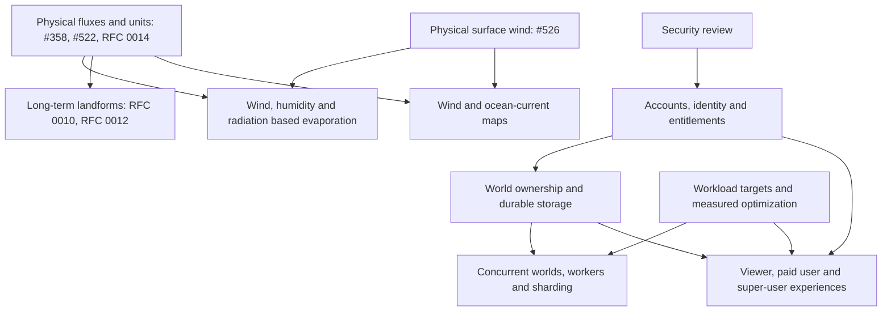

# Launch readiness

This page is the cross-cutting view of work that may be needed before Mantle Bloom's next
public launch. It connects model quality, product capabilities and operating requirements
that do not fit into one GitHub Project. The project tracker and linked issues remain the
source of truth for implementation status; update this page when scope or dependencies change.

## Launch is not yet a defined gate

The list below captures launch concerns, not a promised release scope. Decide what “launch”
means before treating every line as a blocker. In particular, agree on a target user, supported
world lifetime and scale, paid feature boundary, and acceptable scientific fidelity. Items
marked **Needs a tracker** currently have no known matching issue in the reviewed tracker
search and need an owner and acceptance criteria before they can be scheduled.

## Workstreams

### 1. Water, climate and surface processes

**Goal:** lakes and rivers behave consistently across basins, seasons, step lengths and model
resolutions; fluxes that affect one another use compatible units and close their budgets.

- [x] Investigate the flickering inland sea, river routing and lake budgets: [#519](https://github.com/adubey/mantle-bloom/issues/519).
- [ ] Advance accepted [RFC 0014](https://github.com/adubey/mantle-bloom/pull/523) through its diagnosis gates before implementation. It addresses lake conservation, seasonal/per-cell freezing and water-surface temperature; record gate outcomes in the RFC and open implementation issues when its gates allow.
- [ ] Resolve the remaining physical-unit work in [#358](https://github.com/adubey/mantle-bloom/issues/358), including river discharge/speed and glacier mass balance dependencies. Track glacier mass-balance scaling and depth-cap behavior in [#368](https://github.com/adubey/mantle-bloom/issues/368); it is an investigation, not yet a decision to convert the model.
- [ ] Express insolation and humidity in physical units under [#522](https://github.com/adubey/mantle-bloom/issues/522). This issue explicitly leaves albedo, longwave radiation and land humidity/vapour-pressure deficit to later work.
- [ ] **Needs a tracker:** define and implement an albedo-aware energy balance so polar ice caps and insolation respond to surface reflectivity. Treat this as downstream of, or a deliberate replacement for, #522's calibrated temperature mapping. Decide how it should interact with ice and temperature before implementation.
- [ ] Give the diagnostic wind a physical 10 m speed in m/s and define the surface-wind contract every wind consumer reads: [#526](https://github.com/adubey/mantle-bloom/issues/526). This is an issue, not an RFC, because it calibrates against stated targets (ERA5 zonal means, CFD rel-RMS, resolution invariance). It was split from [#118](https://github.com/adubey/mantle-bloom/issues/118), which keeps the diagnostic air-temperature gap. Wind speed feeds evaporation; credible physical evaporation also needs suitable humidity and radiation inputs (see #519 and #522). Prognostic ocean circulation ([#234](https://github.com/adubey/mantle-bloom/issues/234)) stays a separate, larger effort and takes its wind stress from #526's contract.
- [ ] **Needs a tracker:** improve glacier erosion on high, ice-capped mountains. Start from the measurements and recommendation in #368; define a mountain-exposure and erosion metric rather than presuming a larger multiplier is the answer.

### 2. Long-term landforms

**Goal:** land does not systematically vanish beneath water or accumulate implausible relief, and continents develop varied forms over Gyr-scale histories.

- [ ] Advance [RFC 0010](../rfc/0010-rifts-follow-weak-lithosphere.md) and its tracking issue [#487](https://github.com/adubey/mantle-bloom/issues/487). Its rift routing may change how continents break up; it is not by itself a demonstrated fix for land loss or high mountains.
- [ ] Advance [RFC 0012](../rfc/0012-physics-first-simulation.md) and its tracking issue [#464](https://github.com/adubey/mantle-bloom/issues/464). Its physics-first force and deformation work could affect relief and long-term land persistence; the RFC's gates and later metrics must establish that effect.
- [ ] **Needs a tracker:** define the Gyr-scale acceptance measures for land persistence, elevation distribution, mountain height/area and landform diversity. Use matched long replays and state what variation is desirable before deciding that RFC 0010 or 0012 closes this goal.

### 3. Flow maps and visual understanding

**Goal:** users can read the major atmospheric and ocean circulation patterns, including currents in seas.

- [ ] **Needs a tracker:** add a wind map that groups nearby vectors with similar direction and draws smooth paths for major wind currents.
- [ ] **Needs a tracker:** add an ocean-current map with comparable clustering and paths, covering oceans and seas.
- [ ] Decide whether these are visualization-only views of existing vectors or depend on physical wind/current speed work. The display can be tracked separately from scientific calibration; avoid presenting schematic paths as measured streamlines unless the method supports that interpretation.

### 4. Security and public service

**Goal:** the public service is safe to operate for multiple independent users and their worlds.

- [ ] Perform a security review of the full codebase and deployment, then create issues for findings with severity, affected surface and verification criteria. Include authentication/session handling, API authorization, world-file import/export, resource-exhaustion limits, dependencies and deployment secrets. Tracked in [#556](https://github.com/adubey/mantle-bloom/issues/556) (first pass: [#555](https://github.com/adubey/mantle-bloom/issues/555)).
- [ ] Define user accounts, identity provider, account database (if required), and ownership/retention rules. The current hosting guide describes a single owner account and public viewer, not general user accounts; see [hosting](../docs/hosting.md). Tracked in [#560](https://github.com/adubey/mantle-bloom/issues/560): GitHub stays the identity provider, and login itself needs no account database; a durable store (SQLite first) holds entitlements and world ownership.
- [ ] Define the three access levels and their boundaries. Tracked in [#560](https://github.com/adubey/mantle-bloom/issues/560), which settles the tiers as free / paid / admin, a subscription via a merchant of record (Polar planned), and admin as an override rather than a paid plan:
  1. Free (logged-out or logged-in viewer): can inspect and step the shared world within public limits. Logged-in does not imply paid; a signed-in free account is how a subscription is linked to a GitHub user.
  2. Logged-in paid user: can create, save and export their own worlds, with possibly higher resolution and longer runs; billing, quotas and cancellation are defined in #560, except pricing and exact caps, which wait on section 5 capacity targets.
  3. Admin/super-user (owner account and local mode): retains the full local experience and operational controls, with no payment or quotas.
- [ ] Choose world-state ownership and storage, then design concurrent execution, quotas, recovery and horizontal scaling. Several worlds may require a database or durable object storage plus workers; clusters/shards are an option to evaluate, not an assumed first implementation. Tie this decision to account ownership and security boundaries. Per-user world ownership and storage (SQLite metadata plus per-user world files on the volume) are tracked in [#560](https://github.com/adubey/mantle-bloom/issues/560); horizontal scaling stays out of its scope.

### 5. Performance and capacity

**Goal:** simulation and rendering stay responsive at the agreed launch workload and cost.

- [ ] **Needs a tracker:** establish representative workloads, latency and memory budgets, profile them, and optimize measured bottlenecks. Existing measurements and profiling notes are in [docs/profiling.md](../docs/profiling.md); use them as a starting point, not as a substitute for a launch workload.
- [ ] Set capacity and concurrency targets before sizing multi-world workers, queues, shards or database storage. Re-measure after architectural changes and at the world sizes promised to users.

## Dependency sketch

Arrows indicate a likely prerequisite or information dependency, not a commitment that the
upstream item must be fully complete before all downstream investigation can begin.

Wind/current visualization can be designed alongside model work, but its legends and labels
need to distinguish relative diagnostic values from physical speeds. Security review should
inform the account and hosting design; those design decisions should precede paid multi-user
operation. Performance targets should be set before promising a concurrency level.

## Decisions to settle before calling this a launch plan

1. What release does “launch” mean: public preview, paid launch, or both in stages?
2. Which surface-process and Gyr-scale scientific criteria are launch blockers, and which can
   ship as known limitations?
3. How many simultaneous worlds and what world size/runtime should the service support?
4. What exactly does payment unlock, and does “logged-in” always imply a paid account? Settled in [#560](https://github.com/adubey/mantle-bloom/issues/560): payment unlocks a user's own worlds and, subject to capacity targets, higher resolution and longer runs; logged-in does not imply paid (there is a signed-in free tier). Pricing and exact caps remain open.
5. Is super-user mode a local-only mode, an admin role in the hosted service, or both? Settled in [#560](https://github.com/adubey/mantle-bloom/issues/560): both — the owner account in the hosted service and local/desktop mode are admin.

Once these are decided, turn each **Needs a tracker** item into a scoped issue (or RFC when the
science or architecture is uncertain), assign an owner, and replace the placeholders with
links. Keep implementation status in GitHub; use this page to maintain the relationships and
the definition of launch readiness.
