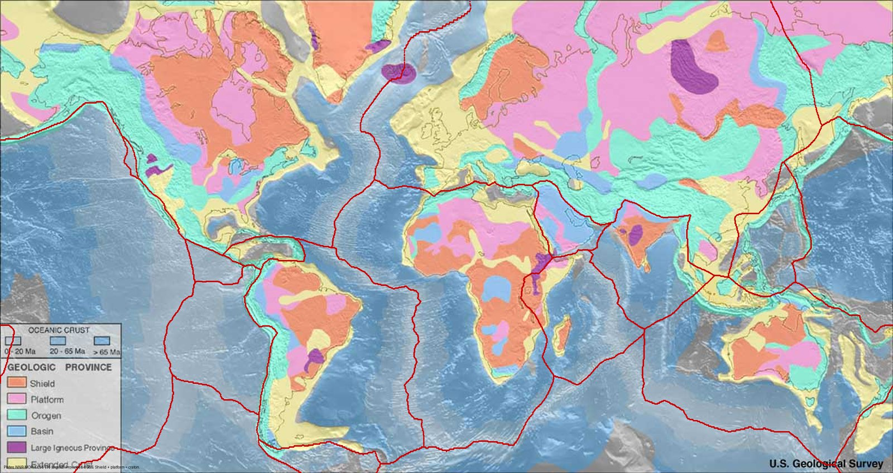
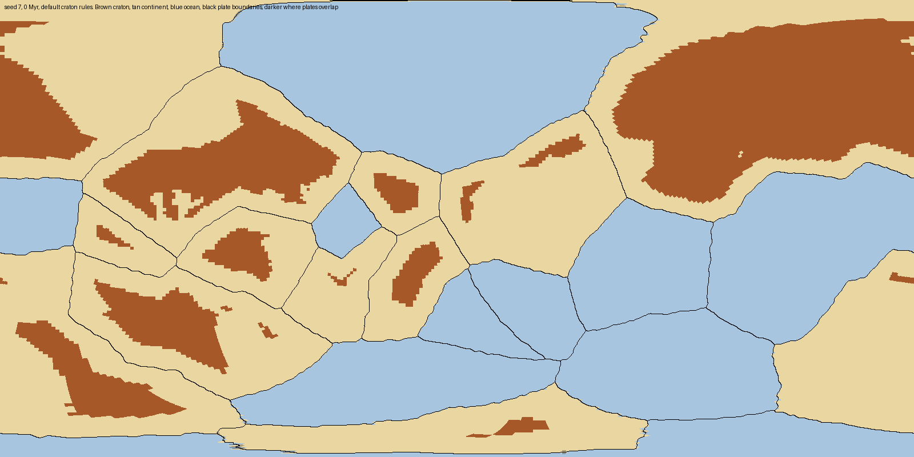
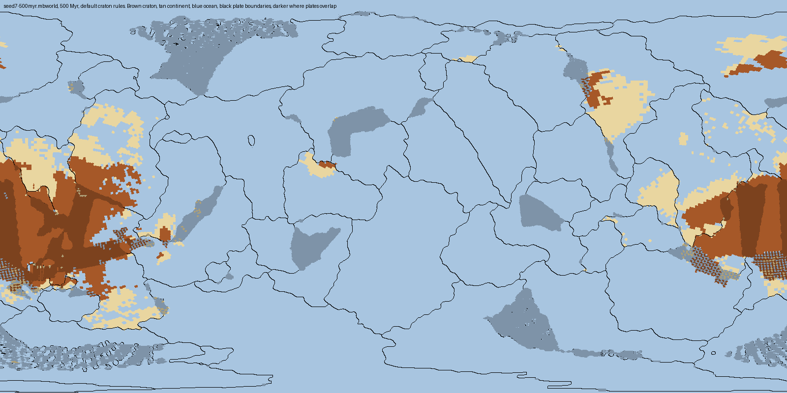
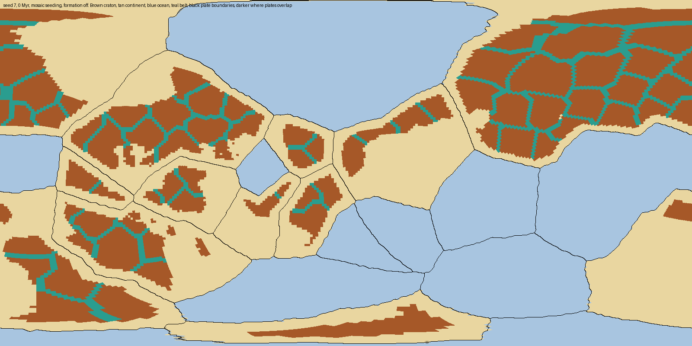

# RFC 0009: Cratons first: continents built from cratonic cores, plates placed around them

- **Status:** Draft (revised after gate G1; the first version, "Cratons as a mosaic", was
  accepted 2026-10-15 in PR #428)
- **Date:** 2026-10-15, revised 2026-10-15
- **Related:** #427 (tracking), #426 (gate G1), #274 (cratons), #389 (RFC 0003 tracking),
  #409 (formation and ratchet diagnosis), #411; PRs #418 (RFC 0003 solution 1) and #430
  (G1); RFCs [0003](0003-rifting-around-cratons.md) and [0004](0004-proto-cratons.md)
  (both superseded by this RFC and [0010](0010-rifts-follow-weak-lithosphere.md)),
  [0007](0007-mantle-plumes-and-plateaus.md), [0008](0008-craton-collision-jamming.md)

## Revision note

The first version proposed seeding each continent's interior as a mosaic of cratonic cores
and belts, inside today's plates. Its gate G1 failed (Design, [analysis/rfc0009](../analysis/rfc0009/README.md)):
belts gave rifts a clear line slightly more often, but the band a rift thins still crossed
craton, and belts were gone within a few hundred Myr. Mapping the worlds showed why the
layout itself is the problem: generation makes plates first, makes each plate wholly
continental or oceanic, and only then puts a craton in the middle of each continental plate.
This revision reverses the order: cratonic cores first, continents built around them, plates
placed last. The mosaic's cores and belts become the first step of that order, and its belt
marks stay.

## Problem

Generation decides where plates are first, and everything else follows from the plate
tiling. On Earth it is the other way round: cratons are the oldest parts of the continents,
continents were assembled around them, and today's plates are younger and cut across that
assembly.

*Figure 1. Earth. Red: the 16 major plates the model bundles (NNR-MORVEL56 outlines bundled in
`backend/app/data/plate_owner_grid.npz`) [[Argus et al., 2011]](#ref-argus2011). Orange
and pink: shield and platform, the cratons; teal: orogens. USGS world geologic provinces
map, public domain; boundaries placed by a Mercator fit to six landmarks
(`bin/debug/render_earth_cratons.py`).*

*Figure 2. Seed 7 at t = 0 on origin/main `02d5145`. Brown: craton; tan: continental crust;
blue: oceanic crust; black: plate boundaries (`bin/debug/render_craton_map.py`).*

**How a world is made today** (`lithosphere_plate.generate_plates`, random path, and
`cratons.seed_initial_cratons`):
1. **Plates.** `build_plate_tiling` scatters 8–20 plate sites, plus two extra sites per
   plate merged into lumpier outlines, and takes their Voronoi cells.
2. **Crust type per plate.** Each plate is continental with probability `CONTINENTAL_FRACTION`
   = 0.4 (or a share of plates set by the UI's `continental_fraction`), and *all* of its
   crust is that type. A continent is a union of continental plates. Hc, Hm and the initial
   bathymetry (`hydroclimate/bathymetry.py`) are set from the plate's type.
3. **Cratons.** Seeding makes every genuine continental column at least
   `CRATON_SEED_MARGIN_KM` = 875 km inside its plate a craton. Formation (`update`) later adds
   columns 500 km inside that stay quiet for 200 Myr.

**Measured layout** (`bin/debug/measure_plate_layout.py`, quarter-degree grid; numbers in
[plate_layout.json](../analysis/rfc0009/plate_layout.json)). Earth uses its 16 major
plates and its coastline, the inputs the premade "earth" world is built from, with land as
the proxy for continental crust:

| | Earth | Seed 7 | Seed 11 | Seed 2024 |
|---|---|---|---|---|
| Continent edge within 300 km of a plate boundary | 28% | 100% | 100% | 100% |
| Plates whose crust is mixed (5–95% continental) | 69% (74% of area) | 0% | 0% | 0% |
| Boundary length with continent on both sides | 17% | 33% | 20% | 27% |
| Continental share of the surface | 29% (land) | 63% | 40% | 49% |
| Craton area within 500 km of a plate boundary | – | 0% | 0% | 0% |

Four consequences follow.

1. **Every continental edge is a plate boundary, and no plate is mixed.** On Earth most
   continental margins are passive margins inside a plate, and most plates carry both
   continent and ocean. The model's generator can't make either. Even the premade "earth"
   world has to cut each real plate into land and ocean sub-plates
   (`real_plates.build_exact_earth_plates`), 65 of them, because a generated plate has one
   crust type.
2. **The plate tiling places and shapes every craton.** Each continental plate gets one
   craton in its middle, 875 km from every edge, so the number, size and shape of cratons
   are set by Voronoi cells drawn without regard to them. At t = 0 on seed 7, cratons start
   as 23 connected pieces (8 over 1 M km²); the largest plate (92 M km²) carries 54 M km² of
   craton. Cratons start at 37.6–50.7% of genuine continental area on seeds 7, 11 and 2024
   (#403).
3. **Welds and scars heal into craton.** A collision suture or a failed-rift band is only
   excluded from formation while its Hc is outside the window or it is near an edge. Once
   it has been quiet inside the window for 200 Myr, formation converts it like any other
   interior. The model keeps no record of where continents were joined or stretched.
4. **Continents become all craton.** Cratons take 85–92% of genuine continental area by
   500 Myr and 94–97% by 1 Gyr (#403). #409 showed this is survival bias, not formation:
   at least 91% of the non-cratonic host lost was destroyed or thinned away, not converted.

*Figure 3. Seed 7 at 500 Myr, today's rules. Most continental crust is gone; craton has
gathered into one mass straddling the map's edges, partly stacked on overlapping plates
(darker). Grey patches are oceanic areas where two plates' cells interleave.*

**Why it matters: rifting.** A plate splits along a cut placed by the mantle flow. RFC 0003
tried to steer that cut off cratons, first by tilting the great circle (PR #418), then, in
an offline probe, by letting it bend around strong lithosphere along a graph minimum cut
([RFC 0010](0010-rifts-follow-weak-lithosphere.md),
[analysis/rfc0010](../analysis/rfc0010/README.md)). Both mostly fail: a craton-free
admissible cut exists for 10–12% of craton-crossing cuts. On those cuts the median plate is
34% craton, and craton fills a median 44% of the cut's band. A cut that divides a
continental plate into two viable halves has to cross its interior, and its interior *is*
its craton. G1 then gave each interior seams (Figure 4), and that wasn't enough either: a
rift can follow a 300 km belt, but the ±312 km band it thins still covers the cores on both
sides. On Earth, continents broke up along the belts that had joined them
[[Wilson, 1966]](#ref-wilson1966) [[Vauchez et al., 1997]](#ref-vauchez1997), between
cratons rather than through them.

*Figure 4. Seed 7 at t = 0 with the first version's mosaic seeding (teal: belts). The cores
are still confined to each plate's interior, framed by the plate's edges.*

**Why it matters: formation.** RFC 0004 found formation shutting off by 335–470 Myr, and
#409 traced 75–86% of each run's formation to one generation pulse: seeding uses an 875 km
margin and formation a 500 km one, so the band between matures together at 200 Myr.

What this evidence does *not* show:
- Whether a cratons-first layout survives the model's sinks (RFCs 0001, 0002, 0005, 0008),
  or whether the model's own merges and splits re-impose "a plate is a continent". At
  500 Myr on seed 7, 31% of plates are mixed, so the runtime does make mixed plates (an
  ocean opening inside a continental plate) and runs with them.
- Earth's figures use land, not continental crust, and only the 16 major plates. Earth
  also has continental plate boundaries (17% of boundary length), along young orogens and
  rifts, so the target is not zero.

## Proposed solutions

**What happens in nature.**
- A craton is a block of continental crust over a thick (about 200–250 km), cold,
  chemically depleted mantle keel [[Pearson et al., 2021]](#ref-pearson2021)
  [[Jordan, 1978]](#ref-jordan1978). Most keels formed in the Archean, by high-degree
  melting of a hotter mantle [[Herzberg & Rudnick, 2012]](#ref-herzberg2012); later
  lithospheric mantle is progressively less depleted [[Griffin et al., 2009]](#ref-griffin2009).
- Cratons are discrete and older than the continents they sit in. The late Archean record
  survives as roughly 35 separate cratonic pieces [[Bleeker, 2003]](#ref-bleeker2003).
  Laurentia, the North American craton, was built in the Early Proterozoic by joining older
  provinces along orogenic belts [[Hoffman, 1988]](#ref-hoffman1988). Accretionary and
  collisional belts weld onto older cores [[Cawood et al., 2009]](#ref-cawood2009).
- The architecture persists at depth. Africa's lithosphere maps into domains of ancient,
  highly depleted mantle and zones of younger or strongly modified mantle
  [[Begg et al., 2009]](#ref-begg2009).
- Belts stay weak, and plates break along them. Rifts run parallel to old orogenic belts,
  explained by a mechanical anisotropy frozen into the lithospheric mantle when continents
  were assembled [[Vauchez et al., 1997]](#ref-vauchez1997)
  [[Tommasi & Vauchez, 2001]](#ref-tommasi2001), or by those belts' thinner lithosphere
  [[Audet & Bürgmann, 2011]](#ref-audet2011). Structures frozen into the mantle lithosphere
  by earlier suturing act as latent plate boundaries [[Heron et al., 2016]](#ref-heron2016).
  The Atlantic reopened along the Caledonian–Appalachian suture
  [[Wilson, 1966]](#ref-wilson1966); its margins now lie inside the North American,
  Eurasian and African plates (Figure 1).

So a world should start as continents assembled from several cratonic cores joined by
belts, and plates should be laid over that assembly: boundaries mostly in the ocean, crossing
continents along belts, and never through a core.

1. **Cratons first (recommended).** Generation in three steps: place cratonic cores, build
   continents around them (cores, belts between them, younger margins around them), then
   partition the sphere into plates whose boundaries avoid cores and prefer ocean and belts.
   Plates carry mixed crust.
   - Fixes the layout at its source: craton count, size and spacing become knobs, not
     side effects of the tiling; passive margins and mixed plates appear from the start.
   - Removes #409's generation pulse, as seeding no longer uses an interior margin.
   - Largest change: a new generator for random worlds, per-node crust type at
     generation, and every place that assumes a plate has one crust type (gate G2).
2. **Mixed plates, plates still first.** Draw continents from noise independently of the
   plate tiling, seed cratons (a mosaic) in their interiors, and keep today's random
   Voronoi plates. Plates become mixed, but boundaries cross cores at random; nothing keeps
   them on belts.
3. **Mosaic inside today's plates** (the accepted first version). Falsified as a fix by G1;
   its cores and belts survive as step one of solution 1.
4. **Belt marks** (from the first version). A per-node field records where crust was welded
   or stretched: belts at generation, then collision sutures and rift bands as they
   happen. A marked column never becomes craton; RFC 0010 uses it as a low-strength path.
   Needed with any of 1–3.
5. **Supercontinent start.** Solution 1 with one continent: all cores assembled into a
   supercontinent the model then rifts. Covered by solution 1's continent-count knob.
6. **Later options**, unchanged from the first version: welded growth at core rims (RFC 0004
   path B), a quiescence signal for formation, a per-node core identity, and
   depletion-based formation (RFC 0004 path C, which needs a depletion model).

**Recommendation:** 1 and 4, through gates G2 and G3 below. Leave 2 as the fallback if G2
finds mixed plates can't be supported; 5 is a setting of 1; 6 stays deferred.

## Design

**Gate G1 (done): does a mosaic inside today's plates give rifts a way around?**
`bin/debug/probe_craton_mosaic.py` reseeded generation as a mosaic (1,500 km core spacing,
300 km belts, the 500 km formation margin) with formation off, and evaluated RFC 0010's
minimum cut on every cut at a 1,000 km corridor, with belts at zero strength. Over the
craton-crossing flow cuts it reported **L**, the share with an admissible minimum cut whose
line touches no craton, and **B**, craton area in the failed-rift band (±2.5 spacings) using
the minimum cut where admissible, over the same for the flow cuts. Building branches, fixed
beforehand: L ≥ 50% and B ≤ 0.50 (build RFC 0010's cut); L ≥ 20% and B ≤ 0.75 (build it with
its resistance fallback); otherwise don't build it. Belts below a third of their t = 0 area
by 500 Myr meant waiting for the sink RFCs.

Result (2026-10-15, #426, seeds 7, 11 and 2024 to 1 Gyr on origin/main `02d5145`;
[analysis/rfc0009](../analysis/rfc0009/README.md)):

| | Seed 7 | Seed 11 | Seed 2024 | Pooled |
|---|---|---|---|---|
| L / B, mosaic at the starting knobs | 9% / 0.94 | 37% / 0.83 | 33% / 0.98 | 24% / 0.91 |
| L / B, today's layout (formation off) | 14% / 0.80 | 21% / 0.69 | 9% / 0.77 | 15% / 0.77 |
| L / B, mosaic with 600 km belts (sweep) | 29% / 0.90 | 42% / 0.75 | 41% / 0.75 | 38% / 0.81 |
| Belt area at 500 Myr, of t = 0 | 5% | 19% | 34% | |

Neither building branch: RFC 0010's cut isn't built on this layout. The cut does follow
belts, but B stays high because the band is wider than a belt, and belts were also lost when
merges blended them onto craton cells. This revision changes the layout rather than the cut;
G3 repeats G1's measures on it.

**Generation, cratons first (solution 1).** A new module, `continent_layout.py` (new), runs
for random worlds (no sketch, no premade world) before any plate exists. It works on a
global lattice of points at the world's node spacing and returns per-point continent,
core and belt masks, and a plate label.

1. **Continents.** Draw `n_c` continent centres by Poisson-disc sampling with minimum
   separation `CONTINENT_SPACING_KM`, `n_c` from `CONTINENT_COUNT_RANGE`. Split the target
   continental area, `continental_fraction` × 4πR², between them in random proportions
   (Dirichlet, `CONTINENT_SIZE_CONCENTRATION`).
2. **Cores.** Within each continent's share, place core nuclei `CRATON_CORE_SPACING_KM` apart
   around its centre until their cores reach `CRATON_SHARE_OF_CONTINENT` of the continent's
   area. Each core is the set of lattice points within `CRATON_CORE_RADIUS_KM` of its
   nucleus, by a distance perturbed with the existing relief noise
   (`terrain_noise`), so cores are irregular.
3. **Belts.** Grow each continent outward from its cores by a noise-perturbed distance until
   it reaches its area (the quantile threshold `plates._land_noise_threshold` already uses for land).
   Points between two cores of the same continent within `CRATON_BELT_WIDTH_KM` of the line
   where their distances are equal become belts; the remaining continental points are
   margin: younger, non-cratonic crust.
4. **Plates.** Place `num_plates` sites (8–20 as today) by Poisson-disc sampling, none inside
   a core. First, assign every point to its nearest site by uniform geodesic multi-source
   Dijkstra; contract each core to one graph node. This gives a complete, connected initial
   partition, but does not choose boundaries by their local cost. Then refine the labels by
   moving boundary points between adjacent plates to reduce
   `J = sum(length(link) * mean(cost(endpoint_1), cost(endpoint_2)))` over links whose
   endpoints have different labels. `cost` is `PLATE_COST_OCEAN` (1), `PLATE_COST_BELT` (1),
   or `PLATE_COST_MARGIN` (3). A move is allowed only if every plate stays connected, every
   point remains assigned exactly once, the plate count stays fixed, and no contracted core
   is divided. Sweep in stable node order until a full sweep lowers no cost; break ties by
   plate ID. This is a constrained local optimization, so it may reach a local minimum; G3
   measures whether the resulting layout meets the Earth comparison. Here the cost applies
   directly to boundary links: a larger `PLATE_COST_MARGIN` penalizes boundaries crossing
   margins, while ocean and belts are cheaper. Tune it to Earth's 28% of continental edge
   near a boundary.
5. **Plates are built from the labels.** Each plate is made with
   `PlateWithSparseQuadPatch.from_lattice`, owning the points labelled with it (replacing
   `build_plate_tiling`'s nearest-site test). Its nominal `crust_type` is the type of the
   majority of its area; points of the other type get an explicit `crust_type_code`
   (`CRUST_TYPE_CONTINENTAL` or `CRUST_TYPE_OCEANIC`), the per-node mechanism the runtime
   already uses. Hc, Hm and the initial bathymetry come from each point's type, not the
   plate's. Land and sea within continents use today's relief noise and `land_fraction`.
6. **Cratons.** `seed_initial_cratons` takes the core mask from generation (whole Hc,
   dated `CRATON_SEED_AGE_YEARS`), not an interior distance. Belts are marked (below).
   Worlds that start without generation's masks (a sketch, a premade world, or an old
   save's first step) keep today's interior rule.

Sketch-drawn and premade worlds keep plates first: their geography comes from a drawing or
from data. A later change could seed the premade Earth's cratons from data like Figure 1's.

**Gate G2: do mixed plates work?** The runtime already makes mixed plates (31% of plates on
seed 7 by 500 Myr), but generation would make most plates mixed from the start, and about
60 call sites read the plate-level `crust_type` (`lithosphere_plate`, `quad_tectonics`,
`hm_ledger`, `quad_merge`, `torque`, `merge_split` and others). Before building the
generator:
- Audit each call site: per-node codes needed, plate-level legitimately, or generation
  only. Record the list in the issue.
- Probe: `bin/debug/probe_mixed_plates.py` (new) generates seeds 7, 11 and 2024 as today,
  then re-labels them with an independent random plate tiling over the same crust (most
  plates mixed), and replays both to 500 Myr.
- The probe also records active plate count and overlap area at each 100 Myr checkpoint,
  plus cumulative successful splits and merges. On every seed, G2 passes only if ledgers
  balance, genuine continental area at 500 Myr stays within 10% of the unmixed run, and each
  of those four measures stays within 20% of its same-seed unmixed value (for split and
  merge counts, compare cumulative totals through 500 Myr). The 20% bound is a design
  threshold, not a literature constraint. If any check fails, fix the responsible call sites
  or diagnose the changed runtime behavior and rerun G2 before choosing the architecture.
- If mixed plates still fail after that work, use a defined single-type fallback rather than
  an infinite traversal cost: assign one continental plate to each connected continent,
  then partition each connected ocean component among the remaining oceanic plates. Reserve
  at least one oceanic plate for each ocean component and distribute any remaining plates
  among them. Every point must be assigned exactly once and every plate connected. If the
  requested plate count cannot cover those components, G2 remains unresolved; do not claim
  this fallback passed.

**Gate G3: does the cratons-first layout keep cratons whole?** After the generator and belt
marks are built (behind a flag), `probe_craton_mosaic.py` gains `--layout cratons-first` and
repeats G1's measures with formation off, on seeds 7, 11 and 2024 to 1 Gyr. It also reports
the share of all cuts whose band crosses craton (today 25%: 135 of 542 cuts, analysis/rfc0010),
belt survival, and `measure_plate_layout.py`'s layout measures at each 100 Myr checkpoint.
Outcomes, fixed now:
- The share of cuts crossing craton falls to half of today's or less on every seed: the
  layout fixes rifting at its source; RFC 0010's cut is not needed for cratons.
- Otherwise, G1's branches decide RFC 0010: L ≥ 50% and B ≤ 0.50, or L ≥ 20% and B ≤ 0.75
  with its resistance fallback; neither means the flow puts boundaries under cratons
  (Falsification).
- Belts below a third of their t = 0 area by 500 Myr on two seeds: the sinks, not the
  layout, decide belt life; finish the sink RFCs (0001, 0002, 0005) before tuning belts.

**Belt marks (4).** `belt_formed_years` (new surface field) holds the time a column last
became a belt, with a "never" sentinel. Writers:
- generation: belts get `−CRATON_BELT_SEED_AGE_YEARS` (Proterozoic welds, younger than their
  cores);
- collision welds: suture-accretion receivers (`quad_tectonics._accrete_onto_survivors`),
  upper-plate receivers in `crust_transfer`, and stacked cells in `quad_merge`;
- rifting: a failed rift's thinned band (`sparse_quad_patch.apply_failed_rift`) and the band
  along a successful split's cut (`merge_split.maybe_split_plate`).

`cratons.update` excludes marked columns from `quiet`. G1 found that a remap keeping a mark
from any contributor (HISTORY) blends belts onto craton cells: 9 M km² on seed 7 by 500 Myr.
The remap is majority by area instead: a merged cell is a belt only if most of its area was,
keeping the latest date among those. `CRATON_BELT_HEAL_MYR` (default infinite) could later
let old belts heal.

**Units.** Distances in km, converted to lattice hops or chord lengths at the world's node
spacing; areas in km² of the sphere; times in years, like `craton_formed_years`. Belt marks
change no thickness.

**Bounds.** Area targets are clamped: `continental_fraction` to [0.05, 0.9], and cores to at
most `CRATON_SHARE_OF_CONTINENT` ≤ 0.7 of their continent, so every continent keeps some
non-cratonic crust. A continent too small for one core gets none.

**Runtime.** Generation uses one multi-source Dijkstra over the lattice (about 31,000
points at density 1, 124,000 at density 4; `scipy.sparse.csgraph.dijkstra` with `min_only`),
then a constrained boundary-refinement pass. The refinement cost is not measured yet; G3
benchmarks the full path at both densities, and acceptance requires generation under 2 s at
density 1. Today's whole generation on seed 7 takes 0.9 s (density 1) and 1.8 s (density 4).
Per step, belt marks add masked writes and one mask in `update`; well under 1%.

**Save compatibility.** Generation-only, apart from `belt_formed_years`, a new surface field
backfilled with the "never" sentinel. Old saves keep their plates and cratons, and get belts
only as new collisions and rifts mark them. No new pickled state on `World`.

**Knobs.**

| Knob | Start | Source | Tuning |
|---|---|---|---|
| `continental_fraction` (existing, now an area share) | 0.5 (random worlds), 0.7 (UI) | Today's mean starting area, 51% on seeds 7, 11 and 2024 (40–63%); the UI default kept as a share | UI copy says "of the surface" |
| `CONTINENT_COUNT_RANGE` | 2–6 | Design choice | Layout measures over 20 seeds |
| `CONTINENT_SPACING_KM` | 4,000 km | Design choice | Same |
| `CONTINENT_SIZE_CONCENTRATION` | 2 | Design choice: unequal continents | Same |
| `CRATON_SHARE_OF_CONTINENT` | 0.4 | Today's 37.6–50.7% at t = 0 (#403) | Fixed to today's mean, so craton calibrations carry over |
| `CRATON_CORE_SPACING_KM` | 1,500 km | Design choice: about 35 Archean cratons survive [[Bleeker, 2003]](#ref-bleeker2003) | G3; sweep 1,000–2,500 km |
| `CRATON_CORE_RADIUS_KM` | 600 km | Design choice: about 1,200 km across, cores up to Superior-province size | With spacing |
| `CRATON_BELT_WIDTH_KM` | 300 km | Orogens welded onto shields are a few hundred km wide [[Cawood et al., 2009]](#ref-cawood2009) | G3; sweep 200–600 km |
| `PLATE_COST_MARGIN` | 3 | Design choice: boundary-link penalty | Continental edge within 300 km of a boundary: 15–50% (Earth 28%) |
| `PLATE_COST_OCEAN`, `PLATE_COST_BELT` | 1, 1 | Design choice: boundary-link penalty for ocean and belts | Fixed |
| `CRATON_BELT_SEED_AGE_YEARS` | 1.8 Gyr | Design choice: Proterozoic assembly, as for Laurentia [[Hoffman, 1988]](#ref-hoffman1988) | Fixed; provenance only |
| `CRATON_BELT_HEAL_MYR` | infinite | Design choice (Assumptions) | Unchanged in this RFC |
| `CRATON_SEED_MARGIN_KM` | 875 km | Today's | Kept only for worlds seeded without generation's masks |

## Detailed design (provisional touchpoints)

- `backend/app/continent_layout.py` (new): continents, cores, belts and the plate
  partition, returning per-lattice-point masks and labels; initialize labels with Dijkstra,
  then refine boundaries against the weighted interface objective.
- `backend/app/lithosphere_plate.py`
  - `generate_plates`: the random path calls `continent_layout` and builds plates from its
    labels; per-node Hc and Hm by crust type; `crust_type_code` stamped on minority-type
    nodes. `build_plate_tiling` stays for sketch and premade worlds.
- `backend/app/plates.py`: `CONTINENTAL_FRACTION` and `DEFAULT_CONTINENTAL_FRACTION` become
  area shares; `MIN_OCEANIC_PLATES` stays for the sketch path.
- `backend/app/hydroclimate/bathymetry.py`: `_gather_columns` reads per-node crust type.
- `backend/app/cratons.py`
  - `seed_initial_cratons`: takes generation's core mask when there is one; constants
    above, with comments citing this RFC.
  - `update`: exclude belt-marked columns from `quiet`.
  - New `mark_belt(world, plate, mask)`, shared by the writers.
  - `diagnostics`: `belt_area_m2` and the number of cores (connected cratonic components).
  - Module docstring: Seeding, Formation and a new Belts paragraph.
- `backend/app/surface_fields.py`: `belt_formed_years` (new), with a majority-by-area remap
  (a new remap class, or a parameterised CATEGORICAL; the implementation checks which).
- Writers calling `mark_belt`: `quad_tectonics._accrete_onto_survivors`,
  `crust_transfer.transfer_column`, `quad_merge._transfer`,
  `sparse_quad_patch.apply_failed_rift`, `merge_split.maybe_split_plate`.
- G2's call-site fixes: whichever of the ~60 plate-level `crust_type` reads the audit marks.
- `backend/app/stats.py`: `belt_area_km2` in the stats row.
- `backend/app/render_image.py`: belts in the `craton` debug view, with
  `frontend/src/legendData.ts`'s `craton` legend; the Generate World dialog's continental
  slider copy in `frontend/src/App.tsx`.
- `bin/debug/`: `probe_mixed_plates.py` (new, G2); `probe_craton_mosaic.py --layout
  cratons-first` (G3); `measure_plate_layout.py`, `render_craton_map.py` and
  `render_earth_cratons.py` (new with this revision) for the layout measures and figures.
- Tests:
  - `test_continent_layout.py` (new): every point has one owner; every plate is connected;
    refinement never divides a core and never increases the boundary objective; belts
    separate the cores of a continent at the configured width; continental and craton areas
    hit their targets within 5%; the same seed gives the same layout; a continent too small
    for a core gets none.
  - `test_plates.py` (which tests `generate_plates`) and `test_bathymetry.py`: generated
    plates carry mixed crust with the right codes, Hc and Hm; sketch and premade generation
    are unchanged.
  - `test_cratons.py`: a belt-marked column in the Hc window, 1,000 km inside, quiet for
    300 Myr, doesn't form; each writer marks the cells it welds or stretches (a contract
    test in each writer's test module); a merged cell is a belt only if most of its area
    was.
  - `test_persistence.py`: old saves load with no belts and unchanged cratons.
- Docs: `docs/simulation-model.md` (world generation, cratons: seeding, formation, belts);
  `docs/architecture.md` (the new module); `docs/api-reference.md` (`continental_fraction`).

## Assumptions and uncertainty

- **Mixed plates are the main risk.** Much of the model was calibrated on plates of one crust
  type. The runtime already runs with mixed plates, but not with most plates mixed from
  t = 0. G2 measures this before the generator is built.
- **Every calibration since #403 used plates-first worlds.** Continental area, craton
  share and their trajectories will move. `continental_fraction` and
  `CRATON_SHARE_OF_CONTINENT` are set to keep the starting totals; the acceptance runs
  re-baseline the rest.
- **Layout knobs are design choices.** Bleeker's count constrains how many Archean pieces
  survive, not the size of the model's cores; the continent and plate-cost knobs are tuned
  to the layout measures, not to physics.
- **The Earth comparison is coarse.** Land stands in for continental crust, which leaves out
  the drowned shelves, and only the 16 major plates are used.
- **Belts may not survive the sinks.** G1 found 66–95% of belt area gone by 500 Myr inside
  today's plates. Belts placed away from plate edges may last longer; G3 measures it.
- **Belts never heal here.** Welded belts join the stable shield
  [[Cawood et al., 2009]](#ref-cawood2009), yet remain weaker and reactivate
  [[Heron et al., 2016]](#ref-heron2016) [[Vauchez et al., 1997]](#ref-vauchez1997). The
  model has one craton state, so a belt is either craton or not; keeping belts non-cratonic
  keeps them weak for rifting at the cost of exposing them to the sinks cratons resist.
- **The model still has no depletion.** Cores are placed geometrically, not where a depleted
  keel would be.

## Acceptance criteria

- [x] **Gate G1** run and reported per seed in `analysis/`, with its pinned commit (#426):
      neither building branch; this revision follows.
- [ ] **Gate G2** (mixed plates) run and reported, with the call-site audit; ledgers balance;
      continental area stays within 10% of the unmixed run; active plate count and overlap
      area at each 100 Myr checkpoint, and cumulative splits and merges through 500 Myr, each
      stay within 20% of the same-seed unmixed run. If not, diagnose and rerun before choosing
      the architecture; update this RFC with the outcome.
- [ ] **Gate G3** (cratons-first replays) run and reported, and this RFC and RFC 0010
      updated with the branch it selects.
- [ ] Layout at t = 0, over seeds 7, 11, 2024 and 17 more: continental edge within 300 km of
      a plate boundary 15–50% (Earth 28%); mixed plates ≥ 50% (Earth 69%); boundary length
      with continent on both sides ≤ 25% (Earth 17%); no core crossed by a plate boundary;
      every continent with room for two cores has at least two; belts 10–30% of continental
      area; craton 35–50% of continental area; continental area within 0.05 of
      `continental_fraction`.
- [ ] The layout lasts: at 500 Myr, mixed plates ≥ 30% and continental edge within 300 km
      of a boundary ≤ 70% on every seed (today 31% and 64% on seed 7).
- [ ] No generation pulse: formation in the step that first reaches 200 Myr is under 10%
      of the matched baseline's on each seed.
- [ ] Belt area at 1 Gyr is at least a third of its t = 0 value on at least two of the
      three seeds.
- [ ] No marked column ever forms craton (unit tests, and a debug-run audit counting
      formation on marked columns, which must be 0).
- [ ] Generation time under 2 s at density 1; step time changes by less than 2% at
      density 4.
- [ ] Ledgers balance; old saves load; sketch and premade worlds generate as before; unit
      tests above pass; affected tests, ruff and `bin/quality_check.sh` are green.

## Falsification criteria

- **The model re-imposes "a plate is a continent".** If by 500 Myr cratons-first worlds are
  back to today's layout (continental edge near a boundary above 90%, mixed plates under
  10%) on every seed, generation alone can't fix the layout: the splits and merges (RFC 0001,
  `merge_split`) are what tie plates to continents; take the RFC there.
- **The flow puts regime boundaries through cratons.** If G3 neither halves the share of
  cuts crossing craton nor reaches a building branch for RFC 0010, the layout was not the
  obstacle; don't build RFC 0010's cut; investigate why the mantle flow localises beneath
  cratons.
- **Mixed plates can't be supported.** If G2 fails after its call-site and runtime-behavior
  diagnosis, use the connected-component single-type fallback in Design, G2. If the plate
  budget cannot cover all continent and ocean components, the fallback is unavailable and
  this RFC's generation choice remains unresolved.
- **Belts become the new sink.** If marked belts lose crust so fast that continental area
  at 1 Gyr falls by more than 10% against the matched baseline, give belts partial craton
  resistance instead of none.

## References

- Argus, D. F., Gordon, R. G., & DeMets, C. (2011). Geologically
  current motion of 56 plates relative to the no-net-rotation reference frame.
  *Geochemistry, Geophysics, Geosystems*, 12, Q11001.
  [doi:10.1029/2011GC003751](https://doi.org/10.1029/2011GC003751)
- Audet, P., & Bürgmann, R. (2011). Dominant role of tectonic
  inheritance in supercontinent cycles. *Nature Geoscience*, 4, 184–187.
  [doi:10.1038/ngeo1080](https://doi.org/10.1038/ngeo1080)
- Begg, G. C., Griffin, W. L., Natapov, L. M., O'Reilly, S. Y.,
  Grand, S. P., O'Neill, C. J., Hronsky, J. M. A., Djomani, Y. P., Swain, C. J., Deen, T.,
  & Bowden, P. (2009). The lithospheric architecture of Africa: Seismic tomography, mantle
  petrology, and tectonic evolution. *Geosphere*, 5(1), 23–50.
  [doi:10.1130/GES00179.1](https://doi.org/10.1130/GES00179.1)
- Bleeker, W. (2003). The late Archean record: a puzzle in ca.
  35 pieces. *Lithos*, 71, 99–134.
  [doi:10.1016/j.lithos.2003.07.003](https://doi.org/10.1016/j.lithos.2003.07.003)
- Cawood, P. A., Kröner, A., Collins, W. J., Kusky, T. M.,
  Mooney, W. D., & Windley, B. F. (2009). Accretionary orogens through Earth history.
  *Geological Society, London, Special Publications*, 318, 1–36.
  [doi:10.1144/SP318.1](https://doi.org/10.1144/SP318.1)
- Griffin, W. L., O'Reilly, S. Y., Afonso, J. C., & Begg,
  G. C. (2009). The composition and evolution of lithospheric mantle: A re-evaluation and
  its tectonic implications. *Journal of Petrology*, 50, 1185–1204.
  [doi:10.1093/petrology/egn033](https://doi.org/10.1093/petrology/egn033)
- Herzberg, C., & Rudnick, R. (2012). Formation of cratonic
  lithosphere: An integrated thermal and petrological model. *Lithos*, 149, 4–15.
  [doi:10.1016/j.lithos.2012.01.010](https://doi.org/10.1016/j.lithos.2012.01.010)
- Heron, P. J., Pysklywec, R. N., & Stephenson, R. (2016).
  Lasting mantle scars lead to perennial plate tectonics. *Nature Communications*, 7,
  11834. [doi:10.1038/ncomms11834](https://doi.org/10.1038/ncomms11834)
- Hoffman, P. F. (1988). United Plates of America, the birth
  of a craton: Early Proterozoic assembly and growth of Laurentia. *Annual Review of Earth
  and Planetary Sciences*, 16, 543–603.
  [doi:10.1146/annurev.ea.16.050188.002551](https://doi.org/10.1146/annurev.ea.16.050188.002551)
- Jordan, T. H. (1978). Composition and development of the
  continental tectosphere. *Nature*, 274, 544–548.
  [doi:10.1038/274544a0](https://doi.org/10.1038/274544a0)
- Pearson, D. G., Scott, J. M., Liu, J., Schaeffer, A., Wang,
  L. H., van Hunen, J., Szilas, K., Chacko, T., & Kelemen, P. B. (2021). Deep continental
  roots and cratons. *Nature*, 596, 199–210.
  [doi:10.1038/s41586-021-03600-5](https://doi.org/10.1038/s41586-021-03600-5)
- Tommasi, A., & Vauchez, A. (2001). Continental rifting
  parallel to ancient collisional belts: An effect of the mechanical anisotropy of the
  lithospheric mantle. *Earth and Planetary Science Letters*, 185, 199–210.
  [doi:10.1016/S0012-821X(00)00350-2](https://doi.org/10.1016/S0012-821X(00)00350-2)
- Vauchez, A., Barruol, G., & Tommasi, A. (1997). Why do
  continents break-up parallel to ancient orogenic belts? *Terra Nova*, 9, 62–66.
  [doi:10.1111/j.1365-3121.1997.tb00003.x](https://doi.org/10.1111/j.1365-3121.1997.tb00003.x)
- Wilson, J. T. (1966). Did the Atlantic close and then
  re-open? *Nature*, 211, 676–681. [doi:10.1038/211676a0](https://doi.org/10.1038/211676a0)
