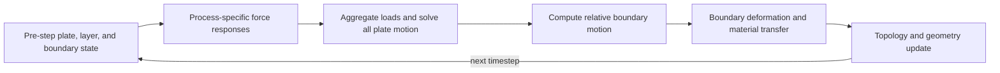
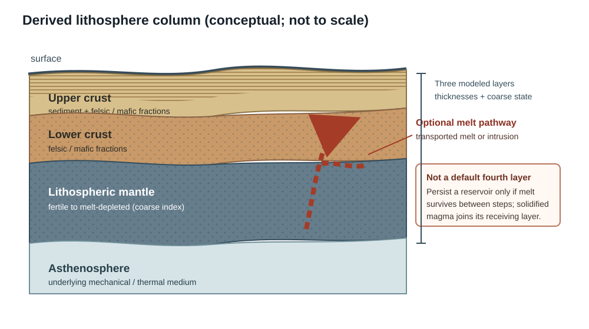
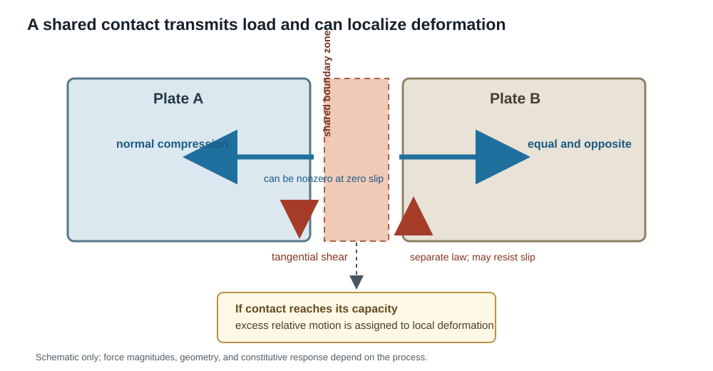
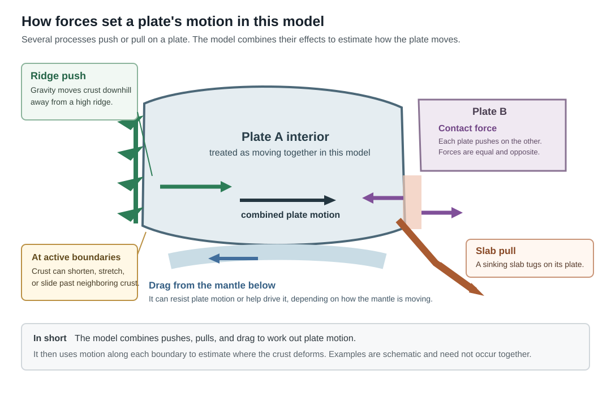

# RFC 0012: Physics-first simulation

- **Status:** Implemented (2026-10-29)
- **Date:** 2026-10-16 (implemented 2026-10-29)
- **Related:** #464 (tracking), #465 (gate G1), #535 (gate G3); RFCs [0009](0009-craton-mosaic.md)
  (cratons-first layout), [0010](0010-rifts-follow-weak-lithosphere.md) (rift routing), and
  [0011](https://github.com/adubey/mantle-bloom/blob/claude/rfc-0011-contact-strength/rfc/0011-contact-strength.md)
  (collision resistance); [#682](https://github.com/adubey/mantle-bloom/issues/682)
  (adaptive timestep investigation); design principles 1–5 and 8–9

## Outcome

The accepted implementation path is complete. G1 and boundary-load normalization were recorded in #465 and #468; the reduced quasi-static contact pilot landed in [PR #491](https://github.com/adubey/mantle-bloom/pull/491), with G2 accepted by the project owner with the caveats below; G3's rift/transform transfer diagnostics are recorded in #535; and merge-rate ownership plus its matched characterization landed in [PR #684](https://github.com/adubey/mantle-bloom/pull/684), completing [#547](https://github.com/adubey/mantle-bloom/issues/547). Evidence is retained in [analysis/rfc0012](../analysis/rfc0012/README.md) and [analysis/issue547](../analysis/issue547/README.md).

The selected implementation adds no persistent state. Existing saves remain compatible; the G2 state inputs and derived layer partition are documented in “Cost and saves.” The merge behavior is described in [the tectonics model documentation](../docs/simulation-model/tectonics.md). The targeted quasi-static, torque, merge, persistence and save tests passed (168 tests); the RFC 0012 implementation PR's affected test gate passed 1,827 tests, and both its backend and frontend CI checks passed.

Results retain their limits: merge-only timestep sensitivity is mixed and does not establish timestep invariance. G2's density-4 runtime evidence is provisional: matched cProfile medians showed +6.1%, while an earlier five-step phase-tapped sample showed +94.8%. The owner accepted G2 without a clean unprofiled repeat; this RFC does not claim a definitive runtime bound. G3 demonstrates diagnostic transferability only; a production integrated-strength law was not selected. Split-rate assignments remain deferred to RFC 0010. The quiet-host, extreme-rate and adaptive-step follow-ups remain in [#493](https://github.com/adubey/mantle-bloom/issues/493), [#494](https://github.com/adubey/mantle-bloom/issues/494) and [#682](https://github.com/adubey/mantle-bloom/issues/682), respectively.

## Problem

Mantle Bloom needs tectonic processes to respond to the physical causes that control their
outcomes, while keeping each step fast enough to run interactively and over long histories.
“Physics-first” does not mean resolving every force on every rock element. It means choosing
state variables, process interfaces, constitutive responses, and numerical approximations
from the physical question the model is meant to answer.

Plate motion already combines rigid-sphere kinematics with force-inspired terms. The torque
engine integrates slab pull, ridge push, basal drag, sunk-slab drag, and continental contact
drag into each plate's angular motion (`torque.py`). Other mechanics are represented in
separate paths: split eligibility uses velocity clustering and geometric cuts
(`merge_split.py`); boundary deformation classifies local convergence, divergence, and
transform motion (`quad_tectonics.py`, `rheology.py`); fault systems update local relief and
slip (`faults.py`). This is a useful reduced model, but a process can change geometry or
material without returning its resistance to the motion solve. Conversely, a force term can
change a plate's rigid rotation without resolving the internal stress and strain it would
cause in the lithosphere.

RFC 0011 makes this gap concrete for blocked convergence: its proposed yield-limited contact
force feeds resistance back into plate motion, and its yield branch allocates the convergence
to deformation. Rifting and transform sliding raise the same coupling question. Rifting
currently thins crust under divergent motion, while split initiation is selected by a
velocity-fit and geometric-cut procedure. Transform faults can accommodate local slip, but
their shear resistance is not an explicit term in the plate torque solve.

These are not arguments for replacing every process with a fine-grid continuum solve. Away
from boundaries, treating plates as rigid is a useful approximation; strong, broad interiors
and localized weak boundaries are central features of plate tectonics, though diffuse and
deforming plate regions show the approximation has limits [[Gordon, 1998]](#gordon-1998)
[[Mulyukova et al., 2019]](#mulyukova-bercovici-2019). The design problem is to pass each process
enough information to calculate its physically relevant response, aggregate that response at
the scale needed by the global motion solve, and retain the invariants that matter.

**Design principles at issue:** process-specific physics at clear interfaces (principle 8),
stated model boundaries and scales (principle 1), efficient approximations (principle 2),
timestep behavior is measured and reported (principle 3), explicit units and conservation
(principles 5–6), and verification separated from validation (principle 9).

The first diagnosis is to identify the rules that currently stand in for forces or material
response. G1 will extend and verify this inventory against the named code paths before
changing them:

| Current proxy or rule | Current implementation | Physical quantity or behavior it stands in for | Physical replacement to evaluate | Supplied by interface? |
|---|---|---|---|---|
| Plate rates are clamped to 0.5–15 cm/yr | `mantle.py:clamp_rate` | A lower bound invents motion without a driving load; the upper bound may hide an unresolved force balance | Solve quasi-static force balance; let an unforced plate stop and measure whether the upper cap binds. | Yes for loads and motion; a numerical safety cap remains outside it. |
| Continental contacts accumulate a deterministic 0–100 Myr timer, then roll a probability scaled by 0.85 and adjusted for plate size and speed; deep overlap can force a merge after 30 Myr | `merge_split.py` | Whether a contact is mechanically locked and has become a persistent suture | Use solved relative motion and contact resistance; test sustained near-zero relative rate across the contact as a topology trigger. | Partial: contact response and relative rate, yes; suture duration is topology memory. |
| Splitting uses the residual of the prescribed mantle flow (`mantle.flow_at`) against the plate's rigid rotation, relaxed by plate size or by `internal_stress` (an accumulator of plate radius and overlap, with no force in it), then geometric gates and a 0.55 chance; failed rifts may thin into an aulacogen | `merge_split.py` | Whether extension can overcome the integrated strength of a cut, and whether extension remains localized | Compare tensile force per length across a candidate cut with vertically integrated strength; retain stochastic nucleation only if it represents a stated event process. | Partial: force and strength, yes; cut selection and topology remain process-specific. |
| Closing rate is converted to stress with `EFFECTIVE_LITHOSPHERE_VISCOSITY_PA_S_PER_M = 1e17`; yield excess drives thickening at `PLASTIC_THICKENING_RATE_PER_MYR_PER_YIELD_EXCESS = 0.06` | `rheology.py` | Contact stress, yield capacity, shortening, and the resulting material budget | Define yield-limited force response and deformation budget in physical units; compare shortening/thickening with material and ledger conservation. | Yes for force/yield response; deformation law remains process-specific. |
| Collision drag uses `CONTACT_RESISTANCE_N_PER_M = 5e12`, a relief factor saturating at `COLLISION_RELIEF_FRICTION_SCALE_M`, and craton/jam factors | `torque.py` | Boundary resistance, including strength contrasts and gravitational-potential-energy (GPE) differences | Derive resistance and driving loads from contact capacity and column properties; test whether relief/GPE can replace overlapping multipliers. | Partial: segment load, yes; ΔGPE requires the column model and reference level. |
| Crustal and mantle-lithosphere thickness have hard upper caps | `lithosphere.py`, `rheology.py` | A finite orogen thickness and a stopping balance between tectonic force and gravitational resistance | Test whether force balance and GPE contrast produce an emergent thickening limit; retain a safety cap only if it does not set geological outcomes. | Partial: load feedback, yes; layer budgets and caps remain material-process rules. |
| Oceanic mantle lithosphere relaxes toward a reference thickness at a fixed rate without seafloor age | `rheology.py:relax_oceanic_mantle_lithosphere` | Thermal cooling and lithosphere thickening away from a ridge | Carry seafloor age and use a cheap age-dependent cooling/thickness relation before a full thermal solve. | Partial: age and column state, yes; cooling law is a thermal-process response. |
| Plate shifts run sequentially, so later force gathers can see earlier plates already rotated; `deform()` also shuffles plate order to decide contested boundary ownership | `world.py:step_world_progress`, `torque.py:shift_plate` | A simultaneous plate-scale force balance and one deterministic owner per shared contact | Assemble from one pre-step snapshot, solve all plate rates together, then apply rotations together and assign each shared contact's deformation once. | Yes for motion; ownership is a deformation/topology contract. |
| Merge angular velocity is blended by angular momentum, then rate-clamped | `quad_merge.py:merge` (`torque.merge_omega` is called only by tests) | Post-merger kinematic continuity | Remove the rate floor from the merged state; recompute its motion from the new plate's loads. | Yes for the next motion state; merge material/topology remains separate. |
| Faults are spawned from distance-decaying rates, lognormal lengths, and sampled slip | `faults.py` | Fault initiation and slip from stress exceeding material strength | Compare fault/rift criteria with aggregated local stress and strength; retain distributions only as calibrated nucleation approximations. | Partial: segment stress and strength, yes; distributed intraplate initiation may need an extension. |

The table is an inventory of hypotheses, not a declaration that every listed rule is wrong.
G1 must record which rule controls a measured outcome, which rule already has the needed
feedback, and which can be removed without moving accepted geological metrics. Count retired
proxies and rules as a diagnostic result, not as a success metric by itself.

## Proposed solutions

**What happens in nature.** Plate interiors are often approximated as rigid blocks separated
by deforming boundaries. Their angular motion can be studied through a torque balance of
driving and resisting forces, including forces from slabs, ridges, the mantle, and plate
boundaries [[Forsyth & Uyeda, 1975]](#forsyth-uyeda-1975). Where the lithosphere deforms, its
response depends on strength and rheology; that response can localize near boundaries rather
than requiring every plate interior to deform equally [[Mulyukova et al., 2019]](#mulyukova-bercovici-2019).
These observations support a reduced model with rigid plate interiors and process-specific
boundary mechanics, while leaving open which forces and constitutive laws are adequate for
Mantle Bloom's scales. Thin-shell models provide a precedent for reducing a 3-D lithosphere
to a 2-D shell with vertically integrated strength and isostasy, while retaining fault
elements and checking local equilibrium against whole-plate torque balance
[[Kong & Bird, 1995]](#kong-bird-1995). Block models also estimate plate rotations and
fault slip/coupling together using a linear estimator
[[Meade & Loveless, 2009]](#meade-loveless-2009). These are precedents for reduced,
simultaneous coupling, not direct prescriptions for Mantle Bloom's constitutive laws.
Continuously closing plate reconstructions show a complementary geometric strategy in which
shared moving margins keep plate polygons closed, a possible future direction for topology
and ownership rather than a force law [[Gurnis et al., 2012]](#gurnis-et-al-2012). Geological
plate-speed changes have also been interpreted through evolving boundary forces and mantle
tractions, including orogenic resistance [[Iaffaldano & Bunge, 2015]](#iaffaldano-bunge-2015).

1. **Continue with process-specific algorithms and add feedback case by case.** This has low
   up-front cost and fits the existing code. But each new mechanism risks inventing its own
   units, contact definition, averaging rule, and coupling order; the same physical quantity
   may be measured differently by motion, deformation, and topology code.
2. **Resolve continuum mechanics throughout the lithosphere.** A fine spatial model could
   derive deformation and plate boundaries from stress and rheology in one framework. It
   would be a major change in state, numerics, runtime, and calibration, and is not needed
   for every question the current simulator asks.
3. **Use physics-based process interfaces with reduced-order coupling (recommended).** Keep
   rigid plate interiors where appropriate. Represent mechanically active boundaries as
   segments or patches. Each process supplies a physical force-response law and its material
   response; the motion solver uses aggregated loads, while deformation receives the solved
   relative motion and transfers material through its own rules and ledgers. Use sufficient
   statistics and implicit or bounded solves where needed, rather than resolving all rock at
   fine scale.

**Recommendation:** adopt solution 3 for tectonic mechanics, incrementally. Treat RFC 0011 as
a candidate collision pilot, not as a blanket template: first express its contact behavior in
terms of the interface below, then test whether the same interface can describe rift and
transform resistance without forcing those processes into collision-specific rules.

The proposed timestep loop is shown below. This is a conceptual data-flow diagram: process
laws remain distinct, while updated deformation and geometry feed the next motion solve.

*Figure 1. Conceptual physics-first timestep loop; it does not imply that every process uses
the same force law or that deformation is solved simultaneously with plate motion.*

## Design

### Model boundary and state

For the first stage, retain the current useful abstraction: a plate interior has one angular
velocity `omega` and rotates as a rigid body on the sphere. Boundary zones may deform, change
thickness and composition, transfer material, or create/remove plates. This RFC does not
propose a full mantle-convection solve, earthquake-cycle model, or continuum stress field
through every interior cell.

Represent a mechanically active boundary as a set of physical segments. A segment's shared
state should be limited to what its processes need, for example:

- geometry: endpoints or representative position, normal and tangent directions, and segment
  length in metres;
- both sides' material state: upper-crust, lower-crust, and mantle-lithosphere thickness,
  available composition proxies and representative temperature, plus process-relevant strength
  or buoyancy derived from those properties;
- kinematics: relative normal closing/opening rate and relative tangential slip rate, in
  metres per year;
- ownership/provenance needed to apply the resulting deformation and book material.

The values are computed from the current world state and boundary geometry. They are not an
extra authoritative copy of per-node fields. Processes can add private state only when it
represents a real memory of the material (for example, inherited weakness), and must define
its lifecycle through remapping, splitting, merging, and old-save loading.

#### Minimal layered lithosphere state

The process interface should expose a three-layer column view: **upper crust, lower crust,
and lithospheric mantle**. At the start, this is a derived view, not three new persistent
arrays. `crustal_thickness_m` (Hc) remains authoritative for total crust; the upper/lower
boundary is estimated using a documented partition or existing proxy and is not independently
evolved. `mantle_lithosphere_thickness_m` (Hm) remains authoritative for mantle lithosphere.
The interface reports those representative thicknesses and boundaries to each process. Add
independently evolving layer thicknesses only if a diagnosis shows that the derived partition
cannot represent a material transfer or force response. Do not separately store boundary
positions when they can be derived from thicknesses. The asthenosphere is the underlying
mechanical/thermal medium, not a fourth plate layer.

The sketch shows the proposed derived view and an optional melt pathway; it is not to scale
and does not imply that melt is a persistent layer.

*Figure 2. Conceptual three-layer lithosphere column. Layer composition and thermal state are
coarse process inputs; the optional magma pathway is a flux or reservoir only when a process
requires it.*

Keep composition compact and specific to each layer rather than using one global rock-type
enum:

- Upper crust: sediment fraction, plus felsic fraction of the non-sedimentary material; mafic
  material is the remainder.
- Lower crust: felsic fraction, with mafic material as the remainder.
- Lithospheric mantle: a bounded depletion index from fertile to strongly melt-depleted.

These are proposed coarse mixture variables, not a claim that sedimentary, felsic, mafic, and
depleted are mutually exclusive rock classes. They are not all stored in the first pilot.
Fractions, if added after diagnosis, are mass fractions bounded in [0, 1], with transfer and
mixing preserving material mass. A typed process boundary may distinguish upper-crust,
lower-crust, and mantle composition variants, but runtime per-node state remains dense
numerical arrays; do not allocate a Python object union for each cell. Any variant-specific
methods belong to the concrete type or shared process protocol, not to the union alias itself.

Use a coarse thermal state rather than a fine vertical temperature mesh in the first
implementation. Initially reuse `moho_thermal_lag_c` for crustal thermal memory where its
semantics fit, and derive representative layer temperatures from a stated geotherm or thermal
age. An oceanic seafloor-age clock is the highest-value candidate for new thermal state:
initialize it where oceanic crust is created at a ridge and advect/remap it with that material.
Cooling-plate observations show oceanic bathymetry and heat flow vary approximately with the
square root of seafloor age over the young-to-intermediate plate interval
[[Parsons & Sclater, 1977]](#parsons-sclater-1977). Age-dependent Hm, ridge push, and slab
buoyancy can therefore be tested with an analytic profile before adding crust and mantle
temperature arrays. The existing `divergent_age_myr` resets when a node leaves the ridge band
and cannot serve as this age. Water content, damage, and metamorphic progress are not default
fields: add them only when a process needs their history and cannot derive the response from
existing composition, temperature, and pressure state.

Melt generation and transport are process fluxes during a step, not automatically a permanent
fourth layer. Persist a melt reservoir only if melt survives between steps. Once magma
solidifies, book its volume and composition to the receiving crustal or mantle layer. An
optional intrusive body/layer is justified only where its depth and geometry affect later
mechanics or transport.

The existing `coal_deposit_m` and `oil_gas_deposit_m` fields remain surface resource
inventories, not buried sediment fractions, pore-fluid pressure, or lithology. They must not
directly weaken a layer. Sedimentary material can have a different baseline rheology, and
pore-fluid pressure can change effective stress and deformation response
[[Lockner & Stanchits, 2002]](#lockner-stanchits-2002). Hydrocarbon abundance alone is not a proxy
for pore pressure or weakness. If sediment mechanics need this effect, add a coarse pressure
or fluid-state variable with its own generation, drainage, transfer, and timestep rules; do
not infer it from the resource-map deposits.

### Process response interface

The contact sketch separates compressive normal load from tangential shear and shows where
yielded relative motion can be assigned to deformation. Arrow sizes are schematic; loads need
not have equal magnitude across different boundaries.

*Figure 3. Conceptual contact response. A closed contact can transmit normal compression at
zero slip; the shared load acts equal and opposite, and bounded strength limits the load
available before deformation accommodates further relative motion.*

Each mechanical process consumes the shared segment state and returns a response in physical
units. The initial contract should express:

1. **Loads:** force per unit boundary length (N/m) in normal and tangential directions, or
   distributed traction (Pa) for a basal/body force. Integrating over the segment or represented
   area gives force (N); applying its lever arm gives torque (N·m).
2. **Motion dependence:** how the load varies with relative velocity or plate angular
   velocities, including a linearized resistance when that is a valid approximation. A
   process may instead return a bounded nonlinear response or an admissible range.
3. **Capacity and yield:** the force or stress a segment can sustain, and what deformation
   takes up excess motion after yield. A geometric label such as “blocked” may identify a
   model condition, but it is not itself a constitutive law. Contact force must be bounded by
   the segment's capacity independent of timestep; formulate yielded contact as a
   complementarity or active-set condition within the simultaneous motion solve, so remaining
   motion is available to deformation. This borrows a numerical contact technique, not a
   geological constitutive law [[Stewart & Trinkle, 1996]](#stewart-trinkle-1996).
   Distinguish normal compression from tangential shear resistance: a closed contact can
   transmit a nonzero compressive load even at zero relative slip, while frictional or viscous
   shear resistance responds to tangential motion (and may have its own static strength).
   The equal-and-opposite contact load can therefore change either plate's solved motion,
   including that of the smaller plate, subject to its other loads and the contact's capacity.
   Plate size or mass alone does not determine which plate moves; the net force/torque balance
   does. A contact law based only on velocity-dependent drag cannot represent a sustained
   compressive push at zero slip.
4. **Material response:** the rate or budget of thinning, thickening, subduction, accretion,
   slip, or transfer that follows from the solved motion. This is applied by the responsible
   deformation process and booked to existing or explicitly new ledgers.
5. **Diagnostics:** integrated load, work/dissipation where defined, yield state, and material
   budget, so the interface can be checked without exposing its internal discretization.

The interface is a contract, not a demand that all processes use the same constitutive law.
Subduction, collision, rifting, transform sliding, basal drag, and ridge push retain their own
driving physics and state. Shared segment geometry and units make their responses comparable
and composable.

### Timestep coupling

Coupling across successive timesteps is a first-class option. The step itself is an iteration:
the simultaneous motion solve changes relative boundary rates; deformation changes thickness,
strength and geometry; those changed fields alter the loads on the next step. A process does
not need to be solved simultaneously with every other process if this lagged feedback is
accurate and stable at the chosen timestep.

The provisional **staggered process step with simultaneous plate motion** is:

1. Read a consistent pre-step state and construct/reuse boundary geometry and process
   classifications.
2. Ask each active process for its current load or force-response approximation on the
   segments it owns. For a response that depends on the unknown motion, evaluate it from the
   previous/current relative rate or use a bounded linearization.
3. Aggregate those loads and update plate angular motion. Compute all plates from the same
   pre-step snapshot by solving the coupled quasi-static system. Each shared boundary load is
   assembled once and applied equal-and-opposite to its two plates. Then apply all rotations
   together so plate iteration order cannot affect either forces or motion.
4. From the resulting relative normal and tangential rates, let boundary processes calculate
   their deformation and material budgets. Give each shared segment one owner for deformation
   and material transfer; do not let a random plate order decide who consumes a shared
   boundary. Apply those updates and close their ledgers.
5. Update topology (rift splits, collision merges, consumed plates) and rebuild only the
   interfaces invalidated by that change. The next timestep sees the changed geometry,
   material state, and resistance.

This is an operator-split approximation: a step may use a force or strength evaluated before
that step's deformation. It is acceptable when the lagged response converges to the intended
large-scale behavior as the step is refined, and when it does not skip a relevant threshold.
The process interface must state which values are sampled at step start, which are updated
after motion, and which feedback arrives on the next step.
This is first-order operator splitting. If G2 identifies a material lag error that affects
accepted metrics, compare a symmetric second-order split (motion/deformation half-steps)
before introducing substeps everywhere [[Strang, 1968]](#strang-1968).

Plate motion is the exception to the staggered process updates above: its default is a
**simultaneous quasi-static solve** of all plate angular velocities from loads evaluated on the
same pre-step state. With P plates there are 3P unknowns; at the current scale of roughly
20–30 plates this is a dense system of at most 90 unknowns. Linear basal and boundary drags
contribute to its matrix, while explicit drivers contribute to its right-hand side. A small
active-set or bounded solve handles contacts at yield. This is a scale-appropriate way to
avoid order-dependent motion; neighbor gathering is already a larger cost than this solve.
The solve changes current motion behavior and must be replayed and compared.

In block form, let `Ω` stack the plates' 3-vector angular velocities, `K_drag` contain
velocity-dependent resistance, and `q_contact` contain shared-contact forces per unit length
(N/m). A geometry map `B` integrates each segment force and its lever arm into equal-and-
opposite plate torques. The solve is `K_drag Ω = τ_driving + B q_contact`; `τ_driving`
contains explicit torques such as slab pull and ridge push. Solve this balance together with
each process's contact and yield constraints. For a closed collision, the normal component of
`q_contact` may be nonzero even at zero relative slip, and is bounded by the segment's
capacity. Tangential resistance follows its own process law. A yielded contact's active set
determines whether normal contact remains closed and whether tangential motion sticks or
slips. Thus static contact force is an unknown load in the balance, not a velocity-dependent
drag coefficient.

The limiting cases must also be defined. With no driving torque and no physical resistance,
the quasi-static convention is zero plate motion. If a nonzero net torque remains with no
physical resistance or contact/deformation response able to balance it, the system has no
bounded quasi-static solution: report the residual torque rather than inventing a rate through
numerical regularization. A dynamic/inertial fallback would be a separate, validated model.

The balance is quasi-static at geological timesteps. For an illustrative plate with density
3300 kg/m³, 100 km thickness, 100 km drag length, and viscosity 5×10¹⁹ Pa·s, the inertial
relaxation estimate τ ≈ ρ h d / μ is about 7×10⁻⁷ s. Even a 100 kyr step is over 10¹⁷ such
relaxation times. These are scale assumptions, not calibrated Mantle Bloom constants; G1
should replace them with the solver's actual drag and plate scales. Inertia is not a useful
geological state at these step lengths. A nearly unconstrained system may need numerical
regularization, but the regularizer must be reported and must not create a minimum plate
speed. The angular-momentum blend in `merge_omega` therefore has no role in the quasi-static
motion law; after a merge, recompute motion from the new plate's loads.

Deformation, thermal response, and topology remain staggered unless G2/G3 demonstrates that
their threshold or conservation behavior requires a local inner solve or substeps. Iterating
the simulation naturally feeds changed thickness, material, and geometry back into the next
quasi-static motion solve. Do not impose a global nonlinear solve for those slower processes.

### Efficient aggregation and approximation

Some processes push or pull on a plate; drag from the mantle below can also affect it. The
model combines these effects to estimate how the plate interior moves. Deformation is worked
out near active boundaries. The sketch uses familiar examples; it is not one real plate
configuration, and the forces shown need not all act at once.

*Figure 4. Forces can push, pull, or resist a plate's motion. The model combines them to
estimate how the plate interior moves, then uses motion at active boundaries to estimate
where crust shortens, stretches, or slides. Arrows are examples and are not to scale.*

The motion solve needs integrated force and torque, not every sub-grid stress value. Boundary
segments can aggregate node-scale information when the aggregation preserves the quantities
that govern the response:

- preserve total force and its moment arm for plate motion;
- preserve area/length-weighted material fractions and strength distributions when yield or
  threshold behavior depends on heterogeneity;
- retain blocked or yielding segment length and the relevant upper-tail load, rather than
  replacing a mixed contact with a mean that hides its strongest or weakest part;
- preserve physical material volume and provenance through deformation and remapping;
- report work/dissipation when a response law implies it, and reject approximations that add
  energy without an identified source.

Uniform linear drag may be aggregated by summing its response matrix. A thresholded or
nonlinear law may need several segment classes or an active-set solve; it must not be reduced
to a single average unless a comparison shows that the average preserves its outcome. Refine
only the segments whose force, yield, or deformation varies enough to change the answer.

The same isostatic-column GPE difference, ΔGPE (N/m), is a candidate representation of both
ridge push and gravitational resistance to collision. Compute the difference in vertically
integrated gravitational potential energy per unit area for the two columns, using their layer
thicknesses, densities, and a declared compensation/reference level; project the resulting
normal load onto the boundary. This is a common way to understand the support and force balance
of mountain belts [[Molnar & Lyon-Caen, 1988]](#molnar-lyon-caen-1988). It could
replace the current relief-based ridge expression and some separate contact relief factors,
while making an orogen's stopping height emerge from the balance rather than a thickness cap.
It is a hypothesis to test in G2, not an assumption that the existing `relief` is already GPE.

Use real units at interfaces: metres, square metres, cubic metres, years, N, N/m, Pa, N·m,
and m/yr. A dimensionless approximation is allowed inside a process, but it must map to the
interface's physical response with stated bounds and a scale check.

### Timestep and resolution robustness

- Rates integrate over elapsed years, not per-step multipliers. A yielded deformation budget
  is rate × duration, subject to available material and capacity.
- A yielded contact load is bounded by its strength in the motion solve for any accepted
  timestep; excess relative motion is assigned to deformation. `mantle.clamp_rate`'s minimum
  rate is not a driving force and should be removed from the physical update. Measure whether
  the 15 cm/yr maximum binds; do not preserve it as a geological outcome if it merely clips a
  force-balance solution.
- A staggered/explicit response is acceptable if its error stays bounded as the timestep is
  refined. Processes with stiff drag, an intra-step yield transition, or another demonstrated
  instability use a local implicit/bounded solve or substeps; a global coupled solve is not
  assumed.
- Compare the same initial worlds at 0.1, 1, and 2 Myr steps, and at node densities 1 and 4
  where interface aggregation is resolution-sensitive. Five Myr is excluded because the
  step-size check for issue #452 fails there. Compare accumulated force response,
  relative motion, deformation, and ledgers, not just final maps. Record whether any mismatch
  comes from timestep lag, spatial aggregation, or the process law.
- Deterministic seed runs must remain reproducible. Any stochastic nucleation or weakening
  belongs to a physical event/time scale, not an incidental number of numerical substeps.

### Diagnosis gates

**Gate G1: process/interface inventory and rule audit.** Start with the table in Problem and
verify each value, unit, spatial support, and writer in the current code. Inventory
convergence, subduction, rifting, transform motion, basal drag, ridge push, merge/split, and
deformation. For each, record inputs, outputs, physical units, spatial support, state changed,
plate-motion feedback, material owner, and measured cost. Also audit the segment-length
normalization of slab pull and ridge push: loads integrated per boundary metre must be
invariant to boundary-band width, node density, and repeated rows within 10% in synthetic
constant-boundary cases. Check whether each candidate replacement is already supplied by
another process. Identify the rules that control accepted geological metrics and count which
can be retired without changing them.

*G1 result (2026-10-16, #465, [analysis/rfc0012](../analysis/rfc0012/README.md)).* On
`dd3c620`, four seeds at 2 Myr steps to 500 Myr:

- **Normalization fails.** Slab pull, slab drag and ridge push give each band node one spacing
  of boundary, so their load per metre is the band's row count times the stated value:
  2.5–2.9× in synthetic cases, 100% higher with repeated rows, 500–600% across band widths
  1.5–6 spacings, and about 2.8× in generated worlds (2.6–3.0 rows). Contact drag's
  nominal-width division leaves 20–100% spreads. A per-metre normalization (#468) is now a
  prerequisite of G2.
- **The motion solve is already quasi-static.** The slowest relaxation time is ≤ 2×10⁻⁶ s, and
  each step's ω matches K⁻¹(τ + b) to 5×10⁻¹². Inertia, and the ω that merges and splits
  assign, carry nothing into the next step. These are the only rules G1 lists as retirable;
  G2 checks them against accepted metrics before removal.
- **Shift order moves ω** by a median 9–18% and at worst 45–446% per checkpoint.
- **The rate clamp binds:** the cap on 0.5–2.7% of plate-steps (≥ 1% on three seeds; unclipped
  99th percentile up to 26 cm/yr) and the floor on 0.6–2.6%. G2 reports the force balance the
  cap hides.
- **Split and merge triggers decide outcomes.** The stress accumulator sets the split
  threshold's relaxation in 75–88% of attempts past the residual gate; the 0.55 roll fails
  39–47% of attempts that clear every gate. Fusions happen at slow, not locked, contacts
  (median |closing| about 0.5–0.9 cm/yr, 6 of 41 opening), which bounds G3's ε.
- **Yield** is a 1.49 cm/yr closing-rate threshold passed by 74–87% of convergent node-steps;
  the rate law never saturates. Hc/Hm caps hold 0.6–4% of continental nodes on average.
- **Cost:** at density 4 a step takes a median 4.97 s; shift 0.32 s and deform 1.03 s, of which
  neighbour gathering is 0.38 s; the per-plate 3×3 solves are negligible.

**Gate G2: reduced coupled pilot.** Use one candidate contact process (RFC 0011's blocked
collision is the initial candidate) to compare current behavior with a contact response inside
the simultaneous quasi-static motion solve, on matched synthetic contacts and replayed worlds.
Include limiting cases for no load, no resistance, symmetric action/reaction, a yielded
contact, and a Tibet-like collision. In the zero-load/no-resistance case, the solved rate is
zero. If net torque remains with no physical resistance or contact/deformation response able
to balance it, report the residual instead of inventing a rate. In a synthetic free two-plate
case, zero-slip compression must change both plates' solved motion while the contact load stays
equal and opposite and within capacity. Copley et al. estimate Himalayan–Tibetan mountain-building
resistance of roughly 5–6×10¹² N/m and ridge-push force around 2.5×10¹² N/m for the Indian
plate force balance; these are regional Cenozoic sanity checks, not universal targets
[[Copley et al., 2010]](#copley-avouac-royer-2010). Compare column GPE contrasts for both ridge push and
collision resistance using one consistently defined ΔGPE per unit boundary length (N/m),
with layer densities and thicknesses stated, then integrate along a geometry-defined ridge
segment or collision belt before comparing with the regional force estimates. Treat that
comparison as a magnitude sanity check, not calibration of a single column. Report
force/torque response, local and mean relative motion, yield/deformation allocation,
material-ledger closure, step-size sensitivity, and runtime. A pilot that only reproduces a
geometric event count does not pass. At node density 4, median total step time must increase
by no more than 10% over the matched baseline.

*G2 outcome (2026-10-22; implementation and replay results: [analysis/rfc0012](../analysis/rfc0012/README.md)).*
The reduced simultaneous contact pilot and its equation-level tests are implemented on the
G2 branch. The ridge and collision column-GPE scale checks land within the expected regional
orders of magnitude under the documented density/geometry sweeps. Four-seed generated-world
replays show higher 500 Myr land fraction in three seeds and nearly unchanged land in one.
The 500 Myr 0.1/1 Myr comparison passes its preregistered land-fraction gates: the largest
per-run endpoint shift is 1.205 percentage points and the mean G2 land advantage changes by
0.614 points. A matched density-4 baseline/G2 cProfile pair measured a 6.1% median increase,
below the ≤10% target. The earlier five-step phase-tapped G2 sample measured +94.8%; the
three-step profiled samples are small and differ methodologically. By project-owner decision,
the runtime gate is accepted provisionally without another unprofiled replay, with this
measurement conflict recorded as a caveat. Profiling places `shift_plates_quasistatic` at about
0.66 s per step and `solve_quasistatic_contacts` at about 0.003 s; the coupled solver itself
is not the runtime hotspot.

**G2 is closed as a supported reduced-interface pilot, with follow-up caveats; this is not a
claim that every original numerical acceptance bound passed.** Ledger traces reconcile the
zero subduction/merge-cap entries as actual outcomes, and the merge-opportunity diagnostic
shows far fewer sustained convergent candidates and merges in G2; it does not isolate contact
braking as the only cause of the changed geology. The full-horizon timestep gate established
land-fraction robustness, not robustness of every ledger or topology metric. High-rate
outliers on very small remnant plates remain assigned to #494, and early craton formation and
the geometric/clock quiet gate remain assigned to #493. These follow-ups do not block moving
to G3, but G2's land increase is a diagnostic outcome, not validation. See the full evidence
and caveats in [analysis/rfc0012](../analysis/rfc0012/README.md).

The four-seed formation-timer sensitivity keeps the G2 host gate fixed and varies only the
200 Myr waiting period to 100 and 300 Myr. Cumulative formation at 400 Myr decreases
monotonically for every seed (four-seed sum 4,564 → 3,233 → 2,330 million km³), with each
run's first pulse at its selected threshold. This shows the timer strongly controls the
early cohort and supports investigating formation timing as a contributor to the excess
craton. It does not establish a preferred geological duration or validate the geometric/Hc
host gate as a measure of low deformation. A physical quiet-gate diagnostic should measure
host strain/deformation history before changing the rule. Seed 580014012 repeatedly reaches
the 5 km glacier-depth cap; its absolute craton result remains climate-limited in
interpretation. G2 is closed with the disposition and outstanding follow-ups recorded above;
G3 must still test transferability to rifting and transform motion.

**Gate G3: transferability.** Exercise the contract against at least one divergent/rifting and
one transform case before declaring it the general tectonic interface. For rifting, calculate
net tensile force across a candidate cut from boundary loads and basal traction, then initiate
a rift only when it exceeds the cut's vertically integrated strength (including temperature
and crustal thickness), following the integrated-strength framing of Kusznir & Park (1987)
[[Kusznir & Park, 1987]](#kusznir-park-1987). Compare extension localization and
widening/localization as the force needed to continue extension changes, following Buck's
force-balance framing [[Buck, 1991]](#buck-1991). For a transform, compare solved
tangential rate with a bounded shear resistance and check equal-and-opposite load. For
topology, test a merge only after solved relative rate is below ε along the contact for
duration τ; the diagnostic must report sensitivity to ε and τ. These thresholds and
constitutive choices are not fixed by this RFC. If rifting or transform motion requires
incompatible or meaningless shared fields, keep a narrower mechanical interface and document
the process-specific extension.

*G3 result (2026-10-23, #535, [analysis/rfc0012](../analysis/rfc0012/README.md)).*
The merged G2 active-set solver can express the same bounded load/rate/capacity equation for a
directionally oriented rift cut and a transform segment: synthetic cases converge with equal-
and-opposite loads, hold below capacity, and yield above it. A paired weak/strong cut sweep
localizes extension on the weak segment first, then activates the stronger segment after its
larger capacity is exceeded. The interface remains process-specific at the constitutive and
assembly layers: the current production caller supplies contact-normal loads, and a rift or
transform adapter must supply its own signed direction, net driving load, and capacity. G3
added a prescribed vertically integrated strength envelope: at a 20 km crust, 100 km total
lithosphere, 650°C Moho and 1300°C LAB, its candidate capacity is `4.491e12 N/m`; 15 km and
30 km crust profiles give `4.192e12` and `4.918e12 N/m`. This shows the shared solve responds to
a depth-integrated, temperature/thickness-dependent capacity, but the profile is an assumed
diagnostic end member, not derived from `World` fields or calibrated against observations. A
reduced 1,000 km cross-section with 40 prescribed 25 km columns widens from 50 km active at
`4.30e12 N/m` to 350 km at `4.80e12 N/m`, then 1,000 km at `4.95e12 N/m`. This is a frozen
strength-heterogeneity sweep under uniform membrane force, not a Buck-style thin-sheet model:
it omits lateral stress transfer, strain weakening, thermal evolution, and buoyancy. As an
order-of-magnitude screen only, the 100 km model zone at `4.40e12 N/m` matches the reported
about-100-km Kenya Rift surface-to-upper-mantle/thinning zone, and the 350 km zone at
`4.80e12 N/m` falls within the reported 300–600 km Basin and Range rifting province
[[Braile et al., 1994]](#ref-braile1994) [[Matthews & Anderson, 1973]](#ref-matthews1973).
These observations describe unlike geological features and neither is the probe's positive-rate
width; the 1,000 km activation at `4.95e12 N/m` exceeds the Basin and Range scale and exposes
the imposed outer-profile threshold jump. This dimensional comparison is not geological
validation or calibration. No ledger check is useful for this frozen synthetic screen: it
changes no material and calls no production rifting writer, so there is no transfer to audit.
Ledger closure is separately checked in the world-level rift evolution diagnostic. A 500 Myr
current-model replay at 1 Myr steps measures
production divergent-thinning support at 10 Myr checkpoints. Aggregate area-equivalent widths
had a 72 km median and 93 km maximum; the widest connected component was 213 km. The component
share ≥100 km had a 2.8% median and 10.1% maximum checkpoint share; no connected component
reached 300 km at a sampled checkpoint. The 10 Myr sampling can miss shorter events, and active
thinning width is not full basin/province width. The continental material ledger closed at every
checkpoint, with a maximum relative rift-path residual of 1.1e-15. Six glacier depth-cap warnings
also occurred. This is descriptive current-model evidence only: production still does not use
the synthetic integrated-strength law. The complete current-main merge trace records one
sustained-collision merger at 141 Myr; its maximum absolute local rate was 0.643 cm/yr. Under
the retrospective lock metric, the fusion qualifies at ε = 1 cm/yr through τ = 10 Myr, and at
ε = 2–10 cm/yr through τ = 25 Myr; it fails at τ = 50 Myr for every tested ε. This single-seed,
single-merger result demonstrates sensitivity without selecting a production trigger or
changing topology. Together with the synthetic rift/transform cases, geological scale screen,
and world ledger checks, G3's diagnostic acceptance criteria are met. This does not validate a
production integrated-strength law or select a general implementation plan. See the reproducible
synthetic, world-rift, and complete lock-sensitivity outputs in the analysis report.

No full implementation plan is selected until G1–G3 are recorded. RFC 0011 can proceed as a
process-specific change if its own gates justify it; its implementation should not assume
that this RFC has already proven the shared interface.

### Cost and saves

The candidate motion system costs O(S) to assemble active segment blocks and O((3P)^3) for a
dense direct solve; at P=20–30 this is at most a 90×90 solve. It should be negligible
beside current boundary gathering and deformation. The G2 design target is no more than a 10%
increase in median total step time at node density 4, measured against the same saved or
generated world on the same hardware. Include gathering, segment construction, the solve, and
deformation. Profiling at commit `f68fa46` recorded
about 1.4 s/step in plate shift plus deformation and about 0.5 s cumulative in gathering at
node density 4, Python 3.14; G2 must re-profile the current branch with the exact seed, world,
and profiler because these are historical measurements, not a promise about current hardware.
Reuse `BoundarySearchCache` and the existing shift-time gather; do not add another full
neighbor search. Substeps multiply deformation/gather work, not just the small motion solve.
An analytic thermal-age profile is cheap; explicit diffusion or a full temperature mesh is
not part of the first pilot.

Runtime and persistent state have separate budgets. The first pilot adds no per-node layer
arrays. Derive upper/lower crust thickness from Hc and a fixed, documented partition, account
for `mobile_cover_m` and `restite_m` as existing shares rather than additional volumes, and use
Hm directly; only add independent thickness state after
a process shows that the partition must evolve independently. Existing `moho_thermal_lag_c`
is the crustal thermal-memory field; use it where applicable. The first new thermal pilot may
add one oceanic seafloor-age clock, initialized at ridge creation and carried with the oceanic
material. Do not use `divergent_age_myr`, which measures recent divergence and resets after
leaving the ridge band. Add at most that one persistent per-node field in the pilot; any
additional state requires a measured save-size/remapping cost and explicit RFC revision.
About two dozen backend modules currently touch Hc, so assigning independent upper/lower
layers would require auditing every writer and dividing each thickness change between the
layers. Every new extensive layer field must be updated by every writer of its parent thickness
and covered by remap, split, merge, transfer, cap, and old-save defaults. That lifecycle spans
`sparse_quad_patch`, `quad_merge`, and `legacy_conversion`, as well as topology and persistence.
A seafloor-age clock instead needs explicit ridge initialization, advection with oceanic
material, remapping, and old-save defaults. The G2 contact pilot adds no persistent per-node
state, so it should add no encoded save size. If the separate age pilot is selected, its
encoded save-size growth has a 5% design cap across representative saved worlds. Report
lifecycle and save-size growth separately from step runtime.

The relevant current fields are not interchangeable with all proposed chemistry:

| Proposed quantity | Existing owner/representation | Initial action |
|---|---|---|
| Total crust thickness | `crustal_thickness_m` (Hc) | Keep authoritative; derive upper/lower thickness partition for the pilot. |
| Lithospheric mantle thickness | `mantle_lithosphere_thickness_m` (Hm) | Keep authoritative; do not duplicate it as a layer array. |
| Surface sediment/regolith | `mobile_cover_m`, a share of Hc; `silt_depth` is geomorphic silt | Treat mobile cover as unconsolidated surface material, not lithified upper-crust sediment. Do not add a sediment fraction until burial/lithification is modeled. |
| Continental-derived material in surface cover | `mobile_cover_continental_m`, a share of `continental_material_m` | Keep as provenance for loose cover; it is not a second lithified sediment or felsic fraction. |
| Continental-derived provenance | `continental_material_m` | Reuse as provenance only; it is not a felsic chemical fraction. |
| Craton state | `craton_crust_m`, an extensive share of Hc | Reuse as crustal craton tracer; its use as a proxy for keel buoyancy/strength must be explicit and tested. It is not a mantle-depletion field. |
| Crustal thermal memory | `moho_thermal_lag_c` | Reuse for Moho/anatexis thermal lag; it is not two independent crust/mantle temperatures. |
| Refractory residue | `restite_m`, a share of Hc | Reuse as crustal anatexis restite; do not interpret it as depleted mantle. |
| Oceanic thermal age | `divergent_age_myr` | Add a distinct clock only if the pilot needs it; `divergent_age_myr` resets and is not seafloor age. |
| Mantle depletion / layer-specific felsic and mafic fractions | No direct existing field | Defer. Add only if a measured force, yield, or melt response cannot be represented by existing proxies. |

The interface itself should be derived/cacheable state and not serialized. Any new persistent
constitutive memory needs a default for old saves and tests covering its remap and topology
lifecycle. Existing surface material fields and ledgers remain authoritative. Six to eight
new per-node arrays would add serialization and remapping work across sparse refinement,
coarsening, merging, legacy conversion, and every Hc/Hm writer, and are explicitly outside
this pilot.

## Detailed design (provisional touchpoints)

- `backend/app/torque.py`: current per-plate force gathering, torque/inertia calculation,
  implicit drag integration, and `shift_plate`; candidate location for assembling shared
  segment loads, solving simultaneous quasi-static plate motion, and then applying rigid
  rotations while preserving or replacing force terms based on G1/G2.
- `backend/app/mantle.py`: `MIN_PLATE_RATE`, `MAX_PLATE_RATE`, and `clamp_rate`; evaluate
  removal of the motion floor and whether the upper safety cap binds in the force-balance pilot.
- `backend/app/world.py`: current step ordering and invalidation points; provisional location
  for the prepare → solve → deform → topology orchestration.
- `backend/app/quad_tectonics.py` and `backend/app/rheology.py`: boundary kinematics and
  material response for convergence, divergence, and transform motion.
- `backend/app/merge_split.py`: geometric split/merge triggers and topology changes; use the
  interface output rather than duplicating process force decisions.
- `backend/app/faults.py`: fault-local slip and deformation state; determine whether
  transform resistance belongs here or in a separate boundary-process module.
- `backend/app/tectonic_mechanics.py` (new, candidate): shared segment state and response
  protocols only if G1 shows they reduce duplication without erasing process-specific laws.
- Tests, if the gates select an implementation: equation-level force/torque cases; paired
  action/reaction; rigid-rotation limiting case; zero-load and zero-strength limits; timestep
  and resolution comparisons; material ledger closure; old-save loading for any new state.
- Docs: `docs/architecture.md`, `docs/simulation-model/foundations.md`, and
  `docs/simulation-model/tectonics.md` if the step flow or physical behavior changes.

## Assumptions and uncertainty

- **Rigid plate interiors remain useful at current scales.** Diffuse deformation exists and
  plate rigidity is an approximation [[Gordon, 1998]](#gordon-1998). This RFC localizes the
  first mechanical coupling to boundary zones; G3 can show when that boundary model is too
  narrow.
- **The correct process state is not yet known.** Crust type, thickness, keel strength,
  relief, and velocity are proxies already used by the model. G1 must show which are enough
  for the chosen metric and which missing variables (temperature, composition, damage,
  inherited fabric) materially alter the response.
- **The proposed three-layer state is a reduced representation.** Upper/lower crust and
  lithospheric mantle do not capture all stratigraphic or mantle compositional layering.
  Fractions, depletion, and coarse thermal states stand in for heterogeneous materials; their
  effect on force, yield, and melt response must be measured before adding more rock classes.
- **Craton strength currently uses a crustal tracer as a mantle-keel proxy.** `craton_crust_m`
  is an extensive share of Hc; the current craton-strength path uses it to estimate keel
  buoyancy/strength in column buoyancy. It is not mantle depletion. Keep that proxy explicit
  until an independently owned mantle composition or depletion state is justified by a
  measured force or rheology outcome.
- **Sedimentary resources are not geomechanical state.** Surface coal and oil/gas inventories
  do not specify burial, lithification, pore pressure, or source-rock maturity. A future
  sediment weakening law needs an independently defined and conserved fluid/pressure state.
- **Quasi-static balance is a scale hypothesis for this model.** Plate inertia is often
  negligible in geological torque balances [[Forsyth & Uyeda, 1975]](#forsyth-uyeda-1975), and
  the illustrative relaxation estimate is far shorter than the timestep. G1/G2 must replace
  the illustrative scales with the solver's actual drag and plate dimensions, and distinguish
  a numerical regularizer from a physical inertia term.
- **Averages can erase localization.** Segment aggregation is safe only when it preserves
  force/moment and the distribution needed by nonlinear yield laws. G2 and G3 explicitly test
  segment-level outcomes.
- **Coupling is not proof of physical validity.** A balanced solve can still use the wrong
  force law. Verification checks equations and invariants; validation requires geological
  comparisons, uncertainty ranges, and per-process evidence under design principle 9.
- **The project is a coupled Earth-like simulator, not a full geodynamic code.** This RFC
  prioritizes the mechanisms controlling plate-scale motion and material budgets. It does not
  claim to resolve grain-scale rheology, earthquake cycles, or mantle convection in 3-D.

## Acceptance criteria

- [x] **G1 first:** verify the Problem inventory against code; record force, torque, traction,
      units, ownership, feedback, current costs and rule replacement for convergence,
      subduction, rifting, transform motion, basal drag, ridge push, topology, and deformation.
      The proposed boundary-load normalization varies by no more than 10% across node density,
      band width, and repeated-row synthetic cases. Each retained proxy is tied to a named
      design principle and measurable outcome; each retired rule is checked against accepted
      geology metrics.
- [x] **G2 (closed with caveats by the project owner, 2026-10-22):** compare the simultaneous quasi-static contact pilot against current behavior on
      synthetic no-load/no-resistance, unbalanced-torque/no-resistance, symmetric-action/
      reaction, zero-slip compressive contact, yield, and Tibet-like cases, plus matched
      replays. The no-load/no-resistance case solves to zero motion; an unbalanced torque with
      no physical balancing response reports a residual instead of an arbitrary rate. In a
      symmetric free two-plate case, zero-slip compression changes both plates' solved motion
      while the contact load remains equal and opposite and within capacity. Force/torque units
      close dimensionally, shared loads are equal and opposite, contact load never exceeds its
      stated capacity, deformation budgets and
      material ledgers close to rounding, and median total step time at density 4 increases by
      no more than 10% over the matched baseline.
      A geometry-specified Himalaya–Tibet belt's integrated ΔGPE should be compared with the
      order of Copley et al.'s 5–6×10¹² N/m mountain-building resistance. Compare ridge-push
      ΔGPE integrated along a stated oceanic ridge segment with the order of 2.5×10¹² N/m.
      These are regional Indian-plate magnitude checks, not universal targets or calibration
      values; vary geometry and layer densities. Do not tune a single column to match either
      regional estimate. The owner accepted the pilot to proceed to G3 while recording these
      exceptions to the original strict bounds: the ≤10% density-4 runtime result is based on
      a three-step-per-model cProfile pair (+6.1%) that conflicts with a five-step phase-tapped
      G2 result (+94.8%); no clean unprofiled repeat was run. The full-horizon timestep check
      passed its land-fraction gates, but did not establish ≤10% agreement for all force,
      motion, deformation, Hc/Hm, ledger, and topology metrics. Long-run high-rate remnant
      behavior and early craton/quiet-gate behavior are deferred to #494 and #493. This marks
      the gate disposition, not a claim that every original numerical bound passed.
- [x] **Timestep sensitivity is characterized, not a pass/fail invariance gate:** on matched
      generated worlds at the same endpoints and node density, report the arithmetic mean of
      each continuous metric across the four preregistered seeds separately for baseline and
      pilot at 0.1, 1, and 2 Myr; include per-seed values/spread and the relative changes from
      0.1 Myr. Report topology event-time/order differences separately and check ledger
      closure per run. Do not require a ≤10% cross-timestep difference and do not claim
      timestep invariance. The merge-only comparison and its observed mixed results are
      recorded in #547. Do not use 5 Myr as an acceptance step: the issue #452 step-size check
      fails at that step. Further investigation of adaptive stepping near predicted collisions
      is tracked separately in [#682](https://github.com/adubey/mantle-bloom/issues/682).
- [x] **G3** reports whether the same interface can express a rift and a transform response;
      any process-specific extension is documented with a physical reason. Rifting diagnostics
      compare whether extension widens or stays localized as the force needed to continue
      extension changes; Buck (1991) supports that widening/localization relationship, not a
      universal rift-stall rule. Compare active-width scales with at least one narrow and one
      broad geological example while matching definitions and labeling this as a scale screen,
      not calibration. Any world-level rift evolution or material-changing implementation must
      close the principle-6 rift ledgers against its cellwise inventory.
- [x] Any pilot that consumes material properties identifies the upper-crust, lower-crust, and lithospheric-mantle derived state it reads. Any composition fractions are bounded and material transfers conserve layer budgets. Temperature and any optional fluid state have an explicit update cadence and timestep-sensitivity result. The G2 contact pilot adds no persistent per-node state and no encoded save-size growth. If a later age pilot adds one seafloor-age field, its encoded save-size growth stays below 5% across representative saved worlds, with lifecycle cost reported separately from runtime. The G2 layer inputs/derived partition are documented above; it introduces no composition fractions or new temperature/fluid state. No seafloor-age pilot was selected.
- [x] Any implementation selected by the gates has equation-level tests, save compatibility for new persistent state, updated simulation docs, and measured runtime at density 4. The density-4 runtime measurement is provisional as described under G2; no new persistent state or save migration was required.
- [x] No process is accepted solely because software tests pass; its force law and outcome are compared with a stated physical benchmark or a clearly labeled design hypothesis.

## Falsification criteria

- **Interfaces erase process physics.** If G3 requires collision, rift, and transform laws to
  share quantities that have no physical meaning for one of them, reject the universal
  contract and retain only shared geometry/unit conventions.
- **Aggregation changes threshold outcomes.** If the reduced segment model changes integrated
  force or torque by more than 10%, or changes the yield/lock/slip classification along more
  than 10% of active boundary length compared with a node-resolved reference, refine the
  sufficient statistics or abandon that aggregation. G1 must report the reference resolution
  and measurement method; these thresholds are design choices.
- **Rigid interiors fail at the target scale.** If validation shows distributed intraplate
  deformation controls the target outcome, add a deformable plate-region model for that
  question rather than tuning boundary forces to compensate.
- **Coupled physics is too costly.** If a reduced solve cannot stay within the runtime budget
  without violating force balance or material conservation, narrow the coupled scope or choose a cheaper physically justified closure. Do not replace the missing
  response with an arbitrary geometric trigger.
- **The force law is not identifiable from available evidence.** If sensitivity runs show
  multiple plausible laws produce indistinguishable observables, leave the mechanism
  unresolved and report the uncertainty instead of choosing a single calibrated law.
- **The compact material state is insufficient.** If force, yield, or melt outcomes depend on
  vertical heterogeneity that the three layers and their coarse properties cannot preserve,
  add only the layer subdivision or material memory demonstrated to change those outcomes.

## References

### Forsyth Uyeda 1975

- Forsyth, D. W., & Uyeda, S. (1975). On the relative
  importance of the driving forces of plate motion. *Geophysical Journal of the Royal
  Astronomical Society*, 43(1), 163–200.
  [doi:10.1111/j.1365-246X.1975.tb00631.x](https://doi.org/10.1111/j.1365-246X.1975.tb00631.x)

### Gordon 1998

- Gordon, R. G. (1998). The plate tectonic approximation:
  Plate nonrigidity, diffuse plate boundaries, and global plate reconstructions. *Annual
  Review of Earth and Planetary Sciences*, 26, 615–642.
  [doi:10.1146/annurev.earth.26.1.615](https://doi.org/10.1146/annurev.earth.26.1.615)

### Mulyukova Bercovici 2019

- Mulyukova, E., & Bercovici, D. (2019). The generation of
  plate tectonics from grains to global scales: A brief review. *Tectonics*, 38(12),
  4058–4076. [doi:10.1029/2018TC005447](https://doi.org/10.1029/2018TC005447)

### Lockner Stanchits 2002

- Lockner, D. A., & Stanchits, S. A. (2002). Undrained
  poroelastic response of sandstones to deviatoric stress change. *Journal of Geophysical
  Research: Solid Earth*, 107(B12), 2353.
  [doi:10.1029/2001JB001460](https://doi.org/10.1029/2001JB001460)

### Kong Bird 1995

- Kong, X., & Bird, P. (1995). SHELLS: A thin-shell program
  for modeling neotectonics of regional or global lithosphere with faults. *Journal of
  Geophysical Research: Solid Earth*, 100(B11), 22129–22131.
  [doi:10.1029/95JB02435](https://doi.org/10.1029/95JB02435)

### Meade Loveless 2009

- Meade, B. J., & Loveless, J. P. (2009). Block
  modeling with connected fault-network geometries and a linear elastic coupling estimator
  in spherical coordinates. *Bulletin of the Seismological Society of America*, 99(6),
  3124–3139. [doi:10.1785/0120090088](https://doi.org/10.1785/0120090088)

### Copley Avouac Royer 2010

- Copley, A., Avouac, J.-P., & Royer, J.-Y. (2010). India-Asia
  collision and the Cenozoic slowdown of the Indian plate: Implications for the forces driving
  plate motions. *Journal of Geophysical Research: Solid Earth*, 115, B03410.
  [doi:10.1029/2009JB006634](https://doi.org/10.1029/2009JB006634)

### Buck 1991

- Buck, W. R. (1991). Modes of continental lithospheric extension.
  *Journal of Geophysical Research: Solid Earth*, 96(B12), 20161–20178.
  [doi:10.1029/91JB01485](https://doi.org/10.1029/91JB01485)

### Braile et al 1994

- Braile, L. W., Wang, B., Daudt, C. R., Keller, G. R., & Patel, J. P. (1994). Modeling the
  2-D seismic velocity structure across the Kenya rift. *Tectonophysics*, 236(1–4), 251–269.
  [doi:10.1016/0040-1951(94)90179-1](https://doi.org/10.1016/0040-1951(94)90179-1)

### Matthews Anderson 1973

- Matthews, V., & Anderson, C. E. (1973). Yellowstone convection plume and break-up of the
  Western United States. *Nature*, 243, 158–159.
  [doi:10.1038/243158a0](https://doi.org/10.1038/243158a0)

### Stewart Trinkle 1996

- Stewart, D. E., & Trinkle, J. C. (1996). An implicit
  time-stepping scheme for rigid body dynamics with inelastic collisions and Coulomb friction.
  *International Journal for Numerical Methods in Engineering*, 39(15), 2673–2691.
  [doi:10.1002/(SICI)1097-0207(19960815)39:15<2673::AID-NME972>3.0.CO;2-I](https://doi.org/10.1002/%28SICI%291097-0207%2819960815%2939%3A15%3C2673%3A%3AAID-NME972%3E3.0.CO%3B2-I)

### Parsons Sclater 1977

- Parsons, B., & Sclater, J. G. (1977). An analysis
  of the variation of ocean floor bathymetry and heat flow with age. *Journal of Geophysical
  Research*, 82(5), 803–827. [doi:10.1029/JB082i005p00803](https://doi.org/10.1029/JB082i005p00803)

### Molnar Lyon Caen 1988

- Molnar, P., & Lyon-Caen, H. (1988). Some simple
  physical aspects of the support, structure, and evolution of mountain belts. *Processes in
  Continental Lithospheric Deformation*, Geological Society of America Special Paper 218,
  179–207. [doi:10.1130/SPE218-P179](https://doi.org/10.1130/SPE218-P179)

### Kusznir Park 1987

- Kusznir, N. J., & Park, R. G. (1987). The extensional
  strength of the continental lithosphere: its dependence on geothermal gradient, and crustal
  composition and thickness. *Geological Society, London, Special Publications*, 28(1),
  35–52. [doi:10.1144/GSL.SP.1987.028.01.04](https://doi.org/10.1144/GSL.SP.1987.028.01.04)

### Gurnis et al 2012

- Gurnis, M., Turner, M., Zahirovic, S., DiCaprio, L., Spasojevic,
  S., Müller, R. D., Boyden, J., Seton, M., Manea, V. C., & Bower, D. J. (2012). Plate
  tectonic reconstructions with continuously closing plates. *Computers & Geosciences*, 38(1),
  35–42. [doi:10.1016/j.cageo.2011.04.014](https://doi.org/10.1016/j.cageo.2011.04.014)

### Iaffaldano Bunge 2015

- Iaffaldano, G., & Bunge, H.-P. (2015). Rapid plate
  motion variations through geological time: Observations serving geodynamic interpretation.
  *Annual Review of Earth and Planetary Sciences*, 43, 571–592.
  [doi:10.1146/annurev-earth-060614-105117](https://doi.org/10.1146/annurev-earth-060614-105117)

### Strang 1968

- Strang, G. (1968). On the construction and comparison of
  difference schemes. *SIAM Journal on Numerical Analysis*, 5(3), 506–517.
  [doi:10.1137/0705041](https://doi.org/10.1137/0705041)
